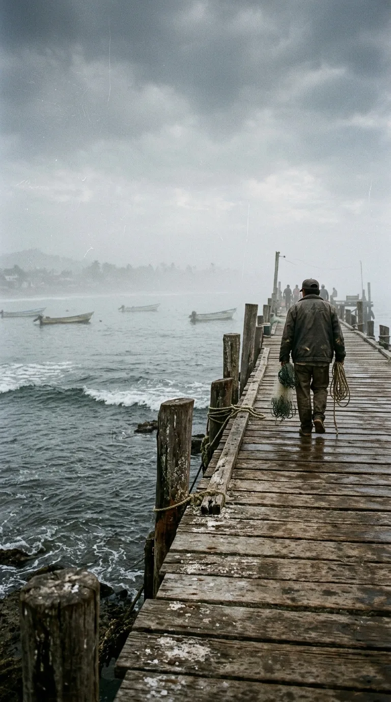
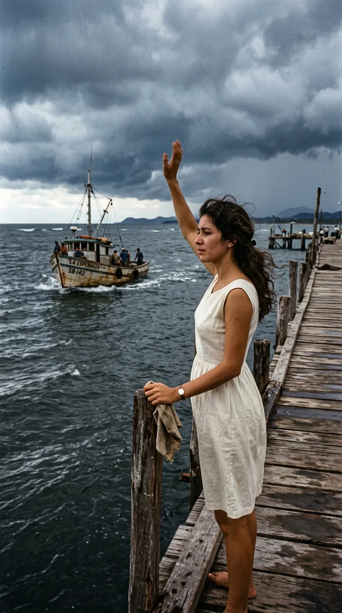
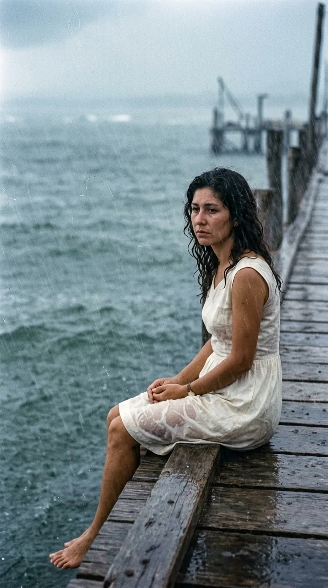
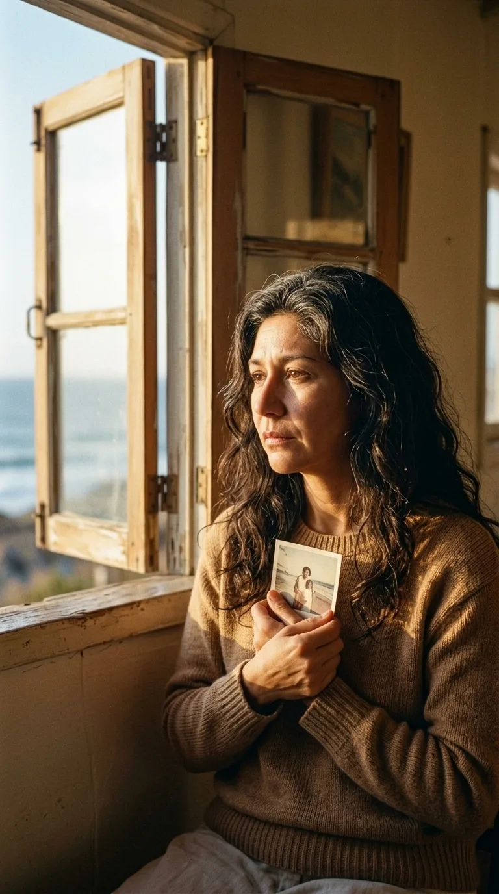
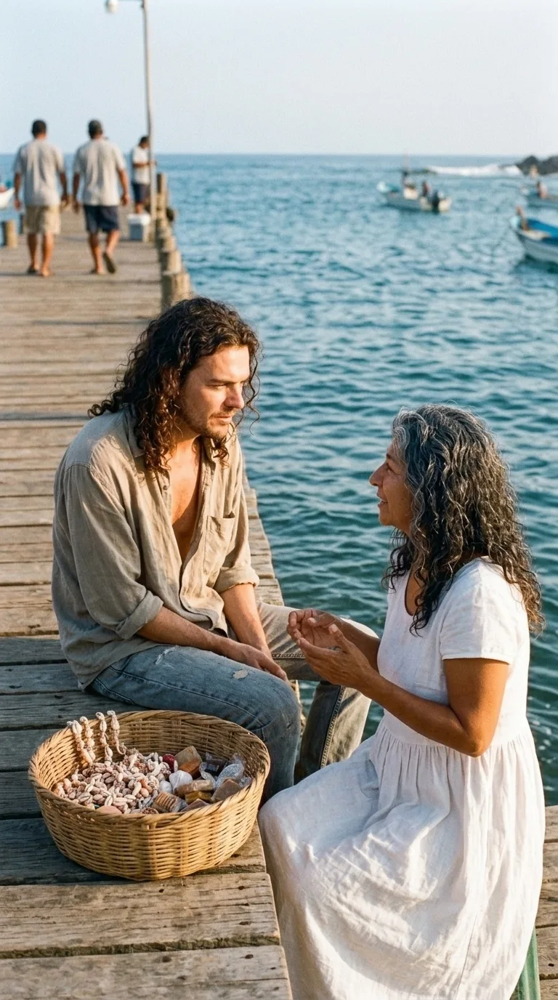

# La novia del mar y la herida oculta de San Blas

### Por Acordes Ocultos

*San Blas, Nayarit: Los tablones centenarios donde el amor, la soledad y la memoria tejieron una de las baladas más universales del rock en español.*

---

### Prólogo: El puerto donde el tiempo se detuvo

En la costa occidental de México, donde las aguas del océano Pacífico se funden con los manglares y esteros de Nayarit, el muelle histórico de San Blas se adentra en el mar como un brazo de madera carcomido por la salitre y el viento. Durante siglos fue una plaza naval de galeones y misioneros, pero en las últimas décadas del siglo XX se convirtió en el escenario de una presencia silenciosa e inquietante: una mujer vestida rigurosamente de blanco que caminaba despacio entre los tablones mojados, con la mirada clavada en el horizonte donde el cielo y las olas se vuelven una misma línea gris.

*El histórico embarcadero de San Blas en Nayarit, envuelto en la bruma marina del Pacífico matutino.*

Los turistas que descendían de los autobuses la miraban con una mezcla de curiosidad y desconcierto; algunos guías locales, ávidos de alimentar el folklore costero, la señalaban a media voz como «la loca del muelle» o «la novia de San Blas». Sin embargo, detrás de aquel apodo cruel y de aquel vestido desteñido por los soles tropicales no había locura gratuita ni una farsa pintoresca. Había una mujer real llamada **Rebeca Méndez Jiménez**, cuya vida albergaba una de las historias de lealtad, quebranto psicológico y dolor maternal más sobrecogedoras que la música en español haya intentado jamás comprender.

---

### Acto I: Octubre de 1971 y la promesa que devoró el mar

La leyenda que recorrió las cantinas y plazas de Nayarit situaba el origen de la tragedia en el otoño de 1971. Según el relato popular transmitido de boca en boca por los pescadores de la bahía, Rebeca era entonces una joven alegre y enamorada que preparaba su boda con un marino mercante o pescador local llamado Manuel. Faltaban escasos días para que ambos intercambiaran los votos matrimoniales en el templo del pueblo cuando Manuel tuvo que embarcarse en una faena rutinaria hacia las aguas profundas del Pacífico.

*San Blas, octubre de 1971: Una joven Rebeca despide con el brazo en alto a la embarcación que se adentra hacia las tormentas del Pacífico.*

Aquel octubre, un vendaval tropical —atribuido con frecuencia a las marejadas del huracán Priscilla— azotó con violencia inusitada el litoral mexicano. Las lanchas y barcazas que faenaban mar adentro fueron sacudidas por olas colosales. Muchas lograron regresar malheridas a la costa al disiparse la tormenta; la embarcación de Manuel jamás volvió. Durante días y semanas, Rebeca permaneció de pie en el extremo del muelle, esperando ver aparecer en la línea del agua la silueta de la barca. Con el paso de los meses, la muchacha comenzó a vestir ropas blancas, confeccionadas por ella misma, prometiendo que no se quitaría aquel atuendo hasta que su prometido cumpliera la palabra de volver a pisar tierra firme para desposarla.

---

### Acto II: El paso de las décadas y la verdad documentada

Durante más de veinte años, bajo tempestades implacables, aguaceros torrenciales y veranos asfixiantes, aquella figura femenina se convirtió en parte indisoluble de la geografía del puerto. El sol curtió su piel, el salitre fue decolorando sus faldas y el cabello oscuro se pobló paulatinamente de hebras plateadas. 

*Finales de los setenta: Sentada sobre la madera húmeda bajo el aguacero, Rebeca mantuvo viva su vigilia frente a la inmensidad del mar.*

Sin embargo, las investigaciones hemerográficas posteriores y los testimonios brindados por su propia familia —en particular por su hija Carola Méndez— revelarían que la historia de Rebeca encerraba una tragedia mucho más íntima y punzante que la simple leyenda del marinero extraviado. Nacida en Guadalajara en 1943, Rebeca había enfrentado desde su juventud heridas profundas: desengaños amorosos con hombres que no pudieron o no quisieron acompañar su camino, y sobre todo, el dolor desgarrador e irreparable de haber sido despojada de la custodia de sus tres hijos pequeños, quienes fueron entregados en adopción o criados lejos de su regazo debido a sus episodios de vulnerabilidad psíquica.

*Años ochenta: En la penumbra de su refugio costero, Rebeca custodiaba el recuerdo de los hijos que la vida le arrebató.*

Aquejada por un trastorno afectivo y sumida en una profunda orfandad emocional, Rebeca encontró en el puerto de San Blas el único espacio donde el dolor del mundo exterior no la alcanzaba. El mar, con su murmullo eterno y su horizonte limpio de juicios, se convirtió en su templo y su refugio. Su atuendo blanco no era solo la espera de un amor de juventud: era un escudo de pureza e inocencia frente a una realidad que le había arrebatado todo lo que amaba.

---

### Acto III: El santuario de un pueblo solidario

En muchas ciudades, una persona en su condición de vulnerabilidad habría terminado recluida en un asilo o arrojada al olvido de la indigencia. En San Blas ocurrió un milagro de fraternidad comunitaria: los pescadores, las cocineras de las palapas, los lancheros y los vecinos decidieron protegerla.

*Principios de los noventa: La comunidad pesquera de San Blas brindó cuidado, alimento y respeto cotidiano a Rebeca.*

Nadie se burlaba de ella; nadie permitía que alguien le hiciera daño. Cada mañana, los marineros que regresaban de altamar le reservaban una taza de café caliente, una concha de pan o un plato de pescado fresco. Para ganarse la vida con digna autosuficiencia, Rebeca aprendió a recoger conchas marinas en la playa, ensartándolas pacientemente en collares y figuras artesanales que luego ofrecía en una cesta de mimbre junto a dulces tradicionales a los paseantes del muelle.

*1997: Con más de cincuenta años y cabello cano, Rebeca ofrecía figuras de conchas en el muelle, conservando una mirada limpia y en paz.*

---

### Acto IV: Mayo de 1997 y el encuentro con Fher Olvera

En mayo de 1997, la banda mexicana **Maná** se encontraba en una etapa cumbre de su carrera, ultimando los detalles conceptuales de su álbum *Sueños Líquidos*. Durante un viaje de descanso e inspiración por las costas de Nayarit y Jalisco, el vocalista y compositor **Fher Olvera** llegó al muelle de San Blas.

*Mayo de 1997: Fher Olvera, conmovido por la presencia de Rebeca, se sentó a escuchar su historia sobre los tablones del muelle.*

Allí, sentado en el borde de madera con los pies colgando sobre el agua, Fher descubrió a la mujer de blanco. En lugar de limitarse a observarla desde la distancia, el músico se acercó, compró algunas de sus artesanías y se sentó a su lado a conversar. Durante largo rato, escuchó el relato pausado de su vida: las palabras entrecortadas sobre el amor que nunca regresó, los hijos ausentes y la serenidad mística con la que ella aseguraba que el mar era el único testigo fiel de su promesa. Fher quedó sobrecogido por la pureza de su mirada: no había resentimiento ni amargura en sus ojos, sino una fe inquebrantable que desafiaba toda lógica humana.

Esa misma noche, encerrado en una habitación rústica frente al rugido de las olas, Fher tomó su guitarra acústica. Conmovido hasta las lágrimas, compuso una progresión melódica arpegiada en mi menor que parecía reproducir el vaivén del oleaje contra los pilotes de madera, y redactó los versos que abrirían la canción:

> *Ella despidió a su amor  
> Él partió en un barco en el muelle de San Blas  
> Él juró que volvería  
> Y empapada en llanto ella juró que esperaría...*

Al llevar la maqueta al estudio junto a Álex González, Sergio Vallín y Juan Calleros, la banda comprendió de inmediato que tenían en sus manos algo mucho más grande que un hit radial: tenían un testamento espiritual. Al publicarse en 1997 dentro de *Sueños Líquidos*, «En el muelle de San Blas» se convirtió en un fenómeno cultural instantáneo en toda América Latina, España y Estados Unidos, catapultando la memoria de aquella mujer solitaria al corazón de millones de personas.

---

### Epílogo: El bronce inmortal frente a las olas

Rebeca Méndez Jiménez continuó viviendo sus últimos años con la misma apacible sencillez. Falleció el 16 de septiembre de 2012, a los 69 años de edad, en la ciudad de Monterrey, donde pasaba sus últimos meses al cuidado de su hija. 

Tras su partida, cumpliendo su voluntad más sagrada, sus familiares trasladaron sus cenizas de vuelta a Nayarit. En una ceremonia íntima y cargada de emoción, las cenizas de Rebeca fueron esparcidas en las aguas abiertas del muelle de San Blas: el mismo océano que durante cuatro décadas había sido el depositario de sus oraciones y sus suspiros.

Poco después, los habitantes del municipio y las autoridades costeras levantaron una hermosa escultura de bronce de tamaño natural en el malecón del puerto, representándola de pie, con su vestido y su mirada orientada eternamente hacia el horizonte marino.

Hay amores que no se miden por los años compartidos, sino por la devoción con la que el alma decide permanecer en el lugar exacto donde fue feliz. En los maderos gastados de San Blas, el viento del Pacífico sigue cantando que la verdadera locura nunca fue esperar, sino haber sido incapaces de amar con tanta pureza.

---

### 📚 Fuentes y Archivo Documental

1. **Méndez Jiménez, Carola**. *Testimonios familiares y biografía autorizada de Rebeca Méndez Jiménez*. Archivo de prensa de Jalisco y Nayarit, 2012-2016.
2. **Olvera, Fher**. *Entrevistas sobre la composición de «En el muelle de San Blas» y las sesiones de «Sueños Líquidos»*. Warner Music México / Archivos hemerográficos de *La Jornada* y *Reforma*, 1997-2002.
3. **Maná**. *Sueños Líquidos* (Notas de producción discográfica). Grabado en Puerto Vallarta y Los Ángeles, California; Warner Music, 1997.
4. **Hemeroteca de Nayarit y Crónica Municipal de San Blas**. *Registros meteorológicos del paso de huracanes en el litoral del Pacífico (octubre de 1971)* y actas conmemorativas de la develación del monumento escultórico a Rebeca Méndez en el puerto de San Blas (2013).
