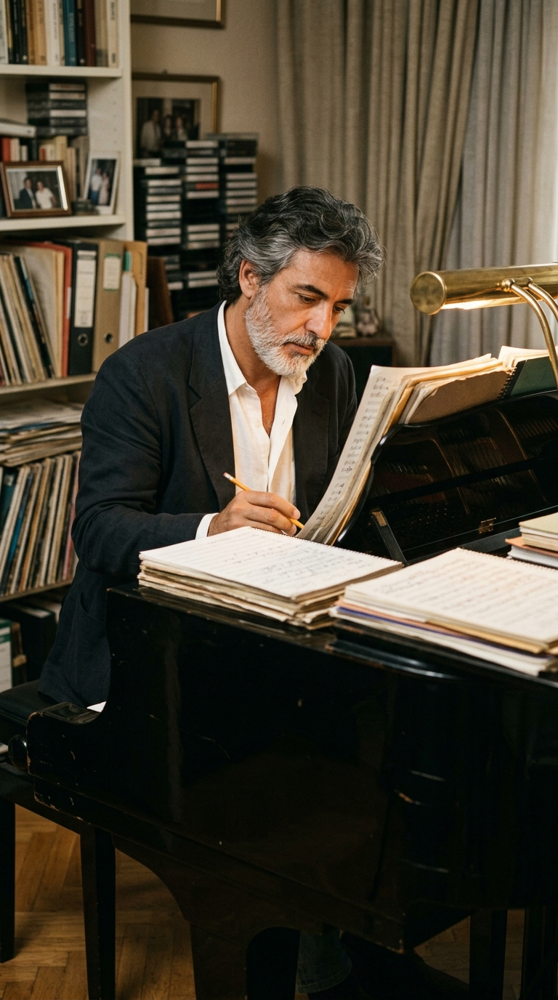
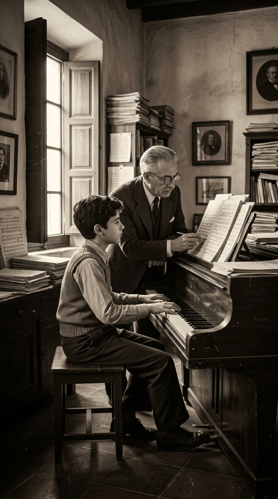
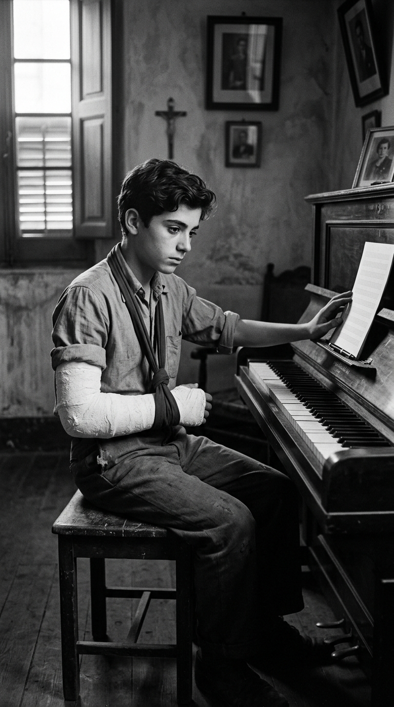
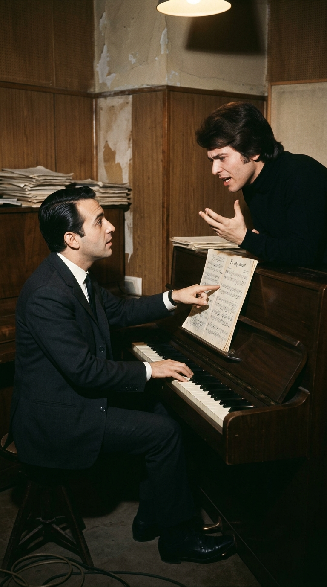
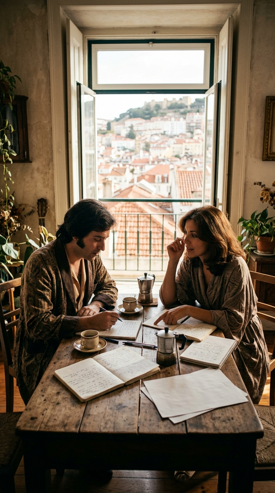
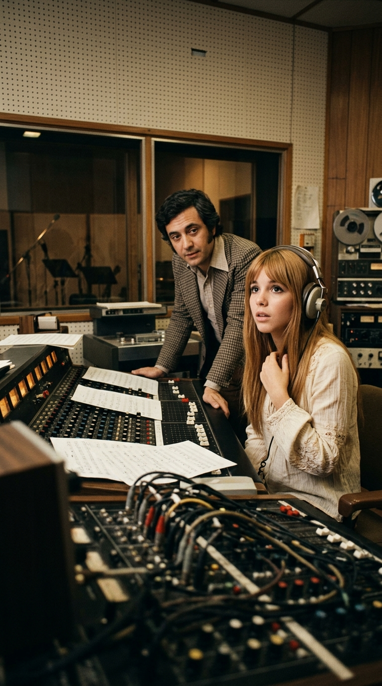
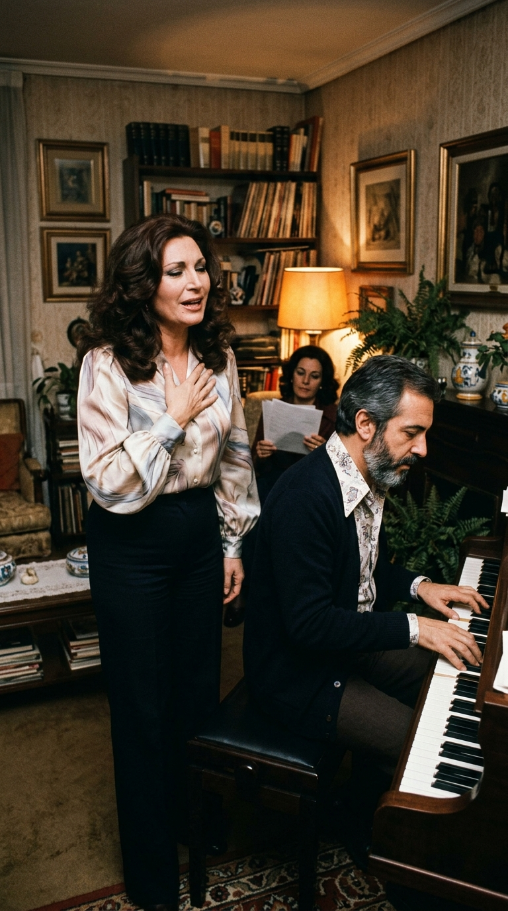
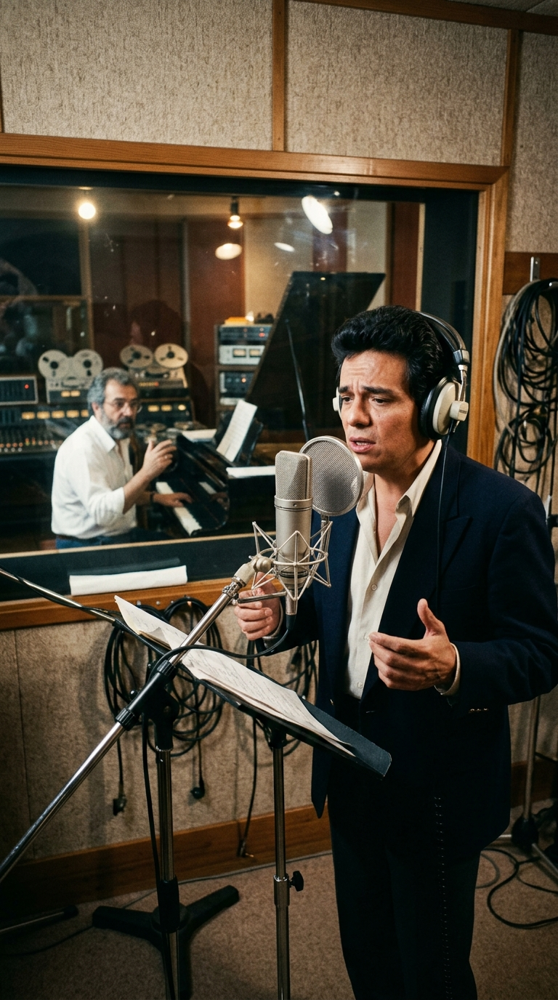
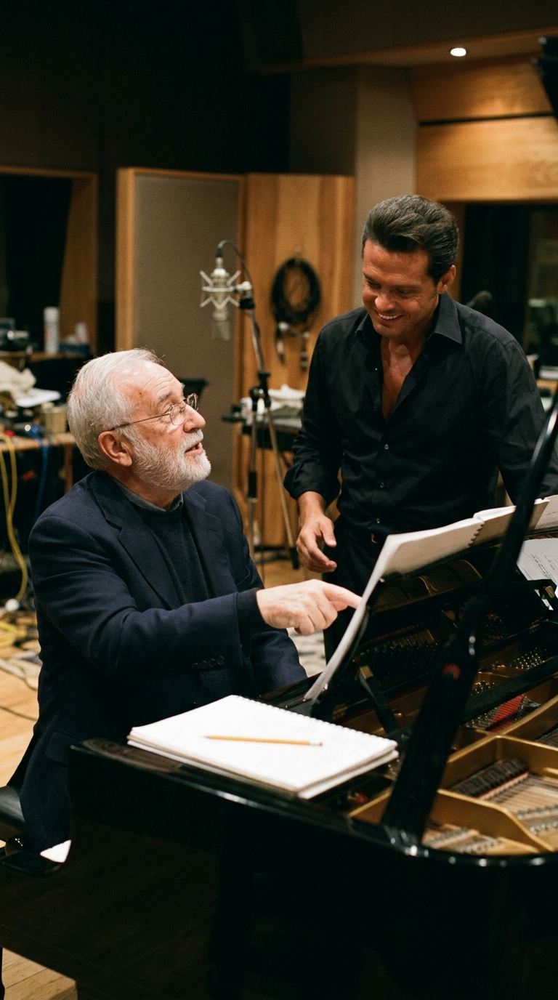
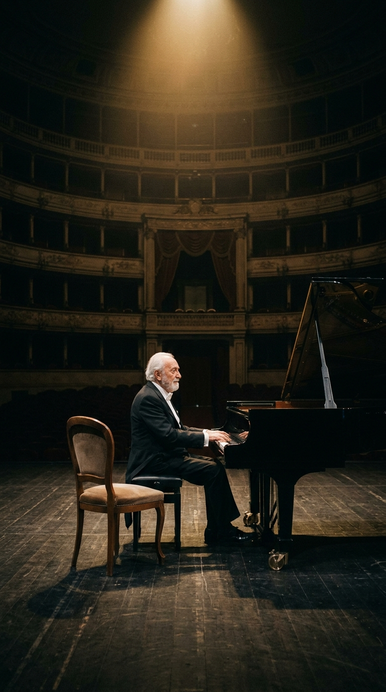

# Manuel Alejandro: La fractura a los 16 años que frustró al concertista y dio vida al gran autor de la balada en español

*Crónica #161 de Acordes Ocultos · Categoría: Catedrales de Leyenda · Por Luis Solano*

Hay nombres que millones de personas llevan tatuados en la memoria emocional sin haber visto jamás su rostro. Quienes han amado, han despedido a alguien en un aeropuerto o han intentado olvidar un desengaño con la radio encendida a medianoche han pronunciado sus versos en voz de **Raphael**, **Jeanette**, **Rocío Jurado**, **Julio Iglesias**, **José José**, **Nino Bravo**, **Hernaldo Zúñiga** o **Luis Miguel**. Detrás de todas esas voces habita un mismo artesano nacido en Jerez de la Frontera el 21 de febrero de 1932: **Manuel Álvarez-Beigbeder Pérez**, universalmente conocido como **Manuel Alejandro**.

Sin embargo, el autor de más de quinientas canciones fundamentales del repertorio hispanoamericano nunca planeó dedicarse a la canción popular. Su existencia como compositor nació de un accidente juvenil, cinco pasos por el quirófano y tres años de silencio frente a un teclado que sus manos ya no podían abarcar como antes.

---

### Acto I: El hijo del maestro en Jerez y el codo roto que cambió la historia (1932–1950)

Manuel creció en un hogar donde la música no era un pasatiempo, sino una disciplina rigurosa. Su padre, **Germán Álvarez-Beigbeder**, era un respetado compositor sinfónico y director de orquesta que formó a su hijo desde niño en la armonía clásica, el solfeo y el repertorio de los grandes maestros europeos. Todo en el destino del joven apuntaba a las salas de concierto como pianista clásico.

Pero a los dieciséis años, la fatalidad se cruzó en su camino. Una caída que le fracturó el **codo derecho** desencadenó un calvario médico: pasó por **cinco operaciones quirúrgicas** y permaneció **tres años apartado del piano**. Aunque con el tiempo recuperó movilidad suficiente para volver a tocar y acompañarse al teclado, las secuelas físicas en la articulación truncaron de raíz la exigencia técnica necesaria para ser concertista clásico.

De aquella renuncia forzosa brotó su verdadera vocación. Si sus brazos ya no podían interpretar las partituras ajenas en los grandes auditorios, su mente y su oído armónico empezarían a escribir las melodías que otros cantarían por él.

---

### Acto II: De los bares de Madrid a «Yo soy aquél» y el refugio de «Ana Magdalena» (Años 60 y 70)

Instalado en un Madrid de pensiones modestas y noches largas, el joven jerezano se ganó la vida tocando el piano en bares y locales nocturnos mientras ofrecía sus primeras composiciones a las casas discográficas. Fue en esos años cuando su camino se cruzó con el de un adolescente de Linares llamado Miguel Rafael Martos, **Raphael**.

En 1966, una canción que Manuel Alejandro había concebido inicialmente pensando en el chileno **Lucho Gatica** terminó en la garganta volcánica de Raphael: ***«Yo soy aquél»***. Su presentación en el Festival de Eurovisión en Luxemburgo y su impacto inmediato en España y América Latina inauguraron una nueva era para la balada dramática en español, dotándola de una arquitectura orquestal de raíz clásica que llevaba el sello inconfundible de la formación paterna de Manuel.

En el terreno íntimo, su vida dio otro giro decisivo cuando conoció a **Purificación Casas Romero**, el gran amor de su existencia. Manuel estaba separado de su primera esposa, pero en la España franquista no existía ley de divorcio que les permitiera formalizar su unión. Para vivir su amor en libertad, la pareja se trasladó a **Portugal**.

De aquella complicidad vital y creativa nació el seudónimo más célebre de la música romántica en español: **«Ana Magdalena»**, elegido en homenaje a **Anna Magdalena Bach**, la segunda esposa de Johann Sebastian Bach. El nombre de Ana Magdalena quedó inscrito junto al de Manuel Alejandro en los créditos de decenas de clásicos inmortales, nacidos de las mañanas en que ambos conversaban frente a frente con una taza de café, desentrañando los pliegues del corazón humano.

---

### Acto III: El himno que Jeanette rechazó y el sastre de Rocío Jurado y Julio Iglesias (1971–1981)

En 1971, el sello Hispavox le encargó una canción para lanzar en solitario a **Jeanette**, una joven cantante criada entre Londres y California que venía del folk-pop del grupo Pic-Nic. Manuel Alejandro escribió ***«Soy rebelde»***. Cuando Jeanette escuchó la propuesta inicial, la canción no le gustó y se resistió a grabarla, pues sentía que aquel tono melancólico se alejaba de la música anglosajona que admiraba. Sin embargo, al entrar al estudio y escuchar la grabación con su propia voz, cambió por completo de opinión: aquella confesión suave se transformó en un himno generacional que recorrió el mundo entero, desde América hasta Japón.

Durante las décadas de 1970 y 1980, el tándem formado por Manuel Alejandro y Ana Magdalena firmó repertorios enteros que redefinieron la carrera de los mayores astros de habla hispana. Antes de sentarse al piano, el compositor solía conversar largamente con cada intérprete para conocer sus gestos, sus silencios y su temperamento. Así nacieron para **Rocío Jurado** obras monumentales como ***«Como yo te amo»*** y ***«Señora»***, y para **Julio Iglesias** clásicos como ***«Manuela»***, llevando a las listas de éxitos un lenguaje íntimo, directo y profundamente humano.

---

### Acto IV: Madrid 1983 con José José, el cruce de siglos con Luis Miguel y la lealtad eterna (1983–Presente)

En 1983, el mexicano **José José** viajó a **Madrid** para trabajar bajo la dirección integral de Manuel Alejandro. De aquellas sesiones madrileñas surgió el álbum ***Secretos***, escrito y producido por el maestro andaluz y encabezado por temas como ***«Lo dudo»***, ***«El amor acaba»*** y ***«Voy a llenarte toda»***. Aquella producción se convirtió en el mayor éxito comercial en la carrera del llamado *Príncipe de la Canción* y en una cumbre indiscutible de la balada latinoamericana.

Lejos de quedarse anclado en una sola época, el oficio de Manuel Alejandro demostró su vigencia en el nuevo milenio. En **2008**, a sus setenta y seis años, compuso y produjo el álbum ***Cómplices*** para **Luis Miguel**, confirmando que su armonía y su pluma seguían conectando con nuevas generaciones de oyentes.

El **9 de marzo de 2021**, la vida le asestó el golpe más duro con el fallecimiento de **Purificación Casas Romero**, su inseparable *Ana Magdalena*, tras más de medio siglo de vida y creación compartidas. Pero ni siquiera la ausencia apagó su vínculo con el piano: desde su hogar en La Moraleja, en Madrid, Manuel Alejandro continuó escribiendo, celebró sus noventa años sobre el escenario del **Teatro Real** en 2022 y siguió encontrando en la música las palabras para dialogar con la memoria de quien siempre estuvo a su lado.

Porque aquel muchacho de Jerez que a los dieciséis años vio quebrarse su sueño de concertista clásico terminó construyendo algo aún más vasto: el idioma sentimental con el que millones de seres humanos aprendieron a decir *«te amo»* y *«procuro olvidarte»*.

---

### 💬 La Memoria Compartida

De todas las obras escritas por **Manuel Alejandro** —*«Yo soy aquél»*, *«Soy rebelde»*, *«Como yo te amo»*, *«Señora»*, *«Manuela»*, *«Lo dudo»*, *«Procuro olvidarte»*—, **¿cuál es la canción que te acompaña en tus propios recuerdos?** Te leemos en los comentarios.

---

### 📚 Fuentes y Archivo Documental

1. **Boletín Oficial de la Junta de Andalucía (BOJA, 2022)**: Decreto de concesión del título de Hijo Predilecto de Andalucía a Manuel Álvarez-Beigbeder Pérez (*Manuel Alejandro*), con registro documental de su formación junto a su padre, el compositor y director Germán Álvarez-Beigbeder.
2. **Archivo Hemerográfico *El País* (2020 y 2025)**: Entrevistas documentales a Manuel Alejandro sobre la fractura de su codo derecho a los 16 años, las cinco intervenciones quirúrgicas y los tres años de alejamiento del piano que truncaron su carrera como concertista clásico, así como la génesis de *«Yo soy aquél»* (pensada inicialmente para Lucho Gatica antes de llegar a Raphael).
3. **Archivo Documental *20 Minutos* y Ayuntamiento de Jerez (2021–2025)**: Crónicas biográficas sobre su relación con Purificación Casas Romero, el traslado de la pareja a Portugal ante la ausencia de ley de divorcio en España, la creación del seudónimo *«Ana Magdalena»* en honor a Anna Magdalena Bach y el homenaje tras su fallecimiento el 9 de marzo de 2021.
4. **Archivo Hemerográfico *Vanity Fair* y Créditos de Hispavox (1971)**: Testimonio de Jeanette sobre su rechazo inicial a grabar *«Soy rebelde»* y su cambio de parecer al escuchar su propia voz registrada en el estudio.
5. **Archivo Hemerográfico *Milenio* y Discografía Oficial de Ariola / Warner Music (1979–2008)**: Registro de la composición y producción en Madrid del álbum *Secretos* (1983) para José José, los créditos compartidos con Ana Magdalena en *«Como yo te amo»* y *«Señora»* (Rocío Jurado), y la producción de *Cómplices* (2008) para Luis Miguel.
