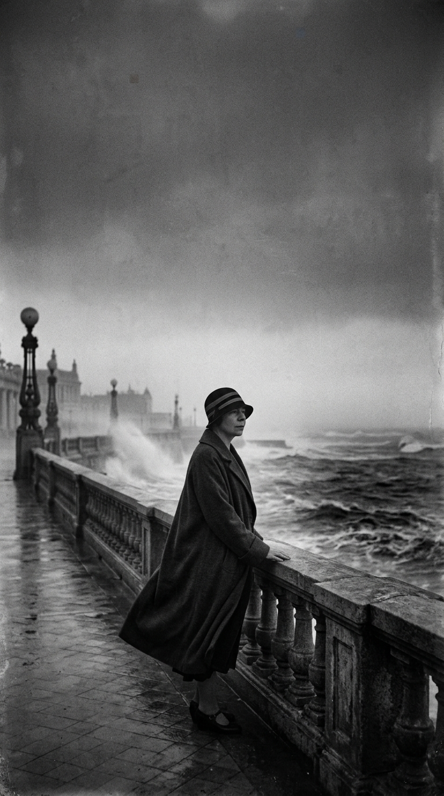
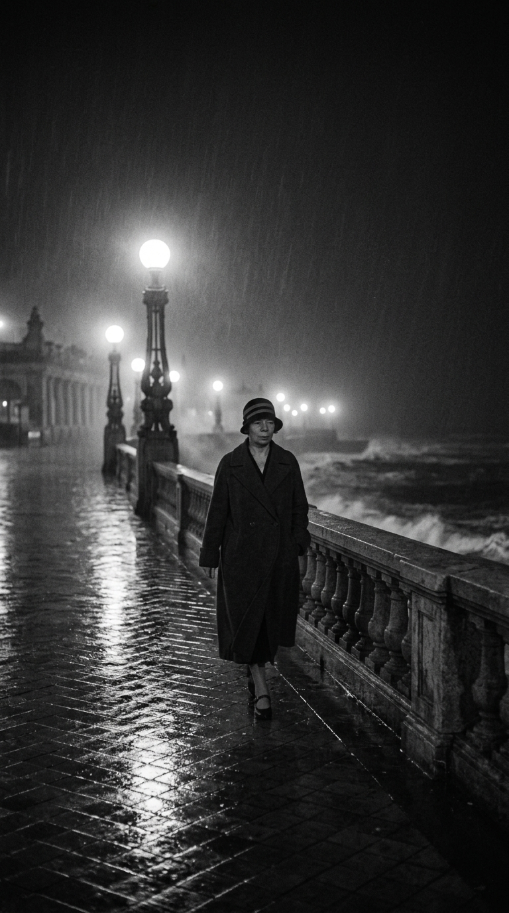
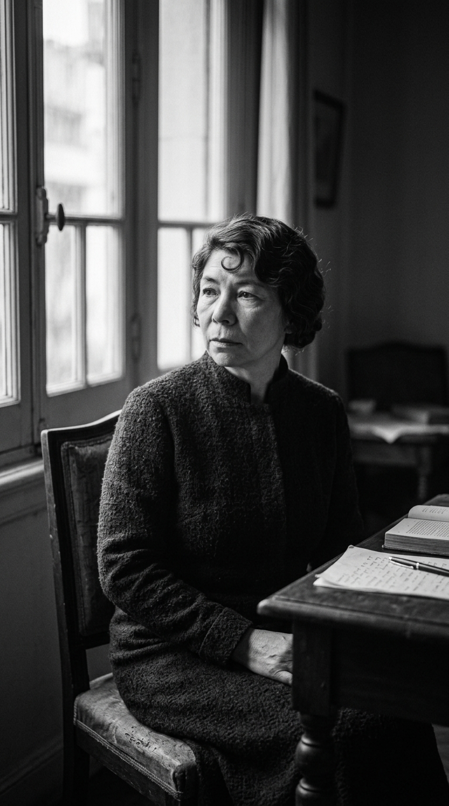
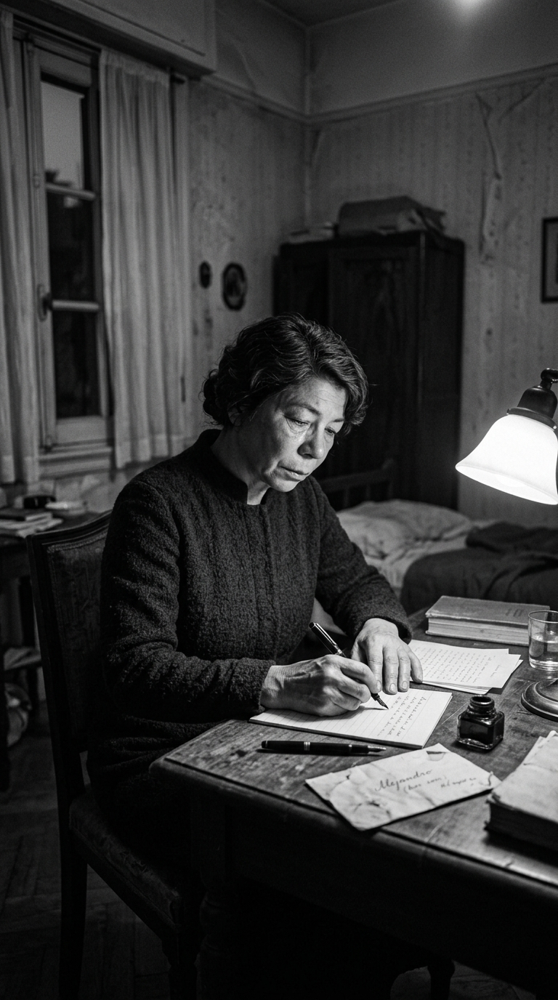
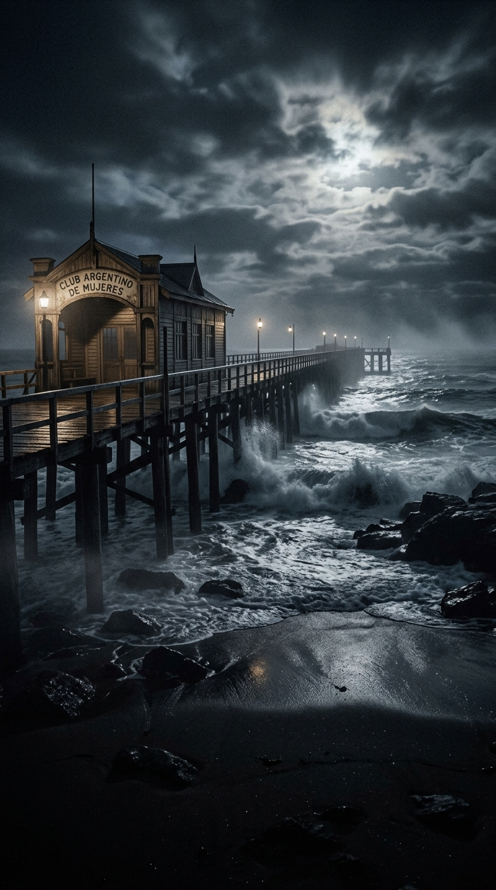
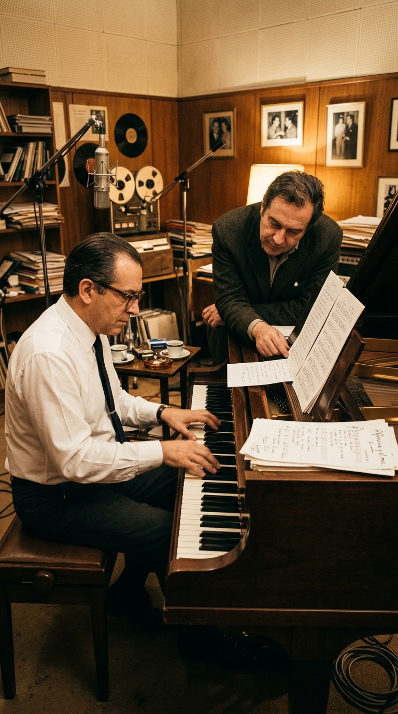
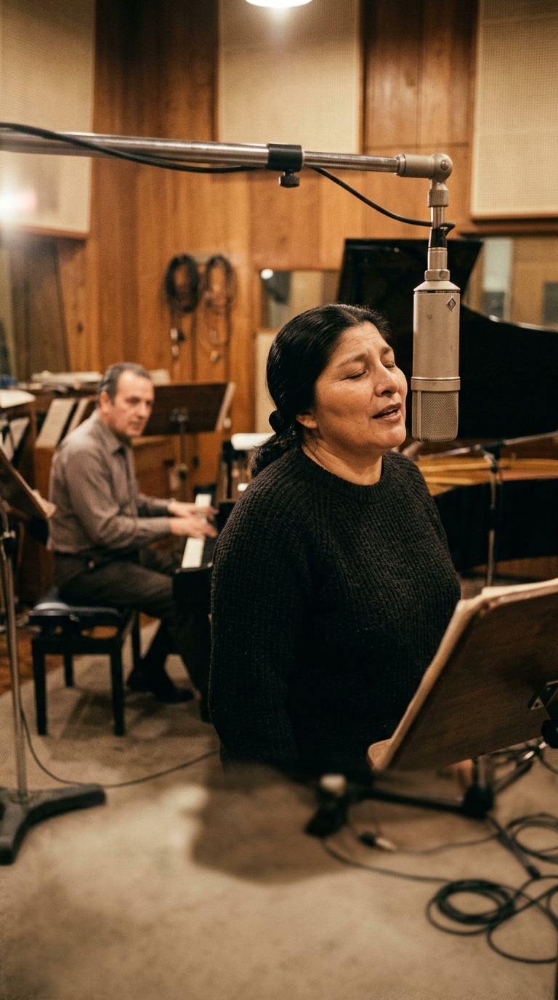

# «Voy a dormir»: La carta que Alfonsina echó al correo antes de caminar hacia el mar

## Prólogo: La niebla de octubre en la costa vacía

En la madrugada del **25 de octubre de 1938**, la ciudad balnearia de Mar del Plata dormía bajo una llovizna helada y un viento sur que azotaba con violencia los toldos cerrados y las piedras del paseo costero. La temporada veraniega quedaba a meses de distancia; las ramblas estaban desiertas y el océano Atlántico rompía con un rugido sordo y metálico contra las rocas de la playa de **La Perla**.

Por el asfalto mojado de la calle 3 de Febrero avanzaba una silueta solitaria. Llevaba un abrigo oscuro y un sombrero modesto. Caminaba con lentitud, soportando un temblor invisible que no procedía del frío nocturno, sino de un dolor físico atroz que la morfina ya no lograba apaciguar. Se llamaba **Alfonsina Storni**, tenía cuarenta y seis años y era, sin discusión, una de las voces poéticas más valientes, libres y universales de la lengua española.

Aquella noche no buscaba el descanso en una cama de hotel. Había tomado una decisión inapelable: devolverle su cuerpo al mar para que el dolor dejara de tener la última palabra.

---

## Acto I: La rebelde del verso y la sombra del dolor

La vida de Alfonsina había sido una batalla permanente contra los moldes estrechos de su época. Nacida en Suiza pero criada en San Juan y Rosario, desafió todos los prejuicios de la conservadora sociedad argentina de los años veinte al convertirse en **madre soltera**, trabajadora incansable y poetisa de vanguardia en un círculo literario dominado por hombres. Sus versos —irónicos, ardientes, lúcidos y descarnados— le abrieron un lugar propio en la historia cultural del continente.

Sin embargo, a mediados de la década de 1930, una sombra oscura se cernió sobre sus días. En **1935**, le diagnosticaron un **cáncer de mama**. Fue sometida a una mastectomía radical en Buenos Aires, una intervención traumática que le dejó profundas secuelas físicas y una mutilación que la sumió en una angustia silenciosa.

Dos años más tarde, la tragedia volvió a golpearla de cerca: su amigo del alma, el escritor **Horacio Quiroga**, diagnosticado con cáncer terminal de próstata, decidió quitarse la vida bebiendo cianuro en el Hospital de Clínicas de Buenos Aires. Alfonsina le dedicó entonces unos versos premonitorios que helaron a sus contemporáneos:

> *«Morir como tú, Horacio, en tus cabales, / y así como en tus cuentos, no está mal; / un rayo a tiempo y se acabó la feria... / Allá dirán»*.

Hacia mediados de 1938, los médicos le confirmaron que el tumor se había ramificado y que los dolores insoportables que sufría en el brazo y en el pecho eran el avance implacable de la metástasis. Alfonsina se negó a soportar el calvario de la postración. Quería marcharse de pie, dueña de su destino.

---

## Acto II: El tren de Constitución y las dos cartas a Alejandro

El viernes **21 de octubre de 1938**, Alfonsina abordó un tren nocturno en la estación porteña de **Constitución** con destino a Mar del Plata. Solo su hijo único, **Alejandro**, de veintiséis años —el centro absoluto de su universo afectivo—, la acompañó al andén. Para no alarmarlo, le aseguró que se trataba de un breve descanso para respirar aire de mar y reponer fuerzas.

Se alojó en una modesta pensión de la calle **3 de Febrero al 2800**, atendida por Luisa Chocho. Apenas salía de la habitación; pasaba las horas sentada junto a la ventana, combatiendo las oleadas de fiebre y punzadas con pequeñas dosis de analgésicos. En un cuaderno escolar con hojas rayadas, escribió con pulso tembloroso dos cartas de despedida para Alejandro:

> *«Alejandro, querido: no te culpes de nada. He vivido bien, he amado, he sufrido... Me voy porque no puedo más con este cuerpo. Te dejo mis libros y mi bendición más honda»*.

---

## Acto III: «Voy a dormir»: Los versos depositados en el buzón

El mediodía del lunes **24 de octubre**, Alfonsina salió por última vez al centro de la ciudad. Con el sobre cerrado en la mano, caminó hasta el buzón de la esquina de Luro y San Martín. Allí depositó un sobre lacrado con destino a la redacción del diario ***La Nación*** de Buenos Aires.

En su interior no había una carta de reproche ni un manifiesto político. Iba un soneto de despedida, el último que escribiría en su vida, titulado con una serenidad sobrecogedora: ***«Voy a dormir»***:

> *«Dientes de flores, cofia de rocío, / polvo de hierbas finas, tejedora, / ¡tú, nodriza fina, a punto estás, / y mi sábana terrosa me prepara!... / Voy a dormir, nodriza mía, acuéstame. / Ponme una lámpara a la cabecera; / una constelación; la que te guste; / todas son buenas; bájala un poquito. / Déjame sola: oyes romper los brotes... / te columpia un pie de cuna desde el cielo / y un pájaro te traza unos compases / para que olvides... Gracias. Ah, un encargo: / si él llama nuevamente por teléfono / le dices que no insista, que he salido...»*

El poema llegó a la redacción del diario porteño horas después de que su autora hubiera dejado de respirar.

---

## Acto IV: La madrugada en La Perla y el abrazo de la espuma

Hacia la una de la madrugada del martes **25 de octubre**, Alfonsina abandonó definitivamente la pensión. El viento del Atlántico levantaba una cortina de rocío y arena húmeda.

A diferencia del mito popular que imagina una caminata apacible vestida con gasas blancas que se adentran lentamente en el agua, los informes periciales de la época señalan que Alfonsina caminó hasta el espigón de madera del **Club Argentino de Mujeres** en la playa de **La Perla**. Desde aquella pasarela sobre las rocas, mirando a la inmensidad negra del mar, se arrojó al vacío.

A las siete y media de la mañana, dos obreros municipales que recorrían la orilla tras el temporal divisaron un bulto oscuro mecidiéndose entre los bancos de arena. El mar la devolvió intacta, con su abrigo ceñido y su rostro en paz. Tenía cuarenta y seis años. Argentina entera enmudeció.

---

## Acto V: 1969: Ariel Ramírez, Félix Luna y el nacimiento del mito

Tres décadas después de aquella noche, el gran compositor argentino **Ariel Ramírez** y el historiador y escritor **Félix Luna** comenzaron a proyectar una obra conceptual que rescatara la figura de las mujeres fundamentales en la forja de la identidad sudamericana: el álbum ***Mujeres Argentinas*** (**1969**).

Al abordar la figura de Alfonsina Storni, ambos comprendieron que la obra no debía ser un réquiem lúgubre, sino un acto supremo de amor y poesía marina. Ramírez concibió una zamba lenta de cadencia arpegiada en el piano, inspirada en el ritmo de las olas que se retiran sobre la arena mojada.

Félix Luna compuso una lírica monumental, fundiendo la biografía real con las metáforas del fondo del océano:

> *«Por la blanda arena que lame el mar / su pequeña huella no vuelve más / un sendero solo de pena y silencio llegó / hasta el agua honda / un sendero solo de penas mudas llegó / hasta la espuma...»*

Y en el estribillo, Luna plasmó la pregunta que todo un continente se había hecho desde 1938:

> *«Te vas Alfonsina con tu soledad / ¿qué poemas nuevos fuiste a buscar? / Una voz antigua de viento y de sal / te requiebra el alma y la lleva allá / y te vas hacia allá como en sueños / dormida, Alfonsina, vestida de mar...»*

---

## Acto VI: La consagración en la voz de Mercedes Sosa

Para interpretar la suite, Ramírez y Luna llamaron a una joven tucumana de voz profunda, maternal y telúrica: **Mercedes Sosa**.

En los estudios de grabación de Philips en Buenos Aires, acompañada por el piano acústico de Ariel Ramírez y la percusión sutil de Kelo Palacios, Mercedes cerró los ojos frente al micrófono. Su timbre oscuro y cálido despojó a la canción de cualquier atisbo de melodrama; le imprimió la dignidad sagrada de una madre que despide a una hermana.

Cuando el disco vio la luz en **1969**, ***«Alfonsina y el mar»*** se convirtió de inmediato en un clásico absoluto de la música universal. Cruzó los océanos y fue adoptada por artistas de los géneros más diversos: desde la ópera (José Carreras, Plácido Domingo) hasta el flamenco (Diego el Cigala), la canción francesa (Nana Mouskouri) y el rock en español (Andrés Calamaro).

---

## Epílogo: La canción que arropó a un alma libre

Casi un siglo después de la madrugada en que Alfonsina caminó hacia el agua, la playa de La Perla luce un monumento esculpido en piedra por Luis Perlotti frente al romper de las olas.

La muerte de Alfonsina Storni no fue una rendición; fue el último acto de soberanía de una mujer que amó la libertad por encima de cualquier mandato y que prefirió fundirse con el misterio del mar antes que dejarse apagar por el dolor. Gracias a la melodía de Ariel Ramírez, los versos de Félix Luna y la voz inmortal de Mercedes Sosa, Alfonsina ya no está sola entre las rocas frías: vive para siempre arrullada por el canto de las caracolas, buscando poemas nuevos en el corazón de quienes no la olvidan.

---

### 📚 Fuentes y Archivo Documental

1. **Storni, Alfonsina.** *Obras completas: Poesía y Prosa*. Editorial Losada, Buenos Aires. Incluye el poema póstumo *«Voy a dormir»*, enviado al diario *La Nación* el 24 de octubre de 1938.
2. **Archivo General de la Nación (República Argentina).** Fondo Documental y Hemerográfico 1938: Partes policiales de la Comisaría de Mar del Plata, actas de defunción y registros de la autopsia médica tras el hallazgo del cuerpo en la playa La Perla el 25 de octubre de 1938.
3. **Diario La Nación (Buenos Aires).** Edición del 26 de octubre de 1938: Crónica de la muerte de Alfonsina Storni y publicación en primera plana de su soneto póstumo *«Voy a dormir»*.
4. **Ramírez, Ariel & Luna, Félix.** Discografía oficial: *Mujeres Argentinas* (Sello Philips / PolyGram, 1969). Notas de producción, créditos de arreglos de piano y testimonios de gestación de la zamba *Alfonsina y el mar*.
5. **Sosa, Mercedes.** *La Negra por sí misma*. Testimonios biográficos y entrevistas sobre la grabación histórica de *Alfonsina y el mar* en 1969 y su repercusión mundial.
6. **Delgado, Josefina.** *Alfonsina Storni: Una biografía*. Editorial Planeta, Buenos Aires, 1991. Reconstrucción pormenorizada de los últimos días de la poetisa en la pensión de la calle 3 de Febrero en Mar del Plata.
