# 🕊️ A Mother's Immortal Whisper: The True Story of «Lovin' You»
### *How an improvised family lullaby moved the world, Stevie Wonder's clandestine pact as 'El Toro Negro,' and Minnie Riperton's tragic farewell at 31.*

---

**By the Secret Chords Editorial Staff**  
*Estimated reading time: 9 minutes*

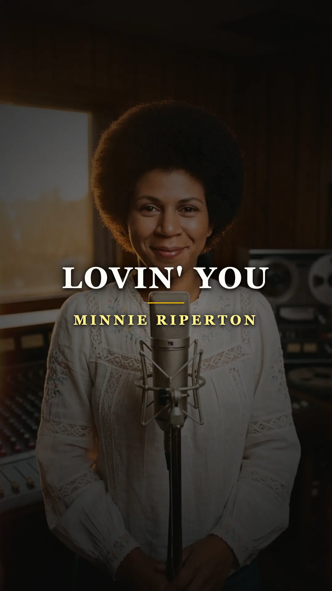
*Minnie Riperton: The artist who turned a maternal cradle song into a universal anthem of tenderness and transcendence.*

---

### Prologue: The morning trill that disarmed the radio in 1975

In the spring of 1975, FM radio stations across the United States and Europe pulsed to the accelerated heartbeat of dance floors and synthesizer opulence. Popular music competed in volume, artifice, and speed. Amidst that electric whirlwind, a track stripped of percussion and bass broke through the dial with the serenity of a confidence whispered in the ear: a warmly plucked acoustic guitar, the clean trill of morning birds, the subtle chords of a Fender Rhodes electric piano, and a female voice capable of soaring into registers bordering on the supernatural.

Near the final measure, the singer did not project her voice with theatrical force; she let the air flow in a vertical sigh until she reached the whistle register—a pitch range reserved for only a handful of throats in the history of modern lyricism. That piece was titled **«Lovin' You»**, and it transformed **Minnie Riperton** into an undisputed recording phenomenon.

*1975: Minnie Riperton before the microphone, whose prodigious five-and-a-half octave range moved the entire world.*

Millions of listeners took it for granted that this was a romantic ballad conceived for grand ballrooms or lovers' courtships. Yet its origin lay neither in the offices of a Manhattan label nor in the calculations of a hitmaker producer. It had been born as a home lullaby, conceived between kitchen stove-tops and living room floors to soothe a little girl's crying before sleep.

---

### Act I: The guitar in the kitchen and the little girl who wouldn't sleep

In the early 1970s, Minnie Julia Riperton was one of the most respected yet least widely recognized figures in the American music scene. Raised on Chicago's South Side and trained in the rigorous discipline of classical bel canto and ballet, she had given her youth to the legendary **Chess Records**. There, she contributed memorable backing vocals for titans such as Etta James, Muddy Waters, and Ramsey Lewis, before leading **Rotary Connection**, a visionary psychedelic soul experiment conceived by Marshall Chess.

In 1970, she released her debut solo album, *Come to My Garden*, featuring symphonic arrangements and production by maestro Charles Stepney. Critics bowed before the work, but commercial distribution failed miserably. The record was a financial failure, and royalty payouts barely covered the rent.

Disenchanted by industry promises, Minnie married songwriter and guitarist **Richard Rudolph**. The couple decided to build a refuge far from corporate pressures, and following the birth of their daughter **Maya Rudolph** on July 26, 1972, the family moved to Gainesville, Florida, residing surrounded by nature alongside their firstborn, Marc.

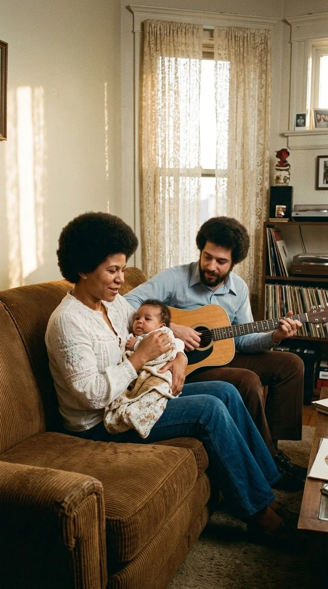
*Chicago and Florida: Minnie Riperton alongside her husband and creative partner Richard Rudolph, forging melodies in the intimacy of home.*

Maya was an energetic baby who fought against sleep during stifling afternoons. To allow Minnie to cook and give the couple a few minutes of respite, Richard began repeating a circular, sweet, and balsamic sequence of major chords on his acoustic guitar—a cadence he had first sketched out in Chicago in 1971.

Minnie would walk over with the child in her arms, humming verses on the fly and playfully imitating the sounds of birds nesting in the garden. The words emerged spontaneously: an affectionate dialogue between spouses turned into a lullaby to wrap the little girl in an atmosphere of absolute safety.

> *«The melody was born as a domestic distraction»*, Richard Rudolph would recall years later. *«There was no intention to sell it or put it on a record. It was our secret to help Maya rest and allow us to look each other in the eyes after an exhausting day»*.

The tune was archived on a home cassette tape, destined to remain a private relic in the drawers of their Florida home.

---

### Act II: The secret pact of 'El Toro Negro'

Minnie Riperton considered herself retired from the stage, devoted to raising her children in the anonymity of Gainesville. But her voice still echoed in the memory of the era's most influential musician: **Stevie Wonder**.

Fascinated by the acoustic purity of *Come to My Garden*, Stevie Wonder commissioned his team to track down Riperton's whereabouts. When he managed to contact her in late 1973, his proposal was categorical: he wanted to sign her to his backing vocal group, **Wonderlove**, and co-produce—alongside Richard Rudolph and Charles Stepney—her triumphant return to the studios under the **Epic Records** (CBS) label.

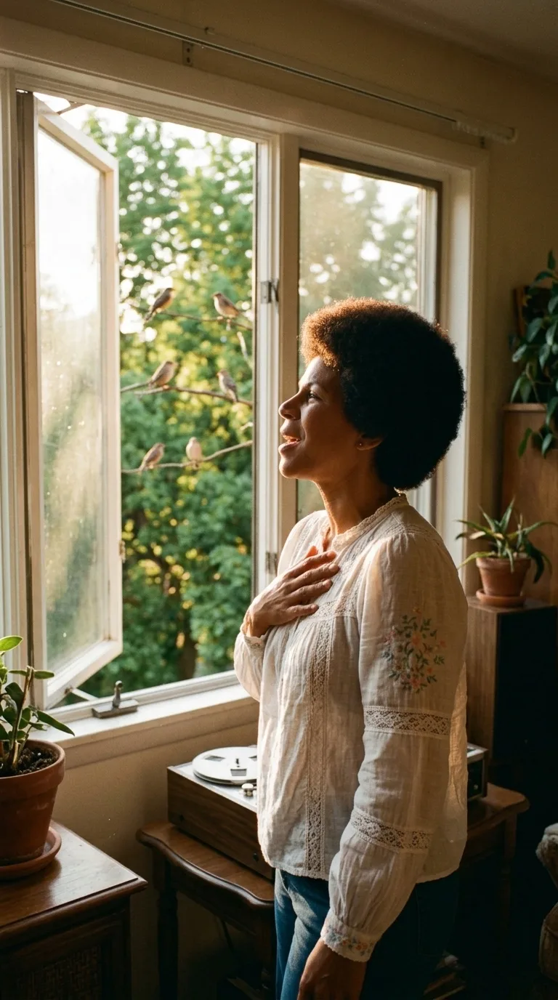
*Five and a half octaves of vocal range: Minnie commanded absolute pitch control, effortlessly transitioning from velvet to the purest highs.*

However, the project faced a formidable legal obstacle. Berry Gordy, president of Motown, held Stevie Wonder under an unforgiving exclusivity contract that forbade him from producing or performing officially for competing record companies.

Wonder refused to back down. He agreed with Minnie and Richard to sign the production and his electric piano performance under an enigmatic pseudonym: **«El Toro Negro»**, a direct reference to his zodiac sign, Taurus.

*1974: Stevie Wonder at the keyboards of Record Plant, conceiving the sound of 'Perfect Angel' in contractual anonymity.*

At the **Record Plant** studios in Los Angeles, during song selection for the album *Perfect Angel* (1974), the session found itself short of a short piece to balance side two of the vinyl. Richard Rudolph remembered the modest Gainesville lullaby and began playing the chords on his acoustic guitar for Stevie. The Detroit musician stopped dead in his tracks in the middle of the control room:

> *«Don't add drums, don't put a bass on it»*, Stevie ordered those present. *«That song is perfect in its fragility. We only need your acoustic guitar, Minnie's voice, and my hands on the Fender Rhodes»*.

---

### Act III: The tape recorder in the botanical garden and the whisper on tape

True to his organic vision, Wonder believed that the studio recording needed to capture the rustic peace of Florida where the song had taken shape. They discarded synthetic archive effects.

Richard Rudolph and the production team took a **Nagra** open-reel tape recorder and headed out at dawn into the trails of the **University of California, Los Angeles (UCLA) Botanical Garden**. There, amidst the humid vegetation, they captured the waking of wild birds. Those field tapes were transferred to analog multitrack and blended with the live performance.

The definitive session for «Lovin' You» at Record Plant was recorded without laboratory tricks. Minnie Riperton stepped up to the microphone and delivered the lyric with moving delicacy, modulating every breath without losing diaphragmatic support, while Wonder caressed the keys of his electric keyboard.

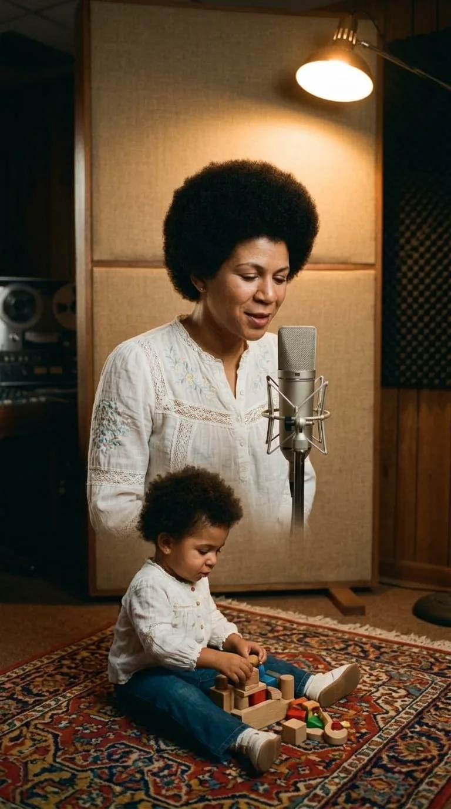
*Record Plant Studios, 1974: The intimate session of «Lovin' You», with little Maya present in the room while her mother recorded the lullaby.*

Just a few feet from the isolation panels, playing on the studio carpet, was little Maya, who had not yet turned two. In the final stretch of the song, as the music began to gently descend into a fade-out, Minnie shifted her eyes away from the notes, looked down at her daughter on the floor, and began repeating in a melodic murmur:

> *«Maya... Maya... Maya... Maya... Maya...»*

That spontaneous whisper, preserved forever in the album mix, was no production script: it was the intimate, unrepeatable dedication of a mother to her child.

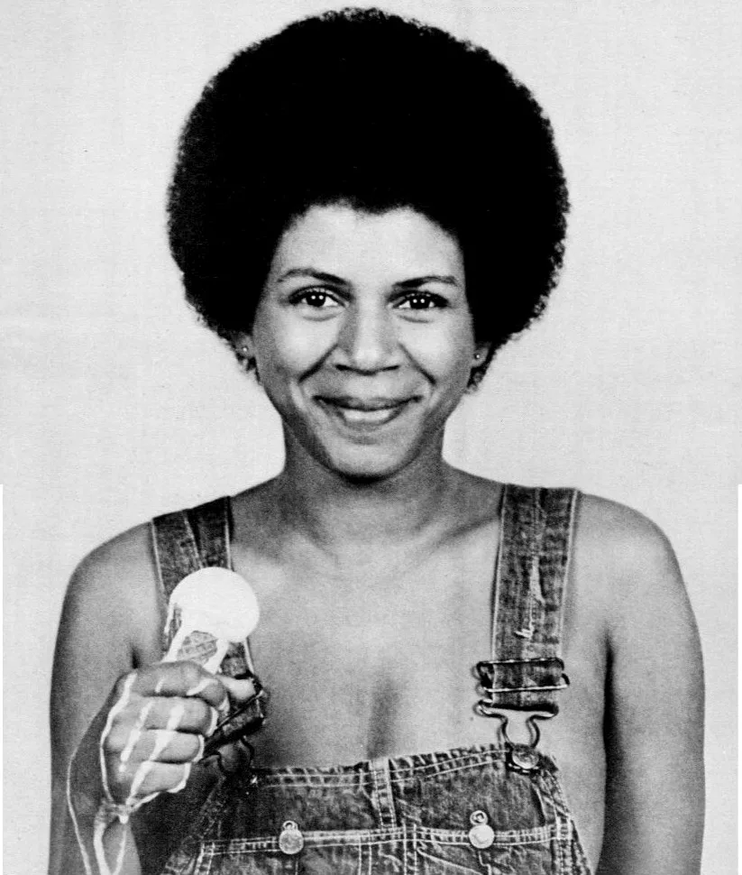
*1974 Archival Document: Minnie Riperton on the cover of 'Perfect Angel', an album that defied the commercial formulas of its time.*

---

### Act IV: The summit of the world and the merciless diagnosis

Epic Records executives doubted the commercial potential of an acoustic ballad without a rhythmic foundation in the height of the disco era and resisted releasing it as a 45 RPM single. Nevertheless, radio stations began broadcasting the album track due to pressure from DJs and listener phone calls.

The phenomenon was overwhelming. On **April 5, 1975**, «Lovin' You» reached **number one on the Billboard Hot 100** in the United States, climbed to number two in the United Kingdom, and conquered top spots in some twenty countries. The album *Perfect Angel* achieved gold certification, and Minnie's luminous smile filled television networks.

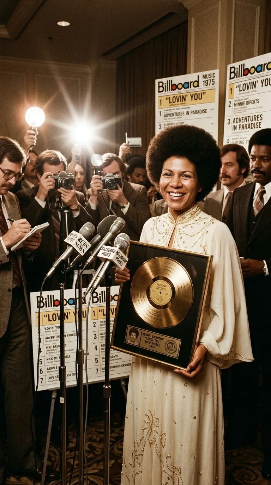
*Spring 1975: Minnie Riperton celebrates conquering the absolute number one spot on international chart listings.*

Yet destiny lay in wait with implacable cruelty. In the early months of 1976, at the pinnacle of her youth and artistic fulfillment, Minnie discovered an anomaly in her chest. After undergoing urgent checkups at **Cedars-Sinai Medical Center** in Los Angeles, the medical diagnosis was devastating: she was suffering from an aggressive breast carcinoma that had already spread to her lymph nodes.

She underwent surgery immediately via a modified radical mastectomy. Specialists' prognosis was grim: they gave her a life expectancy of barely six months. She was only twenty-eight years old.

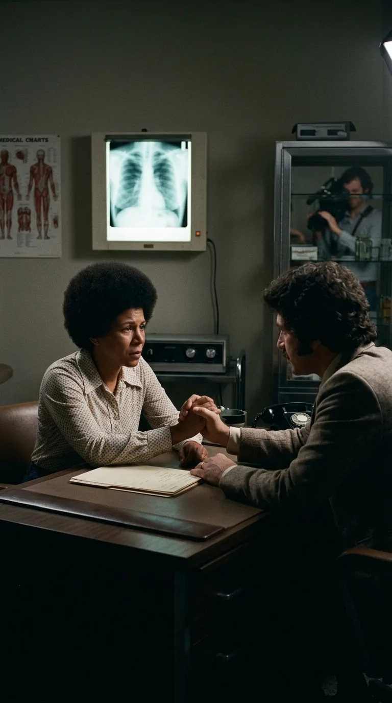
*1976: Facing medical adversity, Minnie Riperton transformed uncertainty into a testament of dignity and civic fortitude.*

---

### Act V: Courage at the White House and farewell at thirty-one

At a time when cancer was considered an unmentionable taboo and public figures hid surgeries out of fear of rejection or pity, Minnie Riperton adopted a pioneering stance.

She appeared on high-ratings programs like *The Mike Douglas Show* and openly recounted her experience with the mastectomy, urging women to lose their fear of self-examination and early detection. Her bravery broke down barriers of medical misinformation in a society that preferred to keep silent.

In 1977, the **American Cancer Society** named her National Education Chairperson. A year later, in a solemn ceremony in the Oval Office, United States President **Jimmy Carter** personally presented her with the **Courage Award** in recognition of her civic bravery and service to the nation's public health.

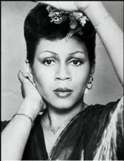
*1977: Minnie Riperton as national spokesperson for the American Cancer Society, dismantling taboos surrounding women's health.*

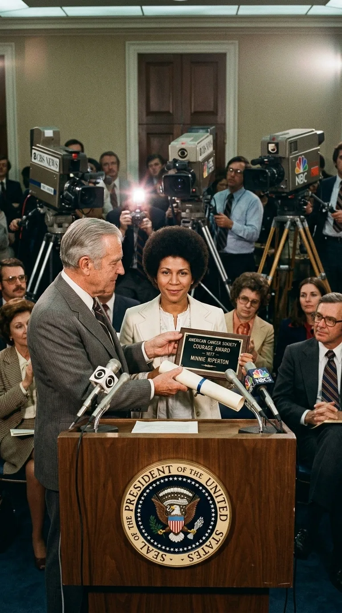
*White House, April 1978: President Jimmy Carter presents the American Cancer Society's Courage Award to Minnie Riperton.*

The cancer continued its relentless march through her bones. As a consequence of the lymph node removal, she developed severe lymphedema that eventually immobilized her right arm entirely. Far from abandoning the stage, Minnie learned to hold the microphone exclusively with her left hand, concealing her affected limb beneath layers of silk and velvet vests, or resting it gracefully on her lap.

She continued performing benefit concerts and completed her final studio album, *Minnie* (1979), until her physical strength was extinguished.

On the morning of **July 12, 1979**, at Cedars-Sinai Medical Center in Los Angeles, Minnie Riperton passed away in the arms of her husband Richard Rudolph, while listening to music recordings together. She was barely thirty-one years old.

---

### Epilogue: The Westwood epitaph and living memory

Minnie was laid to rest at the **Westwood Village Memorial Park Cemetery** in Los Angeles. Her bronze headstone bears neither sales figures, gold records, nor institutional accolades; there is sculpted only the opening verse that sprang forth in familial intimacy to lull her daughter to sleep:

> *«Lovin' you is easy 'cause you're beautiful»*

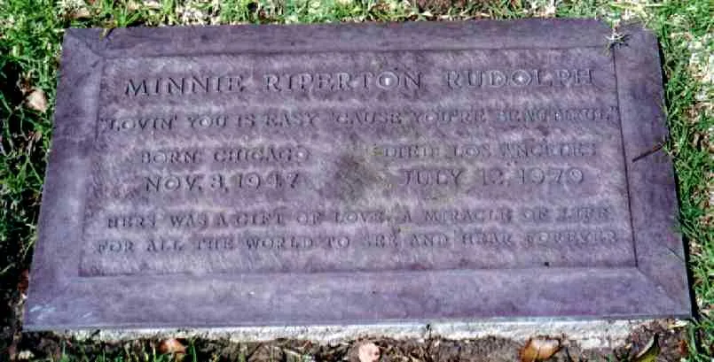
*Westwood Village Cemetery, Los Angeles: Minnie Riperton's bronze epitaph perpetuates the verse of her family lullaby.*

Maya Rudolph grew up keeping the echo of that luminous presence in her memory. Over the years, she became one of America's most beloved comedians and actresses, a prominent cast member of *Saturday Night Live* and multiple Emmy Award winner, always remembering that laughter and art were the purest gifts her mother left her before departing.

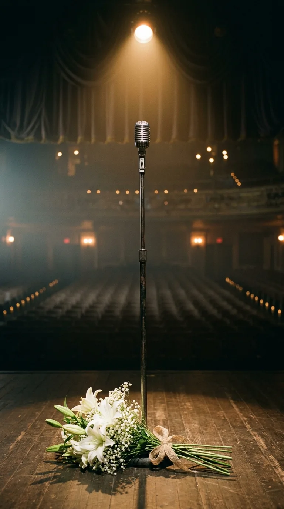
*The invisible bond: Music as a testament of love transcending the borders of time and memory.*

Whenever a radio station broadcasts the UCLA bird trills and the crystal-clear high notes of «Lovin' You», the listener is not merely hearing a technical gem of 1970s soul; they are witnessing the protective shield with which a mother embraced her daughter before saying goodbye to the earth. A cradle whisper that continues to defy death.

---

### 📚 Sources and Archival Records

1. **Billboard Magazine** (March and April 1975 issues). *Hot 100 Charts and charting analysis for the single 'Lovin' You' and the album 'Perfect Angel'* (Epic Records / CBS Inc.).
2. **Rudolph, Richard** (2009–2018). *Biographical interviews on NPR Music, Sound Opinions, and Okayplayer* concerning the home composition of 'Lovin' You', the expedition to the UCLA Botanical Garden to capture bird calls with a Nagra recorder, and the co-production pact under the pseudonym 'El Toro Negro'.
3. **Rudolph, Maya** (2012–2021). *Documentary interviews in The New York Times, Fresh Air (Terry Gross, NPR), and The Guardian* regarding maternal memory in the Record Plant studio and the presence of her name whispered at the end of the original tape.
4. **The White House Archives & American Cancer Society** (1978). *Photographic record and official transcript of the ceremony presenting the 'Courage Award' to Minnie Riperton by President Jimmy Carter in the Oval Office*, Washington D.C.
5. **Epic Records / CBS Records** (1974). *Technical sheet and liner notes for the album 'Perfect Angel' (KE 32561)*; personnel credits: Richard Rudolph (acoustic guitar), 'El Toro Negro' (Fender Rhodes piano), Minnie Riperton (lead vocals), Charles Stepney and Stevie Wonder (production).
6. **Los Angeles Times & The New York Times** (July 13, 1979). *Obituaries and institutional coverage of Minnie Riperton's passing at age 31 at Cedars-Sinai Medical Center*.