# 🕊️ El Susurro Inmortal de una Madre: La Verdadera Historia de «Lovin' You»
### *Cómo una melodía de cuna improvisada en la intimidad familiar conmovió al mundo, el pacto clandestino de Stevie Wonder como «El Toro Negro» y el trágico adiós de Minnie Riperton a los 31 años.*

---

**Por la redacción de Acordes Ocultos**  
*Tiempo de lectura estimado: 9 minutos*

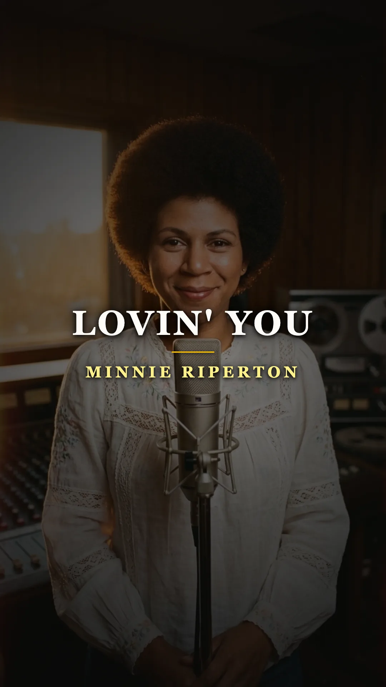
*Minnie Riperton: La artista que convirtió un arrullo maternal en un himno universal de ternura y trascendencia.*

---

### Prólogo: El trino matinal que desarmó a la radio en 1975

En la primavera de 1975, las emisoras de modulación de frecuencia en Estados Unidos y Europa vivían bajo el pulso acelerado de las pistas de baile y la opulencia de los sintetizadores. La música popular competía por volumen, artificio y velocidad. En medio de ese torbellino eléctrico, una pieza despojada de percusión y de bajo irrumpió en el dial con la serenidad de una confidencia al oído: una guitarra acústica pulsada con calidez, el trino limpio de unos pájaros al amanecer, los acordes sutiles de un piano eléctrico Fender Rhodes y una voz femenina capaz de elevarse hacia registros que rozaban lo sobrenatural.

Hacia el compás final, la cantante no proyectaba la voz con fuerza teatral; dejaba que el aire fluyera en un suspiro vertical hasta alcanzar el registro de silbido (*whistle register*), una tesitura reservada a un puñado de gargantas en la historia de la lírica moderna. Aquella pieza se titulaba **«Lovin' You»** y transformó a **Minnie Riperton** en un fenómeno discográfico indiscutible.

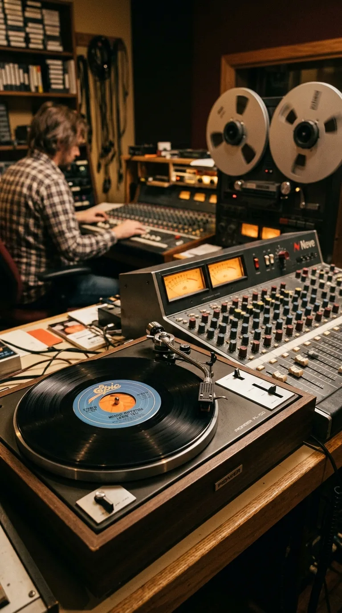
*1975: Minnie Riperton frente al micrófono, cuya prodigiosa tesitura de cinco octavas y media conmovió al mundo entero.*

Millones de oyentes dieron por sentado que se trataba de una balada romántica concebida para los grandes salones o el cortejo de dos amantes. Sin embargo, su origen no estaba en las oficinas de un sello de Manhattan ni en el cálculo de un productor de éxitos. Había nacido como un arrullo casero, concebido entre los fogones de la cocina y el suelo de la sala para calmar el llanto de una niña pequeña antes de dormir.

---

### Acto I: La guitarra en la cocina y la niña que no quería dormir

A comienzos de la década de 1970, Minnie Julia Riperton era una de las figuras más respetadas y a la vez menos reconocidas por el gran público en la escena musical estadounidense. Criada en el South Side de Chicago y formada en la disciplina del bel canto clásico y el ballet, había entregado su juventud al legendario sello **Chess Records**. Allí aportó coros memorables para titanes como Etta James, Muddy Waters y Ramsey Lewis, antes de liderar **Rotary Connection**, un experimento visionario de soul psicodélico ideado por Marshall Chess.

En 1970 publicó su primer álbum en solitario, *Come to My Garden*, con arreglos sinfónicos y producción del maestro Charles Stepney. La crítica especializada se rindió ante la obra, pero la distribución comercial falló estrepitosamente. El disco fue un fracaso comercial y las liquidaciones de derechos apenas alcanzaban para pagar el alquiler.

Desencantada de las promesas de la industria, Minnie se casó con el compositor y guitarrista **Richard Rudolph**. El matrimonio decidió construir un refugio lejos de las presiones corporativas y, tras el nacimiento de su hija **Maya Rudolph** el 26 de julio de 1972, la familia se trasladó a Gainesville, Florida, donde residían rodeados de naturaleza junto a su primogénito Marc.

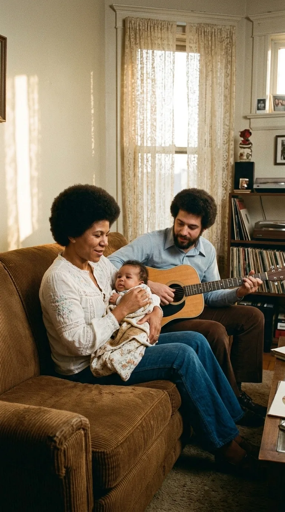
*Chicago y Florida: Minnie Riperton junto a su esposo y compañero creativo Richard Rudolph, forjando melodías en la intimidad del hogar.*

Maya era una bebé enérgica que luchaba contra el sueño en las tardes sofocantes. Para permitir que Minnie pudiera cocinar y la pareja tuviera unos minutos de respiro, Richard comenzó a repetir en su guitarra acústica una secuencia circular de acordes mayores, dulce y balsámica, cuya cadencia había esbozado por primera vez en Chicago en 1971.

Minnie se acercaba con la niña en brazos, tarareaba versos sobre la marcha y jugaba a imitar los sonidos de los pájaros que anidaban en el jardín. Las palabras surgían espontáneas: un diálogo amoroso entre esposos convertido en canción de cuna para envolver a la pequeña en una atmósfera de seguridad absoluta.

> *«La melodía nació como una distracción hogareña»*, recordaría años más tarde Richard Rudolph. *«No había ninguna intención de venderla ni de meterla en un disco. Era nuestro secreto para que Maya descansara y nosotros pudiéramos mirarnos a los ojos después de un día agotador»*.

La melodía quedó archivada en una cinta de casete casera, destinada a permanecer como una reliquia privada en los cajones de su casa en Florida.

---

### Acto II: El pacto secreto de «El Toro Negro»

Minnie Riperton se consideraba retirada de los escenarios, entregada a la crianza de sus hijos en el anonimato de Gainesville. Pero su voz seguía resonando en la memoria del músico más influyente de la época: **Stevie Wonder**.

Fascinado por la pureza acústica de *Come to My Garden*, Stevie Wonder encargó a su equipo rastrear el paradero de Riperton. Cuando logró comunicarse con ella a finales de 1973, su propuesta fue categórica: quería ficharla para su grupo vocal de acompañamiento, **Wonderlove**, y co-producir junto a Richard Rudolph y Charles Stepney su regreso triunfal a los estudios bajo el sello **Epic Records** (CBS).

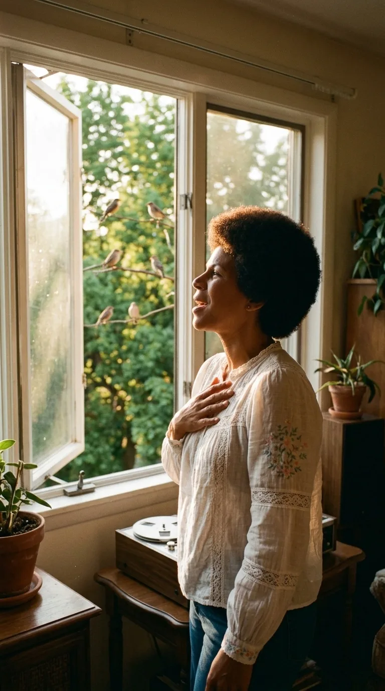
*Cinco octavas y media de rango vocal: Minnie dominaba una afinación absoluta capaz de transitar del terciopelo al agudo más puro.*

Sin embargo, el proyecto enfrentó un obstáculo legal formidable. Berry Gordy, presidente de Motown, mantenía a Stevie Wonder bajo un contrato de exclusividad implacable que le impedía producir o tocar de manera oficial para compañías discográficas competidoras.

Wonder se negó a dar marcha atrás. Acordó con Minnie y Richard firmar la producción y su interpretación al piano eléctrico bajo un seudónimo enigmático: **«El Toro Negro»**, una referencia directa a su signo del zodíaco, Tauro.

*1974: Stevie Wonder en los teclados de Record Plant, concibiendo en el anonimato contractual el sonido de «Perfect Angel».*

En los estudios **Record Plant** de Los Ángeles, durante la selección del repertorio para el álbum *Perfect Angel* (1974), la sesión se quedó sin una pieza corta para equilibrar el lado B del vinilo. Richard Rudolph recordó la modesta nana de Gainesville y comenzó a tocar los acordes en la guitarra acústica ante Stevie. El músico de Detroit se detuvo en seco en medio de la sala de control:

> *«No le añadas batería, no le metas bajo»*, ordenó Stevie a los presentes. *«Esa canción es perfecta en su fragilidad. Solo necesitamos tu guitarra acústica, la voz de Minnie y mis manos en el Fender Rhodes»*.

---

### Acto III: El magnetófono en el jardín botánico y el susurro en la cinta

Fiel a su visión orgánica, Wonder consideró que la grabación de estudio debía capturar la paz agreste de Florida donde la canción había cobrado forma. Descartaron los efectos sintéticos de archivo.

Richard Rudolph y el equipo de producción tomaron un magnetófono de bobina abierta **Nagra** y salieron a las primeras horas del amanecer hacia los senderos del **Jardín Botánico de la Universidad de California en Los Ángeles (UCLA)**. Allí, entre la vegetación húmeda, capturaron el despertar de los pájaros silvestres. Esas cintas de campo se transfirieron a la multipista analógica y se fundieron con la interpretación en vivo.

La sesión definitiva de «Lovin' You» en Record Plant quedó registrada sin trucos de laboratorio. Minnie Riperton se colocó frente al micrófono y desgranó el texto con una delicadeza conmovedora, modulando cada respiración sin perder el apoyo diafragmático, mientras Wonder acariciaba las teclas de su teclado eléctrico.

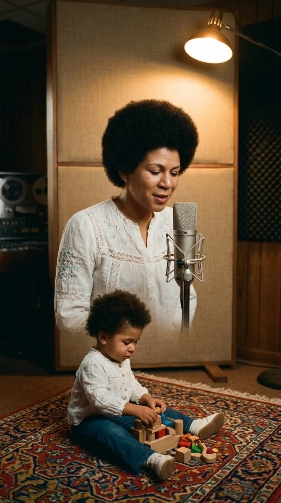
*Estudios Record Plant, 1974: La sesión íntima de «Lovin' You», con Maya presente en el recinto mientras su madre grababa la melodía de cuna.*

A pocos metros de los paneles de aislamiento, jugando en la alfombra del estudio, se encontraba la pequeña Maya, que por entonces no había cumplido los dos años. En el tramo final de la canción, cuando la música comenzaba a descender suavemente en el fundido (*fade out*), Minnie apartó los ojos de las notas, dirigió la mirada hacia su hija en el suelo y comenzó a repetir en un murmullo melódico:

> *«Maya... Maya... Maya... Maya... Maya...»*

Ese susurro espontáneo, preservado para siempre en la mezcla del álbum, no respondía a un guion de producción: era la dedicatoria íntima e irrepetible de una madre a su criatura.

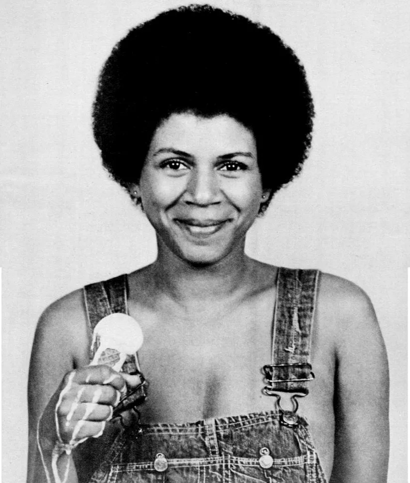
*Archivo documental de 1974: Minnie Riperton en la portada de «Perfect Angel», un disco que desafió las fórmulas comerciales de su tiempo.*

---

### Acto IV: La cima del mundo y el diagnóstico despiadado

Los directivos de Epic Records dudaban del potencial comercial de una balada acústica sin base rítmica en plena era disco y se resistieron a editarla en formato de 45 RPM. Sin embargo, las emisoras de radio comenzaron a emitir la pista del álbum por presión de los propios locutores y las llamadas de la audiencia.

El fenómeno fue arrollador. El **5 de abril de 1975**, «Lovin' You» alcanzó el **puesto número uno del Billboard Hot 100** en los Estados Unidos, se situó en el número dos en el Reino Unido y conquistó los primeros puestos en una veintena de países. El álbum *Perfect Angel* obtuvo la certificación de disco de oro y la sonrisa luminosa de Minnie inundó las cadenas de televisión.

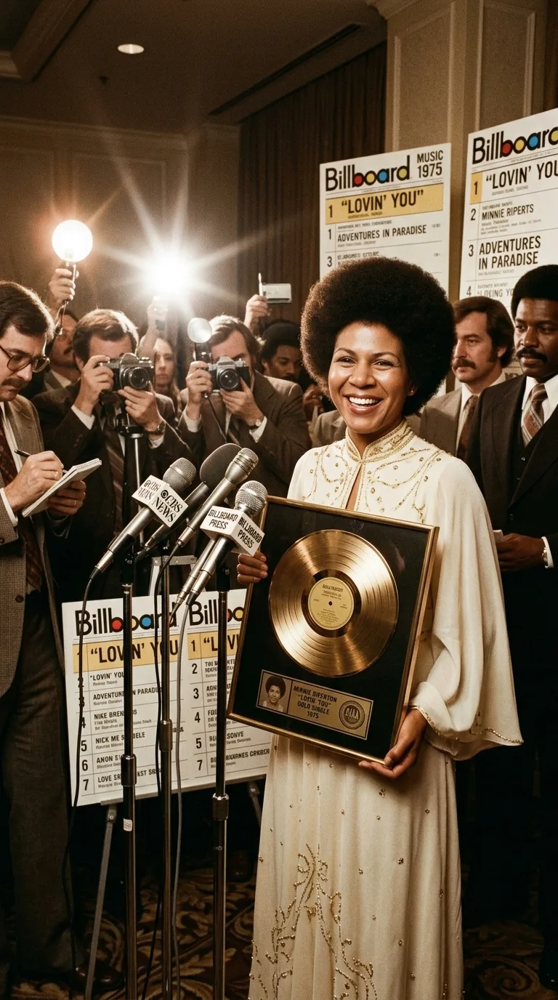
*Primavera de 1975: Minnie Riperton celebra la conquista del número uno absoluto en las listas internacionales de éxitos.*

Pero el destino aguardaba con una crueldad implacable. En los primeros meses de 1976, en la cúspide de su juventud y plenitud artística, Minnie descubrió una anomalía en su pecho. Tras someterse a revisiones de urgencia en el **Cedars-Sinai Medical Center** de Los Ángeles, el diagnóstico médico fue demoledor: padecía un carcinoma mamario agresivo que ya se había diseminado a los ganglios linfáticos.

Fue intervenida de inmediato mediante una mastectomía radical modificada. El pronóstico de los especialistas fue sombrío: le pronosticaron una expectativa de vida de apenas seis meses. Tenía tan solo veintiocho años de edad.

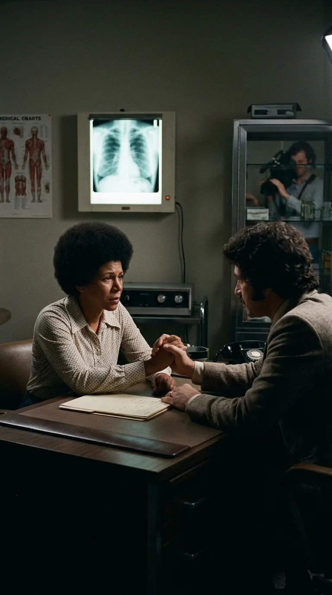
*1976: Frente a la adversidad médica, Minnie Riperton transformó la incertidumbre en un testimonio de dignidad y entereza civil.*

---

### Acto V: Valentía en la Casa Blanca y la despedida a los treinta y un años

En una época en que el cáncer era considerado un tabú inconfesable y las figuras públicas ocultaban las cirugías por temor al rechazo o la lástima, Minnie Riperton adoptó una postura pionera.

Apareció en espacios de máxima audiencia como *The Mike Douglas Show* y narró abiertamente su experiencia con la mastectomía, exhortando a las mujeres a perder el miedo a la autoexploración mamaria y la detección precoz. Su valentía derribó barreras de desinformación médica en una sociedad que prefería guardar silencio.

En 1977, la **American Cancer Society** la nombró Presidenta Nacional de Educación. Un año después, en una ceremonia solemne en el Despacho Oval, el Presidente de los Estados Unidos, **Jimmy Carter**, le otorgó en mano el **Courage Award** en reconocimiento a su coraje civil y su servicio a la salud pública de la nación.

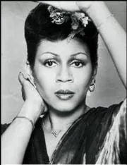
*1977: Minnie Riperton como portavoz nacional de la American Cancer Society, derribando los tabúes en torno a la salud de la mujer.*

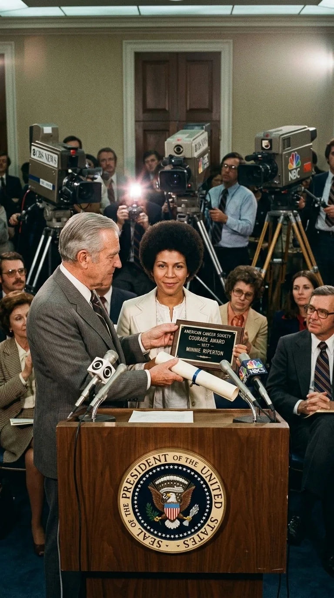
*Casa Blanca, abril de 1978: El Presidente Jimmy Carter hace entrega a Minnie Riperton del Courage Award de la American Cancer Society.*

El cáncer continuó avanzando implacablemente por sus huesos. Como consecuencia de la extirpación de los ganglios, desarrolló un linfedema severo que terminó por inmovilizar por completo su brazo derecho. Lejos de abandonar los escenarios, Minnie aprendió a sostener el micrófono exclusivamente con la mano izquierda, ocultando su extremidad afectada bajo capas de seda, chalecos de terciopelo o descansándola con gracia sobre su regazo.

Continuó ofreciendo recitales benéficos y completó su último álbum de estudio, *Minnie* (1979), hasta que las fuerzas físicas se extinguieron.

En la mañana del **12 de julio de 1979**, en el Cedars-Sinai Medical Center de Los Ángeles, Minnie Riperton falleció en los brazos de su esposo Richard Rudolph, mientras escuchaban juntos grabaciones musicales. Tenía apenas treinta y un años.

---

### Epílogo: El epitafio en Westwood y la memoria viva

Minnie fue sepultada en el cementerio **Westwood Village Memorial Park** de Los Ángeles. En su lápida de bronce no se inscribieron las cifras de ventas, los discos de oro ni las distinciones institucionales; se esculpió únicamente el verso inaugural que brotó en la intimidad familiar para arrullar a su hija:

> *«Lovin' you is easy 'cause you're beautiful»*  
> *(Amarte es fácil porque eres hermosa)*

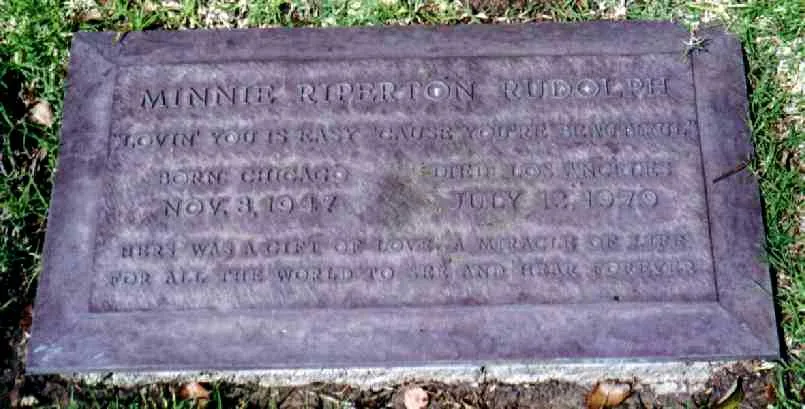
*Cementerio Westwood Village de Los Ángeles: El epitafio de bronce de Minnie Riperton perpetúa el verso de su arrullo familiar.*

Maya Rudolph creció guardando en su memoria el eco de aquella presencia luminosa. Se convirtió con los años en una de las comediantes y actrices más queridas de los Estados Unidos, figura destacada de *Saturday Night Live* y ganadora de múltiples premios Emmy, recordando siempre que la risa y el arte fueron el regalo más puro que su madre le legó antes de partir.

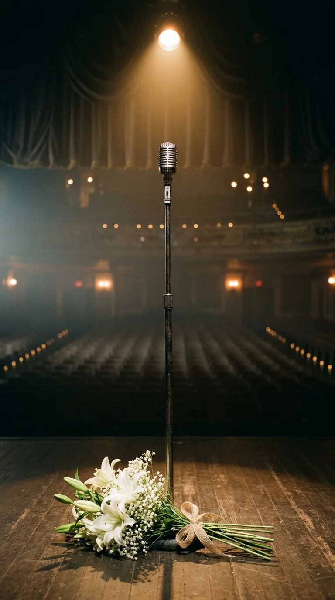
*El lazo invisible: La música como testamento de amor que trasciende las fronteras del tiempo y de la memoria.*

Cada vez que una emisora de radio emite el trino de los pájaros de UCLA y los agudos cristalinos de «Lovin' You», el oyente no está escuchando simplemente una joya técnica del soul de los años setenta; está presenciando el escudo protector con el que una madre abrazó a su hija antes de despedirse de la tierra. Un susurro de cuna que sigue desafiando a la muerte.

---

### 📚 Fuentes y Archivo Documental

1. **Billboard Magazine** (Ediciones de marzo y abril de 1975). *Hot 100 Charts y análisis de posicionamiento discográfico del sencillo «Lovin' You» y el álbum «Perfect Angel»* (Epic Records / CBS Inc.).
2. **Rudolph, Richard** (2009–2018). *Entrevistas biográficas en NPR Music, Sound Opinions y Okayplayer* sobre la composición casera de «Lovin' You», la expedición al Jardín Botánico de UCLA para la captura del trino de las aves con magnetófono Nagra, y el pacto de coproducción bajo el seudónimo «El Toro Negro».
3. **Rudolph, Maya** (2012–2021). *Entrevistas documentales en The New York Times, Fresh Air (Terry Gross, NPR) y The Guardian* acerca del recuerdo maternal en el estudio Record Plant y la presencia del susurro final de su nombre en la cinta original.
4. **The White House Archives & American Cancer Society** (1978). *Registro fotográfico y transcripción oficial de la ceremonia de entrega del «Courage Award» a Minnie Riperton por el Presidente Jimmy Carter en el Despacho Oval*, Washington D.C.
5. **Epic Records / CBS Records** (1974). *Ficha técnica y notas de contraportada del álbum «Perfect Angel» (KE 32561)*; créditos de personal: Richard Rudolph (guitarra acústica), «El Toro Negro» (piano Fender Rhodes), Minnie Riperton (voz líder), Charles Stepney y Stevie Wonder (producción).
6. **Los Angeles Times & The New York Times** (13 de julio de 1979). *Crónicas necrológicas y cobertura institucional del deceso de Minnie Riperton a los 31 años en Cedars-Sinai Medical Center*.
