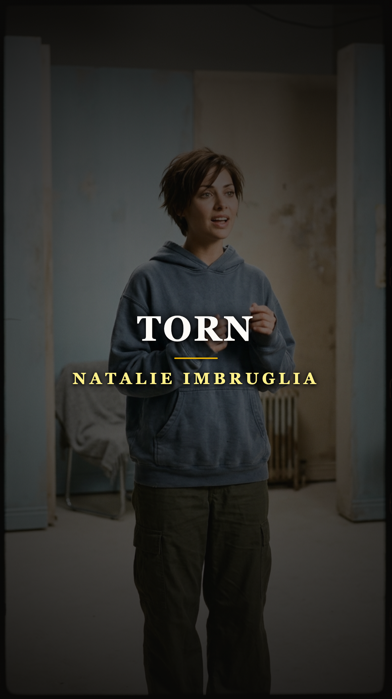

# Tocaban para 50 personas en un bar mientras su canción más íntima conquistaba el planeta

**Por el equipo editorial de Acordes Ocultos**

---

> *«I thought I saw a man brought to life / He was warm, he came around like he was dignified...»*

En el otoño de 1997, la televisión musical de todo el mundo quedó hipnotizada por una presencia singular: una joven australiana de veintidós años, cabello corto a capas, sudadera gris con capucha y pantalones militares holgados, gesticulaba con manos expresivas en un departamento de paredes móviles. Su nombre era Natalie Imbruglia, y su sencillo debut, *«Torn»*, trepó como un meteorito hasta el número uno en decenas de países, vendiendo más de cuatro millones de copias.

Para la inmensa mayoría del público y de la crítica de la época, la canción era el testimonio diáfano de una recién llegada que derramaba su propio corazón roto. Pero detrás de aquel estribillo dorado se ocultaba uno de los viajes más insólitos de la historia del pop: una plegaria nacida en un hospital psiquiátrico de Londres que ya había fracasado tres veces, en dos continentes y en dos idiomas distintos, antes de que Natalie cantara su primera nota.

---

## Acto I: La maqueta en West Hampstead (1991)

La historia de *«Torn»* no comenzó en los despachos de una multinacional del pop, sino en un modesto estudio casero en el barrio londinense de West Hampstead en 1991. Allí se reunieron dos músicos y compositores estadounidenses, **Anne Preven** y **Scott Cutler**, con el experimentado productor británico **Phil Thornalley**.

Preven y Cutler eran pareja y venían luchando por hacerse un hueco en la industria. La letra que Anne comenzó a bosquejar no respondía a los clichés del desamor adolescente. La inspiración procedía de una experiencia mucho más sombría: durante su juventud, Anne había trabajado como asistente de su padre, un psiquiatra dedicado a adolescentes internados en crisis severas. El dolor de ver a jóvenes despojados de esperanza, lidiando con el trauma y la vulnerabilidad absoluta, cristalizó en versos desgarradores:

> *«I’m all out of faith, this is how I feel / I’m cold and I am shamed lying naked on the floor...»*

Aquel día grabaron una maqueta acústica austera y melancólica, concebida como el vehículo para lanzar la carrera solista de Preven. Sin embargo, ningún sello discográfico en Estados Unidos mostró interés en publicarla. La cinta quedó guardada en un cajón.

---

## Acto II: El peregrinaje nórdico y la furia grunge (1993-1995)

Lejos de morir en el olvido, la maqueta comenzó a circular de mano en mano por circuitos editoriales europeos. En 1993, la canción encontró su primer destino oficial a miles de kilómetros de Londres: la veterana cantante danesa **Lis Sørensen** escuchó la melodía y decidió adaptarla a su idioma natal. Bajo el título **«Brændt»** (*Quemada*), con letra adaptada por Elisabeth Gjerluff Nielsen, la pieza se convirtió en un éxito radial en Dinamarca. Fue la primera vez que el mundo escuchó aquellos acordes, aunque nadie fuera de Escandinavia se percató.

Mientras tanto, en Los Ángeles, Anne Preven y Scott Cutler decidieron dejar de esperar a la industria y formaron su propia banda de rock alternativo: **Ednaswap**. En plena era dorada del *grunge*, la banda fichó por East West Records y grabó *«Torn»* en 1995 para su álbum debut homónimo. 

Aquella versión original en inglés era irreconocible comparada con el pop que el mundo conocería después: un tema pesado, lento, sucio, cargado de distorsión en las guitarras eléctricas y con la voz desgarrada de Preven bordeando el llanto. Era una obra de culto formidable, pero comercialmente fue un fracaso rotundo. La discográfica apenas promocionó el disco y las emisoras comerciales ignoraron el corte. Un año más tarde, en 1996, la cantante noruega Trine Rein grabó una versión en clave pop-rock para su álbum *Beneath My Skin*, logrando notoriedad local en Noruega y Japón, pero sin encender la mecha internacional.

---

## Acto III: La metamorfosis acústica y la chica de la sudadera (1997)

A comienzos de 1997, Natalie Imbruglia vivía una encrucijada vital. Hacía dos años que había dejado la popular telenovela australiana *Neighbours* para mudarse a Londres. Sus ahorros se estaban evaporando, las audiciones no prosperaban y su estatus migratorio pendía de un hilo. Decidida a probar suerte en la música, comenzó a reunirse con productores locales.

Fue así como llegó al estudio de Phil Thornalley, coautor de aquella maqueta arrumbada seis años atrás. Thornalley tuvo una intuición brillante: el problema de *«Torn»* no era la melodía ni la letra, sino el ropaje sonoro. Decidió despojar a la canción de los muros de distorsión grunge de Ednaswap y reconstruirla desde la madera acústica. Aceleró ligeramente el tempo, programó una base rítmica ligera inspirada en el trip-hop, añadió guitarras cristalinas y convocó a Nigel Godrich (ingeniero emblemático de Radiohead) para la mezcla final.

Cuando Natalie puso su voz fresca, cercana y contenida sobre la pista, la alquimia fue instantánea. Filmado por la directora Alison Maclean con un presupuesto mínimo, el video capturó a una joven vestida con su propia ropa cotidiana gesticulando con naturalidad desarmante. El impacto fue monumental: *«Torn»* se transformó en la canción más radiada de la década en el Reino Unido y Australia, y una presencia perenne en MTV durante más de un año.

---

## Acto IV: La furgoneta rota y los bares vacíos

Para Anne Preven y los miembros de Ednaswap, el otoño de 1997 fue una experiencia surrealista y agridulce que rozó lo kafkiano. Mientras el rostro de Natalie Imbruglia ocupaba las portadas de las revistas más influyentes del planeta y su versión sonaba en cada supermercado, cafetería y taxi de Norteamérica, **Ednaswap se encontraba de gira en una vieja furgoneta destartalada, tocando en bares lúgubres ante cincuenta personas**.

En más de una parada de carretera, los músicos entraban a cenar a un café de paso y veían en el televisor del mostrador a la cantante australiana recibiendo ovaciones por interpretar su propia creación íntima. Anne Preven admitió en entrevistas retrospectivas la extraña dualidad emocional de aquel período: por un lado, las suculentas regalías de autoría le permitieron pagar sus deudas y consolidar una próspera carrera como compositora profesional; por el otro, era el duelo de ver cómo el dolor que había extraído de su propia juventud se convertía en el trofeo de otra persona.

Ednaswap se disolvió en 1999 tras publicar tres álbumes que jamás alcanzaron el gran público, dejando para la historia la versión más cruda y honesta de una obra que la industria pulió hasta el brillo absoluto.

---

## Epílogo: El viaje invisible de las canciones

La historia de *«Torn»* desvela la naturaleza misteriosa de la música popular: una composición no siempre triunfa en la voz de quien la concibió ni en el formato original en que fue parida. 

Hicieron falta seis años, una adaptación al danés, el rugido ignorado de una banda grunge de Los Ángeles y la mirada vulnerable de una actriz desempleada en Londres para que la chispa encendiera el mundo. Al final, las grandes canciones encuentran su cauce, recordándonos que el arte verdadero trasciende a los egos: una vez que una melodía conmueve a millones de almas, deja de pertenecerle al autor para convertirse en patrimonio de la memoria colectiva.

---

### 💬 Comunidad Acordes Ocultos

¿En qué año escuchaste por primera vez *«Torn»*? ¿Imaginabas que detrás de su melodía pop se escondía un tema de grunge incomprendido? Te leemos en los comentarios.

---

### 📚 Fuentes y Archivo Documental

1. **Songwriting Magazine**: *"How I Wrote: Torn by Phil Thornalley and Anne Preven"*, testimonio directo sobre la sesión de 1991 en West Hampstead.
2. **Billboard Magazine**: Archivo histórico de listas de éxitos (1997-1998), desempeño de *Left of the Middle* y ventas mundiales del sencillo *Torn*.
3. **MTV News Archive**: Cobertura del rodaje del videoclip oficial dirigido por Alison Maclean y declaraciones de Natalie Imbruglia (1997).
4. **Songfacts**: Entrevista documental con Anne Preven sobre la trayectoria de Ednaswap, la versión en danés de Lis Sørensen (*Brændt*, 1993) y las regalías de autoría.
5. **The Guardian / Observer Music**: *"The Strange Life of Torn: from Danish pop to grunge failure to global phenomenon"* (Reportaje retrospectivo).
6. **Discogs / AllMusic Database**: Fichas discográficas oficiales de Lis Sørensen (*Under stjernerne et sted*, 1993), Ednaswap (*Ednaswap*, 1995), Trine Rein (*Beneath My Skin*, 1996) y Natalie Imbruglia (*Left of the Middle*, RCA, 1997).
