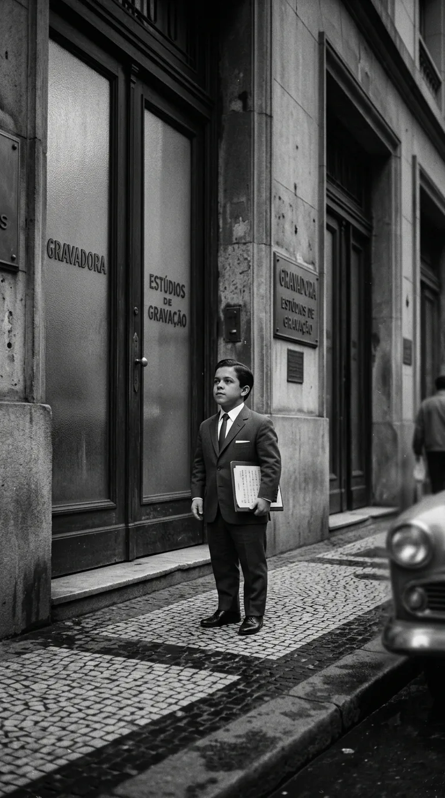
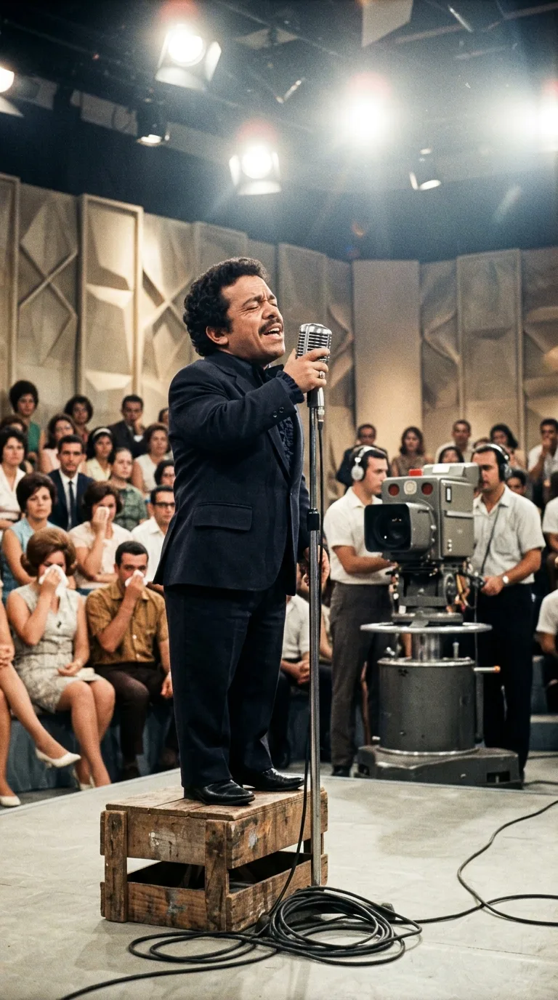
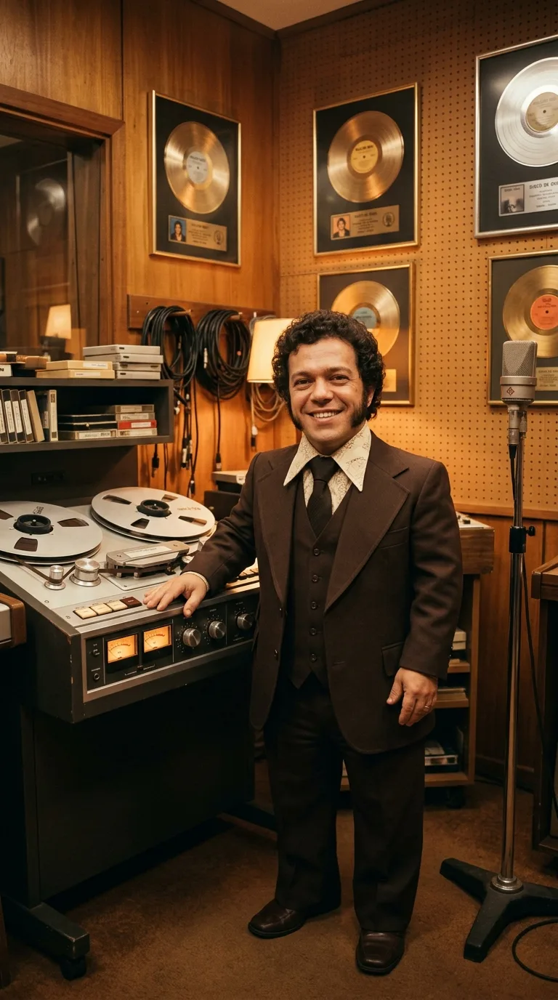
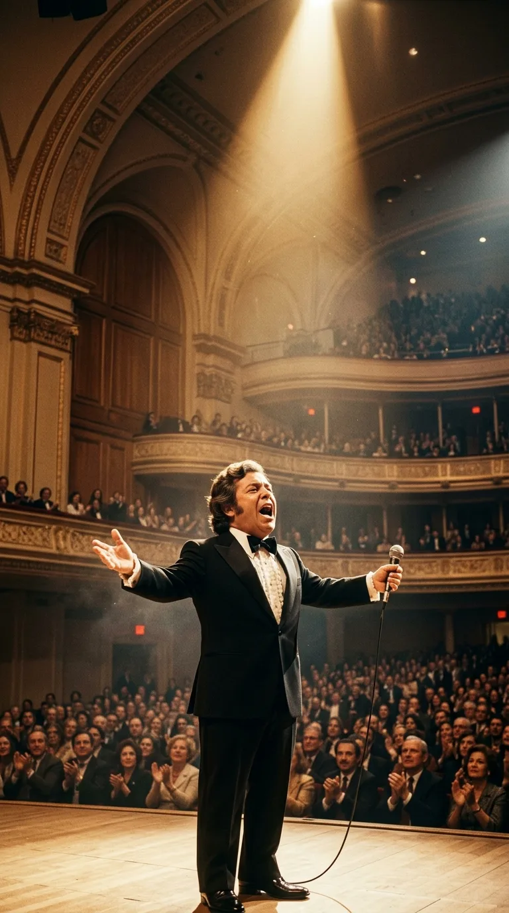
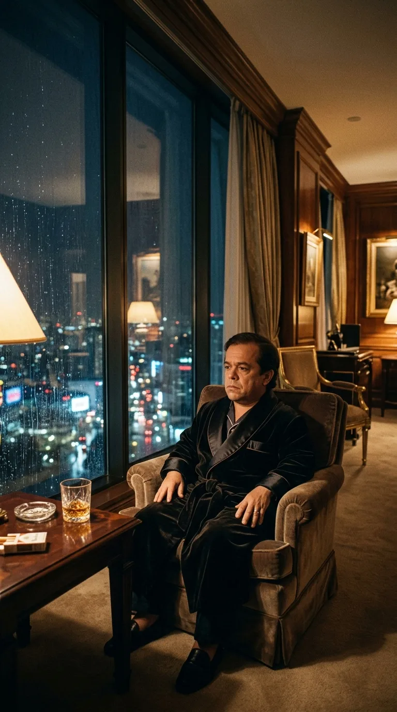
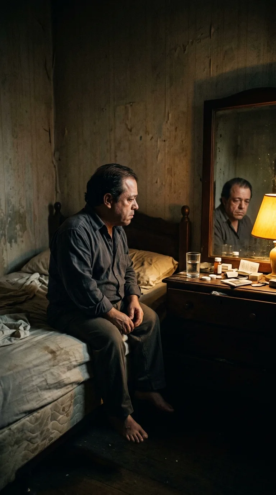
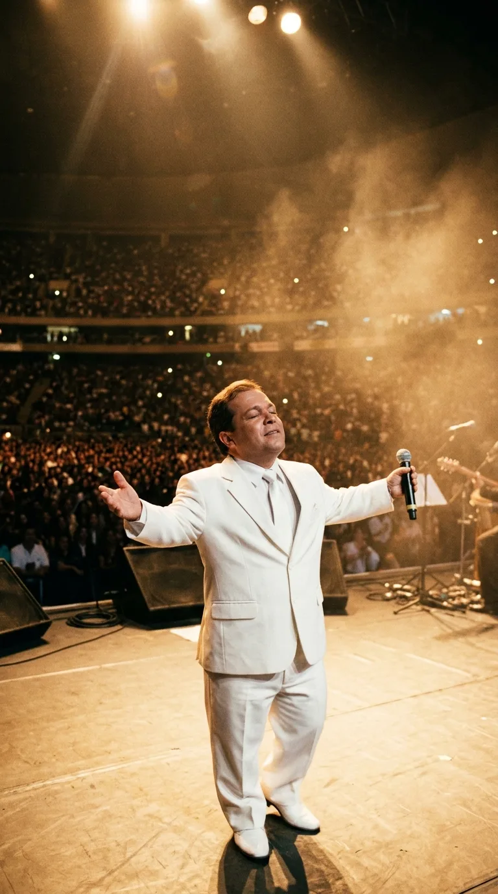
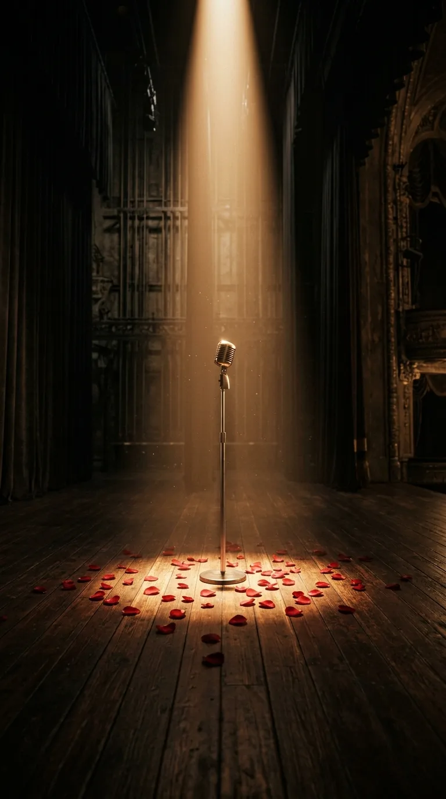

# 🎙️ El Coloso de un Metro: Nelson Ned y la Garganta que Desafió a la Gravedad

### *Medía 1,12 metros y las discográficas lo rechazaron por considerarlo invendible. Cómo un muchacho de Minas Gerais subió a un cajón de madera, conquistó el Carnegie Hall de Nueva York y convirtió sus lágrimas en el mayor himno del dolor romántico en «Déjame si estoy llorando».*

---

**Por la redacción de Acordes Ocultos**  
*Tiempo de lectura estimado: 10 minutos*

> *«Déjame si estoy llorando,  
> ni un consuelo estoy buscando,  
> quiero estar solo conmigo.  
> Si me ven que a solas voy llorando,  
> es que estoy de pronto recordando  
> a un amor que no consigo olvidar...  
> Pues el llanto le hace bien al alma,  
> si ha perdido sufriendo la calma,  
> y yo quiero olvidar que tu amor ya se fue».*  
> — **Nelson Ned** (*Déjame si estoy llorando*, 1973)

---

### Prólogo: La estatura del trueno

En los despachos alfombrados de las casas discográficas de São Paulo y Río de Janeiro a mediados de la década de 1960, el amor tenía una estatura reglamentaria. Los ídolos románticos debían ser altos, de mandíbulas cuadradas, cabellos peinados a la gomina y miradas de galán cinematográfico capaces de derretir a las jovencitas desde las portadas de acetato. 

Cuando Nelson Ned d’Ávila Pinto cruzaba aquellas antesalas, las miradas que recibía no eran de admiración, sino de una mezcla cruel de compasión y mofa solapada. Medía exactamente un metro y doce centímetros. La displasia espondiloepifisaria congénita con la que había nacido en Ubá, una pequeña localidad minera de Brasil, había detenido el crecimiento de sus huesos, pero había dejado intacto un misterio biológico inexplicable: dentro de aquella caja torácica diminuta dormía la resonancia de un tenor dramático descomunal, un trueno de tesitura baritonal y agudos lacerantes capaz de derribar paredes sin necesidad de cables ni micrófonos.

Los directores artísticos le cerraban las puertas en la cara. Le decían que la gente pagaría por verlo en una carpa de feria de pueblo o en un número humorístico, pero jamás para creerle cuando cantara sobre la pasión, el desengaño o el deseo. Nadie concebía que un hombre de un metro pudiera encarnar la desolación de un corazón roto. 

Nelson Ned apretaba los puños, tragaba el veneno de la humillación y repetía para sí una convicción que rayaba en la herejía: *«Dios me hizo pequeño para que mi voz tuviera que ser gigante»*.

*São Paulo, mediados de los años sesenta: El joven Nelson Ned ante el rechazo de los sellos discográficos, armado únicamente con la fe en su garganta.*

---

### Acto I: El cajón de madera y la catarsis nacional

El punto de quiebre ocurrió una tarde calurosa de 1968 bajo los focos abrasadores de la televisión brasileña. Abelardo Barbosa, el legendario presentador conocido en todo el país como «Chacrinha», decidió invitarlo a su programa de auditorio, la *Discoteca do Chacrinha*. El plató era un hervidero caótico de bailarinas, bocinas y concursos populares donde el público solía ser despiadado con los concursantes primerizos.

Para que la boca de Nelson pudiera alcanzar la rejilla del micrófono Shure de pie, un tramoyista tuvo que colocar de urgencia un cajón de madera desvencijado sobre el escenario. Cuando el joven minero subió los tres escalones improvisados, un murmullo de risitas y codazos recorrió las gradas del auditorio. 

Entonces sonó la introducción de la orquesta. Nelson cerró los ojos, apretó las solapas de su saco a medida y lanzó su primera frase.

El auditorio entero enmudeció como si hubiera caído un rayo. No era el canto suave de la *bossa nova* ni el murmullo intimista que dominaba las ondas radiales de la época; era un rugido telúrico, una corriente de emoción desgarrada que brotaba de las entrañas mismas del dolor humano. Las risas se extinguieron en seco. Para cuando alcanzó el clímax del tema, las cámaras enfocaban a mujeres y hombres de la audiencia secándose las lágrimas con pañuelos. Al callar la última nota, Chacrinha corrió a abrazarlo entre una ovación ensordecedora y lo bautizó frente a millones de televidentes con el título que lo acompañaría por el resto de sus días: *«O Pequeno Gigante da Canção»*.

*1968: Sobre un modesto cajón de madera en el plató de Chacrinha, el torrente de su voz transformó las burlas en lágrimas y reverencia colectiva.*

---

### Acto II: La conquista del continente y el templo de Manhattan

Un año después, en 1969, Nelson Ned compuso y grabó la canción que dinamitaría cualquier barrera geográfica y lingüística: *Todo Pasará*. Con ese tema ganó el prestigioso *Festival de la Canción* de Buenos Aires y desató un terremoto comercial sin precedentes. 

En una época en que los artistas brasileños rara vez lograban cruzar al mercado hispanoparlante sin diluir su identidad, Nelson grabó en un español tan perfecto, apasionado y castizo que millones de oyentes en México, Colombia, Venezuela y Argentina creían que había nacido en sus propias tierras. Se convirtió en el primer artista brasileño en superar la marca de un millón de copias vendidas en los Estados Unidos con un álbum debut en español.

*Inicios de los años setenta: Nelson Ned en los estudios de grabación de São Paulo, dirigiendo las sesiones orquestales que barrieron en las listas de toda América.*

Pero la consagración definitiva aguardaba en la meca dorada del espectáculo mundial. En mayo de 1974, Nelson Ned fue contratado para presentarse en el legendario **Carnegie Hall** de Nueva York. 

Los cronistas de la prensa estadounidense acudieron con escepticismo morboso, esperando presenciar una curiosidad exótica. Lo que encontraron fue una cátedra de virtuosismo y magnetismo escénico. Vestido con un esmoquin de satén negro rigurosamente cortado para su figura, Nelson llenó la histórica sala durante tres noches consecutivas con las entradas completamente agotadas. Cantó sin descanso, gesticulando con una intensidad shakesperiana, desafiando a una orquesta sinfónica completa y recibiendo la reverencia de figuras de la talla de Tony Bennett e incluso el elogio público de Frank Sinatra.

En 1973 vio la luz *«Déjame si estoy llorando»*, una balada monumental donde el cantante desnudaba la verdad más profunda de su existencia: el derecho inalienable del hombre a quebrarse, a no mendigar consuelos ajenos y a purificar las heridas del desamor en la soledad de sus propias lágrimas. La canción se convirtió en un himno popular que sonaba en cada cantina, en cada sala de estar y en cada rincón de América Latina.

*Mayo de 1974: La apoteosis en el Carnegie Hall de Manhattan; Nueva York rendida a los pies del Pequeño Gigante durante tres veladas históricas.*

---

### Acto III: El espejismo del oro y el descenso al fango

La gloria trajo consigo un torbellino vertiginoso que pocos seres humanos están preparados para soportar. A lo largo de los años 70 y 80, Nelson Ned vio llover millones de dólares sobre sus cuentas. Se compró residencias fastuosas, automóviles importados, contrató aviones privados y mantenía séquitos de decenas de aduladores que bebían y festejaban a su alrededor todas las noches.

Sin embargo, detrás del terciopelo y los aplausos se escondía una soledad lacerante. La discriminación de su infancia no había desaparecido; solo se había maquillado de adulación interesada. Para acallar las voces de la inseguridad y el agotamiento físico provocado por sus dolores articulares crónicos, Nelson recurrió a las sustancias.

*Años ochenta: En la penumbra de su residencia entre trofeos y botellas de licor, el alto precio de la celebridad comenzaba a pasar factura.*

Llegó a consumir entre cuatro y cinco gramos de cocaína por día, acompañados de litros de whisky de malta. Portaba armas de fuego en el cinto, protagonizaba altercados en clubes nocturnos y dilapidaba fortunas en noches interminables de delirio. En su autobiografía confesaría con descarnada crudeza: *«Compré mansiones, repartí autos y llené de joyas a personas que apenas conocía. Creía que con dinero podía comprar el respeto que el mundo me negó de niño. Pero cuando el dinero empezó a escasear, me di cuenta de que estaba absolutamente solo en un cuarto a oscuras»*.

A finales de los años 80, la voz permanecía, pero el hombre estaba roto. Las deudas millonarias asfixiaban sus finanzas, sus matrimonios habían naufragado entre escándalos y su cuerpo, resentido por los excesos, amenazaba con colapsar en cualquier momento.

*Finales de los años ochenta: La bancarrota emocional y económica; solo en la penumbra de una habitación de hotel, enfrentando el abismo.*

---

### Acto IV: La redención y la última trinchera

En 1993, al borde de la sobredosis y la ruina irreversible, Nelson Ned tocó fondo. Encerrado en una habitación de hotel en São Paulo, arrodillado frente a un espejo que le devolvía la imagen marchita de su propia decadencia, decidió hacer un pacto con la vida y la fe.

Abrazó el cristianismo con el mismo fervor indomable con que había conquistado los escenarios. Cortó de raíz con el alcohol y las drogas, disolvió su séquito de aduladores y volcó su talento vocal a la música cristiana. Discos como *Jesus Está Vivo* y *Jesus Te Ama* vendieron millones de copias en todo el continente. El repertorio cambió, pero la emoción desgarrada y la entrega visceral siguieron intactas: ahora llenaba estadios de fútbol no para vanagloriarse, sino para dar testimonio de su caída y resurrección.

*Años noventa: Reconvertido por la fe, Nelson Ned volvió a congregar multitudes en estadios con un mensaje de esperanza y redención.*

El destino, sin embargo, le tenía reservada una última y dolorosa prueba. En el año 2003 sufrió un accidente cerebrovascular (ACV) masivo que paralizó el lado derecho de su cuerpo y le arrebató la visión del ojo derecho. Confinado a una silla de ruedas y aquejado por los estragos de la diabetes y la hipertensión, muchos creyeron que aquel era el punto final de su historia.

Se equivocaban. Con un solo ojo y medio cuerpo inmovilizado, Nelson Ned continuó presentándose en auditorios y programas de televisión. Cuando le acercaban el micrófono a los labios, aquel chorro de voz intacto volvía a emerger de sus entrañas, conmoviendo hasta la médula a quienes lo escuchaban. No había autocompasión en su mirada; solo la dignidad inquebrantable de un titán que jamás supo rendirse.

*Años dos mil: Confinado a una silla de ruedas y con secuelas de un derrame, su garganta continuó desafiando al destino con entereza intacta.*

---

### Epílogo: La lección eterna del Pequeño Gigante

El 5 de enero de 2014, a los 66 años de edad, Nelson Ned falleció en el Hospital Regional de Cotia, en São Paulo, a causa de un cuadro clínico agravado por una neumonía. Dejó tras de sí más de 45 millones de discos vendidos en todo el planeta, traducciones a más de una docena de idiomas y una huella imborrable en el cancionero sentimental iberoamericano.

Más allá de los discos de oro y las anécdotas de su paso por los grandes templos de la música, su legado perdura como un recordatorio luminoso sobre la condición humana. Nelson Ned demostró que las limitaciones físicas y las burlas del entorno no tienen poder alguno frente a la verdad del alma y la fuerza de la vocación artística. 

Cuando hoy resuenan los violines de *«Déjame si estoy llorando»*, no escuchamos a un hombre vencido por la tristeza, sino a un coloso que tuvo el coraje de derramar sus lágrimas a la vista de todos, enseñándonos que la verdadera estatura de una persona jamás se mide desde el suelo hasta su cabeza, sino desde su pecho hasta las estrellas.

*El micrófono solitario en el centro del escenario bajo un haz de luz dorada; el silencio solemne que honra la memoria de un coloso irrepetible.*

---

### 📚 Fuentes y Archivo Documental

1. **Ned, Nelson.** *O Pequeno Gigante da Canção: Minha Vida, Minhas Lutas e Minha Fé*. Editora Vida, São Paulo, 1996 (Autobiografía oficial del artista).
2. **Barbosa, Abelardo («Chacrinha»).** Archivos audiovisuales de *Discoteca do Chacrinha* (TV Tupi / TV Globo, 1968–1972), Acervo Nacional de Imagem e Som do Brasil.
3. **The New York Times.** Crónica de conciertos de Nelson Ned en el Carnegie Hall de Manhattan, sección *Arts & Music*, mayo de 1974.
4. **Billboard Magazine.** *Latin Music Special: Nelson Ned Breaks U.S. Sales Record with Debut Spanish LP*, Archivo Hemerográfico Billboard, noviembre de 1969.
5. **Dicionário Cravo Albin da Música Popular Brasileira.** Entrada enciclopédica documentada: *Nelson Ned (1947–2014)*, Instituto Cultural Cravo Albin, Río de Janeiro.
6. **Folha de S. Paulo & O Globo.** Cobertura periodística de la conversión espiritual de Nelson Ned (1993) y obituarios documentales conmemorativos de enero de 2014.
7. **Discografía Oficial EMI-Odeon / Copacabana.** Registros fonográficos y hojas de autoría del sencillo *Déjame si estoy llorando* (álbum *A Cigana*, 1973; compositores acreditados en Sociedad General de Autores).
