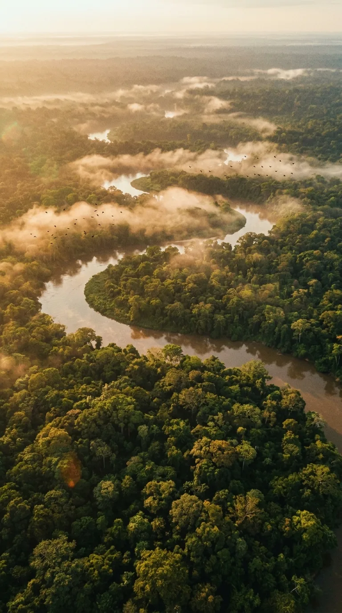
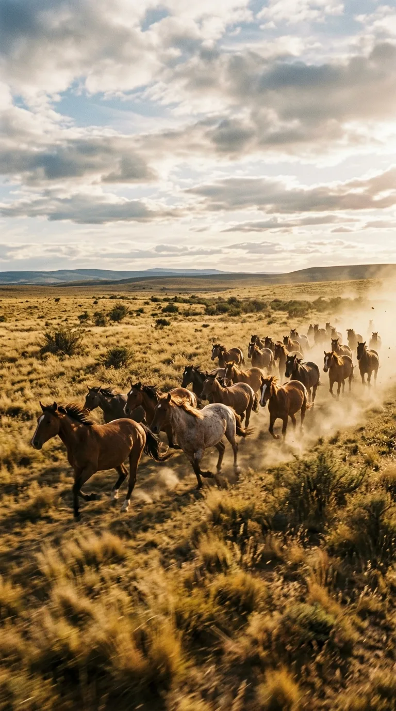
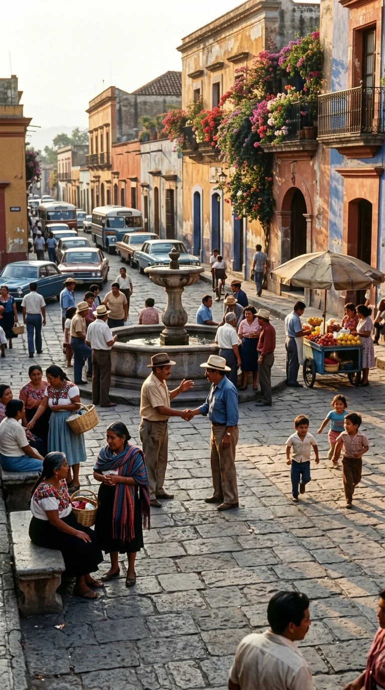
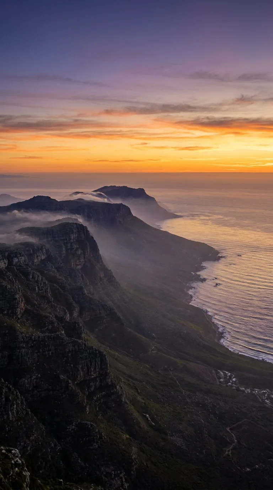

# El jardín infinito del nuevo sol: El canto inmortal a nuestra América

### Por Historia en los Acordes

*América: La inmensidad donde el sol baña las cordilleras, los ríos selváticos y las costas doradas, celebrada en el canto inmortal de Nino Bravo.*

---

### Prólogo: El asombro ante una tierra bendecida

Hay canciones que nacen para describir un amor íntimo, y hay otras, muy escasas en la historia de la música, que nacen como plegarias geográficas y espirituales. En 1973, en las vísperas de su prematura partida física, **Nino Bravo** prestó su voz colosal a una composición magistral de Pablo Herrero y José Luis Armenteros: *«América, América»*. Lejos de ser un himno político o un producto comercial al uso, la obra fue concebida como un poema épico de asombro y gratitud ante la inmensidad del Nuevo Mundo.

*Donde el primer sol baña las orillas vírgenes con la promesa de un mundo nuevo y luminoso.*

La letra no habla de banderas que dividen ni de fronteras de alambre; canta al continente como un organismo vivo, un templo natural donde los elementos recobran su pureza original. En sus versos, América es el jardín infinito donde el sol brilla con un nuevo fulgor, el aire permanece limpio de artificios y la naturaleza despliega una fuerza que empequeñece el orgullo humano.

---

### Acto I: Cumbres infinitas y ríos de memoria

El recorrido lírico se inicia en las alturas, donde la cordillera de los Andes levanta sus columnas de roca y hielo hacia un cielo nocturno libre de humo, poblado por millones de estrellas que han alumbrado a civilizaciones milenarias.

*Bajo cumbres infinitas donde el aire puro susurra secretos al firmamento.*

Desde el silencio solemne de las cumbres, el canto desciende hacia la cuenca viva del planeta: la Amazonía. Allí donde el río es hablador y el monte se hace selva impenetrable, las aguas de los grandes torrentes —el Amazonas, el Orinoco, el Paraná— avanzan como arterias de un continente que respira al ritmo del agua. La canción de Nino comprende que en esta geografía el ser humano no es amo de la creación, sino un habitante agradecido que aprende a escuchar el murmullo de los árboles y el suspiro de las corrientes.

*En el corazón verde de la tierra, donde los ríos cantan la memoria del agua.*

---

### Acto II: La nobleza de la siembra y el galope sin cadenas

Pero un continente no es solo piedra, selva y agua; es, ante todo, el alma de quienes lo habitan y lo fecundan. La poesía de la canción exalta las manos campesinas y originarias: hombres y mujeres de piel curtida por el sol que acarician la tierra con respeto casi religioso, cuidando el maíz, la papa y los frutos que alimentan a generaciones enteras.

*Manos sabias que acarician la siembra y custodian la dignidad de la raíz.*

Más al sur y hacia el interior, la mirada se abre a la inmensidad horizontal de las pampas y las grandes llanuras. En esos pastizales interminables, el viento corre con una ferocidad limpia, levantando el polvo bajo los cascos de caballos salvajes. En esa llanura sin lindes, la canción encuentra su metáfora más poderosa: América como el espacio sagrado donde el alma humana aprende que nació para ser libre, despojándose de las cadenas del pasado.

*Llanuras interminables donde el viento corre sin cadenas ni fronteras.*

---

### Acto III: El crisol del mestizaje y la sonrisa del porvenir

La riqueza de este suelo se plasma en sus pueblos y ciudades: plazas coloniales de piedra volcánica, fachadas pintadas de añil y almagre, y balcones de madera donde florece la buganvilla. En esas calles adoquinadas se produjo uno de los encuentros culturales más complejos y fecundos de la historia humana: el mestizaje de sangres, lenguas, mitos y canciones que hoy forman el rostro cálido y diverso de nuestra tierra.

*Pueblos de piedra y colores cálidos donde el mestizaje floreció en abrazo.*

En las orillas de los pueblos, en las riberas de los ríos donde los niños juegan al atardecer, la canción vislumbra su auténtico triunfo: la esperanza. A pesar de los dolores históricos, de las injusticias sufridas y de las cicatrices del tiempo, la mirada de la juventud americana conserva una luz limpia, una alegría espontánea que ninguna tormenta ha logrado apagar.

*La esperanza que renace en cada mirada joven que sueña con mañanas luminosos.*

---

### Acto IV: La hermandad bajo un mismo sol

El clímax de *«América, América»* no es individualista; es una llamada coral a la fraternidad. Cuando la voz de Nino Bravo alcanza su registro más heroico y vibrante, los versos parecen convocar a todos los pueblos que habitan desde el Río Bravo hasta la Tierra del Fuego. 

*Un mosaico de almas y pueblos que laten bajo un mismo sol fraterno.*

Es la certidumbre de que, por encima de las diferencias geográficas o las distancias kilométricas, late una misma identidad compartida: la fe en el porvenir, la calidez del abrazo fraternal y la capacidad de tender la mano al forastero como a un hermano que regresa a casa.

---

### Epílogo: El jardín donde la luz es eterna

Nino Bravo falleció pocas semanas después de dejar grabada la voz de este tema en una cinta solitaria de estudio. Nunca pudo contemplar en vida cómo millones de almas a lo largo y ancho de este continente harían suya esta melodía, cantándola en escuelas, plazas, teatros y hogares familiares como el himno no oficial de su propia tierra.

*Hay tierras bendecidas por la luz donde la libertad no es un anhelo, sino el destino eterno del alma.*

Hoy, más de medio siglo después, cuando su voz resuena en el aire proclamando que *«América es todo un inmenso jardín»*, la canción sigue cumpliendo su propósito más sagrado: recordarnos que habitamos un suelo extraordinario, fecundo y libre, donde el fuego siempre se hace amor y donde cada nuevo amanecer vuelve a traer la promesa de un mundo mejor.

---

### 📚 Fuentes y Archivo Documental

1. **Herrero, Pablo & Armenteros, José Luis**. *Partituras originales y manuscritos líricos de «América, América»*. Archivos de la Sociedad General de Autores y Editores (SGAE), Madrid, 1973.
2. **Fonogram / Polydor Records**. *Nino Bravo: ...y volumen 5* (Notas discográficas y master de grabación analógica póstuma). Madrid, septiembre de 1973.
3. **Llopis, Darío**. *Nino Bravo: La voz de la emoción*. Biografía autorizada y archivo documental de la familia Ferri Llopis, Valencia, 2013.
4. **Archivo Hemerográfico de la Biblioteca Nacional de España (BNE)**. *Crónicas del impacto de la música hispanoamericana en los años setenta y recepción transatlántica de la obra de Nino Bravo*, 1971-1974.
