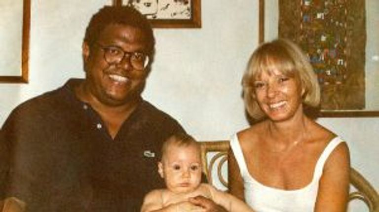
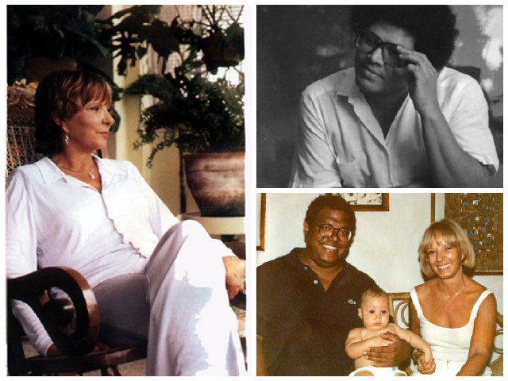
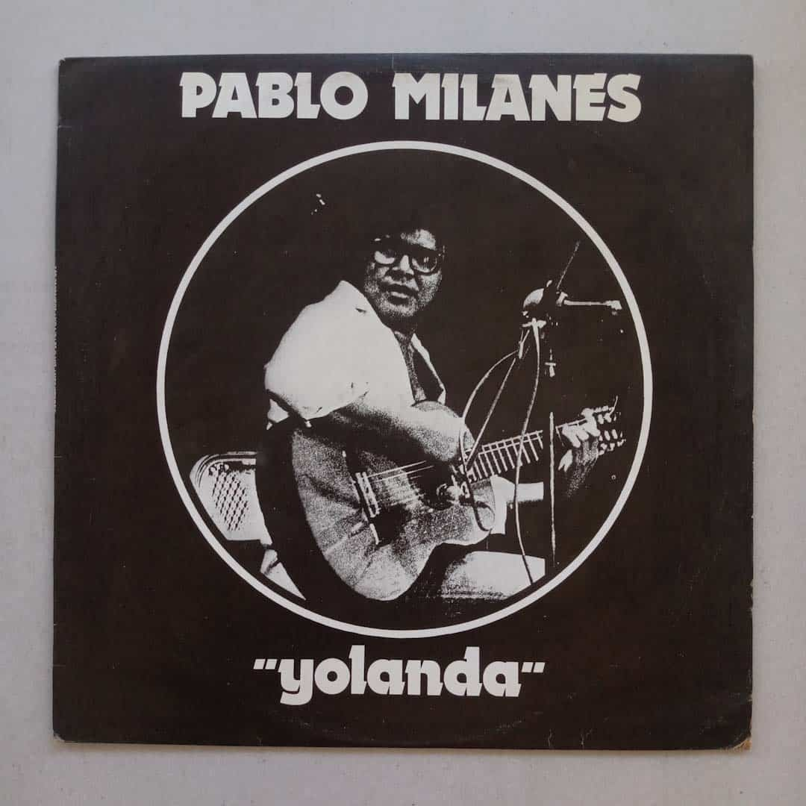
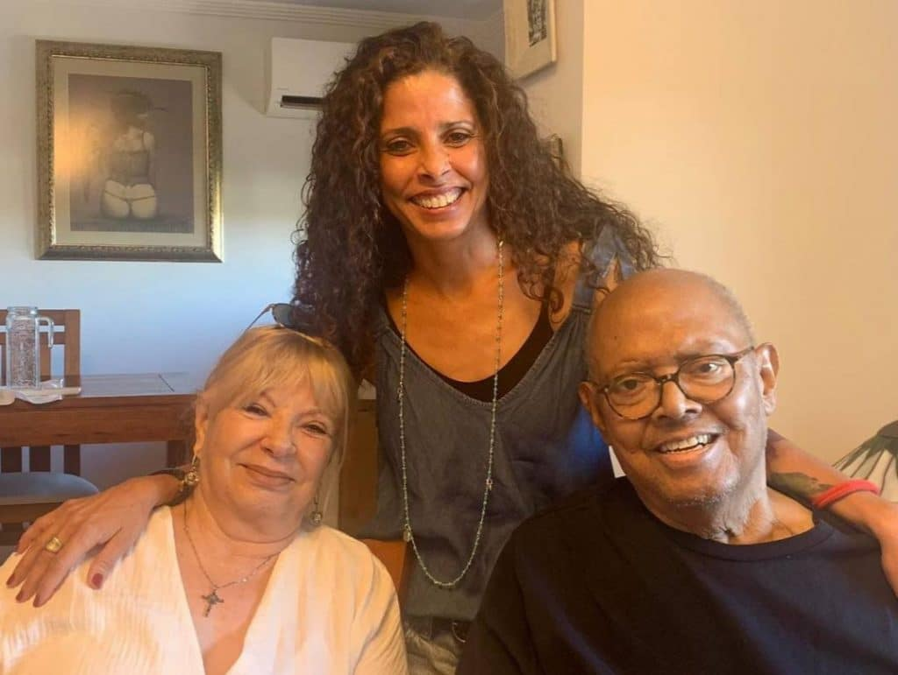

# El pacto roto de una cuna: la noche en que Pablo Milanés compuso «Yolanda»

## Prólogo: La Habana, diciembre de 1970

Hay canciones que parecen haber existido siempre, como si flotaran en el aire esperando únicamente que alguien tuviera el coraje de tender la mano y atraparlas. En la música popular en español, pocas declaraciones han alcanzado la dimensión mítica y el arraigo colectivo de «Yolanda». Se ha coreado en plazas colmadas de decenas de miles de personas, ha bendecido bodas a lo largo de tres generaciones y ha servido de consuelo nocturno en los rincones más dispares del continente.

Sin embargo, en su origen más remoto, aquella melodía no fue pensada para los grandes escenarios ni para los himnarios de la canción de autor. Nació en una modesta habitación habanera de puntales altos y persianas de madera entreabiertas, escrita a lápiz sobre un pedazo de papel de envolver cartucho, y sellada con una promesa que duró apenas unos días: *«Esta canción jamás saldrá de este cuarto»*.

---

## Acto I: Diez días de vida y una cuna desvelada

Corría la primera quincena de diciembre de 1970. En La Habana, la brisa de invierno suavizaba el calor del trópico mientras la joven pareja formada por Pablo Milanés y Yolanda Benet afrontaba el torbellino más transformador de sus vidas. Hacía exactamente diez días que había nacido Lynn, su primogénita, la primera de las tres hijas que tendrían juntos.

Yolanda, una bella joven cienfueguera de ascendencia francesa y mirada transparente que trabajaba en el Instituto Cubano del Arte e Industria Cinematográficos (ICAIC), se encontraba en casa de su madre lidiando con los primeros cólicos de la recién nacida. La pequeña Lynn no lograba conciliar el sueño, lloraba desconsolada durante horas interminables y el cansancio acumulado de la maternidad comenzaba a hacer mella en el ánimo de Yolanda.

Pablo, que por entonces tenía veintisiete años y formaba parte activa de las intensas giras y ensayos del naciente movimiento cultural de la isla, tuvo que ausentarse durante casi una semana por compromisos de trabajo en el interior del país. En la soledad de aquellos trayectos y habitaciones de hotel, la distancia y la imagen de su hogar recién inaugurado se transformaron en un torrente creativo incontenible. 

En un arrebato de inspiración, tomando el único papel que tenía a mano —un pliego rústico de papel de estraza o envolver cartucho—, Milanés compuso tres temas de un tirón: *No me pidas*, *Quiero poner la tierra a tus pies* y una tercera pieza sin título definitivo que terminaría bautizada con el nombre de su musa.

---

## Acto II: El regreso de viaje y el susurro en la madrugada

Cuando Pablo regresó a La Habana, no llegó solo. Lo acompañaba su entrañable amigo y compañero trovador Noel Nicola. Con la guitarra de cedro al hombro y los ojos encendidos por la emoción de mostrar lo que había creado, Pablo cruzó el umbral de la casa buscando a Yolanda.

Pero la realidad doméstica distaba mucho de un idilio sosegado. La pequeña Lynn atravesaba una de sus crisis de llanto más intensas. Yolanda, desvelada, pálida de cansancio y con los nervios a flor de piel, caminaba de un lado a otro meciendo a la niña sin conseguir apaciguarla. Cuando Pablo intentó balbucear que traía canciones nuevas, Yolanda apenas pudo mirarlo:

> *«Llegó con Noel Nicola y me dijo que me traía unas canciones. Pero la niña estaba llorando, no se dormía, yo estaba histérica, agotada de darle vueltas a la cuna. Le dije que en ese momento no podía escuchar nada, que no daba más del cansancio»*, recordaría años después Yolanda con una ternura intacta.

Nicola se marchó, la noche fue cayendo sobre la ciudad y, lentamente, el agotamiento rindió también a la pequeña. Entrada la madrugada, cuando el silencio se adueñó de la casona y la única luz en la penumbra provenía de una pequeña lámpara de noche, Yolanda se sentó en la cama para amamantar a la bebé. Con la niña finalmente tranquila en su regazo, miró a Pablo, que velaba a su lado, y le susurró en voz baja:

—*Pablito... ¿qué era lo que me querías cantar esta tarde?*

---

## Acto III: El borde de la cama y el pacto sagrado

Pablo se sentó con delicadeza en el borde del colchón. Apoyó la guitarra clásica en su pierna y comenzó a rasguear con las yemas de los dedos, midiendo la fuerza para no perturbar a la niña que mamaba acompasadamente.

Primero le cantó las dos primeras piezas. Pero cuando sus dedos modularon la introducción arpegiada de la tercera canción, el aire de la habitación cambió de densidad. Con una voz tibia, desnuda y cargada de una vulnerabilidad que trascendía cualquier artificio poético, Pablo comenzó a entonar:

> *«Esto no puede ser no más que una canción...  
> Quisiera fuera una declaración de amor,  
> romántica, sin caer en el olvido,  
> de una de esas que te van matando...»*

Yolanda escuchaba en silencio, sobrecogida por la franqueza brutal de los versos. Pero el impacto definitivo llegó al alcanzar el estribillo: cuando escuchó su propio nombre elevado a plegaria terrenal, las lágrimas le brotaron de manera incontrolable, corriendo por sus mejillas mientras estrechaba a la bebé contra su pecho.

Al concluir el último acorde, ambos permanecieron mudos durante largos segundos, unidos por un temblor emocional que pocas veces experimenta un ser humano. Fue en ese instante sagrado cuando sellaron su pacto:

—*Esto es tan nuestro, tan íntimo, que no puede salir de aquí. Jamás se lo cantes a nadie.*

Pablo asintió y guardó el papel cartucho en el estuche de su guitarra. Durante algunos días, el secreto permaneció a salvo bajo el techo familiar. Pero la verdadera poesía tiene la naturaleza del agua: no reconoce barreras ni prisiones.

Poco después, durante una reunión de trovadores en la que se encontraban Silvio Rodríguez, Noel Nicola y otros creadores del Grupo de Experimentación Sonora del ICAIC (GESI), la atmósfera de complicidad empujó a Pablo a romper el juramento. Tomó la guitarra y la cantó. Cuando terminó, sus compañeros se miraban entre sí enmudecidos, conmovidos hasta el asombro. El pacto se había roto para siempre: aquella canción ya no pertenecía a una alcoba habanera; acababa de nacer un himno universal.

---

## Acto IV: Un amor que sobrevivió al adiós

El matrimonio entre Pablo Milanés y Yolanda Benet concluyó civilmente en 1973, tras seis años de convivencia y tres hijas en común. En la mayoría de las historias humanas, la separación suele tender un manto de distancia, rencor o silencio sobre los testimonios del pasado. Pero lo que Pablo y Yolanda construyeron desafió todas las convenciones.

A lo largo de los siguientes cincuenta años, jamás dejaron de ser familia, confidentes y amigos entrañables. Cada vez que Pablo ofrecía un concierto y Yolanda se encontraba en la sala, el público la reconocía de inmediato y estallaba en una ovación cerrada antes de que sonaran los primeros acordes.

Cuando Pablo Milanés falleció en Madrid en noviembre de 2022, Yolanda Benet compartió una carta pública de despedida que conmovió a millones de hispanohablantes por su dignidad y nobleza:

> *«Aunque no estemos físicamente juntos, el amor que nos unió y las tres hijas maravillosas que tuvimos nos mantendrán unidos por siempre. Vuela alto, mi querido Pablo; tu música seguirá acariciando el alma de quienes aprendimos a amar contigo»*.

---

## Epílogo: El refugio de una madrugada

«Yolanda» nos recuerda que las obras maestras más perdurables de la cultura rara vez nacen de cálculos comerciales o ambiciones de grandeza. Nacen del desvelo compartido, de la fragilidad de dos seres humanos intentando calmar a su hija en medio de la noche, y de la necesidad urgente de decir *«te amo»* antes de que el mundo se despierte.

Aquel pacto roto al pie de una cuna en 1970 privó a una habitación de un secreto exclusivo, pero le regaló a la humanidad una de sus mayores certezas: que cuando el amor se canta con la verdad del alma, el tiempo no tiene poder para apagarlo.

---

### 📚 Fuentes y Archivo Documental

1. **Benet, Yolanda.** *«La verdadera historia de cómo nació Yolanda»*. Entrevista testimonial en *La Jiribilla* y archivo histórico del ICAIC, La Habana, Cuba.
2. **Milanés, Pablo.** *Antología de la Nueva Trova y cancionero fundamental*. Ediciones Unión, La Habana, 1985.
3. **Díaz Pérez, Clara.** *Pablo Milanés: con luz propia*. Editorial Oriente, Santiago de Cuba, 1994.
4. **Archivo Hemerográfico Diario Clarín.** *«Murió Pablo Milanés: la conmovedora historia detrás de "Yolanda", su obra cumbre»*. Buenos Aires, 22 de noviembre de 2022.
5. **Archivo Periodístico La Tercera.** *«"Jamás saldrá de esta habitación": el pacto y la musa detrás de Yolanda de Pablo Milanés»*. Santiago de Chile, 2022.
6. **Grupo de Experimentación Sonora del ICAIC (GESI).** *Registros sonoros y grabaciones fundacionales (1969-1974)*. Archivo Audiovisual del Cine Cubano, La Habana.
