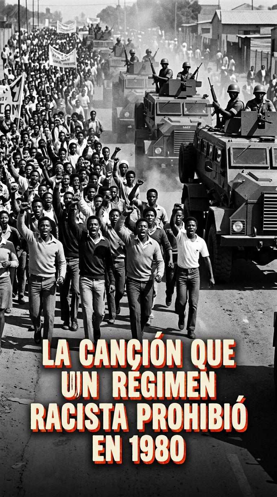
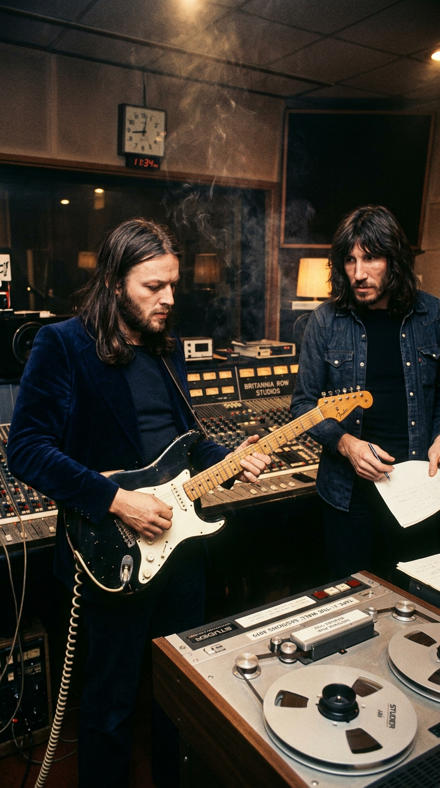
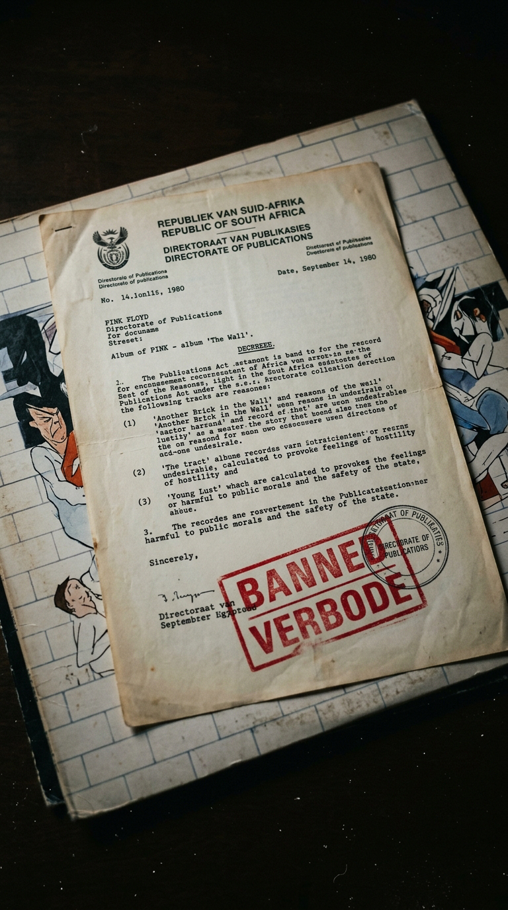
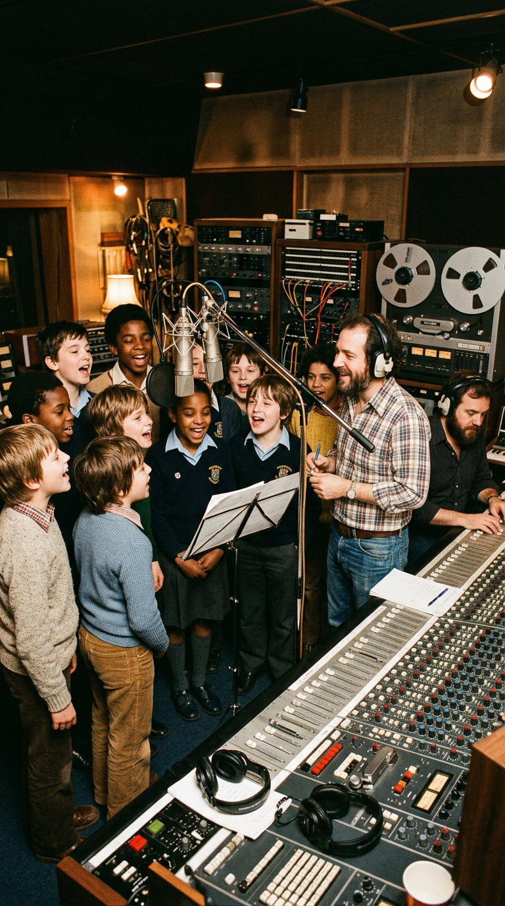
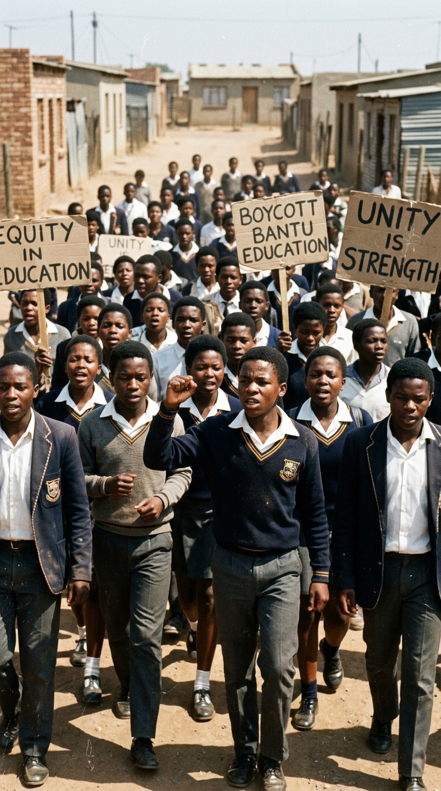
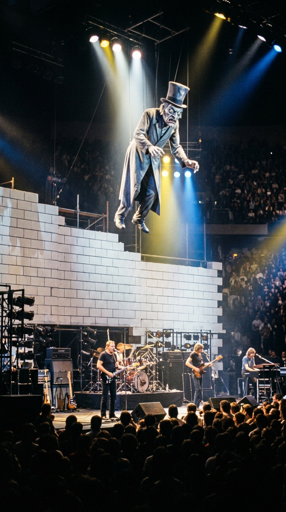

# 🧱 The Classroom Mutiny: How 23 Clandestine Kids Created the Anthem That Defied a Regime

> *“Education in post-war England wasn't about enlightening children; it was about breaking them. They hit you with wooden rulers, humiliated you in front of your peers, and taught you to stay quiet. 'Another Brick in the Wall' wasn't a rebellion against knowledge: it was a war cry against tyrants dressed up as teachers.”*  
> — **Roger Waters**, on the autobiographical roots of *The Wall*, London, 1979.

---

*Britannia Row Studios, London, 1979: The unusual sonic conspiracy where a danceable rhythmic pulse, a 1955 Gibson Les Paul, and a choir of schoolchildren without official permission gave birth to Pink Floyd's only number-one hit.*

---

### Prologue: The Scars of Cambridge and the Wound of Chalk

In the late **1970s**, Great Britain was crumbling amidst garbage collectors' strikes, industrial blackouts, and a winter of discontent that buried the final ashes of sixties optimism. Locked inside **Britannia Row** studios in the working-class neighborhood of Islington, north London, **Roger Waters** wasn't looking at the present; he was staring into the shadows of his own childhood.

Remaining intact in his memory were the echoes of the *Cambridgeshire High School for Boys* from the late 1940s and early 1950s. There, a caste of authoritarian teachers—hardened by the unresolved traumas of World War II and armed with ash-wood canes—practiced a pedagogy rooted in punitive sarcasm and the systematic demolition of individuality. For Waters—whose father, Eric Fletcher Waters, had died at the Anzio beachhead in 1944 when Roger was barely a five-month-old infant—the figure of male authority had always been tied to imposition, coldness, and punishment.

*Britannia Row Studios, 1979: Waters and Gilmour analyze the master tapes of a concept album conceived as a collective exorcism against alienation.*

Within the monumental conceptual tapestry of *The Wall*, the school was not a mere anecdotal setting: it was the second great row of bricks that the protagonist, Pink, erected to isolate himself from a hostile world. Yet, in the summer of 1979, the track destined to portray that school trauma—tentatively titled *"Another Brick in the Wall (Part 2)"*—was on the verge of being discarded or relegated to a minor interlude. 

It lasted scarcely **one minute and twenty seconds**. It had a single acoustic verse, a sparse chorus, and a monotonous tempo that the band considered a simple transition between songs. It was then that a foreign producer, hired to mediate the stormy internal relations of the group, decided to shatter the sacred conventions of progressive rock.

---

### Act I: The Four-on-the-Floor Beat and Bob Ezrin's Strategy

The young Canadian producer **Bob Ezrin**—renowned for his work with Alice Cooper, Lou Reed, and KISS—arrived in London with a titanic mission: to transform Roger Waters' forty disorganized and somber demos into a double album capable of competing on commercial charts without losing its conceptual edge.

Upon listening to the preliminary demo of *"Part 2"*, Ezrin immediately sensed that beneath that funereal cadence beat a volcanic potential. But to release it, he proposed a radical twist: accelerate the tempo to **100 beats per minute** and incorporate the danceable pulse of the **4/4 four-on-the-floor beat**, inspired by the *disco-funk* sound ruling dance floors with Nile Rodgers’ band Chic.

> *“When I told the band we needed to drop in a danceable rhythm section, David Gilmour looked at me like I’d lost my mind,”* Bob Ezrin would recall years later. *“He told me: ‘That’s not Pink Floyd! We don’t make disco music.’ I told him disco rhythm wasn’t the end, but rather the Trojan horse to get the message deep into the youth.”*

*The Britannia Row control room: Adjusting compressors and equalizers to fuse Waters' pulsing bass with an unprecedented rhythmic cadence for the band.*

Ezrin convinced David Gilmour to visit the *Embassy* nightclub in Mayfair one night to hear how disco production sounded on a high-fidelity sound system. Gilmour returned to the studio convinced by the physical punch of the low frequencies and agreed to build an unrelenting rhythm section: drummer Nick Mason locked in a metronomic tempo, and Waters tracked an elastic, tense bassline on his Fender Precision.

Even so, the structure remained minuscule. Ezrin insisted:  
*—Roger, this track needs two full verses and two choruses. It can't end in a minute.*  
*—I am not writing any more lyrics!* —Waters shot back sharply.— *The song says exactly what it needs to say.*  
*—Fine* —Ezrin replied with strategic calm.— *If you won't sing the second verse, I'll have a children's choir sing it.*

Waters left the room, convinced the idea was a fleeting whim that would never materialize.

---

### Act II: The Clandestine Mission: 23 Schoolchildren in Britannia Row

With the band members absent, Bob Ezrin called British sound engineer **Nick Griffiths** and entrusted him with a specific task:  
*“I need a school choir with a north London accent. I don’t want vocal academy kids or refined church-lyric voices. I want authentic, state-school kids who sound defiant, rebellious, and real.”*

Griffiths walked across Essex Road and entered the neighboring **Islington Green School**, a state secondary school known for its multi-ethnic, working-class student body. There he sought out **Alun Renshaw**, a young, charismatic, and unorthodox music teacher who preferred teaching his students popular and pop songs rather than conforming to the official syllabus's rigid classical repertoire.

*Britannia Row, October 1979: Alun Renshaw gathers his class in front of Neumann microphones, recording verse by verse behind the school administration's back.*

The proposal was as tempting as it was risky. The headmistress, Margaret Maden, was a strict and traditional figure who never would have authorized her students to skip class to collaborate on a rock band's production. Renshaw made a bold decision: he used the lunch break to escort **twenty-three pupils aged thirteen to fifteen** in small groups into Britannia Row studios, less than 500 meters from the schoolyard.

For forty minutes of intense focus, Griffiths placed Neumann U87 condenser microphones before the kids. The lyrics, scrawled on a blackboard in chalk, defied all rules of English grammar with their famous double negative:

> *“We don't need no education...*  
> *We don't need no thought control...*  
> *No dark sarcasm in the classroom...*  
> *Teachers, leave them kids alone!”*

The children didn't need to fake it. Those words condensed the genuine weariness accumulated over years of reprimands, mandatory uniforms, and rigid discipline. They sang with visceral force, rolling their vowels with the rough, natural accent of north London.

When the schoolchildren returned to their classrooms before the end-of-recess bell rang, Griffiths remained alone in the control room. He used a classic overdubbing technique: he copied the vocal track of the twenty-three children and duplicated it on the multi-track recorder, shifting each layer by milliseconds with EMT plate reverb. The sonic result was colossal: the twenty-three students had multiplied to sound like a **unanimous army marching against authoritarianism**.

---

### Act III: The Goldtop Solo and the Chart Shock

When Roger Waters and David Gilmour returned to the studio and Ezrin slid the console faders up to play back the combined tape, the room fell completely silent.

Waters listened to the track carefully and nodded to the producer:  
*“Damn it, Bob... this works to perfection.”*

The collective voice of the children not only doubled the song's duration; it lent a choral dimension to Waters' pain, transforming a biographical grievance into a universal manifesto of student dignity.

Only the instrumental closer was missing. This time, Gilmour did not reach for his usual black Fender Stratocaster. To imbue the track with a denser, warmer, and more piercing tone, he used a **1955 Gibson Les Paul Goldtop** equipped with P-90 pickups. He plugged the guitar straight into the recording console via direct injection (DI) and routed it simultaneously to an amplifier in the room to generate a slight harmonic feedback.

*The melodic climax: Gilmour improvises in barely two full takes one of the most acclaimed and fluid solos in electric guitar history.*

In barely two full takes, Gilmour sculpted one of the instrument's crowning achievements: a melodic, blues-infused, rhythmically flawless solo that answered the children's cries with serene and liberating elegance.

Released as a single on **November 23, 1979**—Pink Floyd's first 45 RPM release in Britain since 1968—*"Another Brick in the Wall (Part 2)"* sparked an immediate social shockwave. It sold **over a million copies in three weeks** in the UK alone, captured the coveted 1979 Christmas number one, hit the peak of the *Billboard Hot 100* in the United States in March 1980, and topped charts across Germany, France, Spain, Australia, and Canada.

Yet success brought institutional backlash.

British tabloids accused the song of promoting juvenile insubordination. Conservative Prime Minister **Margaret Thatcher** expressed her displeasure with the lyrics, while Mary Whitehouse criticized the BBC for airing it. The Inner London Education Authority (*ILEA*) opened an official inquiry and barred Islington Green School students from giving press interviews or performing on the iconic television program *Top of the Pops*. Consequently, teacher Alun Renshaw was denied promotions at the school, and the students initially received nothing more than a copy of the album and concert tickets as symbolic recognition.

However, the song's true political reach would not happen on British television sets, but thousands of miles from London, beneath the oppressive climate of the southern tip of the African continent.

---

### Act IV: South Africa, 1980: The Anthem Against Apartheid Tanks

In early **1980**, the Republic of South Africa lived under the segregationist regime of **Apartheid**. The Black and mixed-race population was subjected to the *Bantu Education Act*, an educational framework designed by the Afrikaner state to limit non-white students to manual and subordinate labor, confining them to substandard schools lacking library resources or basic living conditions.

In April 1980, high school students in **Elsies River**, near Cape Town, called a widespread student strike to protest racial disparities and classroom conditions. The boycott quickly spread to the townships of Johannesburg, Soweto, and Durban.

*Cape Town, April 1980: Students defy a state of siege, chanting the Pink Floyd chorus as a banner of peaceful resistance.*

Thousands of young South Africans marched unarmed through dusty streets. Instead of traditional slogans, they began chanting in unison the refrain they had heard on cassette tapes smuggled covertly into the country:

> *“We don't need no education! We don't need no thought control!”*

For South African students, those verses were not an abstract metaphor about stern teachers in Victorian classrooms; they were a direct indictment of the white state's racial indoctrination and the usurpation of their future. The song rose as the anthem of the largest school mobilization in the country since the 1976 Soweto uprisings.

Alarmed by the unifying power of the popular chant, Pieter Willem Botha's government reacted administratively. On **May 2, 1980**, the Publications Control Board of South Africa issued an official resolution in the *Government Gazette* under the *Publications Act of 1974*: *"Another Brick in the Wall (Part 2)"* was declared **banned from sale, broadcast, and public possession**.

*The stamp of censorship: The Apartheid regime swiftly bans the sale, broadcast, and possession of the track on South African soil.*

The order carried the confiscation of vinyl records in shops and criminal penalties for any broadcaster playing its measures. Government prohibition, however, only intensified the track's circulation. Activists and students duplicated contraband cassette tapes that passed from hand to hand in neighborhood assemblies. The harder security forces tried to suppress the protests, the louder the youths' voices rang out in the ghettos. Official censorship turned a progressive rock track into an international emblem of resistance against institutional racism.

---

### Epilogue: The Wall That Fell from Within

More than four decades after that afternoon in Islington, the relevance of *"Another Brick in the Wall (Part 2)"* remains intact in the collective memory.

In **2004**, intellectual property specialist Peter Rowan scoured the archives of Islington Green School and tracked down the former schoolchildren who had recorded the tracks in 1979. Through the British performance rights organization PAMRA, the former students—many of them working in teaching, nursing, or technical trades—secured recognition of their performance rights and payment of royalties accrued from their historic participation for the first time.

*The live spectacle: The colossal scenic wall erected during Pink Floyd's performances, prior to its final collapse at every concert.*

History confirmed an inescapable reality: authoritarian bureaucrats, censors, and pedagogical models based on humiliation ultimately dissolve in time, but the echo of those 23 children's voices before Britannia Row's microphones remains alive.

It proved that no regime and no censorship possess the strength required to build a wall that silences the aspiration of dignity when carried forward by the truth of an immortal song.

---

### 💬 The Question for Our Community

*“Another Brick in the Wall”* proved that music can burst past its creators' initial intent and transform into the voice of a community thousands of miles away.

**What memories does the first time you heard the children's choir and David Gilmour's solo bring back to you? Do you consider that modern education has overcome "thought control," or do invisible walls still persist in modern classrooms?**

*We read your thoughts in the comments of our weekly publication.*

---

### 📚 Sources and Archival Records

1. **Mason, Nick** (2004). *Inside Out: A Personal History of Pink Floyd*. Chronicle Books, San Francisco. Official band chronicle regarding Bob Ezrin's intervention, the Britannia Row sessions, and the incorporation of the 4/4 beat into the album's conception.
2. **Blake, Mark** (2008). *Comfortably Numb: The Inside Story of Pink Floyd*. Da Capo Press, Boston. Documentary research on the clandestine session with the Islington Green School choir, Alun Renshaw's testimony, and Margaret Maden's institutional reaction.
3. **Ezrin, Bob** (1993, 2009). *Technical interviews in Guitar World and Sound on Sound* regarding the pre-production of *The Wall*, 24-track editing for choir overdubbing, and harmonic guidelines given to Gilmour and Mason.
4. **Fitch, Vernon & Mahon, Richard** (2006). *Comfortably Numb: A History of 'The Wall' (1978–1981)*. PFA Publishing. Detailed analysis of analog recordings, 45 RPM release dates, and royalty resolutions.
5. **Government Gazette of South Africa** (May 2, 1980). *Publications Act of 1974: Proscription of 'Another Brick in the Wall (Part 2)' by the Publications Control Board* (Notice No. 892/80), Pretoria.
6. **Inner London Education Authority (ILEA)** (1979–1980). *Minutes of the Education Committee: Inquiry into Islington Green School's Unauthorized Commercial Participation*. City of London Historical Archive.
7. **BBC News Archives** (November 27, 2004). *Pink Floyd choir pupils seek royalties*. Journalistic coverage of the legal proceedings led by Peter Rowan and PAMRA on behalf of the 23 alumni.