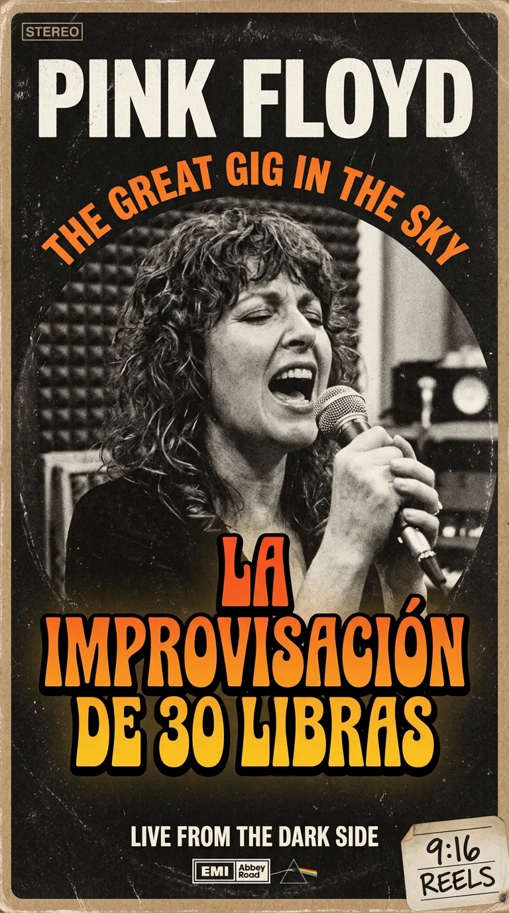
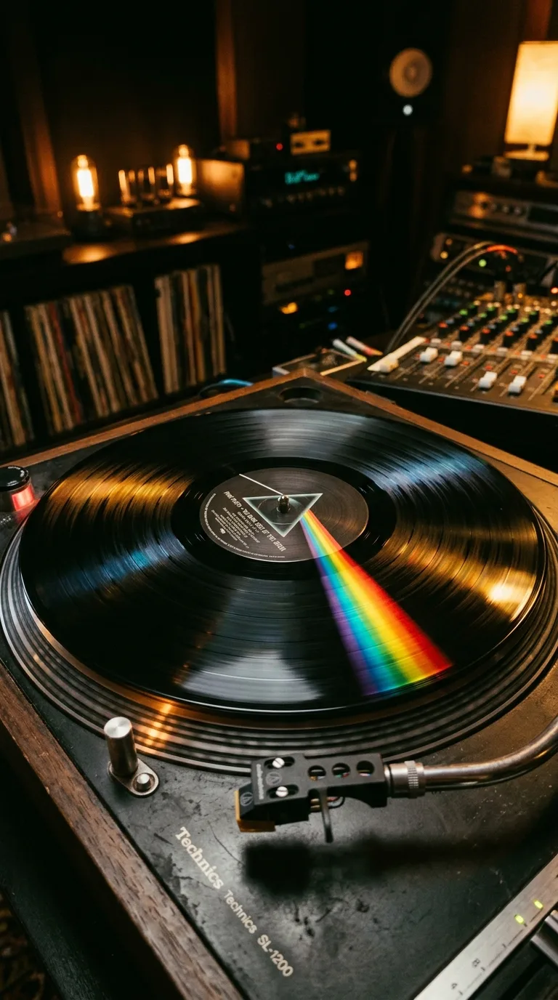
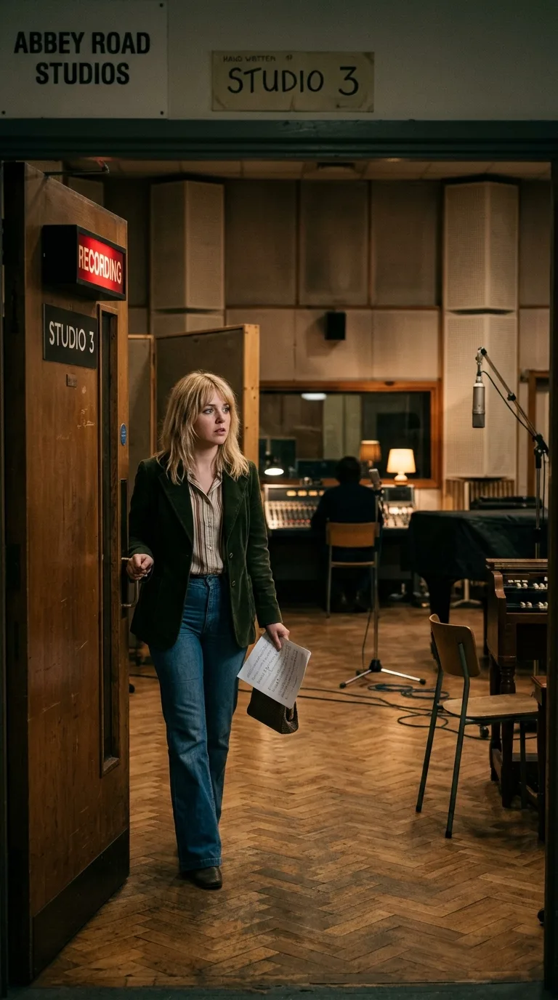
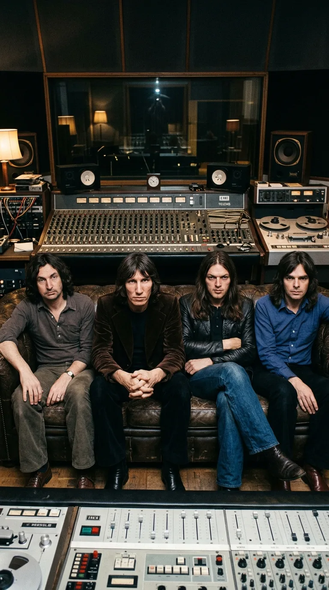
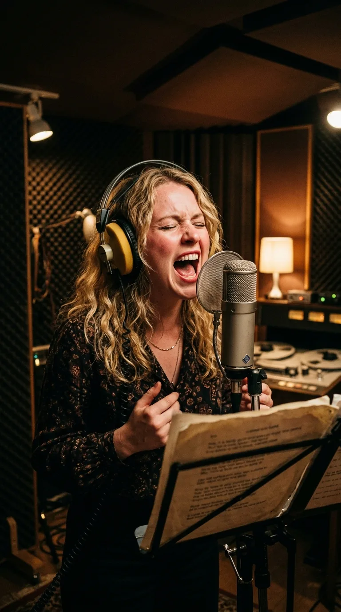
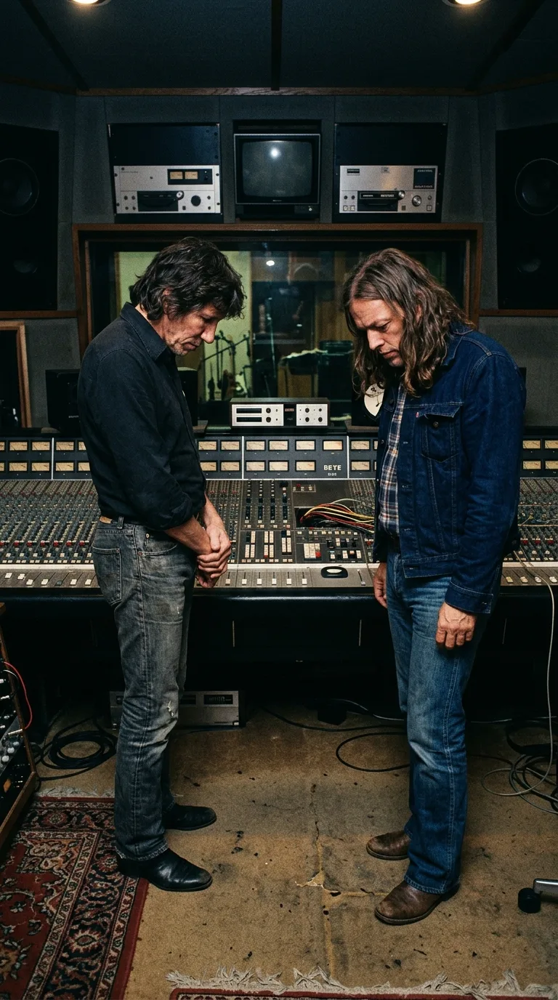
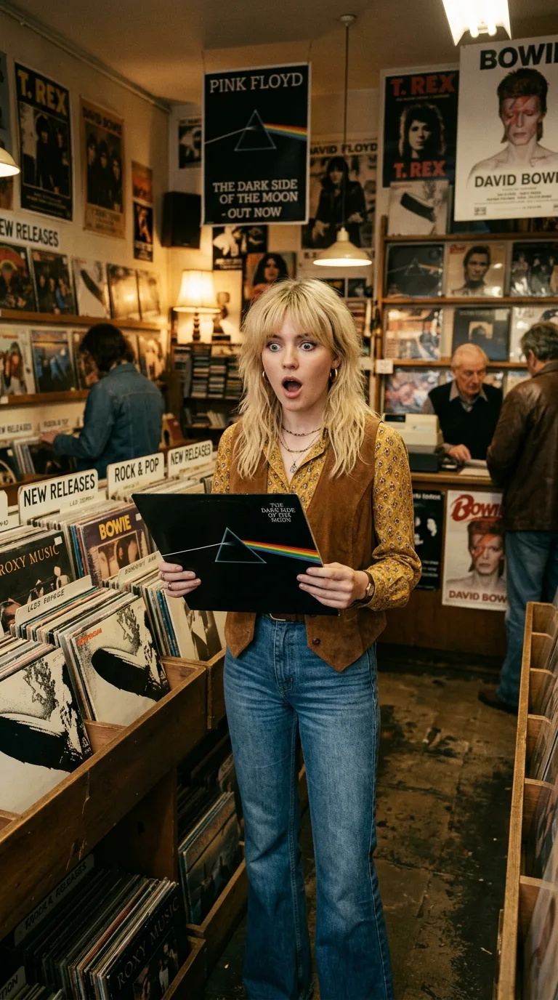
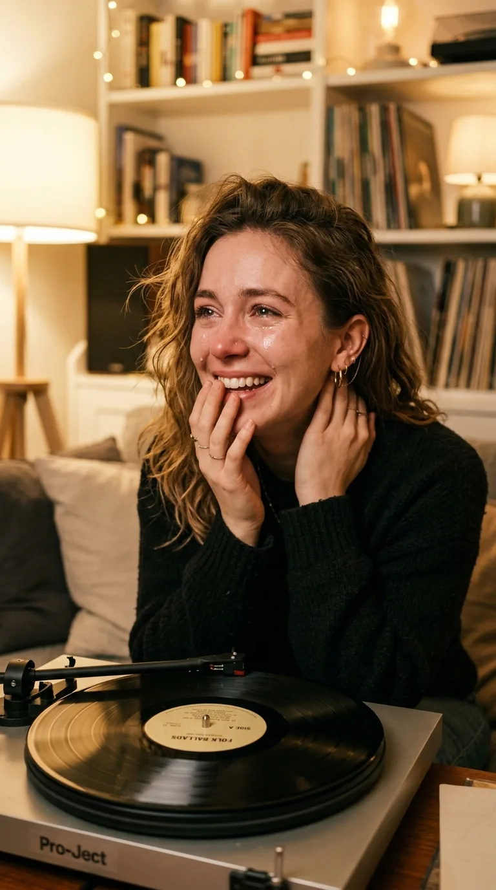

# 🎹 The Thirty-Pound Lament: The Afternoon a Wordless Voice Defied Death

### *The afternoon a twenty-five-year-old girl collected a Sunday union rate at Abbey Road, feared she had made a fool of herself in front of Pink Floyd, and walked out offering apologies—unaware that her improvised lament would become rock's greatest secular requiem.*

---

**By the Secret Chords Editorial Staff**  
*Estimated reading time: 11 minutes*

> *«And I am not frightened of dying... Any time will do, I don't mind. Why should I be frightened of dying? There's no reason for it, you've gotta go sometime...»*  
> — **Gerry O'Driscoll**, Abbey Road Studios doorman (*The Dark Side of the Moon*, 1973)

---

### Prologue: Saturday's Plans and Sunday's Call

Over the weekend of **January 20 and 21, 1973**, music weighed heavily on **Clare Torry**'s mind, but recording studios were the furthest thing from it. At twenty-five, with a solid melodic training and a trade forged in commercial jingles, television themes, and low-budget records, the young London vocalist had an unmovable commitment for Saturday night: tickets to see her idol, the legendary rock and roll pioneer **Chuck Berry**, live in concert.

So when her home phone rang that Saturday with an urgent invitation to a session at the mythical **Abbey Road** studios, her response was immediate and categorical: she couldn't go. She had plans. Classic rock by Chuck Berry in the flesh came first.

*Abbey Road Studios, London, 1973: The session where a 25-year-old singer transformed a piano chord progression into contemporary music's most harrowing vocal elegy.*

On the other end of the line was Dennis, EMI’s booking and payments manager at Abbey Road. Following the enthusiastic recommendation of a young, intuitive sound engineer named **Alan Parsons**—who had been struck by Clare’s power and vocal timbre during previous pop sessions—Dennis insisted. The band recording there wasn't just any commercial orchestra; it was **Pink Floyd**, Britain's most avant-garde progressive rock quartet. They were putting the finishing touches on an ambitious conceptual masterwork and desperately needed a female voice for a piece they simply couldn't nail down.

They agreed to reschedule for the following afternoon. On Sunday, **January 21**, between seven and ten at night, Clare would drop by Studio 3 at Abbey Road. It would be a short job, paid at the standard **Musicians' Union** rate: **thirty pounds sterling**, double the standard fee because it was a Sunday evening. Once the work was done, Clare planned to head out for a quiet dinner with her boyfriend.

It never crossed her mind that this casual winter Sunday assignment, priced at the cost of a modest dinner, would end up etching her breath and her soul into the heart of the 20th century's most legendary album.

---

### Milestone I: The Score of Mortality and the Wordless Abyss

At the dawn of 1973, David Gilmour, Roger Waters, Richard Wright, and Nick Mason were in the home stretch of giving birth to ***The Dark Side of the Moon***. The album had been conceived as an unrelenting fresco on the invisible forces that besiege and wear down human sanity: the destructive march of time (*"Time"*), material greed (*"Money"*), the violence of war (*"Us and Them"*), and the madness that had claimed their former spiritual leader, **Syd Barrett** (*"Brain Damage"*).

Yet right at the equator of the vinyl's first side, an instrumental piece remained suspended in an unsettling limbo.

*Hipgnosis's iconic design: A sonic meditation on the fragility of existence that demanded a harrowing human dimension.*

The composition had sprung from **Richard Wright**'s harmonic sensibility. During their 1972 tour, the band had performed it under working titles like *"The Mortality Sequence"* or *"The Religion Song"*.[^1] It was a solemn, emotive progression built on the piano between B minor and F major, draped in the enveloping textures of a Hammond organ and the aerial lament of David Gilmour's pedal steel guitar.

To give it context during live shows, Roger Waters used to interweave tape loops of sermons by journalist Malcolm Muggeridge and biblical readings from the First Epistle to the Corinthians. But inside the Abbey Road control room, the band felt that device sounded pedagogical, cold, and distant. Death needed no homilies or religious litanies; death was a mute mystery, a biological crossroads that left words disarmed.

David Gilmour was certain: they needed a human voice. But they didn't want written lyrics. The moment a singer began articulating words about the grave, the coffin, or the afterlife, the music would sink into cliché and cheap melodrama. They wanted a voice that would not utter a single intelligible syllable, yet would make the deepest fibers of the chest vibrate.

That was when Alan Parsons remembered that young woman with the elastic, blues-soaked voice he had met weeks earlier.

---

### Milestone II: The Studio 3 Chesterfield Sofa and the Microphone Challenge

At seven o'clock that Sunday evening, Clare Torry arrived at St. John's Wood tube station, walked a few blocks through the freezing London air, and pushed open the doors of Abbey Road's Studio 3.

*St. John's Wood, January 21, 1973: Clare Torry steps into the bowels of Abbey Road, unaware of what awaited her.*

Entering the control room, the atmosphere she encountered deeply unsettled her. Seated on a worn dark-leather Chesterfield sofa in front of the majestic **EMI TG12345** analog console, all four members of Pink Floyd sat nearly motionless. There were no welcoming smiles or casual small talk; only a cold, analytical, and distant British courtesy. They looked exhausted after months of creative confinement.

*Abbey Road control room: Waters, Gilmour, Wright, and Mason listening in silence to the session's first sketches.*

They played the backing track for Clare to hear. Richard Wright told her the song was tentatively titled *"The Great Gig in the Sky"*. Clare listened carefully to the piano chord progression, expecting to be handed a folder with sheet music or a sheet of handwritten lyrics:

—*"Where are the lyrics? What am I supposed to sing?"* she asked with professional ease.  
—*"There are no lyrics,"* David Gilmour replied from the sofa. *"We don't want words. Just go into the booth and do whatever you feel."*

Clare was dumbfounded. For a singer accustomed to the discipline of commercial arrangements, where every bar, harmony, and consonant was meticulously mapped out on a music stand, that absolute freedom sounded like a death trap.

She walked toward the isolated booth. Towering before her was an imposing **Neumann U87** condenser microphone guarded by a pop screen. She adjusted her headphones over her ears and, through the thick glass of the fishbowl, watched Parsons adjust the pots as the red recording light flickered on.

The first chords began to roll through her cans. Clare tried emitting some conventional scat singing (*"Oh, yeah, baby..."*), but she stopped instantly, feeling it sounded ridiculous, vulgar, and entirely out of place against the solemnity of that piano.

In that second of inner silence, she made a decision that would alter the history of contemporary music:

> *«I realized I couldn't sing it like an ordinary pop singer. I had to pretend I wasn't a person; I had to think of my own voice as a musical instrument—a blues lead guitar tearing through the night or a brass section weeping in the shadows. I told myself: 'Close your eyes, let the chords carry you, and don't be afraid to strip bare.'»*

---

### Milestone III: The Lament in the Booth and the Apology Before Leaving

She took a deep breath. In her headphones played Wright's piano introduction, Nick Mason's muffled drum pulse, and, floating in the gloom, the voice of Abbey Road's Irish doorman, Gerry O'Driscoll: *"And I am not frightened of dying... any time will do, I don't mind. Why should I be frightened of dying? There's no reason for it, you've gotta go sometime"*.

When the sequence majestically modulated into F major, Clare Torry opened her mouth and let the gale loose.

*Studio 3 Booth: The intuitive, wordless tearing that immortalized an unknown singer.*

What came out of her throat was no exercise in vocal technique; it was a visceral deflagration, a lament both primitive and sacred. Her voice started in a middle register tinted with autumnal sadness, only to climb in a heartbreaking portamento toward the highest notes of her range. Without using a single consonant, playing solely with open vowels and throat-breaks, she modulated the intensity of human agony: she roared with the force of a wounded lioness in passages where the drums swelled in drama, and descended to tremulous, brittle whispers when Wright's piano sought the repose of resignation.

In the control room, the mood shifted entirely. Alan Parsons kept wide-eyed watch on the analog VU meters of the mixing console to prevent the colossal power of the highs from saturating the two-inch tape. Beside him, David Gilmour and Roger Waters sat nailed to their seats, looking at one another in silence, overwhelmed by an intensity they never could have imagined for that track.

*Abbey Road control room: Gilmour and Waters taking in the emotional impact of the live vocal.*

The tape reached its end and the echoes of the reverb dissolved in the booth. Clare opened her eyes, breathing lightly from the physical exertion. Through the control room glass, no one was clapping. No one gave a thumbs-up. The musicians remained seated on the sofa, completely motionless and silent.

The singer, raised in the rigidity of period pop standards, interpreted that sepulchral silence as an unequivocal sign of failure and embarrassment. She figured she had screamed like a lunatic, ruined the piano track, and that the band was horrified.

She pushed open the booth door, took off her headphones, and, blushing, approached the controls with apologetic embarrassment:

—*"I'm so sorry. I'm afraid I completely overdid it... It sounded way too screechy, didn't it? I can try another take, much softer and more reined-in."*

David Gilmour thanked her for her commitment and asked her to lay down a second take, looking for complementary nuances and different modulations. They even tried recording a fragment of a third track, but Clare stopped after a few bars: her voice was beginning to tire and she felt she was repeating herself mechanically.

The session was over. Clare Torry signed the **Musicians' Union** sheet, tucked the check for **thirty pounds**—the double rate for a Sunday night—into her bag, said a cordial goodbye to those four silent lads, and left Abbey Road. Half an hour later, she was having dinner with her partner at a London restaurant, telling him between laughs that she had been screaming in a booth for a bunch of strange longhairs and was absolutely certain they would wipe her recording to drop in a guitar solo or string arrangement.

---

### Milestone IV: The Prism in the King's Road Shop Window

Weeks passed, and winter yielded to spring. In March 1973, ***The Dark Side of the Moon*** was officially released by Harvest Records in Britain and Capitol Records in the United States.

Wrapped in the revolutionary design of the art collective **Hipgnosis**—that prism refracting a white ray into a hypnotic rainbow over an absolute black background, illustrated by George Hardie—the album became an instant cultural phenomenon. Radio stations constantly spun its tracks, and music store windows across the country turned black and lit with refractions.

One sunny April day, Clare Torry was strolling nonchalantly down **King's Road**, in the bohemian heart of Chelsea. As she passed a crowded record shop, an immense promotional poster for Pink Floyd caught her eye in the window.

*London, Spring 1973: Clare Torry on King's Road discovering the album in a music shop window.*

She felt a spark of curiosity. That was the band she had recorded with three months ago. She stepped inside, browsed the new releases bin, picked up a sealed copy of the vinyl, and flipped it over to check the back cover.

Her eyes scanned the track titles until they stopped at track five on side one:

> **5. The Great Gig in the Sky (Wright)**  
> *Vocal: Clare Torry.*

A chill ran down her spine. Her name was printed right there!

She pulled cash from her pocket and bought the album with her own money like any anonymous customer. She walked briskly to her apartment, tore off the plastic wrap, and placed the virgin vinyl onto her turntable platter. She dropped the needle with trembling fingers.

*The family living room in 1973: The shock of a young woman realizing her Sunday improvisation was now immortal.*

She heard the foundational heartbeat of *"Speak to Me"*, the weightlessness of *"Breathe"*, the technological vertigo of *"On the Run"*, the deafening burst of the clocks in *"Time"*... and suddenly, the solemn, warm chords of Richard Wright's piano.

In the machine room, Alan Parsons and David Gilmour had pulled off a masterstroke of sonic goldsmithing: far from discarding her work, they had taken the finest phrases from **Take 1** and interwoven them with sublime passages from **Take 2**, constructing a continuous vocal performance of devastating beauty. Halfway through the piece emerged the ethereal whisper of **Patricia "Puddie" Watts**: *"I never said I was frightened of dying"*.

And above it all, her own voice soared like a fiery comet, singing face-to-face with eternity.

Clare Torry collapsed to her living room carpet, moved by a mixture of awe, relief, and staggering disbelief. That Sunday session she had feared ruining was actually the emotional pinnacle of the record—a torn, luminous lament belonging neither to Pink Floyd nor to her alone, but to all of humanity facing the enigma of the final farewell.

---

### Epilogue: The Judgment of Justice and Shared Eternity

For over three decades, the world enjoyed *"The Great Gig in the Sky"* as a creation credited solely to Richard Wright, while Clare Torry remained listed in the fine print merely as a guest performer. The sole financial compensation for one of the most celebrated, widely played, and revered vocal performances in rock history remained those thirty pounds collected in 1973.

Yet in **2004**, Clare decided history needed to be written with absolute justice. Backed by rigorous musicological analysis, she filed a formal lawsuit in the **High Court of Justice in London** claiming co-authorship rights to the work.

The argument of her claim was irrefutable: the foundation Richard Wright handed her at Abbey Road was an instrumental piano harmonic progression; the vocal melody, the dramatic dynamics, the interval leaps, and the emotional architecture that turned that track into an imperishable legend **had been composed and created by herself in the act of improvising before the microphone**.

In April **2005**, both parties reached a definitive, confidential out-of-court settlement.[^2] From that historic date forward, all worldwide reissues, vinyl pressings, CDs, and streaming platforms permanently corrected the song's credits:

> 🎼 **"The Great Gig in the Sky" — Composed by Richard Wright and Clare Torry.**

Richard Wright, who passed away in September 2008, always acknowledged with nobility and gallantry that the piece never would have reached mythical status without the stripped-down, courageous devotion of that girl who walked into his studio on a Sunday afternoon ready to sing without words.

Today, more than half a century after that freezing evening at Abbey Road, when Clare Torry's celestial shriek tears through the silence on loudspeakers in any corner of the planet, no one listens merely to a studio exercise anymore: we hear dazzling proof that when human language fails to explain the mystery of death, the barefoot soul is still capable of inventing its own eternity.

---

### 💬 A Question for Our Community

The universal transcendence of *"The Great Gig in the Sky"* lies in its purity: by stripping song of words and dogma, every listener projects into that lament their own grief, their own wound, or their own hope for redemption.

**What did you feel the very first time you heard Clare Torry's voice on this track? What moment in your life does this lament transport you to every time it plays again?**

*We're reading your comments on our weekly publication.*

---

### 📚 Sources and Archival Records

1. **Abbey Road Studios Archive.** *The Dark Side of the Moon Studio Documents & Recording Logs*. Studio 3 console logs and session sheets (January 21, 1973), Alan Parsons tape logs, and Musicians' Union documents.
2. **Harris, John.** *The Dark Side of the Moon: The Making of the Pink Floyd Masterpiece*. Da Capo Press, 2006. Detailed reconstruction of recording sessions and in-depth testimonial interviews with Clare Torry, David Gilmour, and Alan Parsons.
3. **Blake, Mark.** *Comfortably Numb: The Inside Story of Pink Floyd*. Da Capo Press, Cambridge (MA), 2008. Chapters dedicated to the evolution of *The Mortality Sequence* and the incorporation of non-verbal vocals.
4. **Mason, Nick.** *Inside Out: A Personal History of Pink Floyd*. Chronicle Books / Weidenfeld & Nicolson, London, 2004. Official memoirs by the drummer detailing the Sunday audition and mixing process.
5. **Torry, Clare.** Biographical statements and documentary interviews in *The Word Magazine* (2005), BBC Radio 2 (*Classic Albums Special: The Dark Side of the Moon*), and *Pink Floyd: The Making of The Dark Side of the Moon* (Classic Albums, Isis Productions / Eagle Rock Entertainment, 2003).
6. **Tyler, Kieron.** *The Dark Side of the Moon: Clare Torry's Great Gig in the Sky*. The Arts Desk, 2013 (Musicological analysis of Torry's career, the 1973 session, and the Wright/Torry co-authorship settlement).
7. **Harvest Records / EMI Records Ltd.** Production sheets and original pressings of *The Dark Side of the Moon* (Catalog SHVL 804, March 1973; credits updated to Wright/Torry from 2005 onward by Pink Floyd Music Ltd / Sony Music).

---

[^1]: *The Dark Side of the Moon: The Making of the Pink Floyd Masterpiece* (John Harris, Da Capo Press, 2006).
[^2]: *The Arts Desk*, Kieron Tyler, analysis on Clare Torry's co-authorship settlement, 2013.