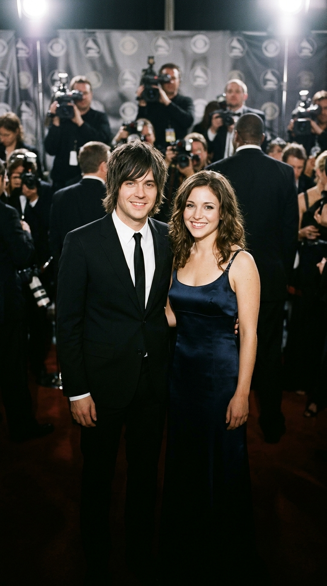

# La canción de amor más famosa que nació de una mentira

**Por el equipo editorial de Acordes Ocultos**

---

> *«Hey there, Delilah, I know times are gettin’ hard / But just believe me, girl, some day I’ll pay the bills with this guitar / We’ll have it good, we’ll have the life we knew we would / My word is good...»*

Hay canciones que se instalan para siempre en la memoria colectiva vestidas con el ropaje de la ternura más pura. Durante casi dos décadas, millones de parejas en todo el mundo bailaron ***«Hey There Delilah»*** en graduaciones, bodas y despedidas, abrazándose con los ojos cerrados ante la promesa acústica de aquel joven que juraba cruzar mil millas de distancia para pagar las facturas con su guitarra y construir una vida perfecta.

Sin embargo, detrás de aquella melodía íntima de cuatro acordes se esconde una de las paradojas más fascinantes y agridulces de la historia del pop moderno: la mujer que inspiró el himno jamás estuvo enamorada de él, tenía una pareja formal desde el primer minuto y nunca compartió ni un solo beso con el cantante. Lo que el planeta entero creyó que era un testimonio de devoción mutua fue, en realidad, el fruto de una fantasía unilateral nacida tras una noche de calabazas.

---

## Prólogo: Una cocina en Chicago y una frase temeraria

Para entender el origen de esta historia hay que retroceder al otoño de **2002**, en un modesto apartamento de Chicago. Por aquel entonces, **Tom Higgenson** tenía veintitrés años y lideraba una banda de rock alternativo llamada **Plain White T’s**. Llevaban años recorriendo garitos de mala muerte en una furgoneta desvencijada, durmiendo en suelos ajenos y acumulando deudas mientras soñaban con un contrato discográfico que no terminaba de llegar.

Aquella noche, un amigo común presentó a Tom a una joven de diecinueve años que pasaba unos días en la ciudad: **Delilah DiCrescenzo**.

Delilah no formaba parte del circuito nocturno del rock independiente. Era una brillante estudiante de la prestigiosa **Universidad de Columbia** en Nueva York y una atleta de élite dedicada a las pruebas de medio fondo y obstáculos (*steeplechase*). Su presencia irradiaba una disciplina y una serenidad que cautivaron a Higgenson de inmediato.

Desesperado por llamar su atención en medio del bullicio de la fiesta, Tom intentó una maniobra clásica de coquetería descarada:
—*«Ya tengo una canción escrita sobre ti»* —le soltó mirándola fijamente.

Delilah, con una sonrisa entre divertida y desconfiada, arqueó una ceja:
—*«Eso es imposible, si acabamos de conocernos»*.
—*«Bueno, todavía no la he escrito, pero lo haré»* —prometió él.

La réplica de la muchacha fue tan educada como demoledora: le agradeció el halago, pero le dejó las cosas perfectamente claras. Tenía novio desde hacía tiempo, estaba profundamente enamorada de él y su vida entera estaba en Nueva York, consagrada a sus estudios y a sus entrenamientos olímpicos. Entre ellos solo podía existir una amistad cordial.

---

## Acto I: La promesa en la libreta amarilla

Cualquier muchacho ordinario se habría marchado a casa con el orgullo magullado a rumiar el rechazo. Pero Tom Higgenson era un compositor y, para un creador sensible, una negativa honesta puede ser un combustible más potente que una correspondencia tibia.

Al regresar a su habitación, Tom se sentó al borde de su colchón deshecho con su guitarra acústica. No sentía rencor ni despecho; sentía una extraña admiración por la firmeza de aquella chica que no se había dejado deslumbrar por el cliché del músico bohemio. En lugar de componer una queja amarga, decidió imaginar lo inimaginable: construyó en su mente una realidad paralela en la que Delilah y él mantenían un noviazgo a distancia entre Chicago y Nueva York.

En un bloc de notas amarillo comenzaron a brotar los versos:

> *«Hey there, Delilah, what’s it like in New York City? / I’m a thousand miles away, but girl, tonight you look so pretty, yes you do...»*

Y, en medio de la estrofa, deslizó la confesión más desgarradora y honesta de su precaria juventud:

> *«I know times are gettin’ hard, but just believe me, girl, some day I’ll pay the bills with this guitar...»*

Tom no le estaba prometiendo castillos ni lujos, porque no tenía ni para pagar el alquiler de la semana siguiente. Le estaba ofreciendo su única posesión en el mundo: su talento y una palabra de honor empeñada al aire.

Apenas terminó la canción, le grabó una maqueta rústica en un casete y se la envió por correo a Nueva York. Delilah escuchó aquel tema en su habitación del campus de Columbia, sonrió ante la ternura del gesto, pero mantuvo la línea infranqueable: le agradeció la gentileza y continuó su vida al lado de su pareja.

---

## Acto II: La balada durmiente y el estallido tardío

Durante años, *«Hey There Delilah»* parecía destinada a ser una simple anécdota privada. Plain White T’s la incluyó en su tercer álbum de estudio, *All That We Needed* (2005), como una pista acústica casi testimonial entre guitarras distorsionadas de pop-punk. La discográfica ni siquiera contempló lanzarla como sencillo; las radios comerciales de la época no tenían tiempo para baladas a una sola voz y guitarra de palo.

Pero la música tiene caminos invisibles. A finales de **2006**, una pequeña emisora universitaria del Medio Oeste comenzó a pinchar la canción de forma insistente. Los oyentes empezaron a llamar en masa preguntando quién era aquella chica y por qué aquella melodía sonaba tan desarmantemente sincera.

El sello discográfico, abrumado por la demanda en descargas digitales, decidió reempacar el tema en el EP *Hey There Delilah* y relanzarlo en el verano de **2007** con un sutil arreglo de cuerdas grabado por Eric Remschneider.

Lo que vino después fue un terremoto cultural:
* La canción escaló imparable hasta alcanzar el **número uno del Billboard Hot 100** en Estados Unidos.
* Coronó las listas oficiales en Alemania, Canadá y el Reino Unido, vendiendo más de cuatro millones de copias digitales.
* Fue nominada a **Canción del Año** y **Mejor Interpretación Pop** en los premios Grammy.

De la noche a la mañana, la voz de Tom Higgenson resonaba en cada supermercado, cafetería, emisora de radio y reproductor MP3 del planeta. Y, con ella, el nombre de una atleta universitaria que jamás había pedido ser el centro del universo.

---

## Acto III: El acoso del teléfono y la alfombra de los Grammy

Para **Delilah DiCrescenzo**, el fenómeno no fue una bendición mágica, sino un vendaval desconcertante. Mientras se preparaba intensamente para clasificar a los ensayos olímpicos de Estados Unidos en los 3.000 metros con obstáculos, su vida privada quedó pulverizada.

Periodistas de *USA Today*, de la cadena *ESPN* y reporteros de prensa rosa comenzaron a rastrear su matrícula y a llamar a las cabinas y teléfonos de su dormitorio universitario. Sus compañeras de equipo le gritaban la letra en los entrenamientos; extraños en la calle la abordaban para preguntarle si ella era *«la Delilah del tema»* y por qué hacía sufrir a aquel pobre muchacho de la guitarra.

> *«No tenía nada que ocultar, pero era muy extraño»*, recordaría años más tarde Delilah en una entrevista para el *Columbia Spectator*. *«La canción era hermosa, pero yo siempre fui honesta con Tom. Tenía a mi novio y nunca hubo la más mínima ambigüedad entre nosotros»*.

El clímax de esta singular historia ocurrió en febrero de **2008**, con motivo de la 50.ª edición de los premios Grammy en Los Ángeles. Al verse nominado junto a leyendas de la industria, Tom Higgenson descolgó el teléfono y la llamó con un ruego respetuoso: quería que ella fuera su acompañante oficial en la alfombra roja.

Delilah no tomó la decisión sola. Sentó a su novio —el mismo muchacho con el que salía cuando conoció a Tom en aquella cocina de 2002— y le consultó la situación con total madurez. Su pareja, comprendiendo la naturaleza histórica del momento y confiando plenamente en ella, le dio su bendición:
—*«Es una locura que pasa una vez en la vida. Ve y disfruta de la fiesta»*.

Aquella noche, los fotógrafos de todo el mundo vieron desfilar a Tom Higgenson con un impecable esmoquin negro del brazo de una bellísima joven de vestido de gala. Todos los titulares creyeron presenciar el triunfo definitivo del amor romántico. Solo ellos dos sabían la verdad: estaban allí como dos viejos amigos celebrando el milagro de una canción que había escapado al control de sus creadores.

---

## Epílogo: El consuelo de una mentira hermosa

Aquel muchacho que en 2002 no tenía un centavo en el bolsillo cumplió con creces la frase central de su estribillo: pagó todas sus facturas con aquella guitarra y aseguró el futuro financiero de su vida y de su banda. Sin embargo, nunca pudo comprar el desenlace que su imaginación había dibujado sobre el papel.

En una entrevista posterior, un reportero le preguntó a Tom si no le dolía cantar cada noche una declaración de amor a una mujer que nunca le perteneció. Higgenson se encogió de hombros con una sonrisa limpia, mezcla de ironía y melancolía:
—*«Nunca pasó nada entre nosotros. Es un poco triste, sí, pero es la historia de mi vida. Al menos nos dio una gran canción»*.

Quizá la grandeza perdurable de *«Hey There Delilah»* resida precisamente en eso. En que el arte tiene el poder soberano de inventar los amores que la realidad nos niega, regalándonos un refugio donde, al menos durante cuatro minutos, dos personas pueden amarse a mil millas de distancia sin que el mundo real se interponga en el camino.

---

### 💬 Conversación con la comunidad

¿Conocías la verdadera historia detrás de *«Hey There Delilah»*? ¿Cambia en algo tu forma de escuchar la canción al saber que nació de una fantasía unilateral tras un rechazo sincero? Te leemos con mucha atención en los comentarios.

---

### 📚 Fuentes y Archivo Documental

1. **DiCrescenzo, Delilah**: Entrevistas testimoniales publicadas en *USA Today* (*«Hey there, Delilah: The real girl behind the hit song»*, 2007) y *The Columbia Daily Spectator* (2007-2008).
2. **Higgenson, Tom**: Declaraciones sobre el proceso de composición y el encuentro original en *Rolling Stone* y *American Songwriter* (2007-2011).
3. **ESPN Track & Field Archives**: Perfil biográfico y deportivo de Delilah DiCrescenzo durante su etapa competitiva en Columbia University y en las pruebas de clasificación olímpica (2008-2012).
4. **Recording Academy / GRAMMY.com**: Registros oficiales de nominaciones de la 50.ª Entrega Anual de los Premios Grammy (2008), categorías *Song of the Year* y *Best Pop Performance by a Duo or Group with Vocals*.
5. **Billboard Charts Archive**: Trayectoria comercial del sencillo *Hey There Delilah* en el Billboard Hot 100 y listas de descargas digitales de Nielsen SoundScan (julio-agosto de 2007).
