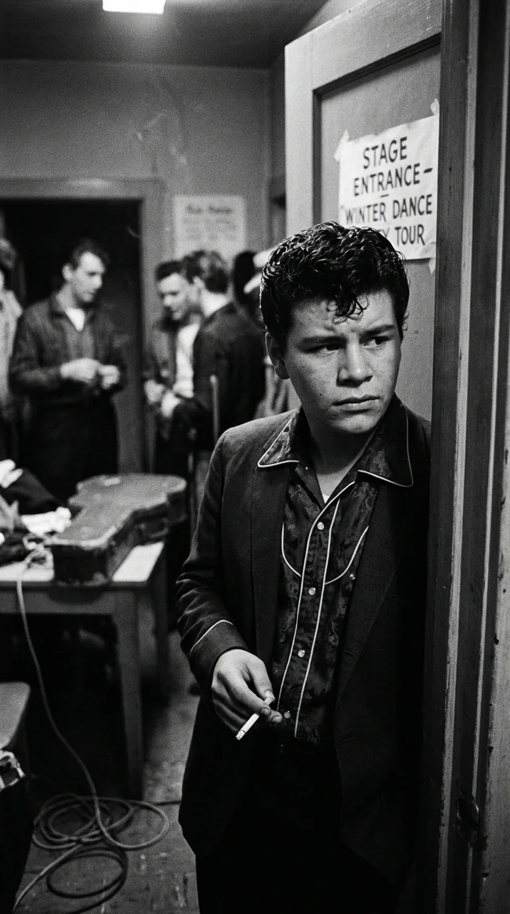
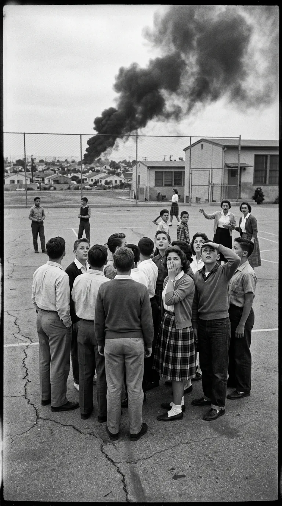
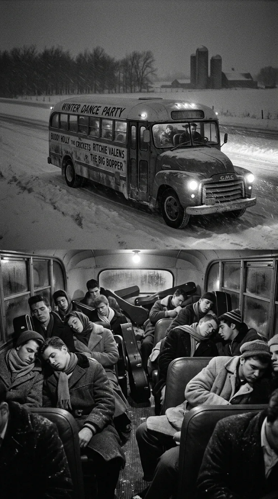
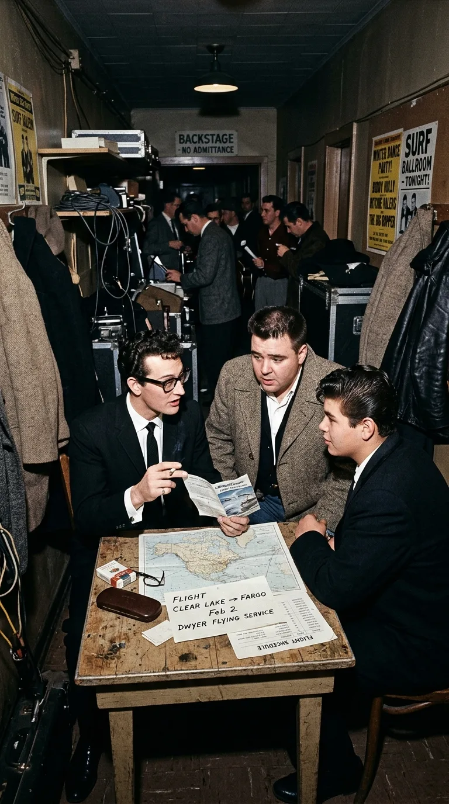
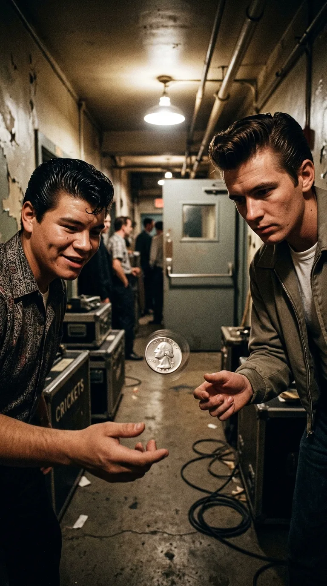
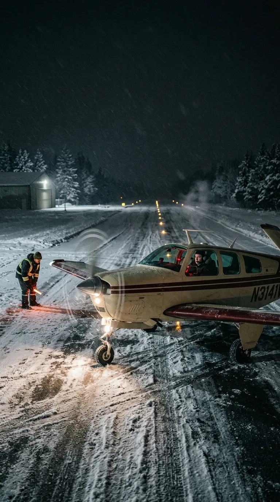
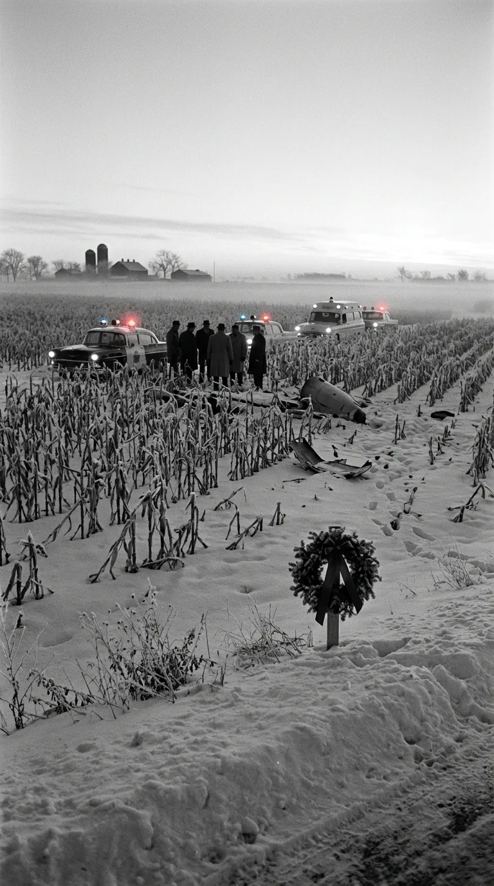

### *Tenía 17 años, pánico visceral a los aviones desde la infancia y una guitarra prestada con la que convirtió un viejo son de Veracruz en el primer terremoto en español del rock and roll. Cómo el invierno más despiadado del Medio Oeste y un volado de 50 centavos sellaron el vuelo de Ritchie Valens hacia la eternidad.*

---

**Por la redacción de Acordes Ocultos**  
*Tiempo de lectura estimado: 11 minutos*

> *«Para bailar la bamba se necesita una poca de gracia...  
> una poca de gracia pa' mí, pa' ti, ay arriba y arriba...  
> Yo no soy marinero, por ti seré, por ti seré».*  
> — **Ritchie Valens** (*La Bamba*, 1958)

---

### Prólogo: La sombra sobre el patio de recreo

El miedo al cielo no era para Richard Steven Valenzuela una metáfora literaria ni una superstición de camerino. Era una cicatriz física y psicológica grabada a fuego en la memoria de un niño de Pacoima, en el extremo norte del Valle de San Fernando, California.

El mediodía del 31 de enero de 1957, un caza militar Northrop F-89J Scorpion colisionó en pleno vuelo contra un avión de transporte de pasajeros Douglas DC-7 a miles de metros sobre el valle. La colisión desintegró las estructuras en una nube de metralla y queroseno ardiendo. Los restos retorcidos cayeron en picada directamente sobre el patio de juegos de la escuela secundaria *Pacoima Junior High School*, donde cientos de alumnos almorzaban bajo el sol de invierno. Tres estudiantes murieron aplastados por los fragmentos del fuselaje y más de setenta resultaron gravemente heridos por las llamas y el impacto.

Richard no estuvo allí ese mediodía únicamente porque se encontraba a kilómetros de distancia asistiendo al funeral de su abuelo materno. Pero al volver y contemplar la tierra quemada, las sirenas aún humeantes y las ausencias definitivas de sus compañeros de pupitre, el cielo se transformó para él en una amenaza despiadada. Desde aquella tarde de 1957, el muchacho de quince años desarrolló un pánico crónico y paralizante a volar: sufría pesadillas recurrentes donde aviones envueltos en fuego caían sobre su cabeza y juró a su madre, doña Concepción «Connie» Reyes, que jamás pondría un pie dentro de un aeroplano mientras pudiera evitarlo.

<small>Richard Valenzuela en los camerinos de California, 1958. Bajo la sonrisa tímida de un muchacho de diecisiete años latía una energía escénica volcánica que desarmaba a las audiencias.</small>

Para un chico mexicano-estadounidense de barrio obrero que limpiaba chatarra y recolectaba fruta con su padre, la tierra firme era el único suelo seguro. Lo que nadie sospechaba en los confines polvorientos de Pacoima era que aquel mismo adolescente, empuñando una vieja guitarra acústica a la que había remendado las cuerdas con alambre fino, estaba a punto de romper en pedazos la barrera del idioma en la música mundial.

---

### Acto I: El alquimista de Pacoima y el secreto de Veracruz

Richard creció en una casa modesta donde convivían dos universos sonoros en apariencia irreconciliables. Por las mañanas, la radio de transistores de su madre desgranaba huapangos, mariachis y sones jarochos que conectaban a la familia con sus raíces en México; por las tardes, los tocadiscos portátiles de sus primos disparaban el pulso frenético de Little Richard, Bo Diddley y los pioneros del rhythm and blues afroamericano.

Autodidacta obstinado, zurdo que aprendió a tocar como diestro porque no había guitarras para zurdos a su alcance, Richard asimilaba cada acorde con una intuición sobrenatural. En 1957 se unió a una banda local llamada *The Silhouettes*. Cuando el vocalista principal abandonó el grupo a mitad de una tocada en un salón comunitario, Richard dio un paso al frente, tomó el micrófono y soltó una improvisación tan salvaje que el público enloqueció. El rumor comenzó a correr por los clubes juveniles de Los Ángeles: en Pacoima había un muchacho capaz de incendiar el escenario con solo tres notas.

En mayo de 1958, el cazatalentos y productor **Bob Keane**, propietario del diminuto sello independiente **Del-Fi Records**, acudió a una matiné sabatina en el *American Legion Hall* de Pacoima tras recibir el soplo de un empleado de una imprenta local. Lo que Keane vio sobre las tablas de madera lo dejó petrificado: un quinceañero de sonrisa ancha y mandíbula noble que dominaba la guitarra eléctrica como si fuera una prolongación de su sistema nervioso, desprendiendo una calidez magnética que contagiaba a toda la sala.

<small>El patio de Pacoima Junior High School tras la caída del fuselaje en enero de 1957. El acontecimiento marcó para siempre la psique de Ritchie Valens con una aerofobia insuperable.</small>

Keane lo citó de inmediato en su casa de Silver Lake para una audición privada con una grabadora de cinta Ampex y, días después, cruzaron las puertas de los míticos **Gold Star Studios** en Santa Monica Boulevard. 

Allí operaron dos transformaciones cruciales. La primera fue de identidad: para evitar que las estaciones de radio conservadoras del sur profundo y la costa este marginaran sus discos por prejuicio racial, y para impedir que el público lo confundiera con Ricky Nelson, Bob Keane abrevió su nombre: Richard Valenzuela se convirtió en **Ritchie Valens**.

La segunda fue un acto de audacia cultural sin precedentes. Ritchie grabó una balada tierna y desgarradora dedicada a su novia de secundaria, Donna Ludwig (*«Donna»*), pero en el reverso del acetato quiso incluir un capricho personal: un tema folclórico veracruzano que sus tíos solían cantar en las bodas familiares, una pieza tradicional del siglo XVIII llamada **«La Bamba»**.

Ritchie sentía dudas profundas. En casa se hablaba un inglés cotidiano de segunda generación y su dominio del español no era perfecto; temía que la comunidad hispana interpretara su versión como una falta de respeto hacia un tesoro folclórico sagrado. Pero Bob Keane y el guitarrista y arreglista afroamericano **René Hall** vieron el diamante en bruto. 

En los estudios Gold Star, con **Earl Palmer** martilleando una batería implacable, la legendaria **Carol Kaye** en la guitarra rítmica de madera y René Hall disparando un bajo de seis cuerdas Danelectro que dibujaba un riff sincopado inolvidable, Ritchie soltó la voz. No imitó el canto tradicional de son jarocho: lo desnudó, le inyectó adrenalina pura de rock and roll y cantó en un español enérgico, callejero y luminoso.

El sencillo *Donna / La Bamba* salió al mercado a finales de 1958. *Donna* escaló hasta el número 2 del *Billboard Hot 100*, pero fue *La Bamba* la que detonó una onda expansiva continental: por primera vez en la historia de la industria discográfica estadounidense, una canción interpretada enteramente en español conquistaba las emisoras anglosajonas de costa a costa, convirtiendo a un muchacho mexicano de diecisiete años en la mayor revelación juvenil del país.

---

### Acto II: El infierno helado del *Winter Dance Party*

El éxito fue tan vertiginoso como asfixiante. En enero de 1959, Ritchie fue reclutado para formar parte de una de las giras más ambiciosas y desquiciadas jamás diseñadas por la industria del entretenimiento: el **Winter Dance Party**.

El cartel era un sueño de juventud: **Buddy Holly**, recién separado de The Crickets y encabezando la gira con su nueva alineación; **J.P. Richardson**, el gigante radiofónico conocido como **«The Big Bopper»**, cuyo tema *Chantilly Lace* hacía furor en todo el país; y el propio Ritchie Valens, la joven promesa que apenas comenzaba a saborear la gloria.

Pero si el cartel era brillante, la logística fue una pesadilla inhumana. Los promotores organizaron una ruta demencial de veinticuatro conciertos en tres semanas a lo largo de Wisconsin, Minnesota y Iowa en pleno corazón del invierno boreal. Las ciudades elegidas no seguían una línea geográfica coherente: los músicos eran obligados a realizar trayectos nocturnos en zigzag de más de cuatrocientas millas diarias atravesando tormentas de nieve sin descanso para dormir en hoteles.

<small>El viejo autobús escolar del *Winter Dance Party* cruzando las carreteras nevadas del Medio Oeste a 30 grados bajo cero. La calefacción averiada convirtió el trayecto en un calvario de congelamiento.</small>

El transporte asignado fue un viejo autobús escolar reconvertido cuya calefacción colapsaba noche tras noche. En el exterior, las temperaturas se desplomaban hasta los treinta y cinco grados bajo cero (-35 °C). En el interior del vehículo, el vaho de la respiración de los artistas se congelaba en el techo, goteando escarcha sólida sobre sus abrigos. No había comida caliente ni ropa seca. El baterista de Buddy Holly, **Carl Bunch**, sufrió una congelación tan severa en los pies que tuvo que ser hospitalizado de urgencia en Michigan, obligando a Ritchie Valens y a Holly a turnarse en la batería durante las presentaciones siguientes.

Para Ritchie, el calvario era doble. Con solo diecisiete años, lejos de su familia en California y desacostumbrado al gélido invierno del norte, el muchacho arrastraba una gripe persistente y un agotamiento que le hacía temblar las manos. Cada noche, al subir a aquel autobús frigorífico, los recuerdos del cielo de Pacoima y el terror a viajar por aire eran lo único que lo mantenían atado a la tierra firme.

---

### Acto III: Clear Lake y el volado del destino

La noche del lunes **2 de febrero de 1959**, la caravana de músicos llegó exhausta a la pequeña localidad de Clear Lake, Iowa, para una fecha improvisada que ni siquiera figuraba en el calendario original: un concierto en el **Surf Ballroom**, un salón de baile junto a un lago helado con capacidad para más de mil personas.

A pesar del cansancio demoledor, los artistas ofrecieron una actuación memorable. Más de mil doscientos adolescentes de las granjas cercanas abarrotaron la pista de parqué pulido mientras Ritchie encendía el salón con *La Bamba* y Buddy Holly electrificaba a la multitud con su Fender Stratocaster.

Sin embargo, tras bambalinas, la desesperación había llegado a un límite insostenible. El itinerario marcaba que la siguiente parada era Moorhead, Minnesota, a casi quinientos kilómetros al noroeste. Sabiendo que el autobús no resistiría otra jornada sin averiarse y que llegarían congelados y sin tiempo de lavar la ropa sucia antes del concierto del martes, Buddy Holly tomó una decisión ejecutiva: fletar una pequeña aeronave para viajar de inmediato esa misma noche.

<small>Los bastidores del Surf Ballroom en Clear Lake la noche del 2 de febrero de 1959. Entre el cansancio y la nieve, los músicos intentaban escapar de las enfermedades de la carretera.</small>

Holly se puso en contacto con la compañía *Dwyer Flying Service* en el aeropuerto municipal de Mason City y contrató un monomotor **Beechcraft Bonanza 35** de cuatro plazas (matrícula N3794N) por una tarifa de treinta y seis dólares por asiento. Al frente de los mandos estaría un joven piloto comercial de veintiún años llamado **Roger Peterson**.

La aeronave disponía únicamente de cuatro plazas: una para el piloto y tres para los pasajeros. Uno de los asientos pertenecía naturalmente a Buddy Holly. Los otros dos debían ser ocupados por sus músicos de apoyo, el bajista **Waylon Jennings** y el guitarrista **Tommy Allsup**.

Fue entonces cuando los hilos del destino comenzaron a cruzarse en una danza trágica de lealtades y azares.

J.P. Richardson, el «Big Bopper», ardía en fiebre por una gripe fulminante. Con su físico corpulento de más de cien kilos comprimido en el frío del autobús, se acercó a Waylon Jennings y le rogó que le cediera su asiento en el avión para poder dormir en una cama tibia en Moorhead y consultar a un médico. Jennings, con una nobleza que lo acompañaría como un fantasma el resto de sus días, aceptó viajar en el autobús y le entregó su lugar.

Al enterarse del intercambio, Buddy Holly bromeó con su compañero texano:  
—*«¡Espero que tu viejo autobús congelado se rompa otra vez!»*  
A lo que Jennings respondió con una carcajada involuntaria:  
—*«¡Pues yo espero que tu maldito avión se estrelle!»*  
Aquel intercambio casual de vestuario perseguiría a Waylon Jennings en sus memorias como una herida que jamás cerró del todo.

Pero quedaba un asiento en disputa: el de **Tommy Allsup**.

Ritchie Valens, debilitado por la fiebre y el catarro, observó los preparativos del vuelo. La perspectiva de pasar diez horas sentado en un cajón de metal congelado a través de las llanuras desiertas de Iowa y Minnesota venció momentáneamente a su fobia ancestral. Se acercó a Allsup en el estrecho camerino del Surf Ballroom y le pidió que le vendiera el boleto.

Allsup se negó inicialmente: él también estaba cansado y deseaba llegar a Fargo para descansar. Ritchie insistió una y otra vez con la terquedad limpia de la adolescencia:  
—*«Vamos, Tommy, juégatelo conmigo. Un volado».*

<small>Recreación del histórico momento en que Tommy Allsup y Ritchie Valens lanzaron una moneda al aire en los pasillos del Surf Ballroom para definir el último asiento del vuelo.</small>

Allsup sacó de su bolsillo una moneda de cincuenta centavos de dólar. En medio del bullicio de los operarios que desmontaban los amplificadores, la arrojó al aire sobre la palma de su mano.

—*«Cara»* —gritó Ritchie.

La moneda giró en el aire, cayó sobre el suelo y rodó hasta detenerse. Mostraba la cara.

Ritchie Valens soltó una carcajada luminosa, levantó los brazos al cielo del camerino y pronunció una frase que quedó grabada en la memoria de Tommy Allsup durante los siguientes sesenta años:  
*«It's the first time I've ever won anything in my life»* (*«Es la primera vez que gano algo en mi vida»*).

---

### Acto IV: La noche en que se apagaron los motores

Cerca de la una de la madrugada del martes **3 de febrero de 1959**, una camioneta llevó a Buddy Holly, The Big Bopper y Ritchie Valens al pequeño aeródromo de Mason City. La noche era un manto cerrado de niebla espesa, viento cortante y copos de nieve seca que azotaban las alas de aluminio.

El piloto Roger Peterson preparó el Beechcraft Bonanza. Aunque contaba con más de setecientas horas de vuelo acumuladas, apenas poseía experiencia en vuelos nocturnos gobernados exclusivamente por instrumentos (IFR). Además, el indicador de actitud (girohorizonte Sperry F3) del Bonanza utilizaba un sistema de lectura visual inverso al de los aviones de entrenamiento habituales: mostraba la posición del avión en relación con la tierra mediante una barra móvil que requería una interpretación contraria a la convencional en condiciones de visibilidad cero.

Ritchie Valens subió a la cabina con paso tembloroso, ajustándose el abrigo y sentándose detrás del piloto. La fobia infantil al cielo de Pacoima lo acompañó en cada latido; solo el consuelo de escapar de la congelación y el calor de haber ganado la moneda le permitían respirar en aquel habitáculo claustrofóbico.

<small>El Beechcraft Bonanza 35 preparándose para despegar en medio de la ventisca nocturna del aeropuerto de Mason City. Menos de cinco minutos después del despegue sobrevendría la catástrofe.</small>

A las **00:55 h**, el monomotor carreteó sobre la pista cubierta de hielo y se elevó hacia la penumbra absoluta. Desde la torre de control, el propietario de la compañía aérea, Jerry Dwyer, observó las luces traseras del avión ascender, inclinarse suavemente y luego descender lentamente en la distancia hasta desvanecerse en el horizonte blanco. Dwyer asumió que la aeronave continuaba su ascenso por debajo del límite de visión.

Nunca fue así. Apenas cinco minutos después de dejar la tierra, rodeado de una blancura cegadora (*spatial disorientation*) y sin horizonte visual de referencia, el joven piloto Peterson interpretó erróneamente los instrumentos. Creyendo que estaba ganando altitud, inclinó el morro hacia abajo.

A más de doscientos setenta kilómetros por hora (170 mph), el avión se estrelló contra un campo de maíz congelado en la granja de Albert Juhl, a unos ocho kilómetros al noroeste de Mason City. El impacto fue tan brutal que la aeronave rebotó y se deslizó cientos de metros contra una cerca de alambre de espino antes de quedar reducida a un amasijo de hierros retorcidos en la nieve.

Los cuatro ocupantes murieron de forma instantánea por politraumatismos masivos. Richard Steven Valenzuela tenía exactamente diecisiete años, ocho meses y veintiún días de vida.

---

### Epílogo: El fuego que la nieve no pudo apagar

A la mañana siguiente, cuando la policía del condado de Cerro Gordo y los equipos de rescate llegaron al campo cubierto por la ventisca, hallaron entre los restos esparcidos la guitarra de Buddy Holly, maletines rotos y la billetera de Ritchie.

La noticia sacudió al mundo entero. En Pacoima, doña Connie Reyes se enteró de la muerte de su hijo a través de un boletín urgente de radio mientras preparaba el desayuno, un golpe devastador que empujó a la industria a establecer protocolos éticos para impedir que los familiares de víctimas de accidentes aéreos se enteraran por la prensa antes que por comunicación oficial directa.

Tommy Allsup, el guitarrista que había lanzado la moneda al aire en el Surf Ballroom, vivió con el peso abrumador de aquel volado hasta su muerte en 2017. Años más tarde fundó en Fort Worth, Texas, un célebre club de música country al que bautizó con un nombre que condensaba su gratitud y su duelo eterno: *The Heads Up Saloon* (El salón de la cara ganadora).

<small>El campo congelado de Iowa al amanecer del 3 de febrero de 1959. En este suelo silencioso se apagó la vida física de Ritchie Valens y nació una leyenda imperecedera del rock mundial.</small>

En 1971, Don McLean compuso la épica balada *«American Pie»*, bautizando la tragedia para siempre como **«El día que murió la música»** (*The Day the Music Died*). Pero la música no murió en aquel campo de maíz helado.

Lo que murió aquella madrugada fue la fragilidad de cuatro cuerpos jóvenes atrapados por el invierno. Lo que quedó para siempre flotando sobre la tierra fue la victoria imperecedera de un muchacho de barrio que, en apenas ocho meses de carrera profesional y sin cumplir la mayoría de edad, abrió las puertas del mundo anglosajón a la lengua española y demostró que una melodía popular nacida en las costas de Veracruz podía hacer bailar al planeta entero con el mismo pulso frenético de la libertad.

---

### 📚 Fuentes y Archivo Documental

1. **Civil Aeronautics Board (CAB):** *Aircraft Accident Report: Dwyer Flying Service, Beechcraft Bonanza 35, N3794N, near Mason City, Iowa, February 3, 1959*. Expediente oficial N.º 2-0001, adoptado el 15 de septiembre de 1959 y publicado el 23 de septiembre de 1959.
2. **Keane, Bob:** *The Oracle of Del-Fi: My Life in Music with Ritchie Valens, Sam Cooke and Frank Zappa*. Del-Fi Books / Amber Books, 2006.
3. **Lehmer, Larry:** *The Day the Music Died: The Last Tour of Buddy Holly, the Big Bopper, and Ritchie Valens*. Schirmer Books / Music Sales Group, Nueva York, 1997.
4. **Mendheim, Beverly:** *Ritchie Valens: The First Latino Rocker*. Bilingual Press / Editorial Bilingüe, Tempe, Arizona, 1987.
5. **Jennings, Waylon & Kaye, Lenny:** *Waylon: An Autobiography*. Warner Books, Nueva York, 1996.
6. **Los Angeles Times:** Archivos hemerográficos (febrero de 1957 y febrero de 1959), cobertura del accidente escolar de Pacoima y la repatriación de Richard Valenzuela al San Fernando Mission Cemetery.
7. **Testimonios orales de Tommy Allsup:** Entrevistas de archivo para el *Rock and Roll Hall of Fame Oral History Project* (Cleveland, Ohio).
