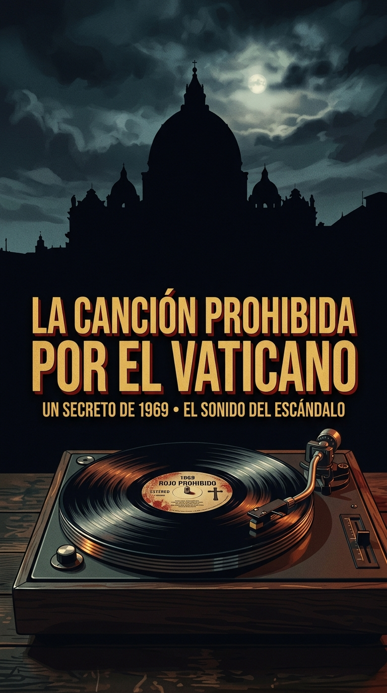
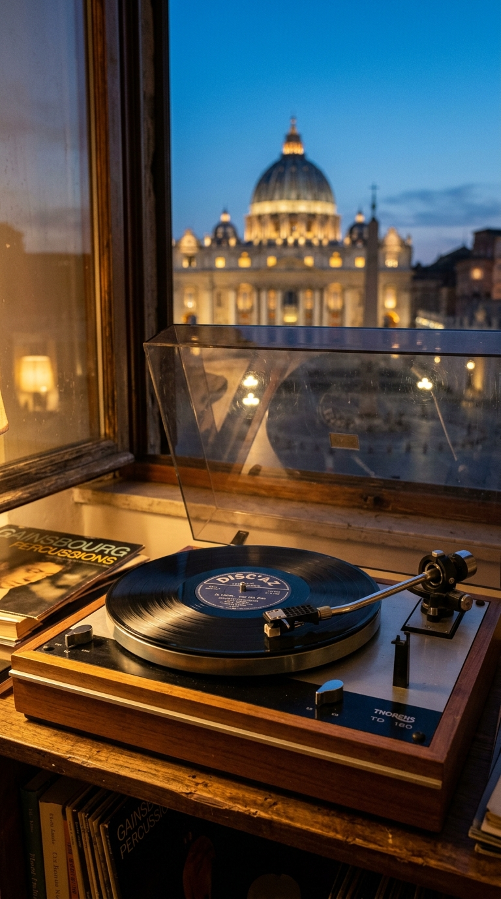
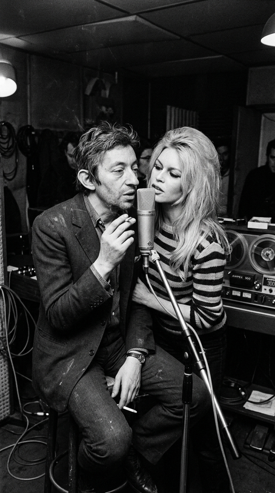
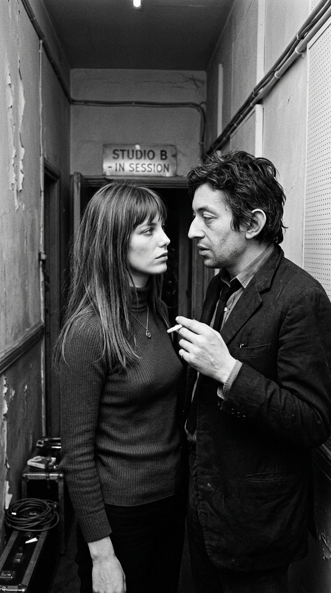
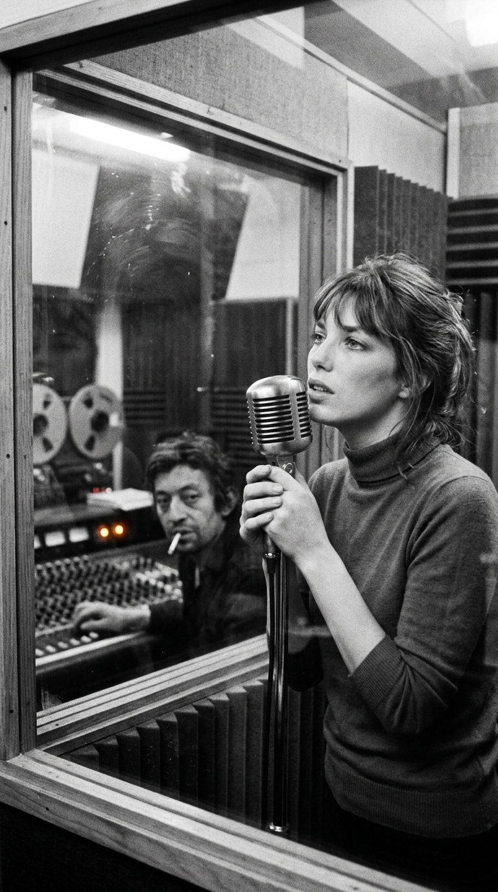
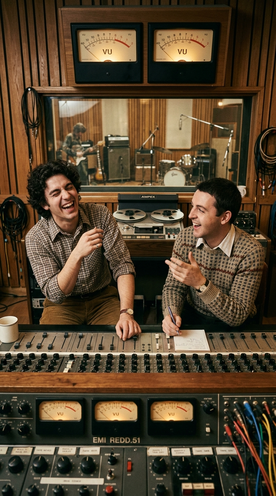
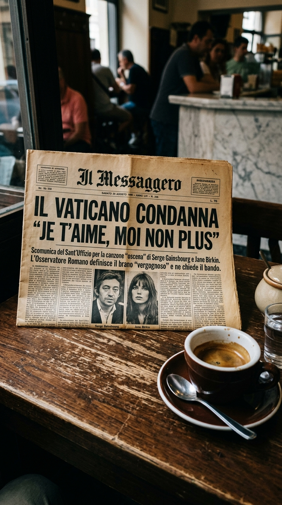
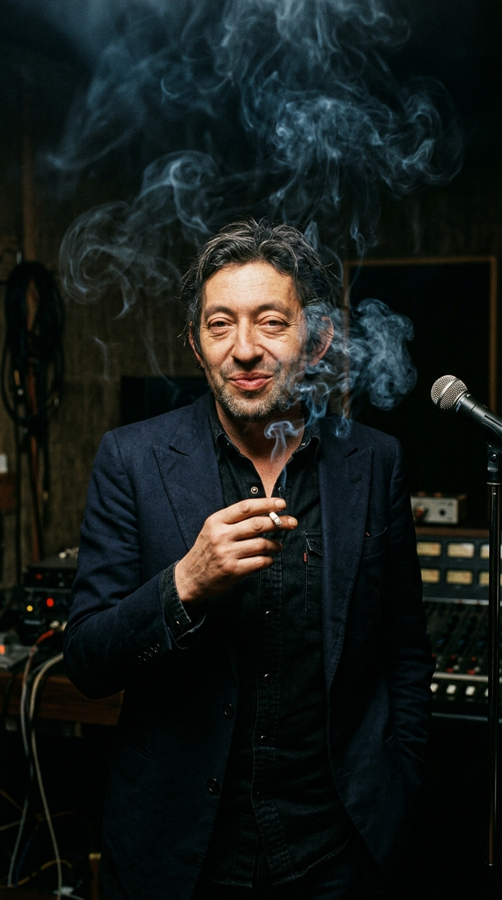

# El suspiro prohibido que desafió al Vaticano: Serge Gainsbourg, Jane Birkin y la verdad tras «Je t'aime... moi non plus»

**Por el equipo editorial de Acordes Ocultos**

---

> *«Je t'aime, je t'aime / Oh, oui je t'aime / —Moi non plus / —Oh, mon amour... / Comme la vague irrésolue / Je vais, je vais et je viens / Entre tes reins...»*

En el verano de **1969**, mientras el hombre pisaba la Luna y el festival de Woodstock congregaba a medio millón de jóvenes en el estado de Nueva York, un disco de vinilo de siete pulgadas con portada austera desató la tormenta moral más escandalosa de la Europa de posguerra. No contenía proclamas políticas revolucionarias ni guitarras distorsionadas: apenas una línea de bajo hipnótica, un órgano con cadencia sacra y dos voces entrelazadas que susurraban, jadeaban y respiraban al oído del oyente como si la intimidad física más absoluta se hubiese filtrado por las rendijas de un estudio de grabación.

Se titulaba **«Je t'aime... moi non plus»**, interpretada por el provocador francés **Serge Gainsbourg** y la joven actriz británica **Jane Birkin**. En cuestión de semanas, el tema fue censurado en las emisoras de radio de media Europa, confiscado por la policía en Italia y anatematizado solemnemente desde la Ciudad del Vaticano. Pero detrás del ruido de los titulares, las leyendas urbanas sobre micrófonos bajo colchones y las amenazas judiciales, la verdadera historia de la canción era la de un triángulo amoroso, un pacto secreto de lealtad y el arrebato de celos de una muchacha de veintidós años que prefirió desafiar al mundo entero antes que permitir que otra mujer cantara aquel poema en los brazos del hombre que amaba.

---

## Acto I: El ruego de Brigitte Bardot y la cinta bajo llave en París (1967)

El nacimiento de la canción no ocurrió junto a Jane Birkin, sino en el torbellino de otra pasión abrasadora. En el otoño de **1967**, Serge Gainsbourg vivía un romance clandestino con la mujer más deseada del planeta: **Brigitte Bardot**. En el punto culminante de su idilio, la actriz le lanzó un reto audaz al compositor: le pidió que escribiera para ella *«la canción de amor más hermosa que jamás pudiera imaginar»*.

Aquella misma noche, al piano de su apartamento en París, Gainsbourg compuso dos partituras inmortales: *«Bonnie and Clyde»* y **«Je t'aime... moi non plus»**. El título encerraba una paradoja existencial inspirada en una célebre frase atribuida a Salvador Dalí (*«Picasso es español, yo también. Picasso es un genio, yo también. Picasso es comunista, yo tampoco»*): al *«te amo»* entregado de la mujer, el hombre respondía con una coraza escéptica: *«yo tampoco»*.

El **10 de diciembre de 1967**, en el **Studio B de los Estudios Barclay** en la avenue Hoche de París, Serge y Brigitte entraron en la cabina de voz bajo los arreglos orquestales de **Michel Colombier**. La interpretación de Bardot fue tan ardiente, explícita y cargada de suspiros que los técnicos de grabación quedaron petrificados detrás de la consola. 

El secreto duró apenas unas horas. Cuando un locutor de radio filtró un fragmento del acetato y la prensa sensacionalista comenzó a publicar rumores del romance, el esposo de Brigitte —el influyente multimillonario alemán **Gunter Sachs**— montó en cólera y amenazó con emprender acciones legales devastadoras. Aterrorizada por el escándalo público y el derrumbe de su matrimonio, Bardot llamó entre lágrimas a Gainsbourg implorándole que no comercializara la grabación.

Serge aceptó el sacrificio por amor y caballerosidad. Guardó la cinta máster en una caja de seguridad y prometió mantenerla bajo llave, sufriendo en silencio el entierro de la que consideraba su mejor composición. Aquella versión original permanecería en la oscuridad durante casi dos décadas, hasta que Bardot autorizó finalmente su publicación en **1986**.

---

## Acto II: *Slogan*, el club Chez Castel y los celos de Jane Birkin (1968)

En la primavera de **1968**, con el corazón todavía resentido, Gainsbourg fue contratado para protagonizar la película ***Slogan***, dirigida por Pierre Grimblat. Su compañera de reparto era una joven inglesa de veintiún años que acababa de aterrizar en París: **Jane Birkin**. 

Birkin venía de sufrir la amarga separación del célebre compositor cinematográfico John Barry, cargaba en brazos a su pequeña hija Kate de apenas un año y no hablaba casi una palabra de francés. Durante los primeros días de rodaje, Gainsbourg se mostró distante, hosco e intimidante, hasta que el director del filme organizó una cena para que ambos se conocieran fuera del set.

Aquella noche por el París nocturno cambió el rumbo de sus vidas. Pasaron por el club **Chez Castel**, bailaron en el **Raspoutine** y terminaron de madrugada en un club de transformistas de Montmartre, riendo y conversando en una mezcla entrañable de inglés y francés. Detrás de la máscara cínica del compositor, Jane descubrió a un hombre tímido, culto y de una delicadeza infinita.

Cuando la relación entre ambos se consolidó, Gainsbourg le confesó la existencia de aquella melodía oculta que dormía en un cajón. Quería regrabarla para que el mundo por fin pudiera escucharla, y barajó en voz alta nombres de cantantes consagradas como Marianne Faithfull, Mireille Darc o Valérie Lagrange. 

Al oírlo, Jane Birkin sintió una punzada de celos incontenible. Décadas más tarde, en sus diarios y memorias, recordaría aquel instante con total franqueza:

> *«Le dije de inmediato: \"La canto yo\". No podía soportar la idea de que entrara en un estudio de grabación con otra mujer a encerrarse en una cabina para cantar una canción así. Tenía que ser yo»*.

---

## Acto III: Marble Arch Studios: una octava más alto y la leyenda del cristal

En **diciembre de 1968**, la pareja viajó a Londres para registrar la versión definitiva en los estudios de grabación de Philips, cerca de **Marble Arch**. Gainsbourg convocó al respetado arreglista y director de orquesta británico **Arthur Greenslade**, quien diseñó una instrumentación sublime: un bajo continuo y denso, una batería comedida, guitarras sutiles y un órgano solemne que confería al tema una atmósfera casi litúrgica.

Para la voz de Jane, Gainsbourg tomó una decisión estética determinante: le ordenó cantar **una octava más alto** de lo que lo había hecho Brigitte Bardot. Quería que su voz sonara delgada, vacilante, casi como la de un *«pequeño niño de coro»* (*petit garçon de chœur*), creando un contraste estremecedor entre la pureza casi infantil de su timbre y la gravedad carnal de sus murmullos.

Dentro de la cabina de voz, Jane cantó pegada al micrófono mientras Serge la observaba desde el otro lado del cristal. Cuando comenzaron las respiraciones entrecortadas y los suspiros que culminaban la melodía, los técnicos de sonido británicos se miraron entre risas y desconcierto. 

La verosimilitud de la toma fue tan sobrecogedora que, apenas el sencillo salió a la calle, se propagó el rumor global de que Gainsbourg y Birkin habían tenido relaciones sexuales reales durante la sesión o colocado micrófonos bajo un colchón. Serge desarmó la fantasía morbosa con su ironía habitual:

> *«Si hubiese sido de verdad, no habría cabido en un sencillo de 45 revoluciones por minuto: habríamos tenido que editar un disco de larga duración»*.

---

## Acto IV: La furia de *L'Osservatore Romano* y el Papa como agente de prensa (1969)

Publicado en **febrero de 1969** por el sello Fontana (filial de Philips), el impacto de **«Je t'aime... moi non plus»** fue instantáneo y volcánico. Las emisoras de radio de Francia, España, Suecia, Brasil y Portugal prohibieron su difusión o restringieron su emisión a la madrugada. En el Reino Unido, la **BBC** vetó la canción de sus ondas diurnas por considerarla contraria a la decencia pública.

Sin embargo, el epicentro del conflicto estalló en Italia. El **22 de agosto de 1969**, el periódico oficial de la Santa Sede, ***L'Osservatore Romano***, publicó una durísima condena editorial en portada, calificando la canción de *«obscenidad descarada»* y síntoma de la degradación moral de la sociedad contemporánea. La radio y televisión pública italiana (**RAI**) impuso un veto total y un tribunal de Milán ordenó el secuestro inmediato de todas las copias en las tiendas de discos del país.

La leyenda popular de la época llegó a afirmar que el Vaticano había excomulgado al director del sello discográfico en Italia. Aunque la sanción canónica no fue formalmente una excomunión sino un proceso penal de la justicia civil italiana con penas de prisión suspendida para el distribuidor, la publicidad gratuita que la Iglesia católica le otorgó al disco superó cualquier campaña de mercadotecnia concebible.

Gainsbourg, fascinado por el terremoto cultural que había provocado, agradeció el gesto con una frase que pasó a los anales de la cultura pop:

> *«El Papa es nuestro mejor agente de relaciones públicas. Sin su condena, jamás habríamos vendido tantos millones de discos»*.

---

## Epílogo: El número uno en Londres y el triunfo de la vulnerabilidad

En el Reino Unido, ante la controversia y las presiones puritanas, la compañía Philips se asustó cuando el disco alcanzó el segundo puesto de ventas y ordenó retirar el sencillo de las tiendas para proteger su imagen corporativa. Lejos de frenar el fenómeno, Gainsbourg licenció de inmediato los derechos al sello independiente **Major Minor Records**, dirigido por Phil Solomon. 

El **7 de octubre de 1969**, la versión relanzada por Major Minor alcanzó el **número uno del *UK Singles Chart***, marcando dos hitos históricos sin precedentes: fue la **primera canción cantada en un idioma extranjero** en coronar las listas británicas y el primer sencillo prohibido por la BBC que lograba conquistar el número uno de la nación.

Más de medio siglo después de aquel año convulso de 1969, **«Je t'aime... moi non plus»** ha perdido la capacidad de escandalizar a los censores, pero ha ganado algo mucho más valioso: la admiración unánime por una pieza de orfebrería pop perfecta. Lo que en su momento los guardianes de la moral juzgaron como provocación pornográfica se revela hoy como un testamento sobre la fragilidad del deseo, la belleza del amor compartido y la valentía de dos jóvenes que convirtieron sus suspiros en un himno de libertad que ningún púlpito logró silenciar.

---

### 💬 ¿Qué recuerdos o emociones guarda para ti «Je t'aime... moi non plus»?

¿En qué momento de tu vida escuchaste por primera vez este tema y qué sensación te transmitió su melodía? Comparte tu experiencia en los comentarios y reenvía esta crónica a quienes aprecian la historia viva de la música.

---

### 📚 Fuentes y Archivo Documental

1. **Birkin, Jane.** *Munkey Diaries (1957–1982)* (Fayard, París, 2018; edición en inglés Weidenfeld & Nicolson, 2019) y *Post-scriptum (1982–2013)* (2019). Diarios íntimos y memorias directas sobre el rodaje de *Slogan*, los celos al enterarse de la grabación previa con Brigitte Bardot, la sesión vocal en Marble Arch Studios (Londres) cantando una octava más alto y las reacciones públicas de 1969.
2. **Gainsbourg, Serge.** Entrevistas y declaraciones autobiográficas compiladas en *Gainsbourg: Entretiens avec Bayon* (Éditions Grasset, 1992) y *Dandy de grand chemin* (Gilles Verlant, Albin Michel, 2000), donde detalla la composición original de 1967, la negativa de comercialización por el escándalo de Gunter Sachs y su célebre ironía sobre el Papa y *L'Osservatore Romano*.
3. **Verlant, Gilles.** *Gainsbourg* (Éditions Albin Michel, París, 2000; reed. 2006). Biografía de referencia definitiva con el registro documental de las sesiones del 10 de diciembre de 1967 en Studio B de los Estudios Barclay (arreglos de Michel Colombier) y de noviembre/diciembre de 1968 en Londres con arreglos y dirección orquestal de Arthur Greenslade.
4. **Bardot, Brigitte.** *Initiales B.B.: Mémoires* (Éditions Grasset, París, 1996). Testimonio sobre la petición de «la canción de amor más hermosa del mundo», la grabación clandestina en 1967 y la súplica desesperada a Gainsbourg para retirar el disco ante la furia de su esposo Gunter Sachs.
5. **Archivo hemerográfico y censura eclesiástica:**
   * *L'Osservatore Romano* (Ciudad del Vaticano, edición del 22 de agosto de 1969): Editorial de condena moral y calificación de la obra como obscenidad decadente.
   * Disposiciones judiciales en Italia (secuestro de copias ordenado por la fiscalía de Milán y causa penal contra el sello distribuidor Phonogram).
   * Archivo de listas oficiales del Reino Unido (*Official Charts Company* / *Record Retailer*): Retirada del sencillo por Philips/Fontana en el puesto #2 y posterior lanzamiento en Major Minor Records alcanzando el #1 el 7 de octubre de 1969.
