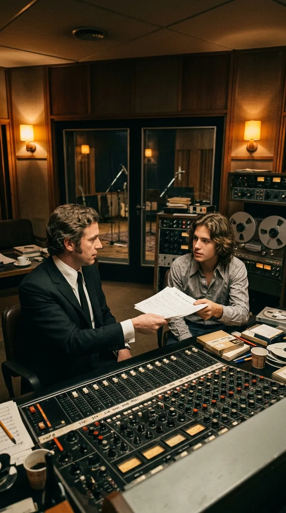
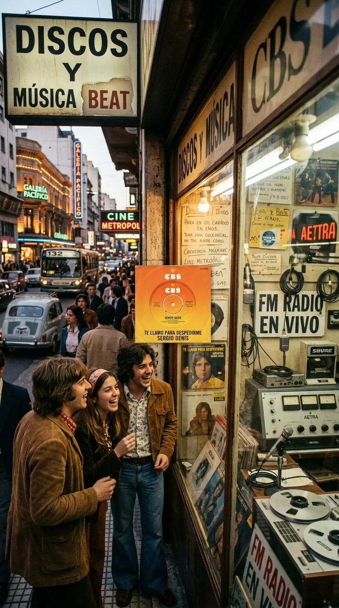

# La profecía involuntaria de un adiós: Sergio Denis y el abismo de una canción

> En noviembre de 1969, un tímido muchacho de pueblo entró a un estudio de Buenos Aires para cantar una balada sobre la despedida. Cincuenta años después, esa misma melodía se convirtió en su último aliento sobre un escenario.

---

### Prólogo: La llamada que detuvo el tiempo

Hay vidas marcadas por una simetría tan asombrosa que parece desafiar las leyes de la casualidad. En la historia de la música popular latinoamericana abundan las despedidas conmovedoras, los homenajes póstumos y las canciones que crecieron a la sombra de una pérdida personal. Pero rara vez el destino ha tejido un círculo tan perfecto, tan luminoso en su origen y tan desgarrador en su desenlace, como el que unió la voz de Sergio Denis con su primer gran éxito.

La noche del 11 de marzo de 2019, en la ciudad de San Miguel de Tucumán, las luces cálidas del Teatro Mercedes Sosa bañaban una sala colmada hasta el último rincón. Sobre el proscenio, un hombre de setenta años recién cumplidos, de cabellera plateada y estampa noble, sonreía con la gratitud intacta de quien ha hecho de la calidez su lenguaje con el mundo. Sergio Denis no era únicamente un cantante melódico; era un miembro entrañable de la familia argentina, el compañero de viajes por carretera de los abuelos, la serenata de los padres y el himno festivo de varias generaciones en las canchas de fútbol.

Aquella noche, mientras el público batía palmas al compás del ritmo suave de la orquesta, Sergio bajó por la pasarela central para estrechar la mano de sus seguidores. Sostenía el micrófono con firmeza y cantaba los versos de la canción que le había abierto las puertas de la gloria medio siglo atrás: *«Te llamo para despedirme, no me preguntes a dónde voy...»*. 

Nadie en el auditorio podía sospechar que aquellas palabras, nacidas en la inocencia de un estudio en 1969, estaban sellando en ese instante su destino definitivo. Un paso en falso hacia la penumbra desprotegida del foso de la orquesta precipitó su cuerpo hacia un abismo de casi tres metros de profundidad. La música cesó de golpe. Y en ese silencio atroz, una canción que había nacido para celebrar el amor se transformó en la profecía involuntaria de un adiós.

---

### Acto I: El muchacho de Coronel Suárez y el bautismo en CBS

Para comprender el peso de aquella última noche es necesario retroceder exactamente cincuenta años en el tiempo. A finales de 1969, Héctor Omar Hoffmann no era una figura pública. Nacido en Coronel Suárez, en el seno de una familia trabajadora de descendientes de alemanes del Volga, el joven Héctor había crecido entre canciones folclóricas, acordeones y el sueño persistente de consagrar su vida al canto.

Tras probar suerte en grupos juveniles como Los Bambis, Hoffmann desembarcó en la vorágine de Buenos Aires con poco más que una guitarra gastada y una voz de barítono brillante, dueña de una dulzura poco común para la época. Los cazatalentos de la filial argentina de CBS Columbia supieron de inmediato que en aquel muchacho de mirada limpia había madera de estrella popular, pero la maquinaria de la industria discográfica exigía dos cosas indispensables: una identidad sonora propia y un nombre artístico que resonara con fuerza en las marquesinas.

En las oficinas del sello se cruzó con Francis Smith —seudónimo de Francisco Bernardo Mancini—, uno de los compositores y productores más prolíficos y visionarios de la época, responsable de decenas de éxitos que marcaban el pulso de las juventudes argentinas. Smith tenía en su escritorio una partitura melancólica, una balada de compás cadencioso que narraba el dolor digno de un hombre que se aleja de un amor imposible para no lastimar a nadie: *«Te llamo para despedirme»*.

Antes de entrar a la sala de grabación, los productores decidieron que Héctor Omar Hoffmann debía transformarse. Descartaron decenas de combinaciones hasta dar con una fórmula sobria y magnética: Sergio Denis. Con ese nombre, el joven suarense se paró por primera vez ante el gran micrófono de condensador de la calle Paraguay en noviembre de 1969.

---

### Acto II: La calidez que conquistó a un país

La grabación contó con los arreglos orquestales del maestro Jorge Leone, quien vistió la melodía con cuerdas envolventes y una sobria sección de vientos que anticipaba la estética de la década que estaba por nacer. Pero lo que distinguió a *«Te llamo para despedirme»* de cualquier otra balada de temporada fue la interpretación de Sergio Denis.

A diferencia del estilo engolado y distante que predominaba en ciertos círculos melódicos, Sergio cantaba con una cercanía desarmante. Su voz sonaba como la confidencia honesta de un amigo al teléfono, alguien que traga saliva y asume la soledad con caballerosidad y ternura. Lanzado en diciembre de 1969 como el simple CBS 22.218 (acompañado en la cara B por *«Fui un soñador»*), el disco explotó en las radios a comienzos de 1970.

Las disquerías no daban abasto. El tema vendió cientos de miles de copias en cuestión de semanas y se transformó en el mascarón de proa de su primer álbum de larga duración, publicado ese mismo año. Con apenas veintiún años, Sergio Denis se convirtió en un ídolo de masas, pero un ídolo atípico: jamás construyó su figura sobre la base del misterio inalcanzable, sino sobre la sonrisa franca, la amabilidad cotidiana y el respeto absoluto hacia su público.

A lo largo de las siguientes cinco décadas, Sergio atravesó todas las tormentas imaginables: crisis económicas feroces, problemas financieros que lo llevaron a la ruina y lo obligaron a reinventarse desde cero, problemas de salud e incluso una experiencia cercana a la muerte en Paraguay en 2007. De cada caída se levantó con la misma humildad, llenando teatros provinciales, clubes de barrio y festivales populares, donde *«Te llamo para despedirme»* nunca dejaba de corearse como un clásico imperecedero.

---

### Acto III: La trampa en la penumbra de Tucumán

El lunes 11 de marzo de 2019 debía ser una noche de fiesta. Con motivo del Día Internacional de la Mujer, el Teatro Mercedes Sosa de San Miguel de Tucumán había programado una función especial. Sergio Denis acababa de cumplir setenta años el 16 de marzo y se encontraba en plena gira, celebrando medio siglo ininterrumpido sobre los escenarios.

El auditorio estaba repleto de familias enteras: madres, hijas y abuelas que aplaudían de pie cada uno de sus clásicos. Cerca del final del concierto, tras interpretar *«Dame luz»*, Sergio anunció el tema que todo el público esperaba. En las grabaciones realizadas por los teléfonos de los asistentes se lo ve pleno, disfrutando del contacto físico con las primeras filas, moviéndose con soltura mientras entonaba los primeros versos:

> *«Te llamo para despedirme,*  
> *no me preguntes a dónde voy...*  
> *Te llamo para decirte*  
> *que todo entre nosotros terminó...»*

El proscenio del teatro contaba con una pasarela que se adentraba hacia la platea. Sin embargo, entre el escenario y las primeras butacas se abría un foso de orquesta de 2,90 metros de profundidad. Aquella estructura carecía de redes de contención, barandas perimetrales o cintas fosforescentes que delimitaran el borde en la oscuridad. Cuando Sergio giró para regresar hacia el centro del escenario, su pie izquierdo pisó el vacío.

El impacto sobre el suelo de cemento del foso fue devastador. La caída le provocó un traumatismo encéfalo-craneano grave, fracturas en la clavícula y costillas, y hematomas cerebrales masivos. Mientras los servicios de emergencia lo trasladaban al Hospital Padilla, el eco de su voz parecía haber quedado suspendido en el aire del teatro, en un suspenso angustioso que conmovió a toda la nación.

---

### Acto IV: Catorce meses de vigilia y el adiós definitivo

Lo que siguió fue una larga vigilia de catorce meses. Tras semanas de estabilización crítica en Tucumán, el cantante fue trasladado a Buenos Aires, internado en el Sanatorio de Los Arcos y posteriormente en una clínica de rehabilitación en el barrio de Núñez. Durante más de un año, miles de admiradores encendieron velas, enviaron cartas y mantuvieron viva la esperanza de un milagro que devolviera a Sergio su sonrisa.

Pero las lesiones neurológicas eran irreversibles. Sergio Denis permaneció en coma, en un estado de desconexión profunda, hasta que en la mañana del viernes 15 de mayo de 2020, en plena pandemia, su corazón se detuvo a los setenta y un años.

La noticia de su fallecimiento desató una ola de dolor colectivo que atravesó a todas las clases sociales y generaciones de Argentina. Sin embargo, detrás del luto emergió una certeza que heló la sangre de los cronistas y melómanos: la última frase que Sergio Denis había pronunciado ante el público antes de entrar en la penumbra fue *«Te llamo para despedirme»*. La misma canción con la que un joven desconocido de Coronel Suárez había saludado al mundo en 1969 había sido, sin saberlo, su testamento final.

---

### Epílogo: El canto que no apaga el abismo

Hay tragedias que se quedan estancadas en el dolor y otras que adquieren la estatura de un mito poético. El final de Sergio Denis no puede explicarse únicamente desde la negligencia edilicia de un teatro; queda grabado en la memoria popular como una de las coincidencias más misteriosas y conmovedoras de nuestra cultura.

El destino quiso que su carrera fuera un ciclo cerrado de principio a fin, una despedida que tardó exactamente cincuenta años en cumplirse. Aquel muchacho que en 1969 grabó una balada ajena terminó adueñándose de ella hasta fundir su propia vida con sus versos.

Hoy, cuando su voz vuelve a sonar en una radio provinciana o en una tarde de domingo, el estribillo de *«Te llamo para despedirme»* ya no suena como una simple canción de desamor juvenil. Suena como el mensaje sincero y noble de un hombre que amó profundamente su oficio, que le entregó hasta el último latido a la gente y que, cuando le tocó partir, se despidió cantando.

---

### 📚 Fuentes y Archivo Documental

1. **Diario La Nación (Buenos Aires)**: Cobertura especial y crónica necrológica: *"Murió Sergio Denis: el cantante popular que marcó a varias generaciones"* (15 de mayo de 2020); archivos hemerográficos de espectáculos sobre su debut discográfico (1969–1970).
2. **Diario Clarín (Buenos Aires)**: Informe cronológico y peritajes del accidente en San Miguel de Tucumán: *"Sergio Denis se cayó del escenario en un teatro de Tucumán y está en grave estado"* (11 de marzo de 2019) y seguimiento médico (2019–2020).
3. **CBS Columbia Argentina / Sony Music**: Registros de producción y catálogo del sencillo *CBS 22.218* (*«Te llamo para despedirme»* / *«Fui un soñador»*, lanzado en diciembre de 1969) y álbum LP homónimo *CBS 8.012* (1970), bajo dirección artística de Francis Smith y arreglos de Jorge Leone.
4. **Revista Gente y La Actualidad / Siete Días Ilustrados**: Entrevistas de época a Héctor Omar Hoffmann (1970–1975) sobre la elección de su seudónimo artístico y sus primeros años en Buenos Aires tras dejar Coronel Suárez.
5. **Poder Judicial de Tucumán**: Causa caratulada *"Denis, Sergio / Lesiones culposas"*, expediente sobre peritajes arquitectónicos y condiciones de seguridad del foso de orquesta del Teatro Mercedes Sosa (2019–2022).
6. **Autobiografía y Archivo Testimonial**: Declaraciones públicas y memorias de Sergio Denis sobre su relación con Francis Smith y su vínculo de cinco décadas con el público argentino.
