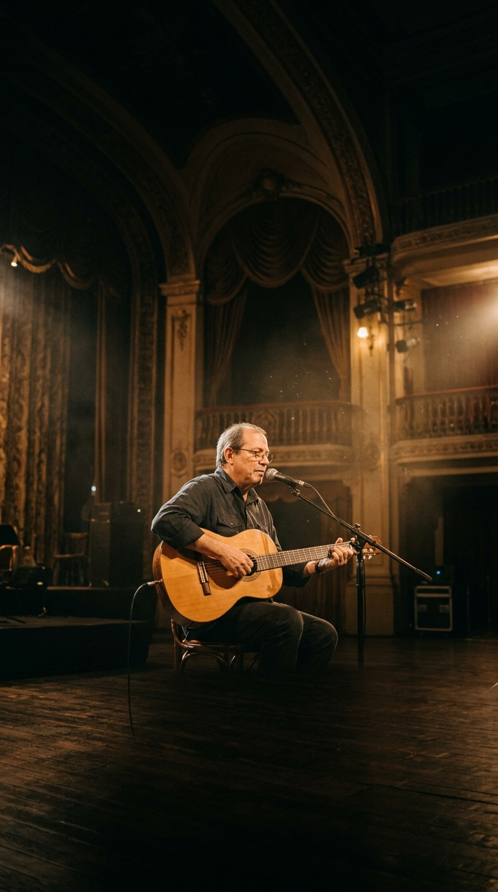
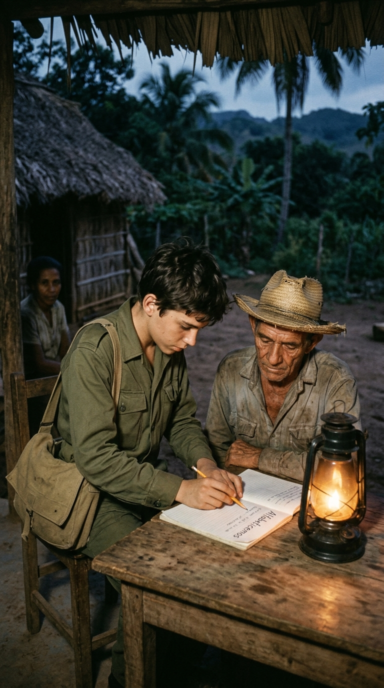
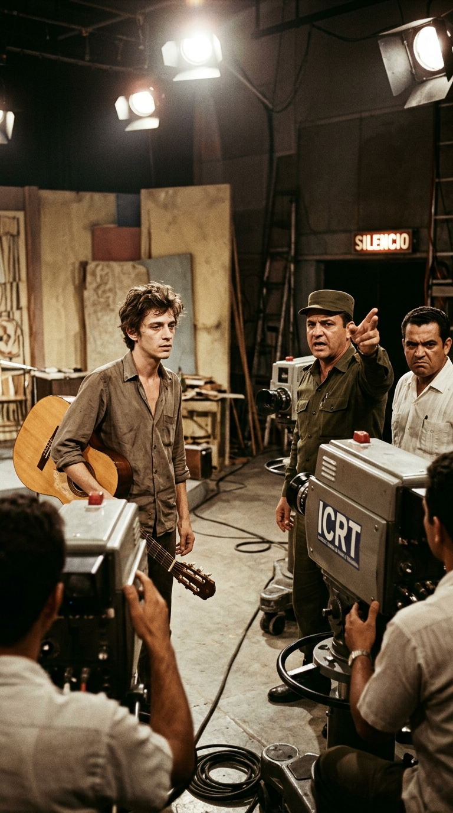
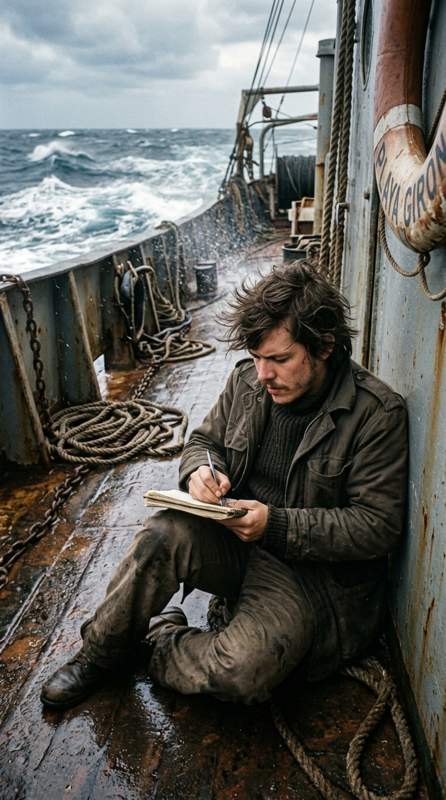
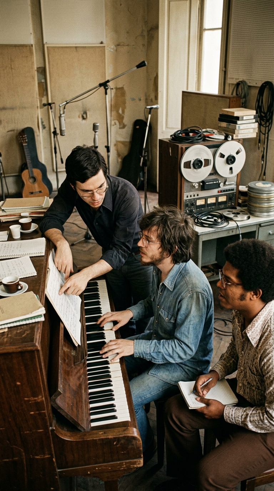
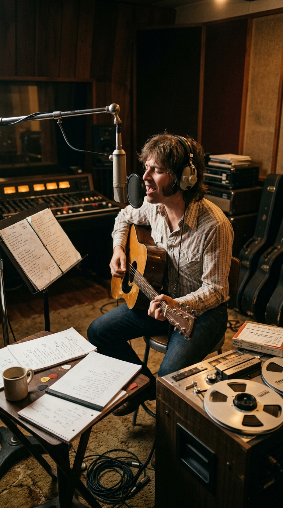
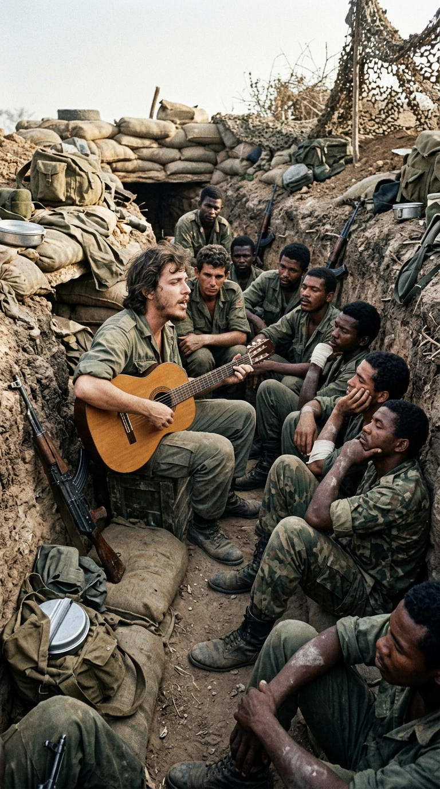
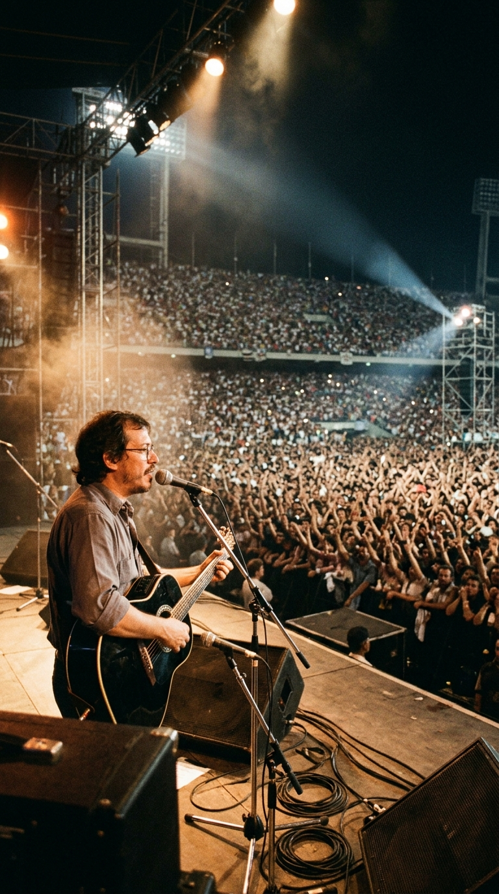
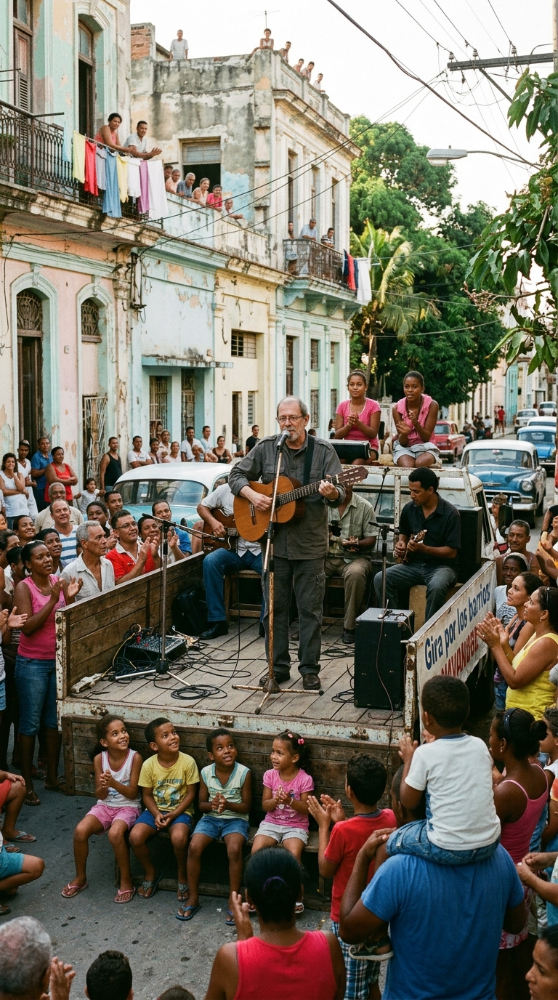

# La cantera inagotable de Silvio Rodríguez

## Prólogo: La madera que aprendió a desafiar al tiempo

En la historia cultural de Iberoamérica, existen figuras que definen una época y nombres que encarnan un movimiento estético. Pero solo unos pocos elegidos logran transformarse en catedrales vivientes: creadores cuya obra atraviesa décadas, censuras institucionales, guerras y mutaciones generacionales sin perder un solo gramo de su misterio ni de su potencia telúrica.

Silvio Rodríguez Domínguez (San Antonio de los Baños, 1946) pertenece a esa estirpe infrecuente. Armado únicamente con una guitarra y una palabra afilada como un bisturí, construyó un universo poético que enseñó a amar, a dudar y a pensar a más de tres generaciones. Lejos de la consigna fácil y ajeno a las modas del mercado discográfico, su trayectoria constituye una de las lecciones de coherencia artística más sólidas del siglo XX.

Esta es la crónica rigurosa de los nueve momentos decisivos que forjaron a una leyenda viva de la música en español.

---

## Acto I: La Ciénaga de Zapata y la clausura en televisión (1961–1968)

Todo comenzó mucho antes de los grandes escenarios internacionales. En **1961**, con apenas catorce años, Silvio se incorporó como brigadista a la Campaña Nacional de Alfabetización. Enviado a la apartada y pantanosa región de la **Ciénaga de Zapata**, convivió con una familia campesina a la que enseñó las primeras letras, tal como testimoniaría años más tarde en el documental *Mi primera tarea*. Aquella vivencia rural fundó su mirada ética: la certeza de que el lenguaje y la poesía no eran un adorno burgués, sino una herramienta de dignidad y emancipación humana.

Siete años después, en **1968**, aquel joven compositor comenzaba a presentarse en La Habana y conducía un espacio experimental en la televisión cubana titulado *Mientras tanto*. Sin embargo, su independencia de criterio no tardó en generar fricciones con los funcionarios culturales de la época. Las tensiones estallaron debido a una confluencia de factores: sus opiniones públicas favorables a la música de The Beatles en un contexto oficial reacio a la influencia anglosajona, sus amistades personales y la inclusión en el programa de un fragmento cinematográfico con un beso. 

El programa fue suspendido abruptamente, cerrándole temporalmente las puertas de los medios de difusión.

---

## Acto II: La travesía del Playa Girón y el nacimiento del GESI (1969–1974)

Deseoso de ampliar sus horizontes vivenciales y llevar su canto más allá de tierra firme, Silvio solicitó enrolarse en la Flota del Golfo. Entre **septiembre de 1969 y enero de 1970**, navegó durante **125 días** a bordo del buque nodriza *Playa Girón*, surcando aguas del Atlántico y las costas occidentales africanas mientras compartía recitales informales con los pescadores.

Aquel aislamiento oceánico se convirtió en un prodigioso estallido creativo: sobre las olas escribió **sesenta y dos canciones**, entre las cuales se encontraban obras cumbres como *Ojalá*, *Resumen de noticias* y la homónima *Playa Girón*.

Ese mismo año **1969**, bajo el impulso intelectual de Alfredo Guevara desde el Instituto Cubano del Arte e Industria Cinematográficos (ICAIC), se fundó el **Grupo de Experimentación Sonora del ICAIC (GESI)**, con la dirección musical del maestro **Leo Brouwer**. 

Silvio se incorporó de inmediato junto a creadores como Pablo Milanés, Noel Nicola y Eduardo Ramos. En aquel taller de rigor vanguardista, la guitarra acústica de Silvio dialogó con la música serial, el jazz contemporáneo y las raíces afrocubanas, pariendo las bases estilísticas de lo que el mundo hispanohablante bautizaría como la Nueva Trova.

---

## Acto III: El fenómeno de «Días y flores» y el frente de Angola (1975–1976)

En **1975** vio la luz *Días y flores*, su primer álbum solista de impacto internacional indiscutible. Grabado en los estudios Sonocentro de la EGREM en La Habana, el disco contenía piezas fundamentales como *Playa Girón*, *En el claro de la luna* y *Santiago de Chile*. 

Sin embargo, la difusión del álbum en el exterior no estuvo exenta de barreras: en la España tardofranquista, la censura oficial intervino la edición comercial mutilando varias canciones de contenido político explícito y alterando el orden y el título del disco, que fue comercializado como *Te doy una canción*. Pese a estas restricciones institucionales, las copias magnetofónicas circularon de mano en mano, consolidando a Silvio como una voz imprescindible para la juventud iberoamericana.

Al año siguiente, en **1976**, en el contexto del despliegue de tropas cubanas en la guerra civil de **Angola**, Silvio viajó al país africano en condición militar. Su misión específica fue integrar brigadas artísticas que recorrieron los frentes de operaciones militares en Cabinda y Luanda, cantando con su guitarra para soldados cubanos y angoleños en campamentos y puestos de avanzada. Aquella experiencia directa con el dolor de la contienda armada impregnó su cancionero de una madurez testimonial indeleble.

---

## Acto IV: La resonancia multitudinaria y la consagración de «La Maza» (Años 80)

La década de **1980** atestiguó la masificación definitiva de su propuesta artística en los escenarios más prestigiosos del mundo hispanohablante. 

En **1982**, Silvio publicó el álbum *Unicornio*, que incluía ***«La Maza»***: una composición filosófica de ritmo sincopado en 6/8 donde interrogaba el sentido del esfuerzo creador frente a la existencia (*«¿Qué cosa fuera la maza sin cantera?...»*). La canción trascendió de inmediato las fronteras genéricas, siendo versionada por figuras monumentales como Mercedes Sosa.

Durante estos años, sus presentaciones en directo convocaron a multitudes históricas. Destacan de manera emblemática los multitudinarios recitales de **abril de 1984 en el Estadio Obras Sanitarias de Buenos Aires**, compartidos con Pablo Milanés, que marcaron el reencuentro de la juventud argentina con la trova tras los oscuros años de la dictadura militar, así como sus conciertos multitudinarios en España, México y diversos países sudamericanos.

---

## Acto V: La gira por los barrios y la cercanía comunitaria (Desde 2010)

Fiel a su vocación de proximidad y servicio social, el **9 de septiembre de 2010** Silvio Rodríguez inauguró en la barriada de **La Corbata**, en La Habana, un proyecto comunitario que marcaría su madurez artística: la **Gira por los Barrios** (o *Gira Interminable*).

A lo largo de más de una década, el trovador se presentó de forma enteramente gratuita en más de un centenar de localidades populares, periféricas y desfavorecidas de la capital cubana y de otras provincias (como Pogolotti, Jesús María o La Güinera). Acompañado por destacados músicos instrumentistas, actuó en sencillos escenarios montados en las calles, cantando para vecinos, ancianos y familias trabajadoras, reintegrando la canción poética al tejido cotidiano del cual se nutrió desde sus inicios.

---

## Epílogo: El refugio de la memoria

Más de sesenta años después de que aquel muchacho de catorce años sostuviera una cartilla de alfabetización en los humedales de Zapata, la obra de Silvio Rodríguez permanece en pie como un testimonio vivo de coherencia y rigor artístico. 

Su trayectoria demuestra que la verdadera trascendencia cultural no radica en perseguir la complacencia del mercado ni en eludir las complejidades de su tiempo, sino en construir un cancionero tan honesto y perdurable que continúe ofreciendo cobijo moral e íntimo a las generaciones venideras.

---

### 📚 Fuentes y Archivo Documental

1. **Documental «Mi primera tarea» (2021).** Dirección de Catherine Murphy / The Literacy Project. Testimonio directo de Silvio Rodríguez sobre su labor como brigadista alfabetizador en la Ciénaga de Zapata en 1961.
2. **Rodríguez, Silvio.** *Canciones del mar*. Ediciones Ojalá / Casa de las Américas, La Habana, 1996. Diario de travesía y cancionero compuesto a bordo del motonave pesquero *Playa Girón* (septiembre de 1969 – enero de 1970).
3. **Brouwer, Leo.** *La música, lo cubano y la innovación*. Ediciones Unión, La Habana, 1982. Documentación histórica sobre la fundación en 1969 y desarrollo del Grupo de Experimentación Sonora del ICAIC (GESI).
4. **Archivo Sonoro y Documental de Radio Televisión Española (RTVE).** Registro de expedientes de censura franquista sobre el álbum *Días y flores* (editado en España bajo el título *Te doy una canción*, 1975).
5. **Archivo Histórico de Radio y Televisión Argentina (RTA).** Registros audiovisuales de las presentaciones de Silvio Rodríguez y Pablo Milanés en el Estadio Obras Sanitarias de Buenos Aires (abril de 1984).
6. **Entrevista de la Agencia EFE a Silvio Rodríguez (septiembre de 2025).** Balance histórico sobre la Gira por los Barrios (2010–2020) y reflexiones sobre su retiro temporal de los escenarios.
