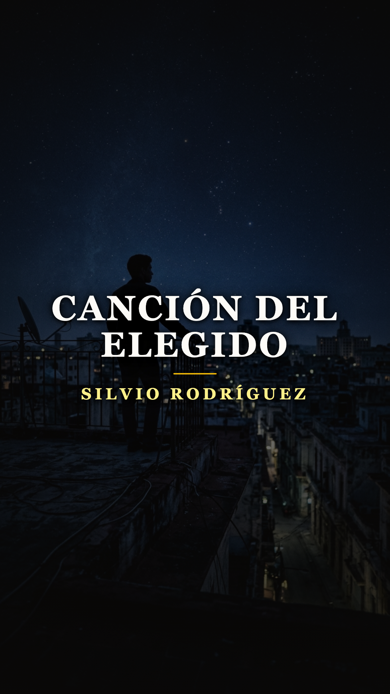
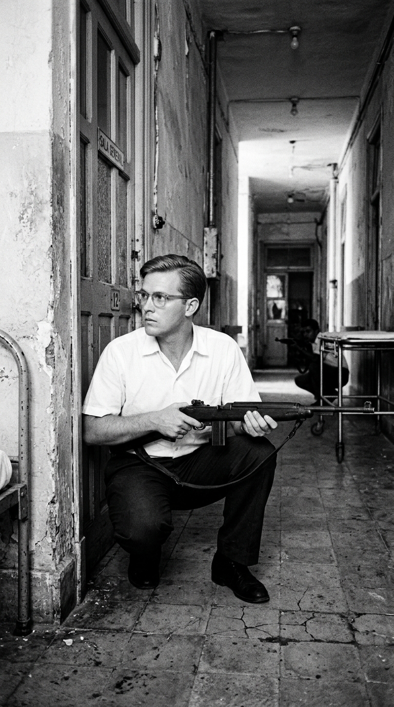
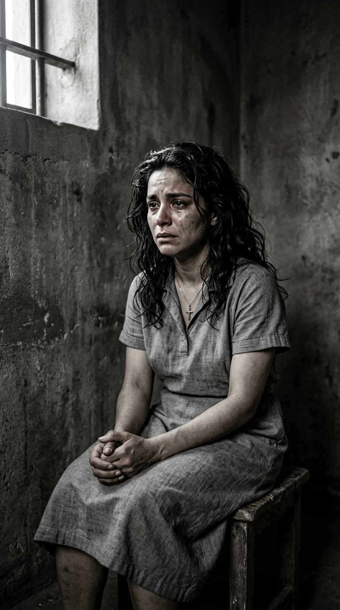
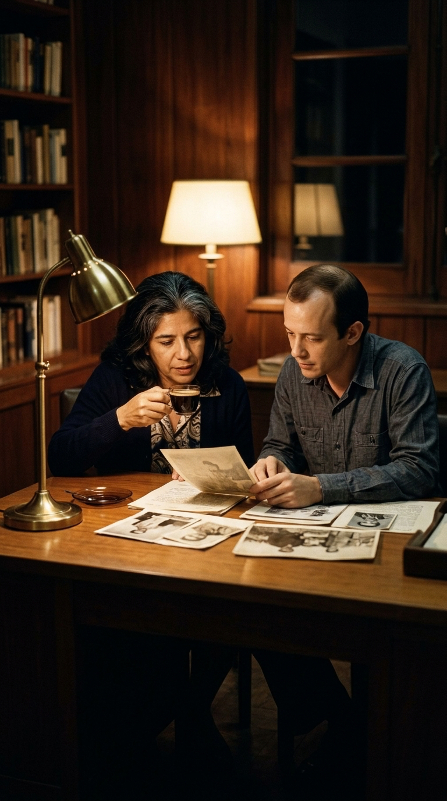
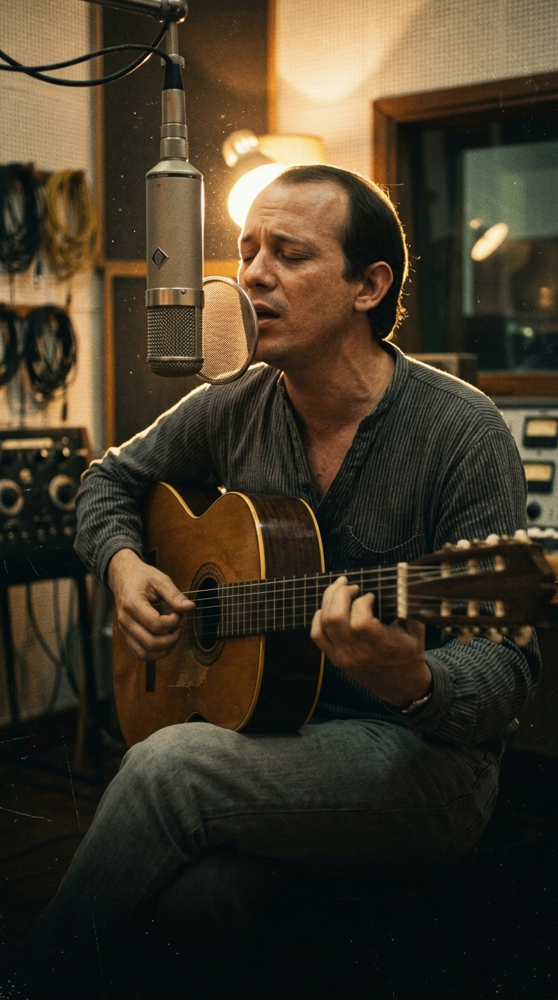

# El «animal de galaxia» que no pudieron quebrar: La verdadera historia tras «Canción del elegido»

Durante décadas, en las peñas universitarias de América Latina, en las marchas estudiantiles y en la intimidad de miles de habitaciones iluminadas por velas de contrabando, se cantó *«Canción del elegido»* con la certeza casi religiosa de estar rindiendo tributo a una figura monumental del panteón revolucionario. La cultura popular dio por sentado que aquel *«ser de otro mundo, animal de galaxia»* que *«nació de una tormenta en el sol de una noche»* solo podía ser la silueta mitificada de Ernesto «Che» Guevara tras su caída en Bolivia o la estampa fundacional de Fidel Castro.

La verdad, sin embargo, era infinitamente más desgarradora, más humana y más limpia. Silvio Rodríguez jamás compuso aquellos arpegios vertiginosos para ensalzar la victoria de los comandantes ni para nutrir la propaganda del poder. La canción nació de un luto íntimo, de un estremecimiento ético y de una madrugada de confesiones en la que una mujer rota por el dolor le abrió el pecho para mostrarle los restos inmaculados de su propia sangre: **Abel Santamaría Cuadrado**.

---

## I. El joven de los espejuelos cuadrados

El 26 de julio de 1953, cuando las ráfagas quebraron la madrugada de Santiago de Cuba en el asalto al Cuartel Moncada, la posición más estratégica y peligrosa no estuvo en la entrada principal, sino en el flanco civil que debía garantizar la atención médica de los heridos: el Hospital Provincial Saturnino Lora. Al frente de ese destacamento de veintidós jóvenes combatientes no había un militar de carrera, sino un muchacho de veinticinco años, rubio, corpulento, de modales suaves y mirada profunda tras unos característicos espejuelos de fórmula con montura cuadrada.

Abel Santamaría no era un fanático del fusil; era el alma civil y organizativa del movimiento clandestino. Quienes compartieron con él los meses de conspiración en el pequeño apartamento de 25 y O en El Vedado hablaban de un joven con una sensibilidad fuera de lo común, capaz de discutir con pasión sobre literatura, justicia social y música mientras empeñaba su modesto sueldo de contador en comprar medicinas y uniformes. Fidel Castro había dicho de él que era *«el más generoso, querido y capaz de todos nuestros jóvenes»*.

Cuando el asalto fracasó y el hospital quedó completamente sitiado por las tropas leales a la tiranía de Fulgencio Batista, Abel ordenó resistir hasta el último cartucho para cubrir la retirada de sus compañeros. Al agotarse las municiones, los soldados irrumpieron en las salas. Lo que siguió no fue un juicio militar ni un arresto legal: fue un descenso a los infiernos de la barbarie institucionalizada.

---

## II. El martirio y la dignidad de Haydée

Conducido a las caballerizas del cuartel, Abel fue sometido a torturas inimaginables con el objetivo de arrancarle el paradero de los sobrevivientes y los planes de la insurrección. Los oficiales al mando sabían que en una celda contigua permanecían prisioneras dos mujeres: Melba Hernández y su propia hermana, **Haydée Santamaría**.

En uno de los pasajes más atroces de la historia cubana contemporánea, los torturadores intentaron doblegar la entereza de Haydée mediante la más brutal de las extorsiones psicológicas: le mostraron los ojos ensangrentados que acababan de arrancarle a su hermano, amenazándola con arrancarle los suyos si no delataba a sus compañeros. La respuesta de Haydée, pronunciada desde un abismo de horror y dignidad sobrehumana, quedó grabada en la memoria colectiva del continente:

> *«Si ustedes le sacaron los ojos a él y él no habló, mucho menos voy a hablar yo».*

Abel fue asesinado pocas horas después, el mismo 26 de julio de 1953. Su cuerpo destrozado fue enterrado clandestinamente, pero su silencio salvó decenas de vidas. Haydée sobrevivió al presidio y a la clandestinidad, cargando para siempre con una quemadura invisible en el alma que ninguna victoria política lograría cicatrizar.

---

## III. El refugio de Casa de las Américas (1969)

Quince años más tarde, a finales de la década de 1960, el paisaje cultural de La Habana vivía tiempos de turbulencia y dogmatismo. Un grupo de jóvenes poetas con guitarras acústicas —entre los que destacaban Silvio Rodríguez, Pablo Milanés y Noel Nicola— comenzaba a incomodar a los comisarios de la burocracia cultural oficial. Sus canciones no repetían consignas triunfalistas ni se plegaban a la estética ramplona del realismo socialista; hablaban de dudas, de desgarros, de amor libre y de las contradicciones vivas del ser humano.

Silvio fue censurado, expulsado de programas de televisión y enviado durante cuatro meses a trabajar en alta mar a bordo del motopesquero *Playa Girón*. En medio de ese cerco de incomprensión, una sola institución oficial extendió su manto protector sobre aquellos muchachos rebeldes: **Casa de las Américas**, dirigida con mano sensible y espíritu cosmopolita por la mismísima Haydée Santamaría.

Haydée no veía en Silvio a un desviado ideológico; veía a un creador puro. En su despacho del tercer piso de la casona de la calle 3ra y G, o en la intimidad de su casa en El Vedado, Haydée solía invitar a Silvio a largas noches de café y humo. Allí, al calor de la confianza más limpia, la veterana combatiente comenzó a evocar ante el joven trovador de veintidós años la memoria íntima de Abel.

---

## IV. La transmutación cósmica: Ni consignas ni panfletos

Haydée no le hablaba a Silvio de un prócer de mármol ni de un busto de plaza pública. Le hablaba del muchacho que adoraba a sus padres, del hermano que compartía su último pedazo de pan, del joven visionario que parecía no pertenecer a las bajezas de este mundo. Le leía fragmentos de sus cartas y le describía su mirada transparente tras los cristales de sus espejuelos.

Silvio quedó profundamente conmocionado. ¿Cómo escribir sobre un mártir sin caer en el panfleto estéril? ¿Cómo rendir homenaje a un héroe sin mancharlo con la retórica partidista de los discursos oficiales?

La respuesta fue un salto al vacío poético. En algún momento de 1969, a solas con su guitarra en un cuarto de La Habana, Silvio decidió despojar la historia de uniformes, fechas y nombres propios. Inspirado por la literatura de ciencia ficción y por la sensación de que Abel había sido un ser adelantado a su tiempo biológico y moral, concibió la metáfora del *«animal de galaxia»*:

> *«Iba a nacer un niño, se detenía el tiempo...  
> Supo la historia de un golpe, sintió en su cabeza cristales molidos,  
> y comprendió que la guerra era la paz del futuro...  
> Lo más terrible se aprende enseguida y lo hermoso nos cuesta la vida».*

La referencia a los *«cristales molidos»* no era un capricho surrealista: era la alusión velada a los espejuelos rotos de Abel durante el asalto y la tortura. El verso cumbre —*«lo más terrible se aprende enseguida y lo hermoso nos cuesta la vida»*— condensaba en catorce palabras el precio absoluto que los mejores seres humanos pagan por desafiar la crueldad del mundo.

---

## V. El destino de una obra inmortal

La canción fue grabada por primera vez en 1969 para un vinilo colectivo titulado *26 de julio: Los nuevos héroes*. Casi una década después, en 1978, Silvio la incluyó en su disco cenital *Al final de este viaje*, grabada a guitarra limpia, sin orquestaciones ni artificios de estudio, en los estudios de Sonoland en Madrid.

Silvio guardó silencio deliberado sobre la identidad del protagonista durante años. No quería que la canción fuera utilizada como herramienta de propaganda. Quería que perteneciera a quienquiera que hubiese sacrificado su propia vida por un sueño de dignidad colectiva. Solo con el paso del tiempo confirmó públicamente lo que Haydée Santamaría supo desde la primera vez que escuchó la cinta magnetofónica entre lágrimas: aquel animal de galaxia era su hermano Abel.

A más de medio siglo de su creación, *«Canción del elegido»* sigue siendo una cumbre insuperada de la trova iberoamericana. Nos recuerda que la verdadera grandeza moral no reside en los desfiles militares ni en los monumentos de bronce, sino en la discreta y luminosa terquedad de quienes dan la vida sin pedir nada a cambio, dejando una estela que ningún verdugo podrá apagar jamás.

---

### 📚 Fuentes y Archivo Documental

1. **Rodríguez Domínguez, Silvio.** *Canciones del mar y de la tierra: Antología poética y testimonial.* Editorial Letras Cubanas, La Habana, 1986. Testimonios del autor sobre la composición de *Canción del elegido* y su relación con Haydée Santamaría.
2. **Santamaría, Haydée.** *Haydée habla del Moncada.* Ediciones Casa de las Américas, La Habana, 1971. Testimonio directo sobre el asalto, la tortura y el asesinato de Abel Santamaría en el Hospital Saturnino Lora.
3. **Mencía, Mario.** *El grito del Moncada.* Ediciones Políticas, Editorial de Ciencias Sociales, La Habana, 1986. Reconstrucción histórica detallada con base en los expedientes de la Causa 37 de 1953 del Tribunal de Urgencia de Santiago de Cuba.
4. **Alonso, Guillermo.** *La Nueva Trova Cubana: Raíces, testimonios y compromiso.* Ediciones Unión, La Habana, 1995. Crónica sobre el papel fundador de Casa de las Américas como espacio de acogida y legitimación artística de la primera generación de trovadores.
5. **Díaz, Clara.** *Silvio Rodríguez: Hay quien precisa.* Editorial Letras Cubanas, La Habana, 2008. Estudio musicológico y biográfico sobre las composiciones del ciclo 1967-1970 y el álbum *Al final de este viaje* (1978).
6. **Zurrón del Aprendiz (Archivo Oficial de Silvio Rodríguez).** Registro de composiciones del año 1969, notas de edición discográfica y declaraciones del trovador sobre el contexto íntimo de *Canción del elegido*. Disponible en hemeroteca digital: `zurrondelaprendiz.com`.
