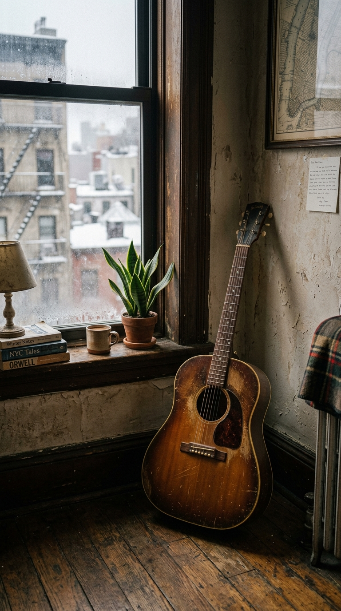
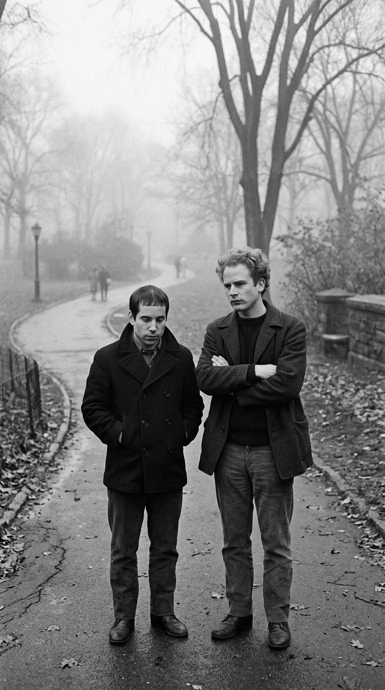
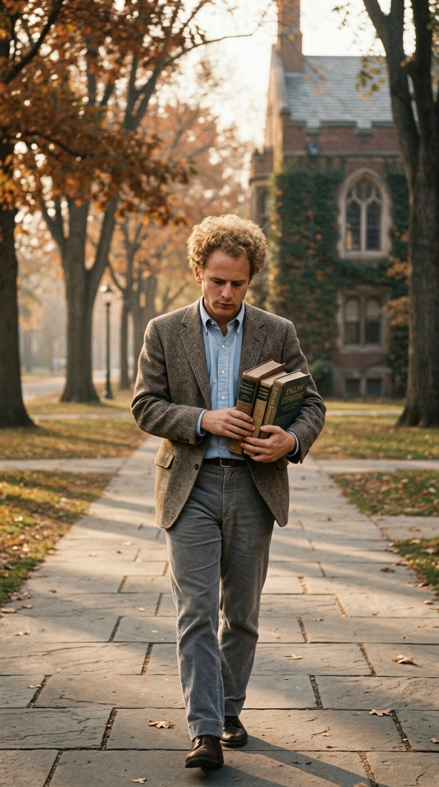
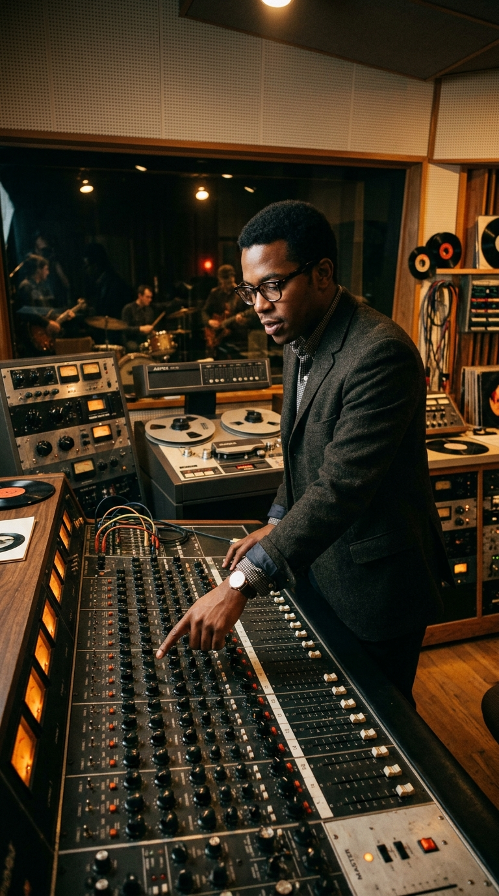
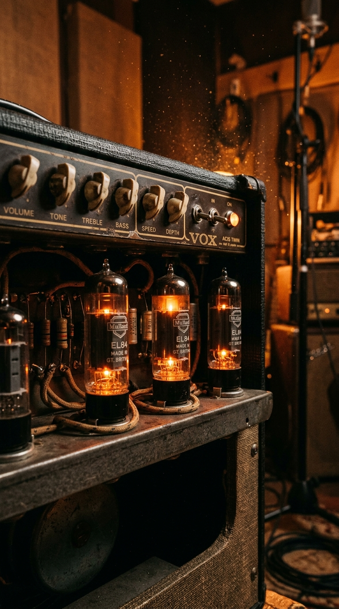
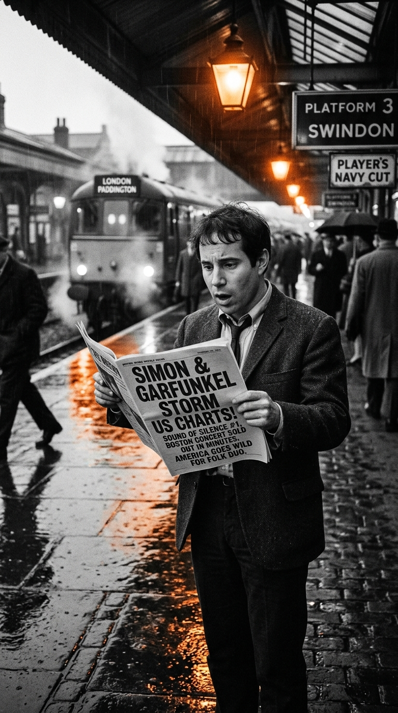
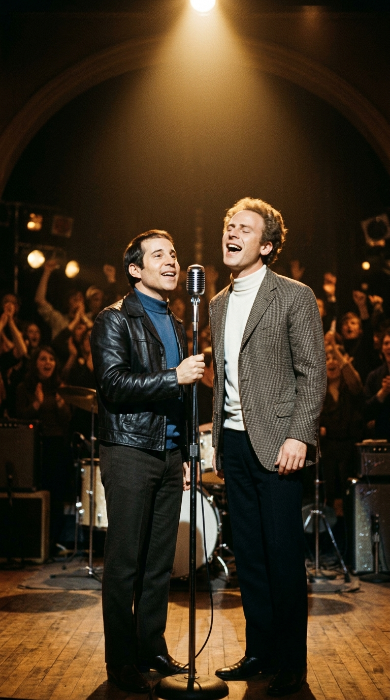

# 🎙️ Rescued from the Shadows: How a Failed Song Changed the History of Folk Rock

> *"We had failed. Our debut album sold barely two thousand copies, and we felt so embarrassed that we decided to split up. I went off to England with a suitcase and a guitar, playing basements for five pounds a night. As far as I was concerned, Simon & Garfunkel was a buried memory... until one afternoon I walked into a London newsstand and saw my name at number one in the world."*  
> — **Paul Simon**, on the unlikely rescue of *"The Sound of Silence,"* 1966.

---

*New York, 1964–1965: The saga of an utter commercial flop that—thanks to the clandestine gamble of a visionary producer working behind its own creators' backs—reinvented the sound of a generation.*

---

### Prologue: The Dripping Faucet in the Dimness of Queens

In the late autumn of **1963**, the Western world stood frozen in shock. The assassination of President John F. Kennedy in Dallas on November 22 had shattered the faith of American youth, ushering in an age of skepticism, mourning, and political disillusionment.

Inside a modest three-room apartment in the working-class neighborhood of Kew Gardens Hills, Queens, New York, a twenty-two-year-old named **Paul Simon** sought refuge from the national trauma in the most unlikely corner of the house: the bathroom.

Simon had discovered that if he locked the door, turned off all the lights, and cracked the sink faucet just slightly, the rhythmic drip of water onto porcelain and the bright acoustics of the tile created an intimate, almost sacred natural reverb. Resting his knees against the bathtub with his fingers tracing the neck of his acoustic guitar in total darkness, he began singing a line that sounded like a midnight confession:

> *"Hello darkness, my old friend,*  
> *I've come to talk with you again..."*

*Queens, winter of 1964: In complete solitude, Paul Simon shapes the opening chords of a song about humanity's inability to truly communicate.*

The lyric told neither a love story nor an explicit political protest. It was a poetic X-ray of urban alienation: millions of people packed into subway cars and crowded streets, *"talking without speaking, hearing without listening,"* unable to be moved by one another's pain.

When his schoolmate and childhood friend **Art Garfunkel** heard the melody in his bedroom, their vocal harmonies locked together with near-seismic precision. Their voices—honed since the days they had imitated The Everly Brothers under the high school pseudonym *Tom & Jerry*—formed a third, ethereal presence: a choral lament that seemed to hover outside of time.

They were ready to conquer the world. Or so they thought.

---

### Act I: The Crushing Flop and the Flight to England

In March **1964**, thanks to an audition arranged by influential folk promoter Tom Wilson, Simon & Garfunkel stepped for the first time into Manhattan's legendary **Columbia 30th Street Studio**—the famed deconsecrated church with hundred-foot ceilings that had hosted giants like Miles Davis and Glenn Gould.

Backed only by Paul's acoustic guitar and a subtle upright bass played by session musician Joe Mack, they recorded *"The Sound of Silence"* in three stark, solemn takes. That piece was chosen as the centerpiece of their debut full-length album, released on **October 19, 1964**, under the title ***Wednesday Morning, 3 A.M.***.

*Central Park, 1964: The quiet, wistful gaze of two young New Yorkers before industry indifference crushed their hopes.*

The commercial result was a devastating disaster.

America had just been swept away by the tidal wave of **Beatlemania**. Youth radio stations wanted nothing but electric shimmer, driving tempos, and infectious hooks from the British Invasion led by The Beatles, The Rolling Stones, and The Kinks. An introspective acoustic folk album by two kids from Queens in dark suits and thin ties like seminary students struck record-store executives as hopelessly out of time.

*Wednesday Morning, 3 A.M.* sold barely **two thousand copies** nationwide. The failure was so complete that Columbia Records immediately pulled all promotional funding and consigned the master tape to its New Jersey vaults.

Mortified, broke, and convinced their musical careers had ended before they ever began, the duo broke up.

Art Garfunkel, blessed with a sharp mathematical mind, set sheet music aside and enrolled at Columbia University to pursue a master's degree in architecture and the history of mathematics.

*Columbia University, 1965: Garfunkel walks between calculus textbooks and architectural blueprints, resigned to the belief that his voice would never again echo inside a professional studio.*

Paul Simon, meanwhile, could not bear walking past New York record stores where his album gathered dust in the ninety-nine-cent bargain bins. With only a few dollars in his pocket, he packed his Martin acoustic guitar into a cardboard case, bought boat passage to the United Kingdom, and settled into a tiny rented room in Brentwood, Essex.

For nearly a year and a half, Simon lived as a solitary, wandering troubadour: riding second-class buses through industrial cities like Liverpool, Newcastle, and Manchester, singing in beer-soaked cellars and provincial folk clubs in front of working-class crowds who tossed coins at the end of the night.

Simon & Garfunkel was already a closed entry in the obituary column of folk music. Yet one man in New York refused to let the song die.

---

### Act II: The Rebellious Instinct of Tom Wilson

That man was **Tom Wilson**.

The son of an African American preacher and trained in economics at Harvard University, Wilson was one of the most singular, visionary, and daring figures in the American music business. Defying the racial prejudices of the era, he had become the star producer of Columbia Records' jazz and folk roster, working alongside titans such as John Coltrane, Sun Ra, and Bob Dylan.

*Columbia Records, 1965: Tom Wilson's keen ear catches the electric spark capable of rescuing a forgotten masterpiece from the vaults.*

Wilson understood better than anyone that popular music was undergoing a tectonic shift. In January 1965 he had produced Bob Dylan's *Bringing It All Back Home*, replacing the Minnesota troubadour's lone acoustic guitar with a snarling electric band. And on **June 15, 1965**, in that very same 30th Street studio, Wilson had helmed the historic session in which Dylan cut *"Like a Rolling Stone,"* the single that officially ushered in the era of **folk rock**.

That same afternoon, after sending Dylan's musicians home, Wilson headed upstairs to his 52nd Street office to review East Coast radio airplay reports.

Something strange was happening.

Two college-area stations—**WBZ** in Boston and a small station in **Cocoa Beach**, Florida—had spontaneously begun spinning the acoustic version of *"The Sound of Silence"* late at night. Nocturnal listeners, mostly college students weighed down by the military draft of the Vietnam War, were jamming the studio phone lines begging DJs to play the song over and over again.

Wilson hurried down to Columbia's tape archive and asked them to pull the original two-inch master tape Simon and Garfunkel had cut fourteen months earlier.

Listening to it alone through the Altec studio monitors, he cracked the puzzle: Paul and Artie's voices were sublime and the poetry was timeless, yet the bare acoustic arrangement lacked the physical punch required to break onto commercial AM radio.

So he made a reckless decision—an outright violation of the unwritten code between artist and producer: **he would rescue the song by electrifying it himself, without asking permission, without consulting its authors, and behind the label's back**.

---

### Act III: The Electric Conspiracy of June 15

That very evening of **June 15, 1965**, Tom Wilson picked up the telephone and urgently summoned to Columbia's Studio A the exact same session players who had just wrapped recording with Bob Dylan.

Four heavyweights of the New York studio scene walked through the door:
* **Al Gorgoni**, a masterful rhythm guitarist.
* **Vinnie Bell**, a pioneer of the electric twelve-string guitar sound.
* **Joe Mack**, a bassist of surgical precision on his Fender Precision Bass.
* **Buddy Salzman**, one of the most sought-after session drummers in Manhattan.

*The electric graft: Plugging Fender amplifiers and a studio drum kit directly over an acoustic tape recorded to a human pulse.*

Wilson threaded the 1964 master tape onto the playback machine and laid out the mission:  
*"Look, boys. We've got this acoustic track by two kids who don't even exist as a group anymore. The melody is pure gold, but it needs muscle. I want you to overdub bass, drums, and electric guitars right on top of it, as if we were a rock band playing live with them."*

The technical obstacle was enormous, bordering on impossible.

Back in 1964, Paul Simon had fingerpicked his acoustic guitar freely, without a metronome or click track. As the song built toward its close, carried along by the emotional weight of the lyric, **Simon had unconsciously sped up the tempo**, shifting time across several bars over the course of three minutes. If the session players locked into a rigid beat, the mix would collapse into a rhythmic train wreck.

Drummer **Buddy Salzman** shouldered a monumental task: he slipped on his leather headphones, closed his eyes, and locked exclusively onto the original picking of Paul Simon's fingers. With remarkable sensitivity, Salzman shaped every stroke of his drumsticks around the organic ebb and flow of Simon's guitar—starting with a tentative pulse on the hi-hat before unleashing a resolute snare-and-kick cadence from the third verse onward.

*The control room: Tom Wilson and the engineers achieve razor-sharp synchronization between the electric guitars and the original vocals.*

Above that foundation, Vinnie Bell wove shimmering arpeggios from an electric twelve-string guitar bathed in light chamber reverb that seamlessly embraced the acoustic strumming, while Al Gorgoni cut in with crisp supporting chords.

In just a few feverish hours, the miracle was complete. Tom Wilson blended the fresh tracks with the original voices and sent the mix straight to Columbia's single-pressing plant.

On the label of the 45 RPM vinyl single, they printed the new title: *"The Sounds of Silence"* (with an added "s" introduced by an editorial slip).

The record hit shelves in September 1965.

Paul Simon was still sleeping in a damp flat in Essex, completely unaware that his destiny no longer belonged to him alone.

---

### Act IV: The Payphone Call and the London Newsstand

Throughout the autumn of 1965, the newly electrified *"The Sound of Silence"* mounted one of the swiftest, most mysterious climbs in the history of *Billboard* magazine.

It caught fire on rock stations in Boston, leaped to Philadelphia, swept Chicago, and by late November was spinning around the clock on radio stations in New York, Los Angeles, and San Francisco. Station switchboards jammed with teenagers mesmerized by that uncanny marriage of liturgical vocal beauty and driving electric bass.

On **January 1, 1966**, the single officially hit **number one on the Billboard Hot 100**, dethroning James Brown's *"I Got You (I Feel Good)"* and The Beatles' *"We Can Work It Out."*

*London, January 1966: Standing before a newsstand, Paul Simon stares in disbelief at Billboard magazine with his name atop the world.*

That very week, Paul Simon was walking along the platforms of a railway station on the outskirts of London after playing to a dozen people in a parish basement. His pockets heavy with loose change and his hands numb from the British winter, he stepped up to an international newsstand to pick up the music papers.

He unfolded the latest imported issue of *Billboard*.

There, on the center chart spread, printed in bold black type at the summit of the one hundred most popular songs in the United States, sat a line that left him dizzy:  
**#1: SIMON & GARFUNKEL — THE SOUND OF SILENCE**.

Simon froze in the middle of the platform, convinced he was hallucinating or staring at a grotesque misprint. Barely minutes later, an international operator tracked him down through the payphone at the folk club where he was staying.

At the other end of the transatlantic line, his voice cracking with excitement and disbelief, stood Art Garfunkel inside a Manhattan phone booth:  
*"Paulie! Where the hell have you been? Come home right now! We're number one in America!"*

*"Artie... what are you talking about?"* Simon managed to reply, still stunned. *"That record died more than a year ago."*

*"No, Paulie. It's not dead. Tom Wilson put electric guitars, bass, and drums on it. It sounds huge. Radio won't stop playing it. Stores can't keep it in stock. You have to get on the first plane back to New York!"*

---

### Epilogue: The Sound That Never Fell Silent Again

Paul Simon flew back to New York in the opening days of January 1966. Although his initial reaction upon hearing the drums and electric guitars grafted onto his song was purist unease—he feared folk purists would brand him a commercial sellout—a single conversation with Tom Wilson made him realize the scale of what had happened.

Wilson had not ruined the work; he had saved it from total oblivion. He had built a bridge of steel and electricity so that the quiet poetry of two boys from Queens could cross the gulf of time and speak to millions of listeners around the globe.

That unexpected rescue brought Simon & Garfunkel rushing back into Columbia's studios to record a full new album, pointedly titled *Sounds of Silence*, launching one of the most celebrated and enduring artistic partnerships in Western culture.

Two years later, director Mike Nichols placed the song at the cinematic heart of *The Graduate* (1967), etching forever into collective memory the adrift gaze of Dustin Hoffman gliding along the moving walkway at Los Angeles International Airport to the opening whisper of *"Hello darkness, my old friend."*

*A monument in sound: Two voices bound by a twist of history that showed the world how, sometimes, silence is the only way to cry out the truth.*

More than sixty years after the afternoon a rebellious producer dared to break a record label's rules, the melody of *"The Sound of Silence"* lives on across thousands of covers, languages, and stages worldwide.

It reminds us that true art is an untamable force that outruns even the intentions of its makers—and that in life's darkest hours, when we believe our hopes lie buried forever in a forgotten vault, all it takes is the spark of one bold chord to pull us out of the silence and return us to the light.

---

### 💬 Secret Chords Community

**Which version stays with you more: the stark 1964 acoustic original or the electric reinvention Tom Wilson created in 1965?**

---

---

### 📚 Sources and Archival Records

For the rigorous historical, technical, and documentary reconstruction of this chronicle, the editorial team of *Secret Chords* consulted and cross-referenced the following archival sources:

1. **Simon, Paul.** Autobiographical interviews in *The Rolling Stone Interview* with Jon Landau (*Rolling Stone*, 1972) and conversations with Paul Zollo for *Songwriters on Songwriting* (Da Capo Press, 1997), in which he recounts composing the song in his Queens bathroom and his shock at the London newsstand.
2. **Garfunkel, Art.** *What Is It All but Luminous: Notes from an Underground Man*. Alfred A. Knopf, New York, 2017. Firsthand memoirs covering the early Columbia 30th Street Studio sessions, his temporary departure to study mathematics, and the historic 1966 transatlantic phone call.
3. **Carlin, Peter Ames.** *Homeward Bound: The Life of Paul Simon*. Henry Holt and Co., New York, 2016. Definitive biography documenting the initial sales figures of *Wednesday Morning, 3 A.M.* and Simon's sojourn through England's folk clubs.
4. **Eliot, Marc.** *Paul Simon: A Life*. Birch Lane Press, New York, 1997. Analysis of Tom Wilson's intervention, radio airplay logs in Boston (WBZ) and Florida, and the June 1965 overdub remix process.
5. **Gorgoni, Al & Bell, Vinnie.** *Session Logs & Musician Guild Archives of New York City (AFM Local 802)*. Recording logs from June 15, 1965, at Columbia Studios detailing the participation of Bob Dylan's session musicians on the electric overdub of *"The Sound of Silence."*
6. **Billboard Magazine Archives.** *Hot 100 National Charts*. Archival issues from September 1965 through January 1966 tracing the single's rise to number one.
7. **Simons, David.** *Studio Stories: How the Great New York Records Were Made*. Backbeat Books, San Francisco, 2004. Technical chronicle detailing the acoustics of Columbia 30th Street Studio, drummer Buddy Salzman's rhythmic synchronization, and analog studio engineering of the era.
