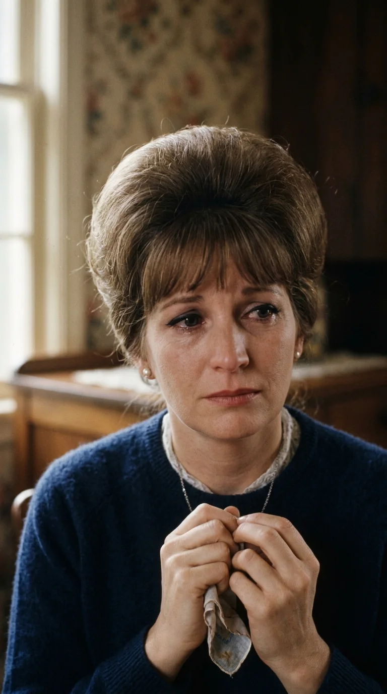
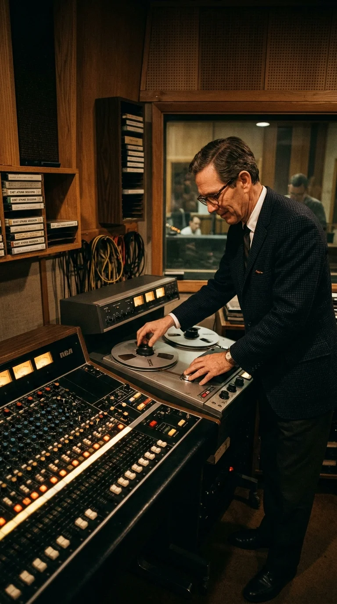
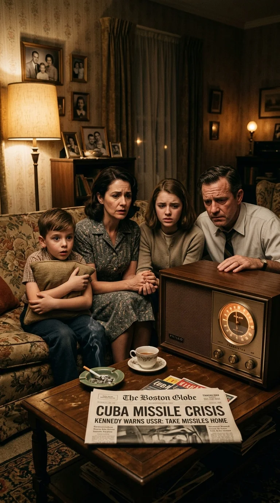
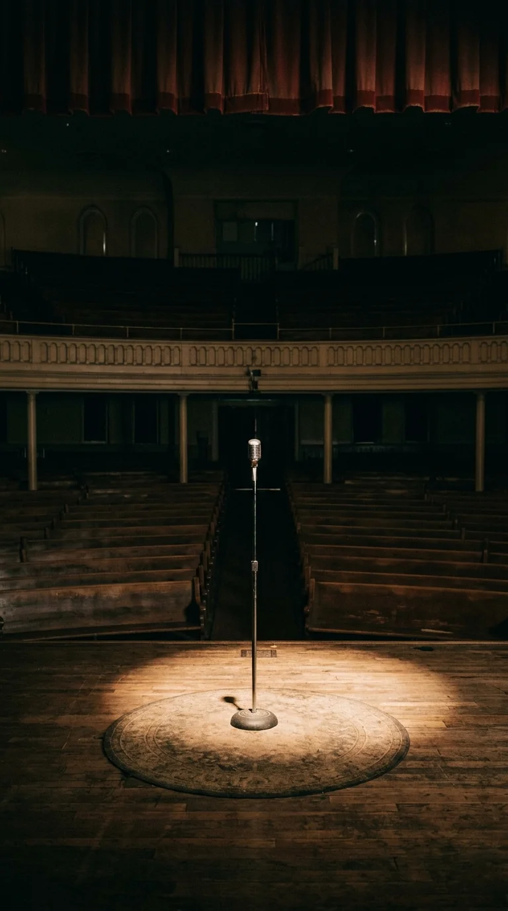

# El fin del mundo de Skeeter Davis: La elegía oculta de una superviviente

### Prólogo: La mañana que no debió amanecer

Hay mañanas en que la luz del sol parece un agravio intolerable. Despertar, abrir la ventana y constatar que el mundo continúa su marcha indiferente —que los pájaros cantan en las ramas, que la marea sigue batiendo contra el malecón y que la multitud camina apresurada por las aceras— mientras el corazón propio yace destrozado bajo toneladas de escombros, constituye uno de los abismos psicológicos más desoladores que un ser humano puede experimentar.

Esa perplejidad ontológica, esa furia silenciosa contra la rutina cósmica de la vida cuando alguien insustituible ha desaparecido, quedó fijada en surcos de vinilo en el verano de 1962. Una melodía frágil, sostenida por las notas ingrávidas de un piano y una voz que sonaba como un cristal al borde de quebrarse, formuló la pregunta que millones de personas se habían hecho en secreto a lo largo de los siglos:

> *«Why does the sun go on shining?*  
> *Why does the sea rush to shore?*  
> *Don't they know it's the end of the world...»*

El público creyó escuchar la queja melancólica de una adolescente a quien le habían roto el corazón en el baile de graduación. Pero bajo la apariencia de una balada romántica del floreciente pop de Nashville, latía una arquitectura de luto mucho más profunda, real y trágica. Para su letrista, era un réquiem por la muerte de su padre. Para su intérprete, Mary Frances Penick —bautizada artísticamente como Skeeter Davis—, no existía metáfora alguna: cada verso era la resurrección espectral del peor amanecer de su existencia, aquella madrugada de agosto de 1953 en una carretera de Kentucky donde vio morir en el asfalto a su otra mitad.

---

### Acto I: Dos voces en una sola garganta

A finales de la década de 1940, en los pasillos de la escuela secundaria Dixie Heights, en Erlanger, Kentucky, dos adolescentes descubrieron que cuando juntaban sus voces no cantaban dos personas distintas: creaban un tercer instrumento indivisible.

Mary Frances Penick era menuda, vivaz e incansable. Su abuelo la había apodado *Skeeter* —una jerga sureña para mosquito— porque no paraba quieta un solo instante. Su compañera de pupitre, Betty Jack Davis, poseía un temple más sereno y un rango vocal bajo y terrenal que encajaba de manera milagrosa con los tonos brillantes y agudos de Mary Frances. Aunque no compartían una sola gota de sangre, adoptaron el apellido de Betty Jack y se presentaron ante los promotores locales como **The Davis Sisters**.

En una época en que la música country estaba dominada por solistas masculinos de honky-tonk o agrupaciones familiares tradicionales, dos muchachas de instituto con peinados perfectos y armonías vocales entrelazadas eran una anomalía electrizante. Sus registros no se limitaban a alternar melodía y coro: se cruzaban, se envolvían y respiraban al unísono con una intuición casi telepática.

El cazatalentos Steve Sholes las descubrió en Detroit y las llevó de inmediato a los estudios de RCA Victor. En la primavera de 1953 registraron un tema titulado *"I Forgot More Than You'll Ever Know"*. En cuestión de semanas, la canción comenzó a trepar las listas de popularidad de *Billboard*. Las dos jóvenes, con apenas veintiún años, se convirtieron en la gran promesa del folklore estadounidense, codeándose en las carteleras de las giras de radio con leyendas consolidadas del *Grand Ole Opry*.

El futuro les pertenecía por completo. Pero la gloria en las carreteras secundarias de la posguerra estadounidense solía cobrarse peajes despiadados.

---

### Acto II: La curva fatídica de la Ruta 9W

En la madrugada del 1 al 2 de agosto de 1953, The Davis Sisters regresaban de actuar en el prestigioso *WWVA Wheeling Jamboree*, en Virginia Occidental. El automóvil enfilaba la autopista hacia Covington, Kentucky, donde residían sus familias. Betty Jack iba al volante; Skeeter dormitaba en el asiento del copiloto, exhausta tras los aplausos y las horas de carretera.

A pocos kilómetros de llegar a su destino, en la Ruta 9W, un vehículo que circulaba en sentido contrario a velocidad suicida perdió el control, invadió el carril contrario y embistió de frente el automóvil de las cantantes.

El impacto fue demoledor. Betty Jack Davis murió en el acto, decapitada por la violencia del choque contra el metal retorcido. Skeeter sobrevivió de puro milagro: su cuerpo atravesó el parabrisas sufriendo fracturas severas en el cráneo, contusiones faciales masivas y un daño cerebral temporal que la mantuvo en coma durante días.

Cuando Mary Frances despertó en una cama de hospital de Cincinnati, rodeada de vendajes y luces blancas, preguntó por su compañera. La respuesta que recibió destruyó su juventud en un segundo. Mientras ella se debatía entre la vida y la muerte, el sencillo *"I Forgot More Than You'll Ever Know"* alcanzaba el **número uno absoluto en las listas de Billboard**, permaneciendo allí durante ocho semanas consecutivas.

La ironía era insoportable. Las radios de todo el país transmitían a cada hora las armonías celestiales de dos hermanas inseparables, mientras una de ellas yacía enterrada en el cementerio y la otra, devorada por la culpa de la superviviente, no encontraba razones para levantarse de la cama.

Presionada por la madre de Betty Jack —quien intentó forzar una sustitución colocando a su otra hija, Georgia, en el dúo—, Skeeter intentó volver a los escenarios por lealtad familiar. Pero cada ensayo era una tortura psicológica. Mirar al micrófono y no escuchar la respiración de Betty Jack a su lado la asfixiaba. En 1956, destrozada anímicamente, Skeeter Davis anunció su retiro definitivo de la música. Tenía veinticinco años y sentía que su vida había terminado en aquella curva de Kentucky.

---

### Acto III: El arquitecto del dolor y la cinta magnetofónica

Quien se negó a permitir que aquella voz se extinguiera en el olvido fue **Chet Atkins**. El virtuoso guitarrista y flamante director de operaciones de RCA Victor en Nashville vio en Skeeter no solo una superviviente con talento, sino el alma perfecta para una revolución estética que estaba a punto de cambiar la historia discográfica: el **Nashville Sound**.

Atkins comprendió que el viejo estilo rural de Nashville necesitaba desprenderse de las guitarras desafinadas y los violines estridentes para conquistar las listas de pop cosmopolita. En el mítico **RCA Studio B**, ubicado en Music Row, Chet construyó un templo de calidez acústica: sustituyó el sonido de taberna por secciones de cuerdas elegantes, coros aterciopelados y una intimidad vocal que situaba al cantante a escasos centímetros del oído del oyente.

A finales de los cincuenta, Atkins convenció a Skeeter de regresar a Nashville como solista. Pero había un obstáculo emocional gigantesco: Skeeter se sentía incompleta cantando sola. Acostumbrada a la dualidad simbiótica de The Davis Sisters, su voz en solitario le parecía desnuda y desolada.

Fue entonces cuando Chet Atkins implementó una solución técnica nacida directamente de un dilema humano: el **double-tracking** (sobregrabación vocal). Utilizando las grabadoras multipista de cinta Ampex, Atkins hizo que Skeeter grabara la melodía principal y, posteriormente, escuchándose por los auriculares, cantara la armonía superior, replicando con exactitud los intervalos que solía hacer con Betty Jack.

Para Skeeter, el procedimiento era una experiencia casi mística. Cada vez que grababa una segunda voz, no estaba ejecutando un truco de estudio: estaba dialogando con el fantasma de su amiga, invocando en la cinta magnética aquella presencia que la carretera le había arrebatado.

---

### Acto IV: La plegaria de Sylvia Dee en Studio B

Hacia mediados de 1962, una partitura llegó al escritorio de Chet Atkins. La música había sido compuesta por Arthur Kent y la letra pertenecía a **Sylvia Dee** (cuyo nombre real era Josephine Moore).

Dee era una respetada escritora neoyorquina que ya había saboreado las mieles del éxito con temas como *"Too Young"* para Nat King Cole. Sin embargo, los versos de aquella nueva pieza no respondían a un encargo comercial ni al despecho de un noviazgo roto. Sylvia los había garabateado entre lágrimas, intentando procesar el duelo insuperable por la muerte prematura de su padre. En sus anotaciones personales, Dee confesó que tras enterrar a su progenitor, lo que más le dolía y enfurecía era salir a la calle y ver que la primavera seguía brotando como si nada hubiera ocurrido.

Atkins escuchó la melodía al piano y supo al instante que sólo una garganta en todo Estados Unidos podía pronunciar aquellas frases sin caer en el melodrama barato: Skeeter Davis.

El **8 de junio de 1962**, el legendario personal de músicos de sesión conocido como el *Nashville A-Team* se congregó en RCA Studio B:
* **Floyd Cramer** se sentó al piano de cola, deslizando sus dedos con su inconfundible estilo *"slip-note"* —esa técnica de rozar una nota un semitono antes de resolver en la tecla correcta, otorgando una sensación de suspiro o sollozo contenido—.
* **Bob Moore** afinó su contrabajo acústico con pulsaciones profundas y solemnes.
* **Buddy Harman** acarició la caja de la batería únicamente con escobillas de alambre, marcando el pulso como el segundero de un reloj que descuenta el tiempo.
* **The Anita Kerr Singers** prepararon sus armonías vocales, envolviendo el arreglo en una niebla celestial.

Cuando Skeeter se paró frente al micrófono RCA 44-BX en la sala semioscura, no necesitó actuar ni imaginar el desamparo. Las estrofas de Sylvia Dee describían con exactitud milimétrica lo que ella había sentido al despertar en el hospital en 1953:

> *«Why do the birds go on singing?*  
> *Why do the stars glow above?*  
> *Don't they know it's the end of the world?*  
> *It ended when I lost your love...»*

Hacia la mitad del tema, la música desciende y Skeeter recita en lugar de cantar. Su voz hablada tiembla con una inocencia desarmante, como una niña perdida en la noche que intenta explicarse por qué su corazón sigue latiendo cuando ya no queda nadie esperándola al otro lado de la puerta. Atkins dejó el micrófono abierto; la vulnerabilidad que quedó atrapada en la cinta no admitía retoques ni repeticiones.

---

### Acto V: Octubre de 1962 y los trece días del pánico nuclear

El sencillo salió de las prensas de RCA Victor a mediados de octubre de 1962 bajo la referencia **47-8098**. Por una coincidencia histórica sobrecogedora, el lanzamiento coincidió con los momentos más tensos de la Guerra Fría: la **Crisis de los Misiles en Cuba**.

Entre el 16 y el 28 de octubre de 1962, el presidente John F. Kennedy y el líder soviético Nikita Jrushchov sostuvieron al planeta entero con el dedo apoyado sobre el botón del holocausto termonuclear. En las escuelas de Norteamérica los niños realizaban ejercicios de evacuación bajo los pupitres; las familias abarrotaban los supermercados para abastecer refugios antiaéreos subterráneos, y las transmisiones de radio se interrumpían periódicamente con pitidos de emergencia nacional.

En medio de esa psicosis colectiva, donde la aniquilación de la especie humana era una posibilidad real que se medía en horas, la voz de Skeeter Davis comenzó a brotar de las bocinas de los transistores:

> *«I wake up in the morning and I wonder*  
> *Why everything's the same as it was...»*

La canción trascendió de golpe su condición de balada de ruptura sentimental. Para millones de familias aterrorizadas que miraban el cielo esperando ver el destello de los misiles balísticos, *"The End of the World"* se convirtió en un himno existencial, un bálsamo de ternura desgarradora que ponía palabras al miedo absoluto a la nada.

El impacto en las listas de ventas no tuvo parangón en los anales de la industria fonográfica. En los primeros meses de 1963, la grabación de Skeeter Davis logró una hazaña irrepetible: alcanzó simultáneamente el **Top 5 en cuatro clasificaciones distintas de la revista Billboard**:
1. **N.º 2** en el *Billboard Hot 100* (Pop general).
2. **N.º 2** en el *Hot Country Singles*.
3. **N.º 1** en el *Adult Contemporary / Easy Listening*.
4. **N.º 4** en el *Hot R&B Singles* (un hito casi impensable para una intérprete country blanca en plena era de la segregación y el auge de Motown).

Skeeter Davis se convirtió en una celebridad internacional, pero jamás olvidó el origen de su éxito. Cuando los periodistas le preguntaban qué sentía al escuchar su tema en la radio, solía responder con una sonrisa melancólica: *"Sé que Betty Jack la está escuchando conmigo"*.

---

### Epílogo: El silencio del Ryman Auditorium

Chet Atkins y Skeeter Davis compartieron una amistad inquebrantable que duró medio siglo. Atkins fue el mentor que la rescató de las tinieblas de la depresión y la acompañó en cada etapa de su madurez artística.

En junio de 2001, cuando Chet Atkins falleció a los 77 años víctima de cáncer, la comunidad musical de Nashville se reunió en el legendario **Ryman Auditorium** —la llamada «iglesia madre de la música country»— para darle el último adiós. En medio de un silencio sepulcral, con su mítica guitarra Gretsch reposando sobre el escenario vacío, los acordes de *"The End of the World"* sonaron a través del sistema de sonido del auditorio como la elegía definitiva a su genio como productor.

Apenas tres años después, en septiembre de 2004, Skeeter Davis falleció a los 72 años tras una larga batalla contra el cáncer de mama. Fiel a su voluntad, su servicio fúnebre se ofició en ese mismo templo sagrado del Ryman. Una vez más, aquella balada nacida de un accidente en la carretera, un padre añorado y una tarde de lluvia en Studio B volvió a inundar las naves del teatro.

Las modas musicales han sepultado a miles de éxitos efímeros, pero *"The End of the World"* permanece intocable en la memoria emocional de la cultura occidental. Ha sonado en el cine de autor, en series televisivas de época y en las habitaciones solitarias de incontables generaciones que han perdido a alguien que amaban.

Porque mientras el sol siga saliendo puntualmente cada mañana sobre los corazones rotos de los hombres y las mujeres, la voz temblorosa de Skeeter Davis seguirá allí: recordándonos que el dolor verdadero no necesita gritos, y que a veces la más dulce de las canciones es el único refugio que queda cuando nuestro propio mundo ha dejado de girar.

---

### 📚 Fuentes y Archivo Documental

1. **Davis, Skeeter.** *Bus Fare to Kentucky: The Autobiography of Skeeter Davis*. Nueva York: Birch Lane Press / Carol Publishing Group, 1993. (Memorias oficiales donde la cantante relata con crudeza el accidente de 1953, su infancia en Dry Ridge y la sesión de grabación con Chet Atkins).
2. **Atkins, Chet & Neely, Bill.** *Country Gentleman: The Chet Atkins Story*. Chicago: Henry Regnery Company, 1974. (Testimonio de Atkins sobre las técnicas de grabación en RCA Studio B y la gestación del Nashville Sound).
3. **Escott, Colin.** *Roadkill on the Three-Chord Highway: Art and Trash in American Popular Music*. Nueva York: Routledge, 2002. (Capítulo dedicado al auge, tragedia y secuelas de The Davis Sisters).
4. **Billboard Magazine.** Archivo hemerográfico histórico (ediciones de agosto de 1953, noviembre de 1962 y marzo-abril de 1963). Reseñas de lanzamientos y evolución histórica en las listas Hot 100, Country, R&B y Adult Contemporary.
5. **RCA Victor Records.** *Studio B Session Logs (Nashville, TN)*. Registro de sesión de grabación n.º 11475 (8 de junio de 1962). Ficha técnica de instrumentación, ingenieros de sonido (Bill Porter) y músicos participantes.
6. **The Country Music Hall of Fame and Museum.** Colección de archivo y perfiles biográficos de Skeeter Davis, Chet Atkins y Floyd Cramer. Nashville, Tennessee.
