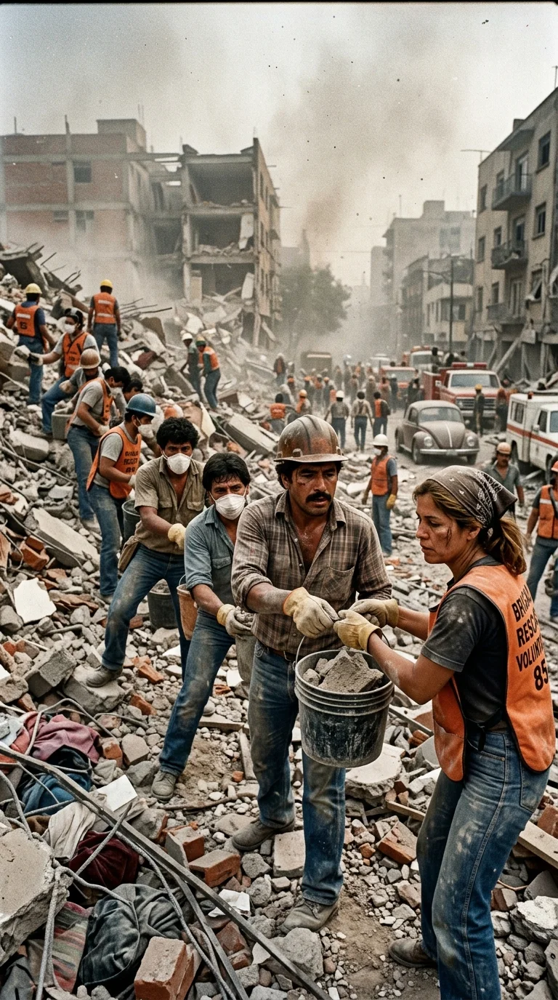
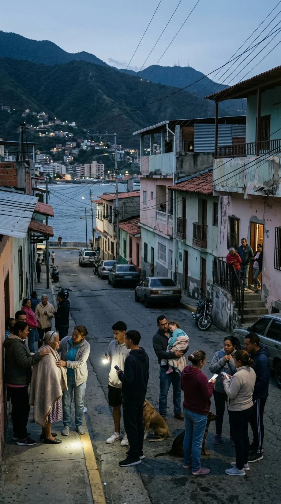
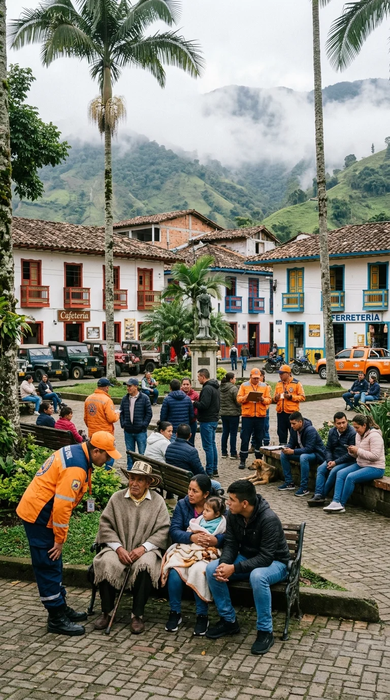
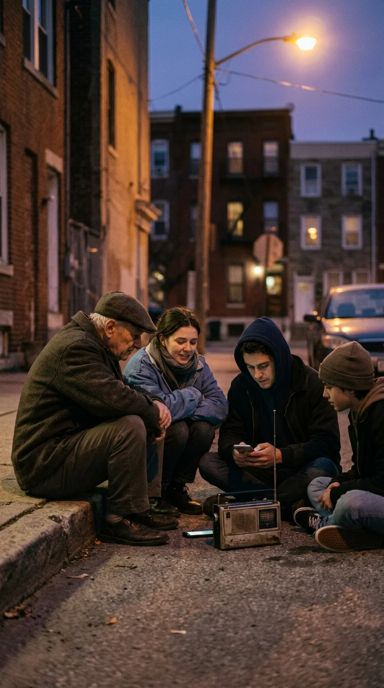
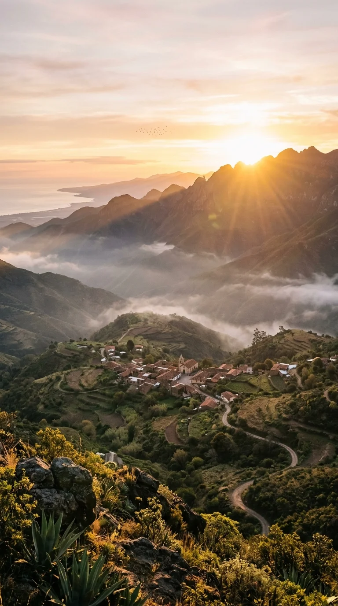

# El himno que aprendió a levantarnos de los escombros

### La historia de cómo una metáfora íntima de Gustavo Cerati en 1985 se transformó en la plegaria de resistencia de un continente: desde el sismo de México hasta el estremecedor ciclo telúrico de 2026 en Venezuela, Colombia y Panamá.

---

## Prólogo: El suelo que cede y la voz que sostiene

Hay momentos exactos en que la realidad desborda las intenciones de un artista. En el otoño bonaerense de 1985, un joven Gustavo Cerati de veinticinco años rasgueaba su guitarra acústica buscando un puente entre la vanguardia del *new wave* británico y la cadencia ancestral de la música andina. Quería hablar de la soledad, del desconcierto íntimo y de los terremotos emocionales que sacuden el pecho cuando una relación se desmorona. Nunca imaginó que aquellas estrofas no le pertenecerían por mucho tiempo.

Apenas cuatro décadas después, en el transcurso de poco más de cien días de 2026, el norte de Sudamérica y el istmo centroamericano vivieron uno de los periodos de mayor liberación de energía tectónica de su historia reciente. Tres terremotos de magnitud superior a 7 estremecieron sucesivamente a Venezuela, Colombia y Panamá. En medio de la zozobra nocturna, las sirenas de emergencia y la polvareda de las réplicas, las radios comunitarias, las redes sociales y los megáfonos de voluntarios volvieron a reproducir el mismo estribillo: *«Despiértame cuando pase el temblor»*.

Esta es la crónica de una canción que aprendió a caminar entre las ruinas y que enseñó a toda una región que la verdadera fuerza nunca estuvo en la solidez del concreto, sino en la mano que se estira para levantar al vecino.

---

## Acto I: La génesis del compás andino (Buenos Aires, 1985)

Para mediados de 1985, Soda Stereo ya no era el trío festivo y juvenil de peinados batidos que cantaba sobre dietas y duchas. Tras el impacto de su álbum debut, Gustavo Cerati, Zeta Bosio y Charly Alberti sentían la necesidad de dotar a su sonido de una densidad dramática más profunda. En la sala de ensayo y en los estudios Moebio, bajo la atenta mirada del técnico de grabación Mariano López, Cerati comenzó a experimentar con un compás inusual para el rock urbano: el pulso sincopado del carnavalito andino y el huayno.

Cerati tomó un teclado programable y emuló el timbre etéreo de los sikus y las quenas del altiplano, entrelazándolos con una caja de ritmos seca y guitarras limpias deudoras de The Police y The Cure. La lírica brotó desde la confesión y el aislamiento: *«Yo caminaré entre las piedras, hasta sentir el temblor en mis piernas...»*. Gustavo hablaba de un cráter desierto y de la vergüenza de sentirse vulnerable frente al mundo. Era un autorretrato sobre el pánico a ser herido. La pista fue titulada provisionalmente con el nombre que pasaría a la posteridad: *Cuando pase el temblor*.

Sin embargo, el destino no permitiría que la canción quedara confinada al plano de la psicología individual.

---

## Acto II: El bautismo de ceniza y lágrimas en México

El 19 de septiembre de 1985, a las 7:19 de la mañana, un terremoto de magnitud 8.1 sacudió los cimientos de la Ciudad de México, derribando cientos de edificios y cobrando miles de vidas. Fue la mayor tragedia urbana de la historia moderna del país. Las imágenes de brigadistas anónimos, vecinos removiendo losas con las manos ensangrentadas y el silencio reverencial exigido con el puño en alto conmovieron al planeta entero.

Dos meses más tarde, en noviembre de 1985, salió al mercado el álbum *Nada Personal*. Cuando Soda Stereo realizó su primera incursión en territorio mexicano, el país aún respiraba a cal y duelo. Los ecos de la catástrofe estaban vivos en cada esquina del Distrito Federal.

Al llegar la noche del concierto y sonar los primeros acordes de *Cuando pase el temblor*, ocurrió un fenómeno inexplicable: el público no saltó para bailar un hit radial. Miles de jóvenes cerraron los ojos, se abrazaron entre lágrimas y alzaron los brazos al cielo para corear *«¡Despiértame cuando pase el temblor!»*. 

En ese instante sagrado, el texto fue arrancado de la libreta de Cerati y entregado a la memoria colectiva. Ya no hablaba de un desamor; era la plegaria desesperada de un pueblo que le pedía al destino despertar de la pesadilla y encontrar a sus hermanos con vida.

---

## Acto III: La falla compartida: El ciclo sísmico de 2026

Cuarenta años más tarde, la naturaleza recordó con crudeza la fragilidad de nuestra geografía. En 2026, el contacto entre las placas tectónicas del Caribe, Nazca, Suramericana y el bloque de Panamá desató una secuencia sin precedentes en el norte del continente:

1. **Venezuela (24 de junio de 2026):** Un violento doblete sísmico de magnitudes 7.2 y 7.5, con diferencia de segundos, sacudió el centro del país. El estado La Guaira, especialmente la franja costera de Caraballeda y sectores de Caracas, revivieron fantasmas históricos ante colapsos de estructuras y deslizamientos.
2. **Colombia (10 de agosto de 2026):** Menos de cincuenta días después, un sismo intraplaca de 7.4 con epicentro en los límites del Chocó y el Eje Cafetero estremeció con furia el occidente y centro del país, sintiéndose con violencia en Manizales, Pereira, Medellín, Cali y Bogotá.
3. **Panamá (9 de octubre de 2026):** Completando la tríada en apenas tres meses, un colosal temblor de 7.7 en la península de Azuero sacudió el istmo panameño a escasa profundidad, dañando cientos de edificaciones desde Chiriquí hasta la capital.

Fueron semanas de zozobra continental, alertas de tsunami canceladas a última hora y noches enteras en vela sobre aceras y parques. Pero en cada una de esas latitudes, la reacción de la sociedad civil fue idéntica: la cadena humana, el café caliente compartido con el desconocido en la acera y la comprobación inmediata de que la familia y los vecinos estuvieran a salvo.

---

## Acto IV: La melodía que no conoce fronteras

¿Por qué una canción de rock grabada hace cuatro décadas continúa siendo el refugio instintivo ante cada sismo? La respuesta no reside en su estructura armónica ni en su producción técnica, sino en su profundo sentido de humanidad compartida.

Durante la noche del terremoto en Colombia y en las réplicas que siguieron a los temblores de Venezuela y Panamá, emisoras de radio y transmisiones en vivo encendieron sus micrófonos para calmar el pánico colectivo. Y una y otra vez, la voz de Cerati surcó el dial:

> *«Sé que la música no detiene la caída de una pared, pero tiene el poder de sostener el alma de quien está esperando en la oscuridad a que el mundo deje de crujir.»*

El verso *«nadie me vio partir, nadie me espera»* adquirió el significado de la pérdida, pero el estribillo se convirtió en una declaración de victoria moral. Cantar *«cuando pase el temblor»* implica la certeza ineludible de que la sacudida terminará, de que la calma regresará y de que habrá un amanecer esperándonos.

---

## Epílogo: La herencia de la fraternidad

Gustavo Cerati partió en 2014, pero las canciones que nacen de la verdad humana nunca mueren. En los estadios de Tilcara donde se rodó el legendario videoclip entre cardones y cerros multicolores, el eco de su voz sigue resonando como un pacto con la tierra.

Los mapas políticos trazan aduanas, pasaportes y fronteras ideológicas. Sin embargo, cuando la corteza terrestre cruje, las divisiones se evaporan en una fracción de segundo. En el polvo de México, en la bruma de La Guaira, en las laderas de Colombia y en el puente que es Panamá, late el mismo corazón. 

Y mientras la tierra siga buscando su acomodo, la música de Soda Stereo permanecerá allí, como un faro encendido para recordarnos que ninguna sacudida es eterna si nos mantenemos de pie juntos.

---

### 📚 Fuentes y Archivo Documental

1. **Fernández Bitar, Marcelo.** *Soda Stereo: La biografía total.* Editorial Sudamericana, Buenos Aires, 2017.
2. **Aboitiz, Maitena.** *Cerati en primera persona.* Ediciones B, Buenos Aires, 2013.
3. **Servicio Geológico de los Estados Unidos (USGS):** *Earthquake Hazards Program — Reportes técnicos y catálogos de sismicidad del norte de Sudamérica y Centroamérica (2026).*
4. **Fundación Venezolana de Investigaciones Sismológicas (FUNVISIS):** *Boletines sismológicos oficiales del evento del 24 de junio de 2026.*
5. **Servicio Geológico Colombiano (SGC):** *Informe técnico preliminar del sismo de profundidad intermedia de magnitud 7.4 (10 de agosto de 2026).*
6. **Instituto de Geociencias de la Universidad de Panamá (UP):** *Monitoreo y análisis del sismo de magnitud 7.7 en la Península de Azuero (9 de octubre de 2026).*
7. **Archivo Hemerográfico El Universal y Excélsior:** *Crónicas del sismo de 1985 y la recepción sociocultural de las giras de Soda Stereo en México (1985-1988).*
