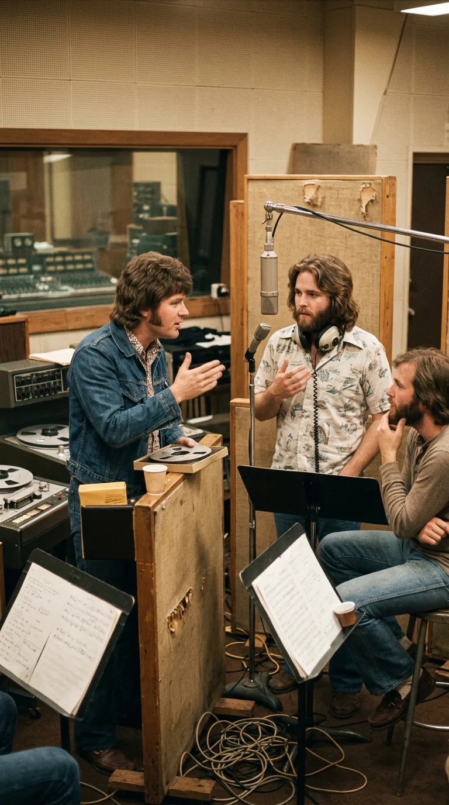
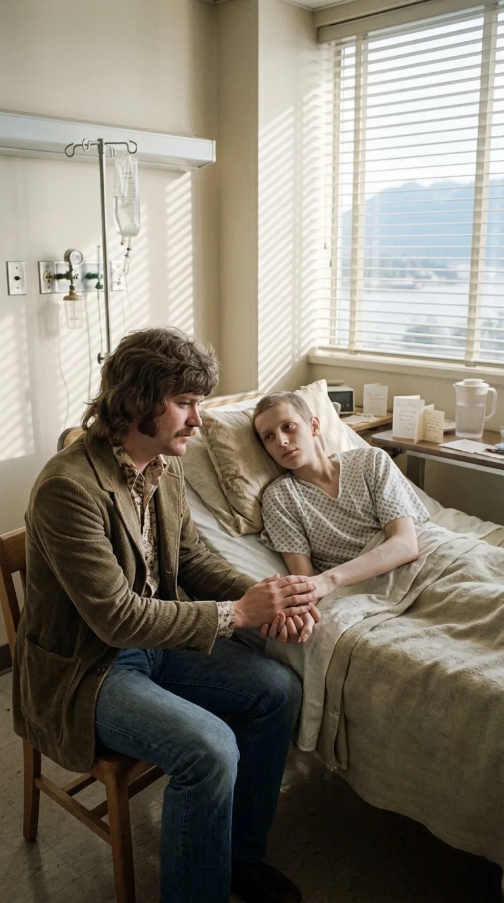
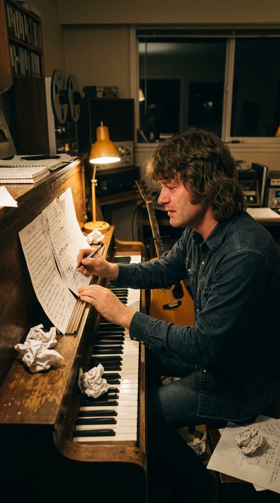
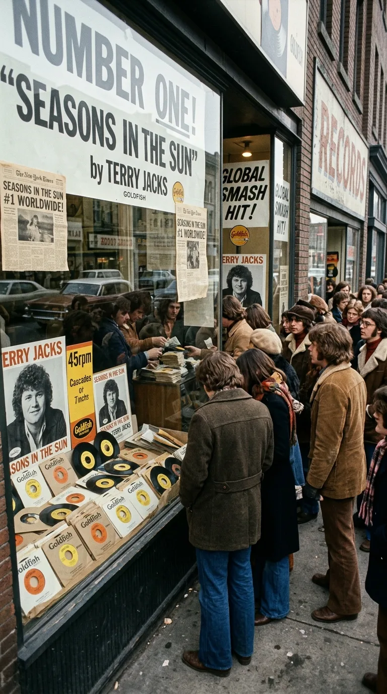

# The Joyful Farewell of a Dying Soul: The Hidden Tragedy Behind "Seasons in the Sun"

> It sold fourteen million copies, and the entire world danced to it on the beaches of 1974 like an ode to summer. Hidden behind its breezy rhythm was the farewell letter of a young man dying of cancer.

---

## Prologue: The Smile That Fooled the World

Some melodies are so infectious and sunlit that the ear welcomes them without asking a single question. In early 1974, a sweet, hummable refrain flooded radio stations from London to Tokyo, from New York to Buenos Aires: *"We had joy, we had fun, we had seasons in the sun..."* Teenagers sang it at the top of their lungs in convertibles, families hummed it at outdoor picnics, and dance floors spun it as a carefree celebration of youth and bright days.

The single moved fourteen million physical copies in a matter of months, claiming the undisputed number-one spot on the charts in the United States, the United Kingdom, Canada, and Germany. Its singer, an amiable young Canadian named Terry Jacks, was vaulted overnight to the pinnacle of the global record industry.

Yet behind that facade of radiant harmonies and buoyant handclaps lay one of the most startling and poetic paradoxes in pop history: the entire world was dancing and celebrating, word for word, the heartbreaking last testament of a young man with only weeks left to live.

---

## Act I: The Acidic Shadow of Jacques Brel

To trace the origin of this song, we have to travel thirteen years backward in time to the bohemian theater world of Paris in 1961. There, the brilliant Belgian singer-songwriter Jacques Brel composed and recorded one of his sharpest, most provocative songs: *"Le Moribond"* (*"The Dying Man"*).

Brel's piece was never meant to draw gentle tears or offer spiritual comfort. It was a theatrical funeral march drenched in corrosive black humor and blunt realism. In it, a man on his deathbed summons the people around him to settle accounts before he draws his final breath. He bids farewell to Émile, his closest carousing friend; to the village priest, reminding him of his hypocritical sermons; and, at the song's stinging climax, to Antoine, his own wife's lover (*"Goodbye Antoine, I never liked you, though I know you slept with my wife... take good care of her once I close my eyes"*).

The song was a slap in the face to the bourgeois conventions of its era. In the mid-1960s, American poet and balladeer Rod McKuen heard the piece in Paris and adapted it into English under the title *"Seasons in the Sun."* McKuen softened the harsher edges of the infidelity, yet the song remained a niche curiosity, cherished mainly by devotees of European *chanson*.

---

## Act II: The Forgotten Tape of the Beach Boys

By the early 1970s, Terry Jacks was already a respected figure in Canada thanks to the success of his group, the Poppy Family. Seeking new creative horizons, he was invited to Los Angeles to produce studio material for the Beach Boys—the legendary California band trying to reinvent its sound in the wake of Brian Wilson's psychological crisis.

During sessions at Hollywood's storied Western Recorders in 1972, Terry suggested cutting a modern rendition of Rod McKuen's adaptation. At first, the band embraced the idea. They laid down the basic guitar and percussion tracks, and Carl Wilson sang his unmistakable lead vocal over the melody.

Yet the chemistry unraveled before the mixes were ever finished. The Beach Boys concluded that a song about death and parting clashed head-on with the golden myth of sun, surf, and fast cars their audience expected from them. Studio tensions mounted, the band lost interest, and the two-inch master tape was banished to the back of a storage closet, seemingly condemned to total oblivion.

---

## Act III: The Blow of Leukemia and the Three Farewells

Terry Jacks returned to Vancouver feeling that the project had been a dead end. Then, in late 1973, fate dealt a devastating blow that altered his life forever: one of his closest, dearest friends from his youth was diagnosed with terminal leukemia.

Watching his friend fade away in a hospital bed over a matter of weeks tore the musician apart. Through long nights of vigil and grief, Terry remembered the melody the Beach Boys had shelved. Yet when he reread the lyrics, he realized that Jacques Brel's theatrical sarcasm and the coolness of French satire felt like an insult in the face of the real sorrow he was living through.

Sitting at his piano in the dead of night, Jacks picked up a pencil and crossed out every line steeped in bitterness or infidelity. He set out to turn the song into the farewell letter his dying friend would leave to the people he loved before departing:

* **Farewell to a childhood friend:** The opening verse (*"Goodbye to you, my trusted friend..."*) recalled childhood races, climbing trees at nine years old, and gratitude for having shared the road together.
* **Asking a father's forgiveness:** In the second verse (*"Goodbye, Papa, please pray for me..."*), the speaker bows before his father, asking forgiveness for having been the black sheep of the family and thanking him for the stern love that tried to guide him right.
* **Tenderness toward Michelle:** The third verse was entirely Jacks's own creation (*"Goodbye, Michelle, my little one..."*), dedicated to the innocence of a young girl who had brought light back into his darkest days.

Rather than sounding grim, the chorus was conceived as a shaft of sunlight: celebrating that, however brief life might be, they had known joy, laughter, and bright seasons beneath the sky.

---

## Act IV: The Rebellion of Goldfish Records

With the demo recorded in his own studio and his voice trembling with emotion, Terry took the tape to executives at the major multinational record labels in search of distribution. The answer was a unanimous door slammed in his face. Executives told him the rhythm was too naive, that listeners wanted hard rock or disco, and left him with a blunt verdict: *"Nobody in their right mind is going to buy a record about a man dying in bed."*

Wounded in his pride—and holding fast to his promise to his friend's memory—Terry Jacks refused to shelve the song. He withdrew his life savings and pressed the vinyl singles himself under his modest independent label, *Goldfish Records*.

What happened next defied every rule of the marketplace. Local radio stations in Vancouver began spinning the record at the insistence of listeners. Within weeks, demand spilled across the border into the United States. The single shot up the Billboard Hot 100 to number one, where it stayed for three consecutive weeks, repeating the phenomenon across the United Kingdom, Canada, and much of Europe. Fourteen million people bought the record, turning it into one of the best-selling singles of all time.

---

## Epilogue: The Art of Letting Go

Fifty years after that unrepeatable phenomenon, *"Seasons in the Sun"* lingers in collective memory as a fascinating poetic riddle. It stands as unmistakable proof that music holds the quiet miracle of wrapping the sharpest grief inside enduring beauty.

Those who danced to it in the summer of 1974 believed they were celebrating endless youth; those who listen to it today with an open heart recognize something far deeper—a profound act of human grace: the right to say goodbye to the people we love not with bitterness or reproach, but in gratitude for the good fortune of having shared a moment in the sun before evening fell.

---

### 📚 Sources and Archival Records

1. **Rolling Stone Magazine**: Contemporary music criticism and archival reporting on the Terry Jacks phenomenon and the independent launch of Goldfish Records (March 1974).
2. **Billboard Magazine (USA)**: Historical record of the Billboard Hot 100 chart (March 2, 1974: #1 "Seasons in the Sun," holding the top position for 3 consecutive weeks).
3. **Jacques Brel / Barclay Records**: Original recordings and sheet music of *"Le Moribond"* (Paris, 1961), alongside comparative analysis of Rod McKuen's translation (1964) and Terry Jacks's lyrical revisions.
4. **The Beach Boys Studio Archives (Capitol Records)**: Production logs from the Western Recorders sessions in Hollywood (1971–1972), documenting the shelved session master tape featuring Carl Wilson on lead vocals under Terry Jacks's production.
5. **Jacks, Terry — Memoirs and Public Testimony**: Press interviews and autobiographical archive (*"This Is My Story: From The Poppy Family to Seasons in the Sun,"* Vancouver, 2014) detailing his friend's leukemia diagnosis and the crafting of the definitive lyrics.
6. **Canadian Music Hall of Fame / RPM Magazine**: Canadian recording industry archives documenting worldwide physical sales certifications exceeding 14 million units beginning in 1974.
