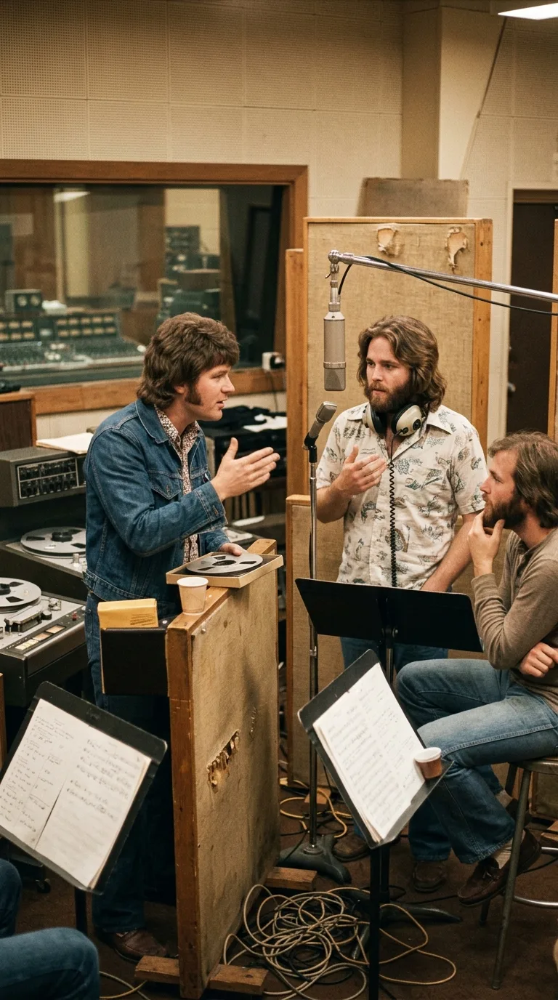
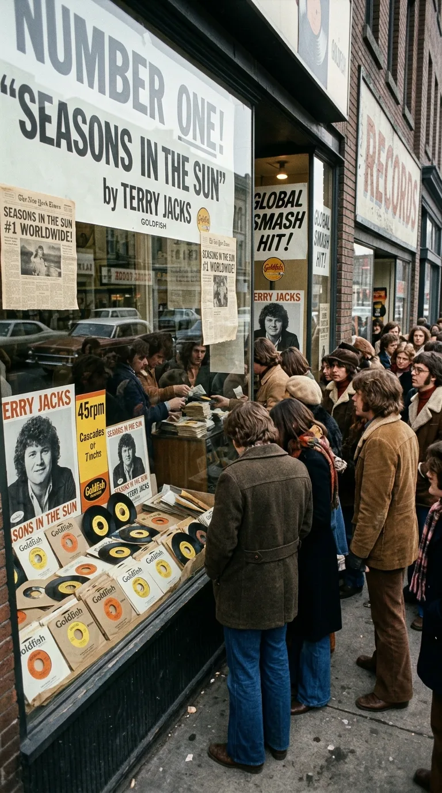

# El himno alegre de un moribundo: La tragedia oculta tras «Seasons in the Sun»

> Vendió catorce millones de copias y el mundo entero la bailó en las playas de 1974 como un canto al verano. Detrás de su compás ligero se escondía la carta de despedida de un joven muriendo de cáncer.

---

### Prólogo: La sonrisa que engañó al planeta

Hay melodías tan contagiosas y radiantes que el oído las abraza sin hacer preguntas. A comienzos de 1974, un estribillo dulce y tarareable inundó las emisoras de radio desde Londres hasta Tokio, desde Nueva York hasta Buenos Aires: *«We had joy, we had fun, we had seasons in the sun...»*. Los adolescentes la coreaban en los automóviles descapotables, las familias la cantaban en picnics al aire libre y las discotecas la programaban como una celebración desenfadada de la juventud y los días luminosos.

El sencillo despachó catorce millones de copias físicas en cuestión de meses, alcanzando el número uno indiscutido en las listas de Estados Unidos, el Reino Unido, Canadá y Alemania. Su intérprete, un joven canadiense de aspecto afable llamado Terry Jacks, fue catapultado de la noche a la mañana a la cima de la industria discográfica mundial.

Sin embargo, detrás de aquella fachada de armonías luminosas y palmas alegres se ocultaba una de las paradojas más sobrecogedoras y poéticas de la historia del pop: el mundo entero estaba bailando y festejando, palabra por palabra, el testamento desgarrador de un hombre joven al que le quedaban pocas semanas de vida.

---

### Acto I: La ácida sombra de Jacques Brel

Para desentrañar el origen de esta obra es imprescindible viajar trece años atrás en el tiempo, a la bohemia teatral de París en 1961. Allí, el genial cantautor belga Jacques Brel compuso y grabó una de sus canciones más mordaces y provocadoras: *«Le Moribond»* (*«El moribundo»*).

La pieza de Brel no pretendía conmover hasta las lágrimas ni ofrecer consuelo espiritual. Era una marcha fúnebre teatralizada, empapada de un humor negro corrosivo y un realismo descarnado. En ella, un hombre postrado en su lecho de muerte convocaba a quienes lo rodeaban para pasarles factura antes de expirar. Se despedía de Émile, su mejor amigo de juergas; del cura párroco del pueblo, a quien le recordaba sus sermones hipócritas; y, en el momento culminante de la obra, de Antoine, el amante de su propia esposa (*«Adiós Antoine, nunca te quise, pero sé que te acostaste con mi mujer... cuida bien de ella cuando yo cierre los ojos»*).

La canción era una bofetada a las convenciones burguesas de la época. A mediados de los años sesenta, el poeta y baladista estadounidense Rod McKuen escuchó la obra en París y decidió adaptarla al inglés bajo el título de *«Seasons in the Sun»*. McKuen suavizó los bordes más grotescos de la infidelidad, pero la canción continuó siendo una curiosidad de nicho, reservada para los amantes de la *chanson* europea.

---

### Acto II: La cinta olvidada de The Beach Boys

A principios de los años setenta, Terry Jacks ya era un nombre respetado en Canadá gracias al éxito de su grupo The Poppy Family. Buscando nuevos horizontes creativos, fue convocado a Los Ángeles para producir material de estudio para The Beach Boys, la mítica banda californiana que intentaba reinventar su sonido tras la tormenta psicológica de Brian Wilson.

Durante las sesiones en los míticos estudios Western Recorders de Hollywood en 1972, Terry les propuso registrar una versión moderna de la adaptación de Rod McKuen. La idea entusiasmó inicialmente al grupo. Grabaron las pistas básicas de guitarras y percusión, y Carl Wilson colocó su inconfundible voz líder sobre la melodía.

Sin embargo, la química se desmoronó antes de terminar las mezclas. The Beach Boys consideraron que una canción sobre la muerte y la despedida chocaba frontalmente con el mito dorado de sol, olas y coches veloces que su público esperaba de ellos. Las tensiones en el estudio crecieron, la banda perdió el interés y la cinta de dos pulgadas fue desterrada al fondo de un armario de archivos, aparentemente condenada al olvido absoluto.

---

### Acto III: El golpe de la leucemia y las tres despedidas

Terry Jacks regresó a Vancouver sintiendo que el proyecto había sido un callejón sin salida. Pero a finales de 1973, el destino le asestó un golpe demoledor que cambiaría su vida para siempre: uno de sus mejores y más íntimos amigos de la juventud fue diagnosticado con leucemia terminal.

Ver a su compañero apagarse en una cama de hospital en cuestión de semanas desgarró el alma del músico. En medio de largas noches de vigilia y duelo, Terry recordó aquella melodía que The Beach Boys habían desechado. Pero al releer la letra, comprendió que el sarcasmo teatral de Jacques Brel y la frialdad de la sátira francesa eran un insulto frente al dolor real que estaba viviendo.

Sentado a su piano en la madrugada, Jacks tomó un lápiz y tachó cada línea que hablara de rencor o desamor. Decidió transformar la canción en la carta de despedida que su amigo moribundo le dejaría a sus seres queridos antes de partir hacia la nada:

* **El adiós al amigo de la infancia:** La primera estrofa (*«Goodbye to you, my trusted friend...»*) rememoraba las carreras infantiles, los árboles trepados a los nueve años y la gratitud por haber compartido el camino.
* **El perdón al padre:** En la segunda estrofa (*«Goodbye, Papa, please pray for me...»*), el protagonista se arrodillaba ante su padre, pidiéndole perdón por haber sido la oveja negra de la familia y agradeciéndole el amor severo que intentó enderezarlo.
* **La ternura hacia Michelle:** La tercera estrofa fue una creación total de Jacks (*«Goodbye, Michelle, my little one...»*), dedicada a la inocencia de una niña pequeña que le había devuelto la luz en sus días más oscuros.

El estribillo, en lugar de sonar sombrío, fue concebido como un rayo de sol: celebrar que, a pesar de la brevedad de la existencia, habían tenido alegría, diversión y temporadas luminosas bajo el cielo.

---

### Acto IV: La rebelión de Goldfish Records

Con la maqueta grabada en su propio estudio y la voz rota por la emoción, Terry presentó la cinta a los directivos de las grandes multinacionales discográficas en busca de distribución. La respuesta fue un portazo unánime. Los ejecutivos le dijeron que el ritmo era demasiado ingenuo, que la gente buscaba rock pesado o música disco, y le dejaron una sentencia lapidaria: *«Nadie en su sano juicio va a comprar un disco sobre un hombre agonizando en una cama»*.

Herido en su dignidad y con la promesa intacta a la memoria de su amigo, Terry Jacks se negó a archivar la canción. Retiró los ahorros de toda su vida y decidió fabricar los discos sencillos de vinilo por su cuenta bajo su modesto sello independiente, *Goldfish Records*.

Lo que ocurrió a continuación desafió todas las leyes del mercado. Las radios locales de Vancouver comenzaron a radiar el tema ante la insistencia de los oyentes. En semanas, la demanda cruzó la frontera hacia Estados Unidos. El sencillo se disparó en el Billboard Hot 100 hasta alcanzar el primer puesto, donde permaneció durante tres semanas consecutivas, replicando el fenómeno en el Reino Unido, Canadá y media Europa. Catorce millones de personas compraron el disco, convirtiéndolo en uno de los singles más vendidos de todos los tiempos.

---

### Epílogo: El arte de soltar la mano

Cincuenta años después de aquel fenómeno irrepetible, *«Seasons in the Sun»* permanece en la memoria colectiva como un enigma poético fascinante. Es la prueba irrefutable de que la música posee la capacidad milagrosa de envolver el dolor más desgarrador en una capa de belleza trascendente.

Quienes la bailaron en el verano de 1974 creían celebrar la juventud eterna; quienes la escuchan hoy con el corazón despierto comprenden que estaban presenciando un acto supremo de piedad humana: el derecho a despedirse de quienes amamos no con amargura ni reproches, sino agradeciendo la fortuna de haber compartido un instante bajo el sol antes de que caiga la tarde.

---

### 📚 Fuentes y Archivo Documental

1. **Rolling Stone Magazine**: Archivos de crítica musical y reportajes de época sobre el fenómeno de Terry Jacks y la independencia discográfica de Goldfish Records (marzo de 1974).
2. **Billboard Magazine (EE.UU.)**: Registro histórico del chart Billboard Hot 100 (2 de marzo de 1974: #1 «Seasons in the Sun», manteniéndose en la cima durante 3 semanas consecutivas).
3. **Jacques Brel / Barclay Records**: Grabaciones originales y partituras de *«Le Moribond»* (París, 1961), con análisis comparativo de la traducción de Rod McKuen (1964) y las modificaciones líricas de Terry Jacks.
4. **The Beach Boys Studio Archives (Capitol Records)**: Registros de producción de las sesiones en Western Recorders de Hollywood (1971–1972), cinta maestra de sesión archivada con voz líder de Carl Wilson bajo producción de Terry Jacks.
5. **Jacks, Terry — Memorias y Testimonios Públicos**: Declaraciones hemerográficas y archivo autobiográfico (*«This Is My Story: From The Poppy Family to Seasons in the Sun»*, Vancouver, 2014) sobre el diagnóstico de leucemia de su amigo y la gestación de la letra definitiva.
6. **Canadian Music Hall of Fame / RPM Magazine**: Archivos de la industria discográfica canadiense sobre la certificación de ventas mundiales que superaron los 14 millones de unidades físicas a partir de 1974.
