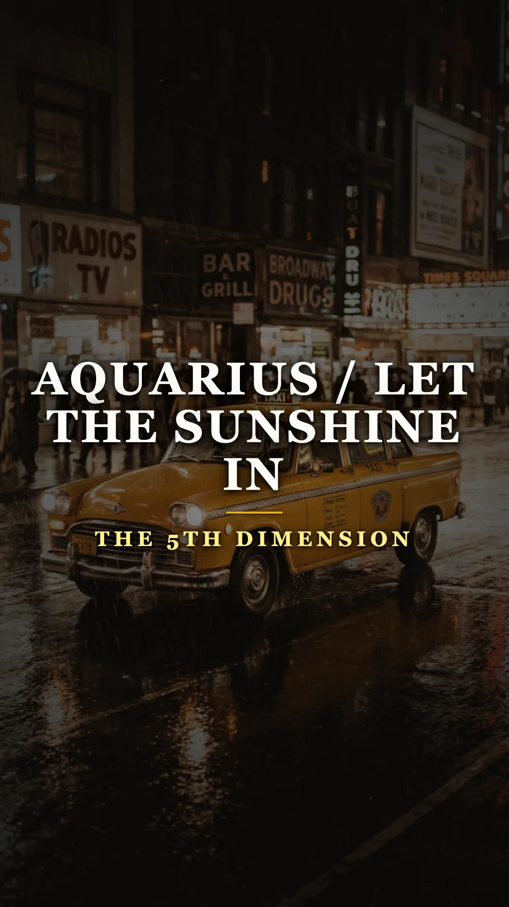
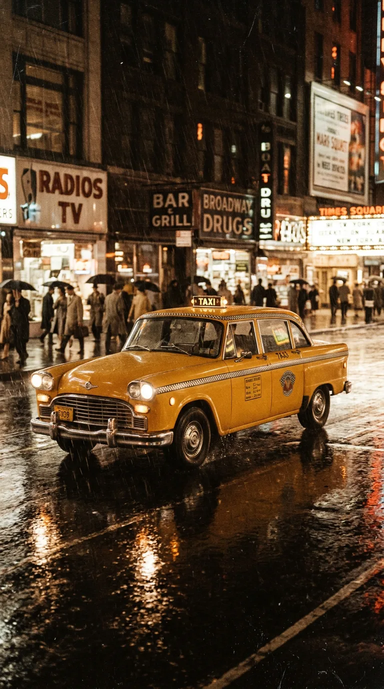
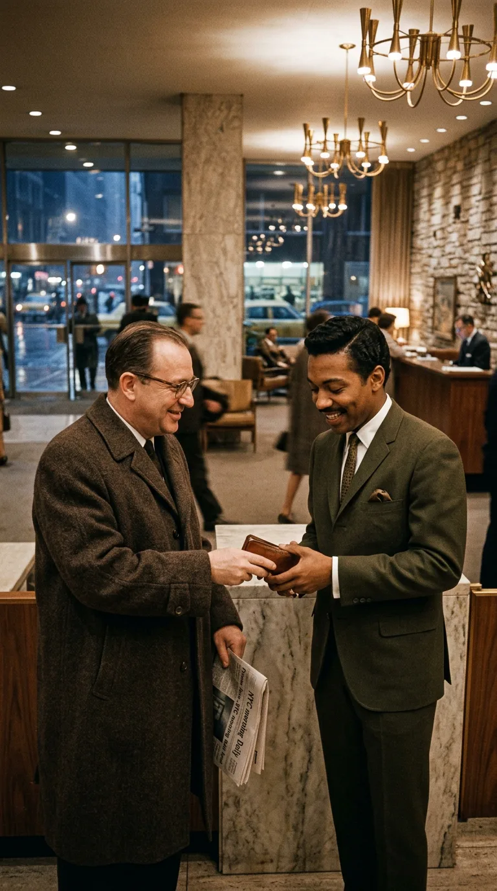
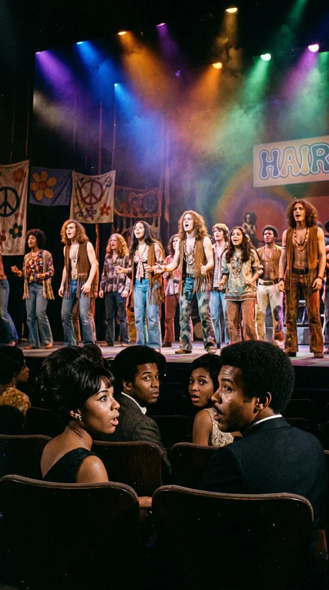
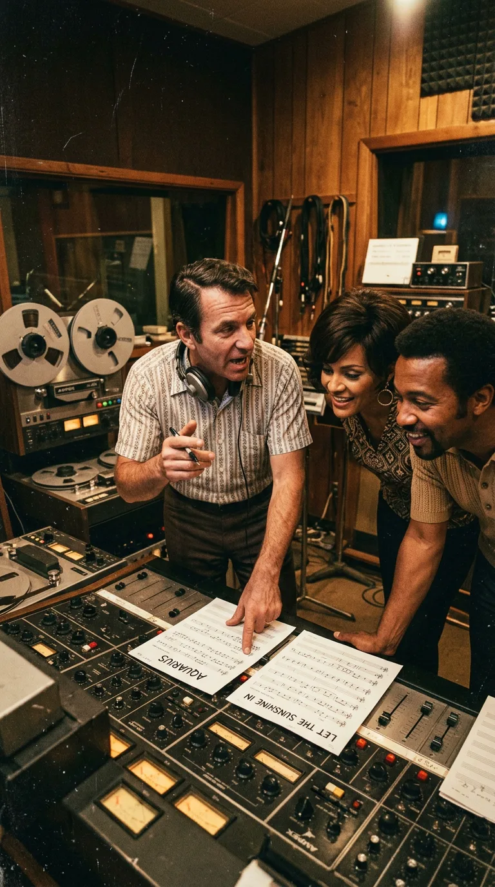
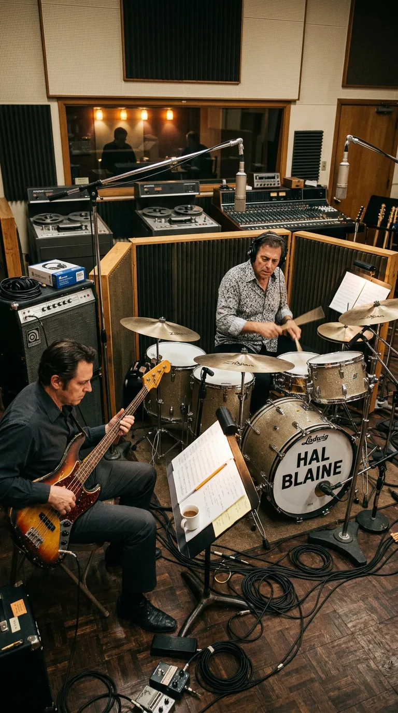
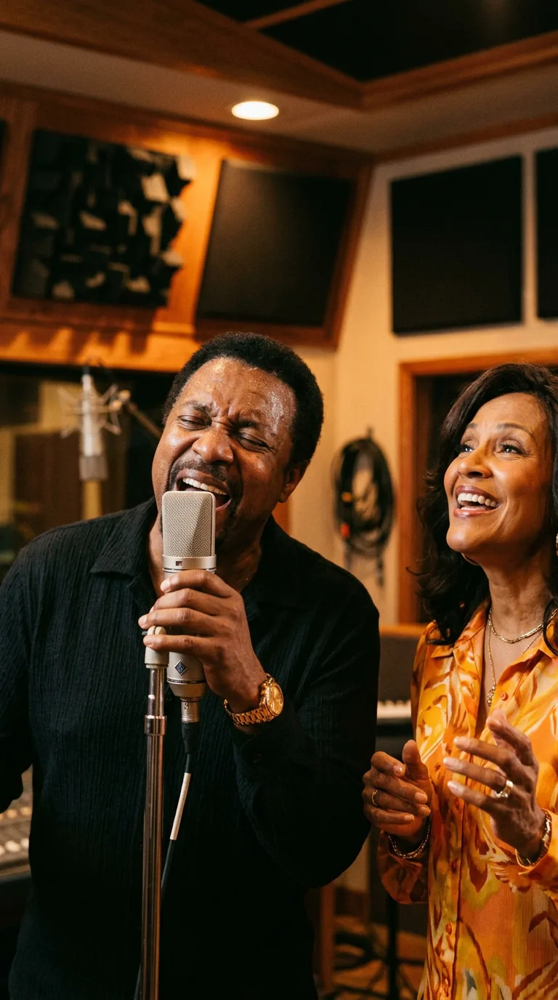
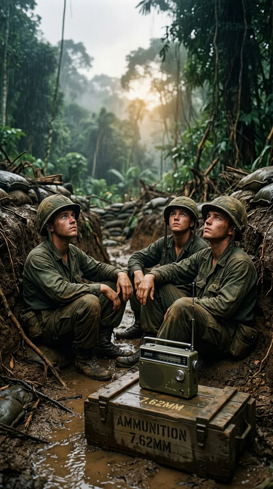
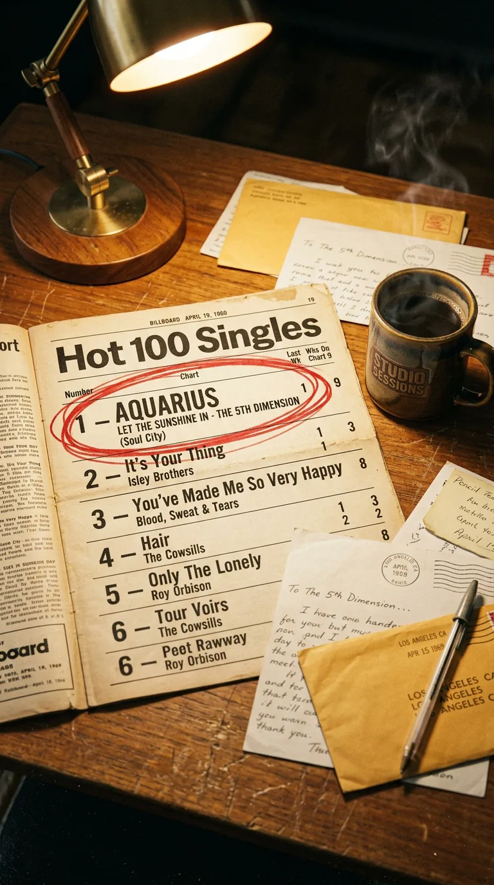
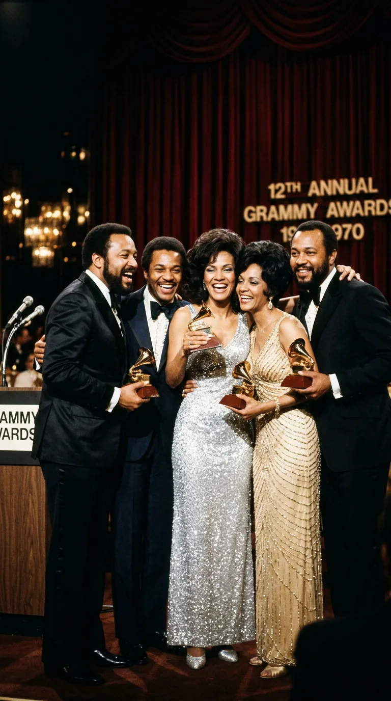

# El Himno de Luz que Nació de una Billetera Perdida

*1969: The 5th Dimension, la armonía vocal que unió la astrología y el góspel para desafiar la pesadumbre de Vietnam.*

### Prólogo: La casualidad que abrió las nubes

> *«When the moon is in the Seventh House / And Jupiter aligns with Mars / Then peace will guide the planets / And love will steer the stars...»*

En los primeros meses de **1969**, Estados Unidos parecía un país desangrado por la fractura social. Más de medio millón de jóvenes soldados combatían en las selvas de Vietnam, los ataúdes cubiertos con banderas llegaban a diario a las bases aéreas y las calles de las grandes ciudades ardían entre marchas pacifistas y gases lacrimógenos. El desánimo y la incertidumbre dominaban las conversaciones cotidianas.

*Nueva York, 1968: Un taxi amarillo cruzando Broadway bajo la lluvia, escenario del extravío providencial de la cartera.*

En medio de aquella pesadumbre generalizada, una explosión de luz, armonía vocal y optimismo cósmico partió en dos las transmisiones de radio: **«Aquarius / Let the Sunshine In»**, del quinteto californiano **The 5th Dimension**.

Lo que casi nadie imaginaba al escuchar aquel canto a la paz universal era que la grabación jamás habría existido sin un tropiezo fortuito en una noche lluviosa de Nueva York, sin un taxi de Manhattan y sin el gesto honrado de un desconocido que devolvió una billetera perdida con todos sus documentos.

---

### Acto I: El asiento trasero del taxi y las entradas para «Hair» (1968)

A finales de **1968**, **The 5th Dimension** —el quinteto vocal formado por **Billy Davis Jr.**, **Marilyn McCoo**, **Florence LaRue**, **Lamonte McLemore** y **Ron Townson**— viajó a Nueva York para cumplir una temporada de presentaciones en el prestigioso club nocturno del hotel **Americana de Manhattan**.

Tras una cena en el centro de la ciudad, **Billy Davis Jr.** abordó un clásico taxi amarillo para regresar al hotel. Al descender a toda prisa bajo la lluvia, no se percató de que **su cartera de cuero marrón, con todo el dinero en efectivo, sus tarjetas y sus documentos de identidad, se había deslizado sobre el asiento trasero**.

*Hotel Americana, Manhattan: El vestíbulo donde la honradez de un desconocido devolvió la cartera perdida a Billy Davis Jr.*

A la mañana siguiente, Davis despertó presa del pánico. Pero la suerte le sonrió de forma providencial: el pasajero que subió al taxi después de él encontró la cartera y, al ver la identificación del cantante, la llevó personalmente a la recepción del Hotel Americana.

Aquel honrado ciudadano no era un oficinista cualquiera: **formaba parte del equipo de producción de *Hair: The American Tribal Love-Rock Musical***, el revolucionario y polémico montaje teatral de Broadway que desafiaba a los tribunales por sus desnudos y sus proclamas contra la Guerra de Vietnam en el **Biltmore Theatre**. Como agradecimiento sincero por su honradez, el grupo lo invitó a tomar algo y el productor, a cambio, les entregó cinco entradas en platea para la función de esa misma tarde.

*Biltmore Theatre, Broadway: El elenco de «Hair» en escena, donde The 5th Dimension descubrió el embrujo de «Aquarius».*

Los cinco integrantes de The 5th Dimension se sentaron en el patio de butacas sin sospechar la sacudida que iban a experimentar. Cuando el telón se alzó y la compañía entonó los primeros versos de la suite astrológica ***«Aquarius»*** (con música de **Galt MacDermot** y letras de **James Rado** y **Jerome Ragni**), Marilyn McCoo y Billy Davis Jr. se miraron deslumbrados: necesitaban grabar aquella pieza a toda costa.

---

### Acto II: La visión quirúrgica de Bones Howe

De regreso en Los Ángeles, el grupo acudió entusiasmado a su productor e ingeniero de cabecera: **Dayton Burr «Bones» Howe** —el prestigioso arquitecto sonoro que ya los había llevado a la gloria con *«Up, Up and Away»* y *«Stoned Soul Picnic»*—.

Howe tomó un vuelo a Nueva York para ver *Hair* con sus propios oídos. Su diagnóstico profesional fue tajante: *«Aquarius»* era una pieza fascinante, pero como canción pop para la radio resultaba incompleta; era un preludio teatral de apenas dos minutos y medio que se detenía de golpe sin ofrecer un clímax emocional al oyente.

*Los Ángeles, 1969: El productor Bones Howe con las partituras en mano, concibiendo la unión de dos polos opuestos.*

Sin embargo, Howe se había quedado hasta el final de la obra. Allí, en la escena cumbre de la tragedia donde el soldado Claude muere en combate en Vietnam, el elenco entero avanzaba hacia el público entonando una plegaria repetitiva y catártica: ***«The Flesh Failures (Let the Sunshine In)»*** (*«Deja entrar el sol»*).

Fue entonces cuando Bones Howe tuvo la revelación de su vida:

> *«Pensé: "Si grabamos 'Aquarius' sola, la gente sentirá que la canción se queda a mitad de camino. Pero si tomamos los primeros compases místicos y los empalmamos en un cambio de ritmo con el coro final de 'Let the Sunshine In', tendremos dos polos opuestos: la contemplación cósmica y el júbilo terrenal"»*.

---

### Acto III: The Wrecking Crew y el trance góspel de Billy Davis Jr.

En **enero de 1969**, en los míticos estudios **United Western Recorders** de Sunset Boulevard en Hollywood, Howe reunió a la realeza de los músicos de sesión: la legendaria banda **The Wrecking Crew**.

La base rítmica quedó en manos de **Hal Blaine** en la batería y **Joe Osborn** en el bajo eléctrico Fender Jazz Bass, acompañados por las guitarras de **Tommy Tedesco** y los teclados de **Larry Knechtel**.

*United Western Recorders: Hal Blaine a la batería y Joe Osborn con el bajo Fender Jazz Bass sentando la base rítmica de The Wrecking Crew.*

El arreglo fue un prodigio de arquitectura dinámica:
* La primera mitad —conducida por la voz serena y cristalina de **Marilyn McCoo** y las armonías a cinco voces— flotaba en un compás espacioso y soñador bajo los signos del zodíaco.
* De pronto, en el minuto 2:30, la batería de Hal Blaine ejecutó un redoble descendente, el tempo se aceleró y la canción giró hacia una fiesta de *soul* y *gospel* impulsada por palmas y un bajo demoledor.

Al registrar la voz solista de la segunda parte (*«Let the Sunshine In»*), Bones Howe notó que **Billy Davis Jr.** cantaba con demasiada corrección pop. Howe detuvo la cinta, abrió el micrófono de cabina y le dijo con firmeza:

—*«Billy, olvídate de que esto es un disco pop. Creciste cantando góspel en las iglesias de San Luis. ¡Entra en trance y llévanos a la iglesia!»*.

*Sunset Boulevard, 1969: Billy Davis Jr. entregándose al trance góspel en cabina junto a Marilyn McCoo.*

Davis cerró los ojos, apretó los puños y desató un torrente vocal salvaje, improvisando quejidos, desgarraduras y llamadas espirituales (*«Oh, let it shine, c'mon... you got to feel it!»*) que contagiaron a los músicos de la sala, convirtiendo la toma en una comunión humana irrepetible.

---

### Acto IV: La radio en las trincheras de Vietnam

Lanzado por **Soul City Records** el **8 de marzo de 1969**, el sencillo superó cualquier cálculo comercial. En un país convulsionado por el dolor, aquellas dos canciones unidas funcionaron como un bálsamo colectivo.

*Vietnam, 1969: Soldados estadounidenses escuchando la radio de campaña en la trinchera al atardecer.*

A miles de kilómetros de casa, en las bases y campamentos de Vietnam, los soldados sintonizaban las emisoras de las Fuerzas Armadas estadounidenses (*Armed Forces Radio Network*) para escuchar el estribillo de *«Let the Sunshine In»*. Como relatarían decenas de veteranos en cartas enviadas al grupo, aquella melodía era el único puente que les permitía soñar con el amanecer y mantenerse con vida un día más.

El **12 de abril de 1969**, **«Aquarius / Let the Sunshine In»** alcanzó el **número 1 del *Billboard Hot 100***, donde permaneció atrincherada durante **seis semanas consecutivas**, vendiendo más de tres millones de copias en cuestión de meses y coronándose como el sencillo más exitoso de todo el año 1969.

*Billboard Hot 100 de abril de 1969: Seis semanas consecutivas en el número uno indiscutible.*

---

### Epílogo: El sol que nunca dejó de brillar

En la **12.ª entrega de los Premios Grammy**, celebrada en **marzo de 1970**, The 5th Dimension subió al escenario para recibir el galardón más codiciado de la industria: el **Premio Grammy a la Grabación del Año** (*Record of the Year*), además del premio a la Mejor Interpretación Pop por un Dúo o Grupo.

*Premios Grammy de 1970: The 5th Dimension alzando los galardones a Grabación del Año en una noche histórica.*

Aquel premio selló una victoria histórica para cinco artistas afroamericanos que derribaron las barreras raciales de la radiofórmula tradicional.

Y todo comenzó una noche fría en una esquina de Broadway, cuando un hombre bueno encontró una cartera en el suelo de un taxi y decidió que la honradez merecía una recompensa. La recompensa terminó siendo un haz de luz que iluminó a toda una generación.

---

### 📚 Fuentes y Archivo Documental

1. **Testimonios Autobiográficos y Origen de la Grabación (1968–1969)**:
   * McCoo, Marilyn & Davis Jr., Billy (2004). *Up, Up and Away: How We Found Love, Faith, and Lasting Marriage in the Entertainment World*. Chicago: Northfield Publishing. Relato autobiográfico del olvido de la cartera en el taxi de Nueva York, las entradas para *Hair* y la sesión en Los Ángeles.
   * Howe, Bones. Entrevista histórica en *Sound On Sound* («Classic Tracks: The 5th Dimension 'Aquarius/Let the Sunshine In'», marzo de 2007). Explicación técnica de la unión de los dos temas de Galt MacDermot, James Rado y Jerome Ragni, y la dirección vocal de Billy Davis Jr.
2. **Sesiones con The Wrecking Crew y Catálogo Discográfico**:
   * Archivos de **United Western Recorders (Hollywood)**: sesión de enero de 1969 con **Hal Blaine** (batería), **Joe Osborn** (bajo), **Tommy Tedesco** (guitarra) y **Larry Knechtel** (teclados). Sencillo Soul City 772, editado el **8 de marzo de 1969**.
   * Hartman, Kent (2012). *The Wrecking Crew: The Inside Story of Rock and Roll's Best-Kept Secret*. Nueva York: St. Martin's Press.
3. **Reconocimientos Oficiales y Listas de Éxitos**:
   * **Billboard Magazine** (abril–mayo de 1969): Seis semanas en el N.º 1 del *Hot 100* y N.º 1 del *Year-End Hot 100 Singles of 1969*.
   * **Academia de la Grabación (Grammy Awards, 1970)**: Ganadora a *Record of the Year* y *Best Contemporary Vocal Performance by a Group*.
