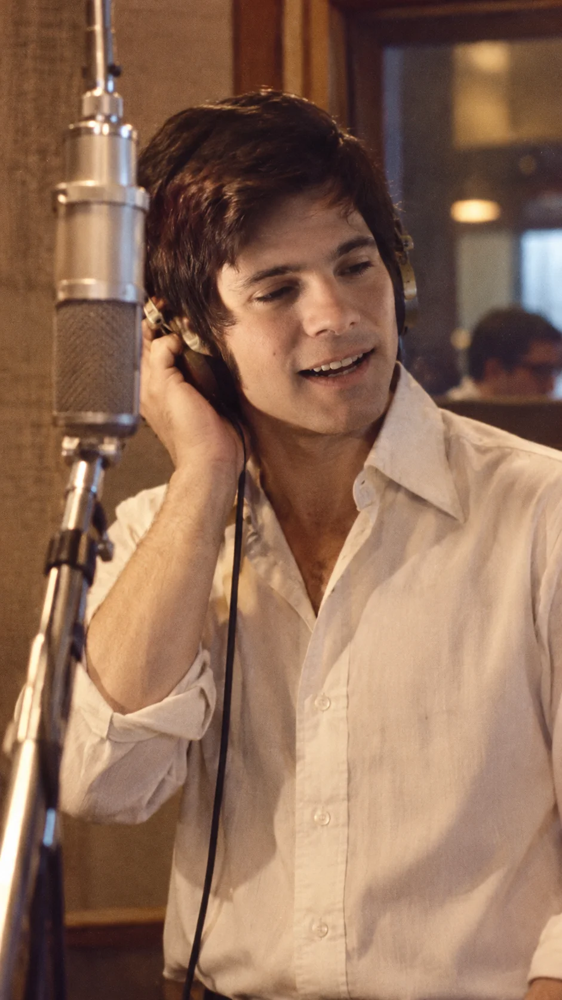
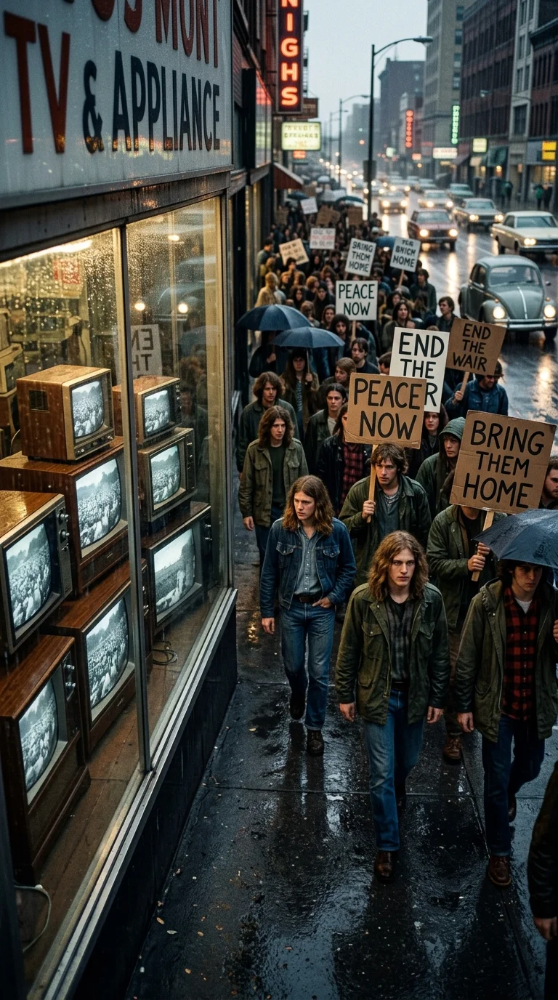
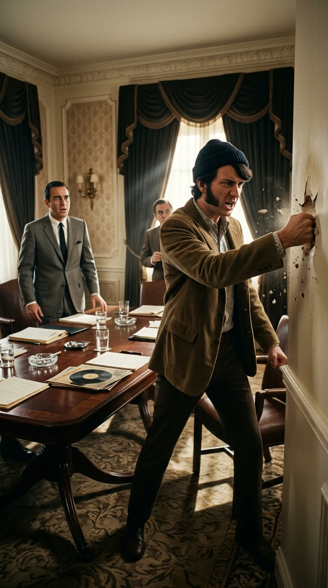
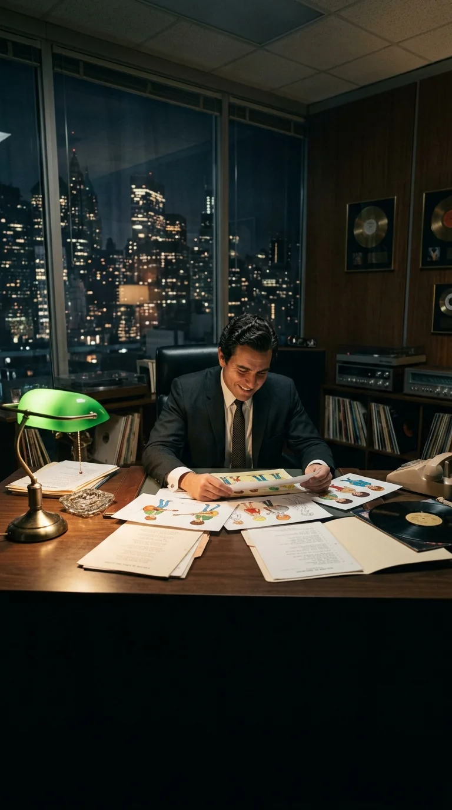
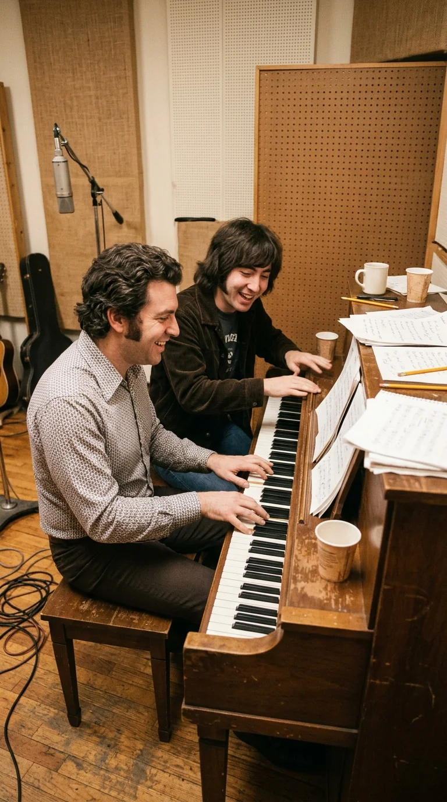
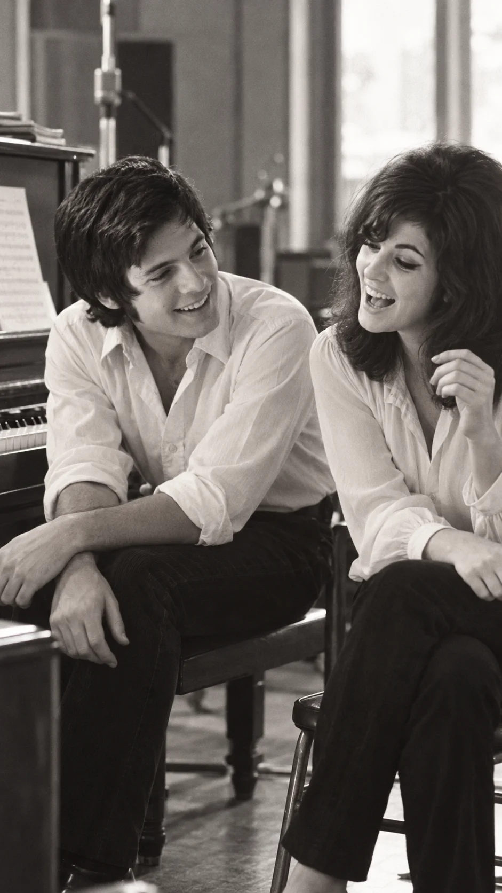
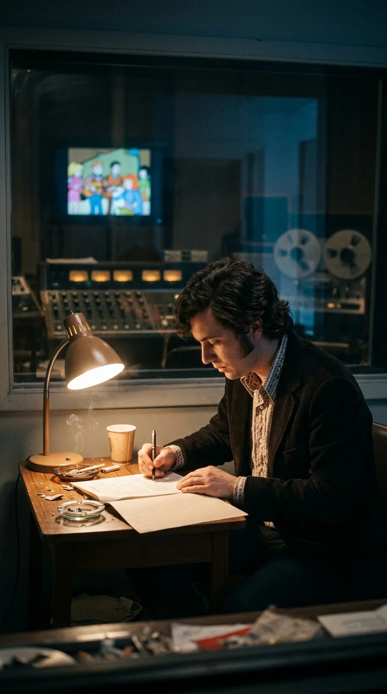
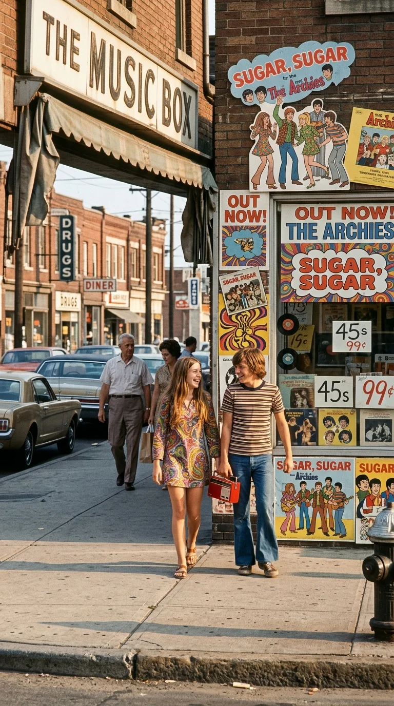
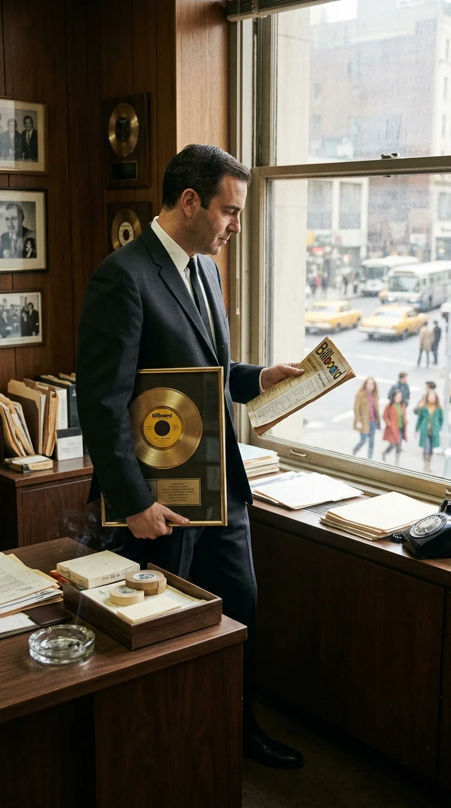
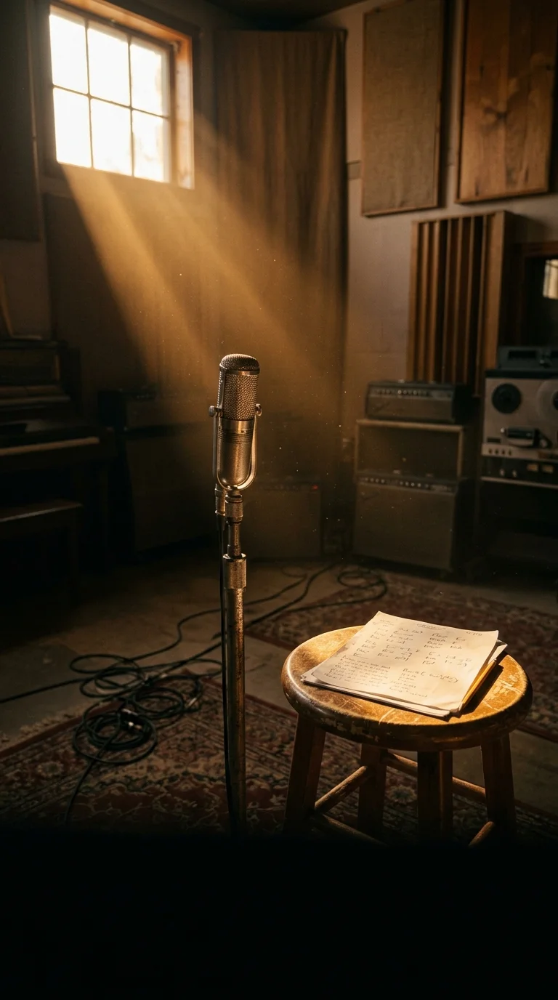

# 🍭 La Rebelión de los Humanos y la Venganza de Azúcar: El Secreto de «Sugar, Sugar» y las Voces Prohibidas de The Archies
### *Cómo el productor Don Kirshner, humillado por la rebelión de The Monkees, juró reemplazar a los músicos de carne y hueso por dibujos animados que no protestaran, y cómo dos cantantes invisibles conquistaron el número uno del mundo en pleno año de Woodstock y Vietnam.*

---

**Por la redacción de Acordes Ocultos**  
*Tiempo de lectura estimado: 8 minutos*

*Nueva York, 1969: El joven cantante de sesión Ron Dante frente al micrófono, la voz humana detrás de Archie Andrews.*

---

### Prólogo: El año en que la realidad se desbordó (1969)

El año 1969 fue una herida abierta en la conciencia de Occidente. En las selvas de Vietnam la metralla devoraba a miles de jóvenes conscriptos; en las calles de Washington y Chicago las multitudes marchaban bajo gases lacrimógenos exigiendo el fin de la guerra; en agosto, medio millón de almas se hundían en el lodo sagrado de Bethel para consagrar el festival de Woodstock al sonido de la guitarra desgarrada de Jimi Hendrix; y en las colinas de Los Ángeles, los crímenes de la secta Manson apagaban el sueño dorado de los años sesenta entre sangre y paranoia.

El rock se había vuelto adulto, peligroso, ácido y combativo. The Rolling Stones cantaban al refugio del apocalipsis en *«Gimme Shelter»*, The Beatles registraban su canto de cisne en *Abbey Road*, y Led Zeppelin redefinía la potencia del blues eléctrico con decibelios de acero.

Sin embargo, cuando la revista *Billboard* cerró sus clasificaciones anuales para proclamar cuál había sido el sencillo más vendido y escuchado de todo aquel tempestuoso 1969, ni Hendrix, ni Lennon, ni Jagger ocupaban el trono.

En la cima absoluta de los Estados Unidos y de Gran Bretaña, reinaba una melodía inocente, pegajosa y luminosa que repetía una palabra como un encantamiento infantil:

> *«Sugar, ah honey honey...  
> You are my candy girl, and you got me wanting you...»*

La canción no pertenecía a ninguna estrella de la contracultura ni a una banda de carne y hueso. Estaba acreditada a **The Archies**, un cuarteto de estudiantes ficticios salidos de las tiras cómicas y transmitidos por la televisión en dibujos animados los sábados por la mañana. 

Para millones de personas, aquello fue un milagro del pop ligero. Pero en los despachos de la industria discográfica, era el desenlace de una amarga y feroz guerra de egos, orgullo y venganza entre el poder corporativo y la dignidad del artista humano.

*Estados Unidos, 1969: Entre el clamor contra la guerra de Vietnam y el fango contracultural de Woodstock, un tema de dibujos animados conquistaría las listas de éxitos.*

---

### Acto I: La rebelión de las marionetas (Beverly Hills Hotel, 1967)

Para entender el nacimiento de *«Sugar, Sugar»*, es preciso retroceder dos años en el tiempo, a una suite de lujo en el Beverly Hills Hotel de Los Ángeles.

Allí reinaba **Don Kirshner**, conocido en la industria como *«el hombre del oído de oro»*. Como presidente de Colgems Records y supervisor musical del fenómeno televisivo *The Monkees*, Kirshner había construido un imperio de millones de dólares. Su fórmula era infalible: contrataba a los compositores más brillantes del Brill Building (Neil Diamond, Carole King, Tommy Boyce, Bobby Hart) y a los músicos de sesión más pulcros de Los Ángeles (The Wrecking Crew) para grabar las pistas instrumentales. A los cuatro jóvenes elegidos para la serie de televisión —Micky Dolenz, Davy Jones, Peter Tork y Michael Nesmith— solo se les permitía entrar a la cabina a poner sus voces.

La fórmula produjo éxitos descomunales como *«Last Train to Clarksville»* y *«I'm a Believer»*, pero engendró una bomba de relojería. Michael Nesmith y Peter Tork eran músicos con aspiraciones artísticas reales. Estaban asqueados de que la prensa los tachara de «marionetas sin talento» y de que no se les permitiera tocar una sola cuerda en sus propios discos.

En enero de 1967, la tensión estalló. En una reunión privada en el hotel, Nesmith encaró a Kirshner y le exigió control artístico sobre sus grabaciones. Cuando Kirshner amenazó con demandas contractuales y les recordó con desprecio que ellos no eran más que actores contratados, Nesmith perdió el control: descargó un violento puñetazo contra la pared de la suite, perforando el yeso a centímetros del rostro del ejecutivo, y gritó:  
*«¡Podrías haber sido tú!»*.

Desafiando a los productores del programa de televisión, Kirshner lanzó unilateralmente el sencillo *«A Little Bit Me, a Little Bit You»*. Aquella insubordinación colmó el vaso de Screen Gems y Columbia Pictures: a principios de febrero de 1967, Don Kirshner fue despedido de manera humillante y despojado de todo vínculo con *The Monkees*.

*Beverly Hills Hotel, 1967: Michael Nesmith perfora la pared de un puñetazo ante Don Kirshner, exigiendo control artístico para The Monkees.*

---

### Acto II: El sueño del productor: Músicos sin alma ni pretensiones

El despido fue un golpe demoledor al ego de Kirshner. Expulsado de su mayor creación, se encerró en sus oficinas de Nueva York masticando la derrota, pero también una convicción obsesiva: el único problema de la música popular eran los seres humanos.

Los músicos de carne y hueso se volvían vanidosos con el éxito; exigían aumento de regalías, pedían componer sus propios temas, consumían sustancias, llegaban tarde a las sesiones o amenazaban con huelgas.

¿Cuál era la solución definitiva para un empresario musical? Crear una banda que **nunca pudiera protestar, nunca exigiera créditos, nunca envejeciera y jamás pidiera un dólar más de sueldo**.

Kirshner encontró su vehículo en los personajes creados por John L. Goldwater en Archie Comics. Se alió con los estudios de animación Filmation y la cadena CBS para lanzar una serie de dibujos animados matutinos: *The Archie Show*. 

Archie Andrews tocaría la guitarra rítmica; Reggie Mantle el bajo; Jughead Jones la batería; y Betty Cooper y Veronica Lodge las panderetas y coros. Eran dibujos bidimensionales de tinta y acetato. No tenían abogados, ni sindicatos, ni crisis existenciales. Obedecerían a Kirshner ciegamente.

Para fabricar el sonido, Kirshner recurrió a dos de los arquitectos del pop más talentosos de la época: el veterano productor y compositor **Jeff Barry** (creador de clásicos inmortales para The Ronettes y The Crystals) y un joven cantautor canadiense llamado **Andy Kim**.

Juntos se sentaron al piano con una misión clara: componer melodías tan contagiosas, luminosas y rítmicas que resultaran irresistibles para cualquier oído, desde niños de primaria hasta adultos al volante.

*Manhattan, 1968: Don Kirshner concibe en la soledad de su despacho una banda de dibujos animados que jamás protestaría ni exigiría derechos.*

---

### Acto III: Los fantasmas de carne y hueso (Ron Dante y Toni Wine)

Pero los dibujos animados no cantan. Para dar vida a aquellos personajes de celuloide, Kirshner necesitaba cuerdas vocales reales. Y fue a buscarlas en las sombras de los estudios de Manhattan.

El elegido para ser la voz principal de Archie fue **Ron Dante** (nacido Carmine Granito), un muchacho de apenas 22 años dotado de un registro brillante, afinación impecable y una versatilidad vocal pasmosa. Dante ya se ganaba la vida grabando coros y anuncios publicitarios. Sin embargo, había un dilema contractual: Ron estaba bajo contrato exclusivo con otro sello y pronto alcanzaría las listas de éxitos con otro proyecto anónimo, *The Cuff Links* (con el tema *«Tracy»*). Por esa razón, su contrato con Kirshner le exigía confidencialidad absoluta: **bajo ninguna circunstancia podía revelar al público que él era la voz de The Archies**.

Para las voces femeninas de Betty y Veronica, convocaron a una muchacha de 21 años del Bronx llamada **Toni Wine**. Toni era una joven prodigio del Brill Building: a los 16 años ya componía canciones para otros artistas y colaboraba en sesiones de grabación.

En una sesión maratónica en los estudios de grabación de Manhattan, Jeff Barry, Andy Kim, Ron Dante y Toni Wine se juntaron alrededor de las partituras. No hubo tensión, ni egos desmedidos, ni peleas de camerino. Toni recordaría décadas más tarde la alegría pura que flotaba en aquella sala:
*«Jeff Barry y Andy Kim estaban al piano. Nos enseñaban la melodía y nosotros simplemente nos divertíamos cantando. Éramos chicos jóvenes riéndonos, improvisando armonías. Cuando llegó la frase de ‘I'm gonna make your life so sweet...’, bajé la voz para hacerla juguetona y pícara. Todos en la cabina empezaron a sonreír. Sabíamos que teníamos algo especial entre manos»*.

*Manhattan, 1969: Los compositores Jeff Barry y Andy Kim dan forma al piano a la melodía de «Sugar, Sugar».*

Ron Dante dobló sus propias pistas de voz para crear el empuje del coro principal, mientras Andy Kim aportaba palmas, maracas y armonías de apoyo. En pocas horas, una obra maestra del *bubblegum pop* estaba registrada en la cinta magnética. Los músicos cobraron su tarifa sindical reglamentaria, recogieron sus abrigos y salieron a la noche neoyorquina sin imaginar lo que acababa de nacer.

*Nueva York, 1969: Ron Dante y Toni Wine comparten micrófono en cabina, aportando la calidez y picardía vocal que le dio alma a la canción.*

*Nueva York, 1969: Ron Dante firma en la penumbra de la cabina el contrato que le exigía mantener en secreto su identidad como la voz de Archie.*

---

### Acto IV: La conquista del mundo y el desprecio de las emisoras

El camino de *«Sugar, Sugar»* no fue una alfombra roja inmediata. Cuando Kirshner y su equipo presentaron el sencillo a los directores de las grandes emisoras de radio en la primavera de 1969, la mayoría lo arrojó a la papelera.

Los programadores de radio lo consideraban un «disco de plástico para bebés», indigno de competir en las frecuencias moduladas que transmitían la revolución contracultural de Bob Dylan, Creedence Clearwater Revival y Crosby, Stills & Nash.

Pero Kirshner conocía el poder de la televisión. Cada sábado por la mañana, millones de niños veían a los personajes animados interpretar la canción en la pantalla de CBS y corrían a pedirle a sus padres que les compraran el vinilo de 45 RPM. El tema comenzó a sonar primero en pequeñas estaciones locales, luego en supermercados, y pronto el clamor popular obligó a los directores de programación más escépticos a rendirse a la evidencia.

*Verano de 1969: Las vitrinas de las tiendas de discos se llenan de publicidad de The Archies mientras los jóvenes sintonizan el tema en sus transistores.*

Para septiembre de 1969, *«Sugar, Sugar»* trepó al **número uno del Billboard Hot 100**, donde permaneció durante cuatro semanas consecutivas. Poco después, cruzó el Atlántico y dominó durante ocho semanas el número uno del Reino Unido. Vendió más de tres millones de copias en cuestión de meses y fue certificado como el **Sencillo del Año 1969**.

*Nueva York, finales de 1969: Don Kirshner en la discográfica con el premio oficial de Billboard tras coronar «Sugar, Sugar» como el sencillo más vendido del año.*

---

### Acto V: La paradoja de la invisibilidad

La mayor ironía de aquel triunfo planetario era que nadie en la calle conocía el rostro de sus creadores.

The Archies eran invitados a programas de televisión, pero en su lugar solo podían proyectar las animaciones de Filmation. No podían salir de gira. No podían firmar autógrafos. Si Ron Dante entraba a una cafetería en Manhattan mientras *«Sugar, Sugar»* sonaba en la radio del mostrador, nadie a su alrededor sospechaba que el chico de pelo castaño que bebía un café solo era el hombre más escuchado del planeta.

Dante no se amargó. Siguió trabajando como una de las voces de estudio más cotizadas de la historia de los Estados Unidos (grabando miles de jingles legendarios) y años más tarde se consagró como un formidable productor musical, apadrinando los primeros éxitos millonarios de **Barry Manilow** (como *«Mandy»* e *«I Write the Songs»*) e incluso produciendo a **Cher** y **Pat Benatar**.

Pero la historia le reservaba una dulce revancha.

Con el paso de las décadas, cuando la nostalgia devolvió los clásicos del pop a los escenarios, Ron Dante comenzó a salir de gira bajo su propio nombre en festivales y conciertos masivos. Al pararse frente al micrófono y cantar las primeras notas de *«Sugar, Sugar»*, multitudes de dos y tres generaciones rompían en aplausos emocionados. La voz que una vez estuvo enjaulada en un dibujo animado finalmente tenía un cuerpo, unos ojos y una sonrisa que recibía el cariño de su público.

---

### Epílogo: El alma que las máquinas no pueden fabricar

La historia de The Archies y *«Sugar, Sugar»* suele contarse como una victoria de la manufactura discográfica y el cálculo empresarial de Don Kirshner. Pero vista con la lente del tiempo, revela exactamente la lección contraria.

Kirshner intentó eliminar el factor humano para no tener que lidiar con la vulnerabilidad, los reclamos ni los sentimientos de los artistas. Diseñó personajes de papel, armó una maqueta rítmica impecable y financió una campaña comercial gigantesca.

Sin embargo, lo que hizo que *«Sugar, Sugar»* no se disolviera como un producto perecedero en el olvido no fueron los dibujos de Filmation. Fue la calidez luminosa del timbre de Ron Dante; la risa y picardía espontánea de Toni Wine susurrando ante el micrófono; el talento lírico de Andy Kim; y esa chispa invisible, tibia e indestructible que solo los seres humanos son capaces de transmitir cuando cantan juntos en una habitación.

Hoy, más de medio siglo después, cuando la industria discográfica vuelve a soñar con cantantes virtuales, hologramas e inteligencias artificiales para prescindir de los músicos reales, la lección de 1969 resuena con más fuerza que nunca:  
**Podrán fabricar la caricatura más perfecta, pero el alma de una canción siempre pertenecerá a los corazones invisibles de carne y hueso.**

*La metáfora del tiempo: más allá de los artificios comerciales, las canciones permanecen vivas por el alma de quienes las cantaron con verdad.*

---

### 💬 Conversación con la Comunidad

¿Conocías los verdaderos rostros de Ron Dante y Toni Wine detrás de The Archies? ¿Crees que la industria de hoy repetirá el sueño de Kirshner reemplazando a los artistas por inteligencias artificiales, o el calor humano sigue siendo irremplazable?

Déjanos tu reflexión en los comentarios.

---

### 📚 Fuentes y Archivo Documental

1. **Entrevistas Testimoniales con Ron Dante**: *Forgotten Hits Audio Archives* (2004) y *Goldmine Magazine: The Voice Behind The Archies* (2017, por Ken Sharp).
2. **Archivo Histórico de Toni Wine y Andy Kim**: *NPR Music / All Things Considered*: «The Real-Life Voices Behind The Archies' 'Sugar, Sugar' at 50» (agosto de 2019).
3. **Sandoval, Andrew**: *The Monkees: The Day-By-Day Story of the 60s TV Pop Sensation* (Thunder Bay Press, 2005). Documentación hemerográfica y cronología del despido de Don Kirshner y el mito de «Sugar Man».
4. **Brill Building & Bubblegum Pop Chronicles**: Cooper, Kim & Smay, David: *Bubblegum Music is the Naked Truth* (Feral House, 2001). Análisis historiográfico sobre Filmation, Don Kirshner y Jeff Barry.
5. **Billboard Chart Archives**: Registros oficiales de ventas y posiciones de 1969 para el sencillo *«Sugar, Sugar»* (RCA/Calendar Records).
