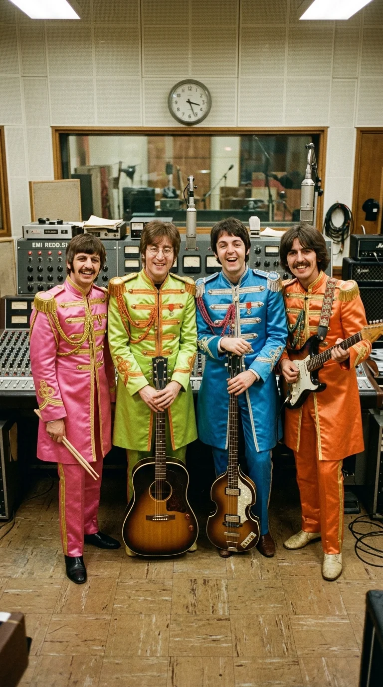
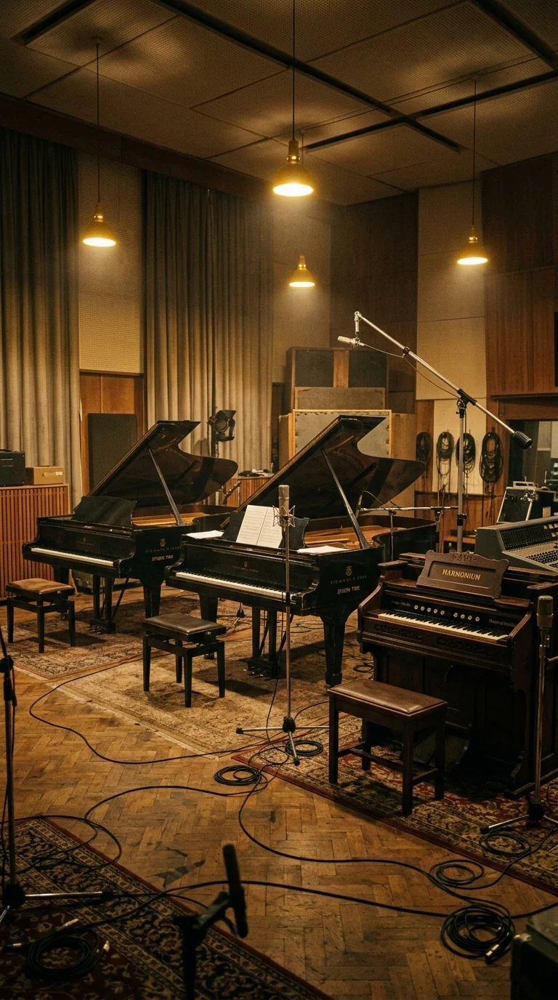
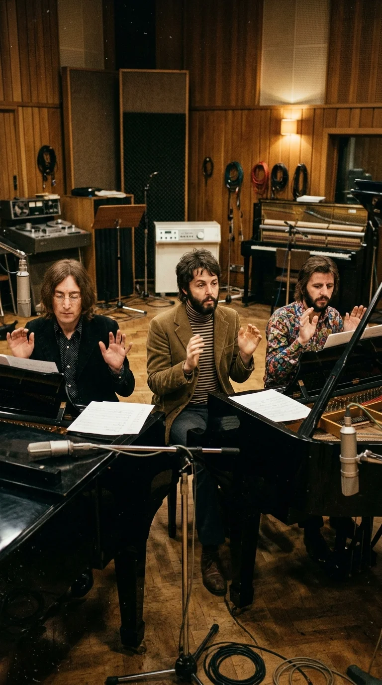
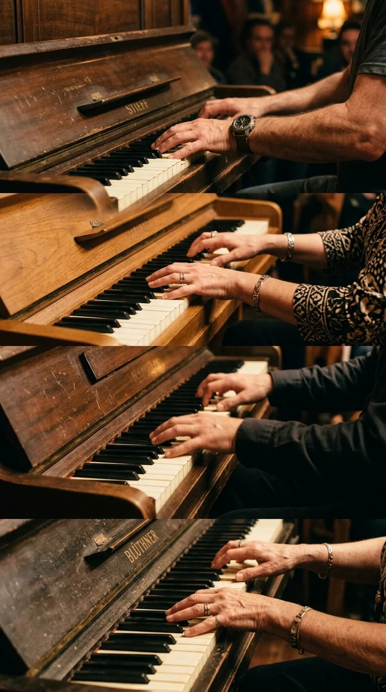
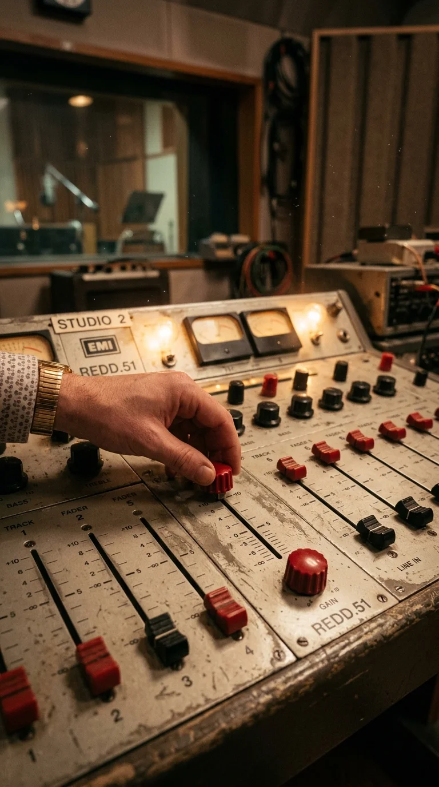
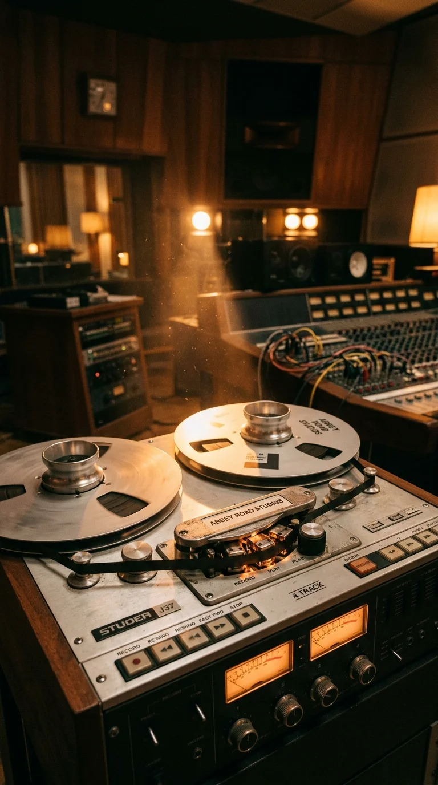
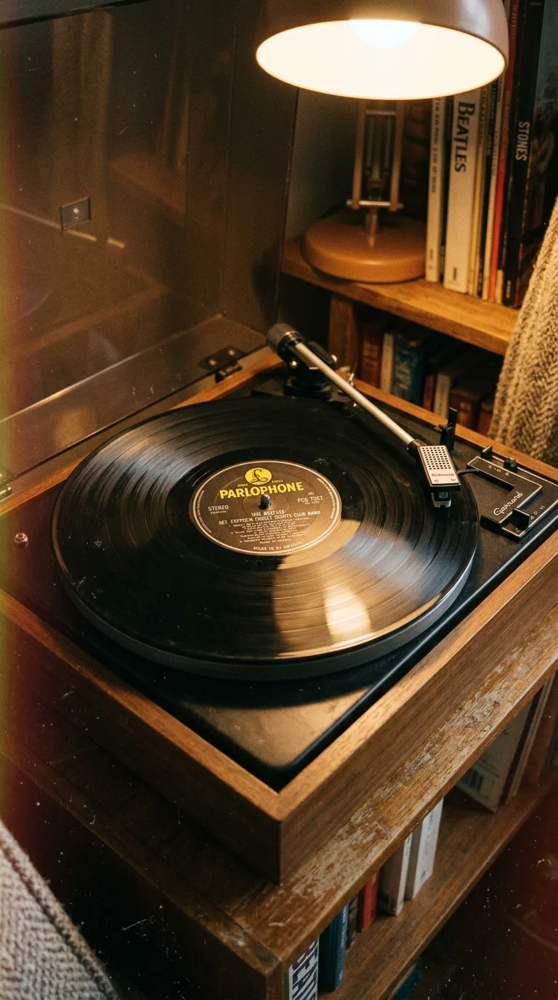

# El acorde más famoso de la historia: La inmortalidad suspendida de A Day in the Life

### Prólogo: El peso del silencio

Hay notas musicales que describen un sentimiento y acordes que construyen un mundo, pero existe una sola vibración en la historia de la música popular capaz de resumir el final de una era y el nacimiento de otra.

Ocurrió la tarde del miércoles **22 de febrero de 1967**, en el Estudio Dos de EMI en Abbey Road, Londres. El aire en la sala estaba espeso por el humo de cigarrillos, el aroma de té frío y el agotamiento de semanas de experimentación febril. Cuatro muchachos de Liverpool que habían renunciado para siempre a los gritos ensordecedores de los estadios estaban a punto de poner el punto final a una obra que cambiaría para siempre la percepción del álbum discográfico como arte mayor: *Sgt. Pepper's Lonely Hearts Club Band*.

Faltaba el cierre. No una simple cadencia de despedida ni un fundido en negro convencional. John Lennon y Paul McCartney buscaban un impacto sónico que cayera sobre el oyente como un rayo celestial, una nota tan rotunda y suspendida en el tiempo que hiciera contener la respiración a quien la escuchara.

Lo que lograron en nueve tomas frente a tres pianos de cola y un armonio no fue únicamente el remate de una canción; fue un prodigio de la física acústica y la audacia técnica donde la cinta magnetofónica devoró el silencio del estudio hasta capturar el zumbido de los motores y el leve crujido de una silla de madera.

---

### Acto I: Dos periódicos, un amigo muerto y el reloj despertador

La génesis de *"A Day in the Life"* nació de una coincidencia cotidiana en la mansión Kenwood de Weybridge, Surrey, a mediados de enero de 1967. John Lennon estaba sentado al piano de su sala de estar con la guitarra apoyada en las rodillas y un ejemplar del diario británico *Daily Mail* del **17 de enero de 1967** abierto sobre el atril.

La portada recogía el informe forense sobre el fatal accidente de tráfico ocurrido en Redcliffe Gardens, South Kensington, en el que había perdido la vida **Tara Browne**, joven de veintiún años, heredero de la dinastía cervecera Guinness y amigo cercano de los Beatles y de los Rolling Stones. Browne conducía su Lotus Elan a toda velocidad cuando se estrelló contra un camión aparcado tras volantear desesperadamente para proteger la vida de su acompañante, la modelo Sian Phillips.

Lennon no quiso redactar una crónica necrológica fría; transformó la tragedia en una ensoñación surrealista sobre la alienación urbana y los espectadores que se arremolinan ante el horror sin comprenderlo:

> *«I read the news today, oh boy*  
> *About a lucky man who made the grade*  
> *And though the news was rather sad*  
> *Well, I just had to laugh...»*

En las páginas interiores del mismo periódico, una breve columna municipal mencionaba que una inspección en las calles de Blackburn, Lancashire, había contabilizado exactamente **cuatro mil baches** en el asfalto. La yuxtaposición entre la muerte aristocrática y los baches provinciales activó la chispa poética de Lennon, quien remató los versos con una pregunta de absurdo cómico y desolador: *«Now they know how many holes it takes to fill the Albert Hall»*.

Cuando John le mostró los borradores a Paul McCartney en su casa de Cavendish Avenue, Paul sintió que a la canción le faltaba un contraste terrenal. McCartney tenía guardado un fragmento inacabado sobre sus rutinas de adolescencia en Liverpool: despertar sobresaltado, llegar tarde al autobús escolar de dos pisos, subir al piso superior y encender un cigarrillo (*«Found my way upstairs and had a smoke...»*).

Las dos piezas encajaban como dos mitades de un espejo roto. Sin embargo, entre la atmósfera etérea de John y el trote cotidiano de Paul había un vacío de **veinticuatro compases en blanco**.

Para medir ese abismo en la cinta durante las primeras sesiones del **19 de enero**, el fiel asistente de la banda, **Mal Evans**, se colocó frente a un micrófono contando en voz alta del uno al veinticuatro, mientras el eco aumentaba gradualmente con cada número. Al llegar al compás veinticuatro, un reloj despertador mecánico sonó con estrépito. El despertador no estaba planeado como efecto dramático; lo habían llevado para cronometrar las pistas, pero encajó de manera tan providencial justo antes del verso de Paul (*«Woke up, fell out of bed...»*) que decidieron dejarlo para siempre en la mezcla maestra.

---

### Acto II: La orgía sinfónica del 10 de febrero

¿Cómo llenar aquel abismo de veinticuatro compases? La respuesta provino de Paul McCartney: un crescendo orquestal masivo, un torbellino anárquico que sonara como el fin del mundo.

El productor **George Martin** frunció el ceño. En la música clásica occidental, una orquesta se rige por la disciplina férrea de la partitura. Pero McCartney no quería una melodía escrita: quería caos puro. Martin convocó a **cuarenta músicos de élite** de la Orquesta Filarmónica de Londres y de la Orquesta Filarmónica Real el viernes **10 de febrero de 1967** en el Estudio Uno de Abbey Road.

Para romper la rigidez aristocrática de los atrilistas sinfónicos, los Beatles convirtieron la velada en un aquelarre psicodélico. Invitaron a amigos como Mick Jagger, Marianne Faithfull, Keith Richards y Donovan. A los músicos clásicos, vestidos con esmoquin de gala, se les repartieron narices de payaso de plástico, dientes postizos de vampiro, sombreros extravagantes y patas de gorila.

La instrucción que George Martin escribió en los atriles era un anatema para cualquier músico de conservatorio:
1. Comenzar en la nota más baja que su instrumento pudiera producir a volumen *pianissimo*.
2. Ascender a lo largo de los veinticuatro compases a su propio ritmo individual, sin sincronizarse con su vecino de atril.
3. Culminar en el compás final en la nota más aguda posible dentro de un acorde de **Mi mayor**, alcanzando el volumen máximo (*fortissimo*).

La orquesta se grabó cuatro veces sobre la máquina de cuatro pistas sincronizada manualmente, acumulando el equivalente sonoro a **ciento sesenta instrumentos desatados**. El resultado fue una marea sónica aterradora que subía por la garganta del oyente como un maremoto de metales y cuerdas.

Pero cuando la ola orquestal reventaba en su punto más álgido... la música se detenía en seco. Faltaba el desenlace.

---

### Acto III: El concilio de los tres pianos y el armonio

Durante las dos semanas siguientes, la banda debatió cómo cerrar semejante cataclismo. El 10 de febrero habían probado una idea de John: un coro de voces masculinas tarareando un mantra prolongado (*«Hummmmmm»*). Registraron varias tomas, pero al escucharlas por los monitores, todos coincidieron en que el efecto sonaba débil, casi cómico, incapaz de sostener el peso de la tempestad que lo precedía.

El miércoles **22 de febrero**, los cuatro Beatles regresaron al Estudio Dos resueltos a encontrar la solución definitiva. Lennon fue categórico: el final debía ser un golpe seco, colosal y perentorio. Un portazo que cerrara el universo.

Para lograr un volumen acústico que ninguna guitarra eléctrica podía proporcionar en 1967, George Martin ordenó al personal de mantenimiento desplazar todos los teclados disponibles en el edificio de Abbey Road hacia el centro del estudio:
* Un piano de cola **Steinway**.
* Un piano de cola **Bechstein**.
* Un piano de cola **Challen**.
* Y un **armonio** de fuelles tradicional.

La disposición de los músicos fue histórica:
* **John Lennon** se sentó frente a uno de los pianos de cola.
* **Paul McCartney** tomó posición en el segundo.
* **Ringo Starr** se colocó en el tercero.
* **Mal Evans** compartió teclado con Ringo.
* Y el productor **George Martin** se acomodó en el armonio, listo para bombear los pedales con los pies.
* George Harrison aguardaba en la cabina de control junto a los ingenieros, supervisando el balance estéreo.

La partitura constaba de una sola indicación: golpear simultáneamente y con la máxima fuerza física posible el acorde de **Mi mayor** (compuesto por las notas Mi, Sol sostenido y Si).

---

### Acto IV: La proeza de Geoff Emerick y los faders al límite

Golpear cuatro pianos al mismo tiempo parece sencillo, pero en la práctica requirió una sincronización milimétrica. En los primeros intentos, los dedos caían con fracciones de segundo de desfase, debilitando el impacto percusivo inicial. Tuvieron que repetir la operación ocho veces.

A la novena toma (**Take 9**), Paul McCartney levantó la mano, contó en silencio con la cabeza y los cinco hombres dejaron caer sus brazos con toda la fuerza de su cuerpo sobre el marfil.

El choque acústico fue brutal. El acorde de Mi mayor retumbó contra las paredes de mampostería del estudio como un trueno de catedral.

Pero la verdadera obra maestra de ingeniería apenas comenzaba en ese instante.

En la cabina de control, un muchacho de apenas veinte años, el ingeniero de sonido **Geoff Emerick**, estaba a cargo de la legendaria consola de válvulas **EMI REDD.51**. Emerick sabía que la vibración de las cuerdas de un piano decae de manera natural a los diez o quince segundos. Si no intervenía, el sonido se apagaría en la nada.

Con una audacia que desafiaba todos los manuales de procedimientos de la rígida burocracia técnica de EMI, Geoff colocó sus dedos sobre los faders de ganancia de los canales de los micrófonos y comenzó a **empujarlos lentamente hacia arriba**.

Conforme el sonido de los pianos perdía potencia física, Emerick aumentaba el volumen de los micrófonos para compensar la pérdida de decibelios. Para el segundo veinte, los faders estaban más allá de los niveles normales. Para el segundo treinta, los potenciómetros rozaban el límite rojo absoluto.

A ese nivel de amplificación demencial, los micrófonos de condensador Neumann U47 y U67 se volvieron ultrasensibles, convirtiéndose en receptores casi microscópicos del entorno. La cinta de una pulgada no sólo estaba grabando el acorde; estaba devorando la intimidad acústica del propio estudio:
* El zumbido constante y sordo del motor del sistema de aire acondicionado de Abbey Road.
* El siseo del rozamiento del aire contra las membranas de los micrófonos.
* Y en el **segundo 35**, perfectamente audible en los auriculares de cualquier melómano moderno: el crujido levísimo de la madera de una silla de estudio (atribuido a Ringo Starr o a Mal Evans al mover ligeramente el pie por la tensión muscular).

El acorde vibró en el aire y en la cinta durante **42.5 segundos consecutivos**. Cuando la última oscilación armónica se extinguió finalmente en el éter, nadie en el estudio se atrevió a respirar durante diez segundos más, conscientes de que habían grabado el silencio más elocuente de la historia de la música moderna.

---

### Acto V: El surco infinito y el veto de la BBC

El acorde de Mi mayor no era el final absoluto del disco. Siguiendo el espíritu bromista de John Lennon, los Beatles decidieron incluir dos sorpresas finales grabadas el 21 de abril:
1. Un tono ultrasónico de **15 kilohercios** (15.000 Hz), imperceptible para el oído humano adulto pero diseñado expresamente para alertar a los perros de los oyentes (*«para que el perro del comprador empiece a ladrar cuando termine el disco»*, reía Lennon).
2. Un bucle concéntrico en el surco de salida (*run-out groove*) con risas, ruidos de fiesta y voces reproducidas al revés que, en los tocadiscos manuales de la época donde la aguja no se levantaba automáticamente, se repetía en un bucle infinito (*«Never could see any other way...»*).

El álbum vio la luz oficialmente en el Reino Unido el **26 de mayo de 1967**. Sin embargo, la reacción de las instituciones británicas fue inmediata. La **BBC prohibió la radiodifusión** de *"A Day in the Life"* alegando que el verso de John Lennon *«I'd love to turn you on»* incitaba al consumo de sustancias psicodélicas.

Lennon y McCartney protestaron enérgicamente en las páginas del *Melody Maker*. Explicaron que la intención de la frase no era química, sino existencial: encender la conciencia humana frente a la alienación de las noticias, despertar de la rutina mecánica del periódico y del autobús, y contemplar la belleza y la tragedia de la existencia con los ojos abiertos.

El veto de la BBC no hizo más que alimentar el mito. *Sgt. Pepper* permaneció veintisiete semanas en el número uno británico y quince semanas en la cima del *Billboard 200* estadounidense, ganando cuatro premios Grammy en 1968, incluido el primer galardón a **Álbum del Año** para un disco de rock.

---

### Epílogo: La nota que nunca dejó de resonar

Medio siglo después de aquella tarde en Abbey Road, el acorde final de *"A Day in the Life"* se estudia en los conservatorios y facultades de física del mundo entero como la piedra roseta de la producción musical analógica.

Aquellos cuarenta y dos segundos marcaron la frontera definitiva: antes de ese acorde, la música pop era un divertimento adolescente para máquinas de discos; después de él, el rock se convirtió en una forma de arte reflexivo, capaz de interrogar a la muerte, a la rutina y al infinito con la misma hondura que una sinfonía de Mahler.

John Lennon fue asesinado en Nueva York en 1980; George Harrison partió en 2001; George Martin y Geoff Emerick ya descansan en la memoria de los estudios que construyeron con sus propias manos.

Pero cada vez que la última nota de *Sgt. Pepper* cae sobre el silencio, el tiempo se detiene. En esa vibración interminable siguen vivos el aserrín del periódico, los baches de Blackburn, los veinticuatro compases de Mal Evans y cinco pares de manos golpeando la madera con toda la furia de su juventud: recordándonos que incluso cuando el mundo parece desmoronarse en las páginas de los diarios, la música es el único acorde que jamás deja de sonar.

---

### 📚 Fuentes y Archivo Documental

1. **Lewisohn, Mark.** *The Complete Beatles Recording Sessions: The Official Story of the Abbey Road Years 1962–1970*. Londres: Hamlyn / EMI Records, 1988. (Bitácoras oficiales de Abbey Road: sesiones del 19 y 20 de enero, 10 de febrero y 22 de febrero de 1967).
2. **Emerick, Geoff & Massey, Howard.** *Here, There and Everywhere: My Life Recording the Music of The Beatles*. Nueva York: Gotham Books / Penguin Group, 2006. (Testimonio técnico de Emerick sobre la manipulación manual de faders en la consola REDD.51 y los ruidos capturados en la cinta).
3. **Martin, George & Hornsby, Jeremy.** *All You Need Is Ears: The inside, personal story of the genius who created The Beatles*. Nueva York: St. Martin's Press, 1979. (Relato de Sir George Martin sobre la orquestación del crescendo y la sesión con tres pianos y armonio).
4. **MacDonald, Ian.** *Revolution in the Head: The Beatles' Records and the Sixties*. Londres: Fourth Estate, 1994 (3.ª ed. revisada, Chicago Review Press, 2007). (Análisis musicológico exhaustivo compás por compás de *"A Day in the Life"*).
5. **Daily Mail.** Archivo hemerográfico histórico del Reino Unido (edición del martes **17 de enero de 1967**). Reportaje sobre la muerte accidental de Tara Browne en Redcliffe Gardens y nota municipal sobre los 4.000 baches en Blackburn, Lancashire.
6. **Miles, Barry.** *Paul McCartney: Many Years From Now*. Londres: Secker & Warburg, 1997. (Testimonio de McCartney sobre la composición de su pasaje intermedio y el concepto del crescendo caótico).
