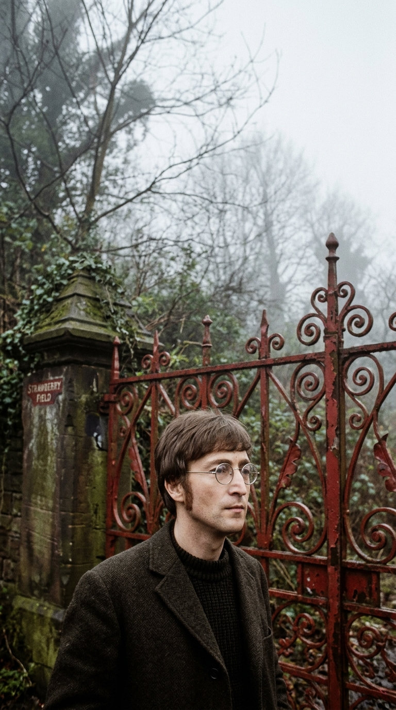
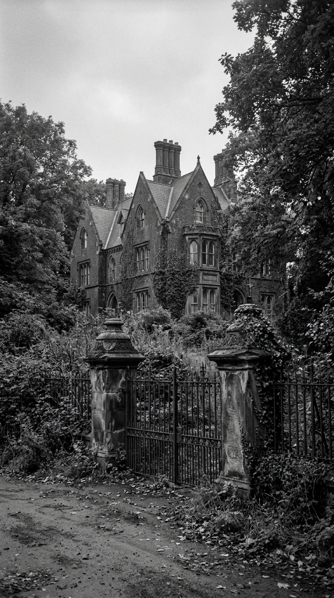
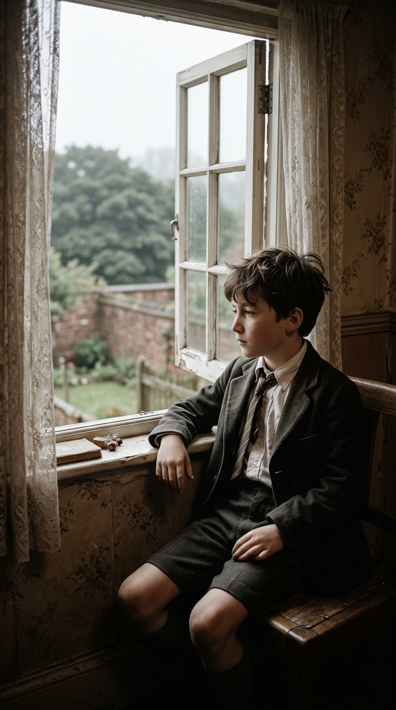
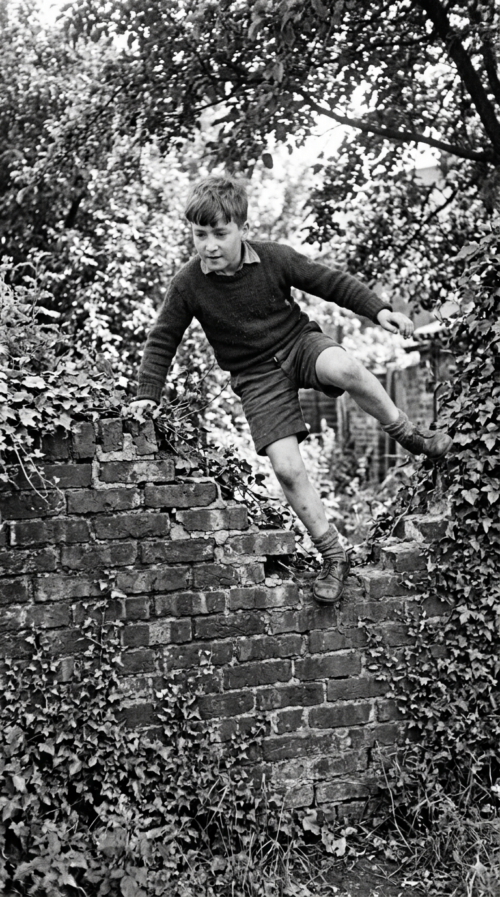
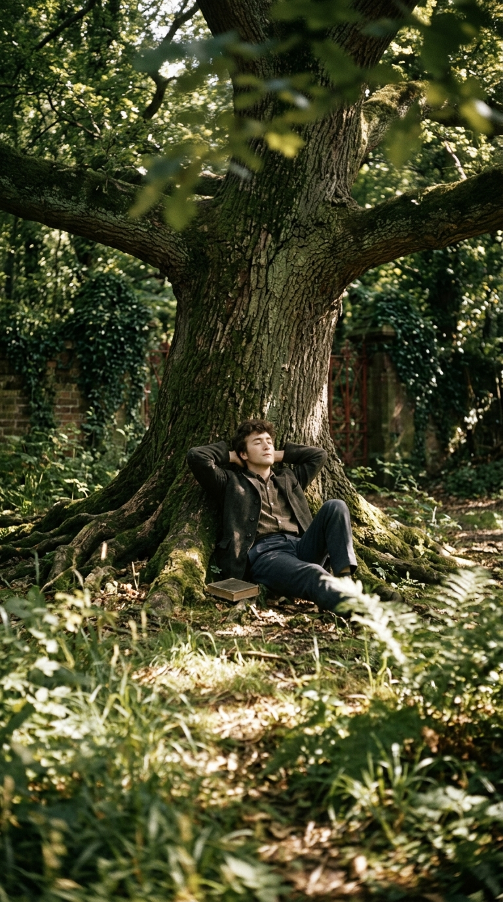
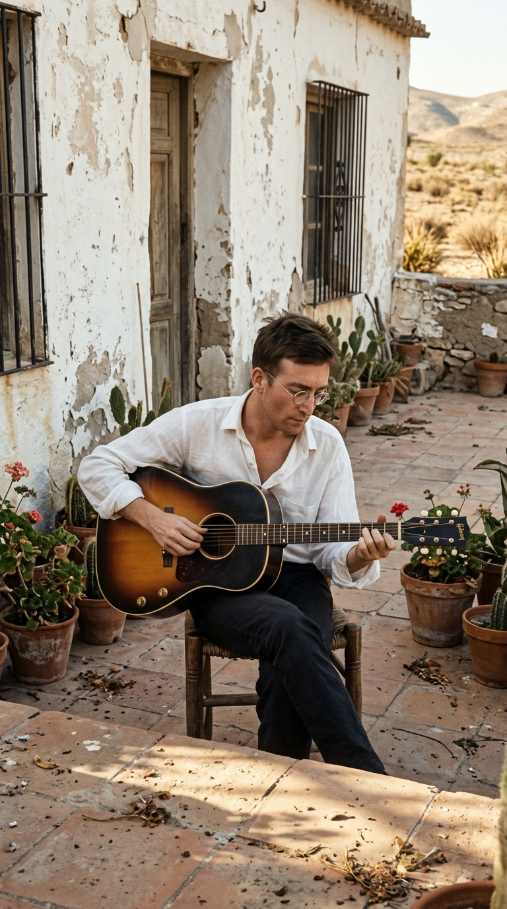
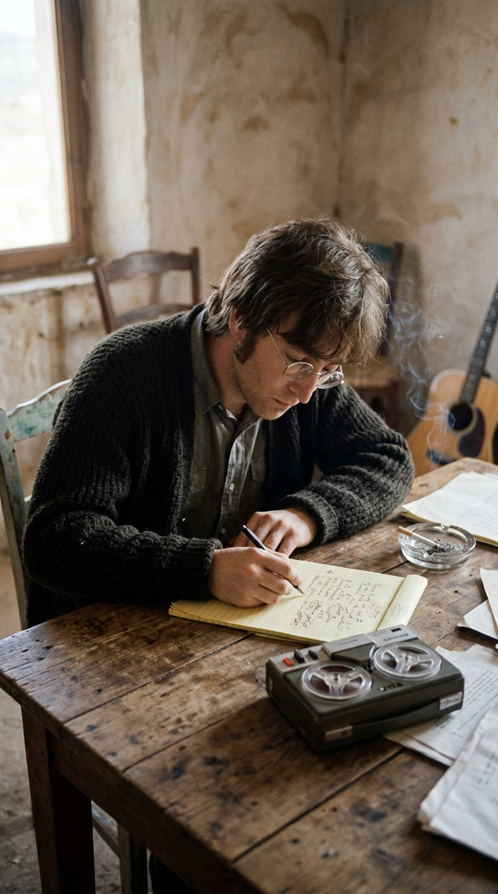
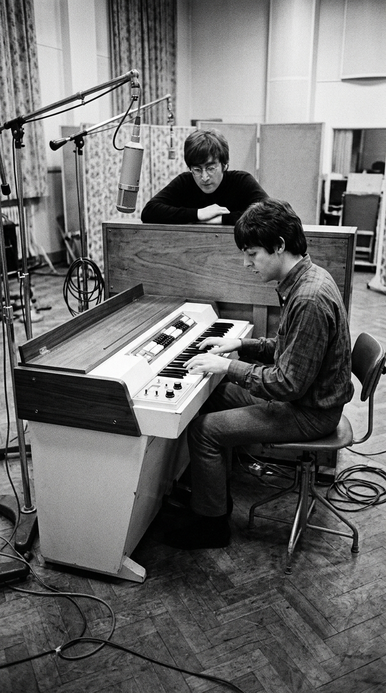
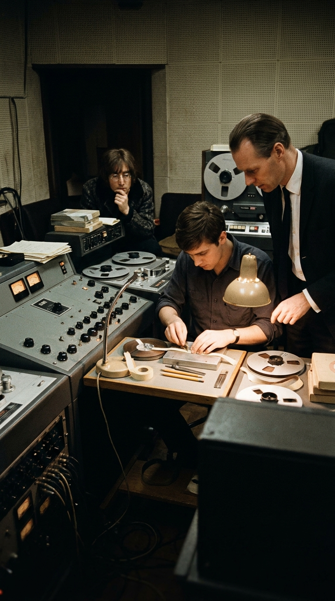
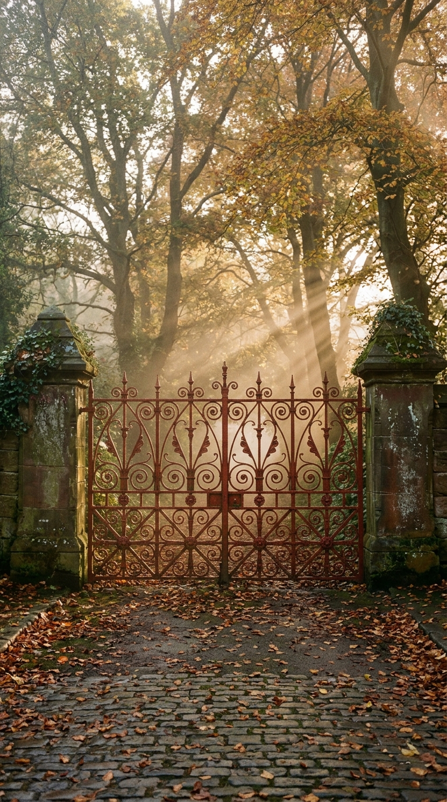

# El orfanato prohibido donde John Lennon aprendió a no tener miedo

## Prólogo: El muro de Woolton

En el número 251 de Menlove Avenue, en el suburbio de Woolton al sur de Liverpool, una casa adosada de piedra y ladrillo rojo bautizada como *Mendips* albergaba la solitaria infancia de **John Winston Lennon**. Corría la posguerra británica de finales de los años cuarenta y principios de los cincuenta. Justo al otro lado de la cerca del jardín trasero, recortado contra el cielo plomizo de Merseyside, se erigía una imponente mansión gótica victoriana de arenisca oscura rodeada por densos bosques sombríos.

Era **Strawberry Field**, un hogar para niñas huérfanas y desamparadas administrado por el Ejército de Salvación (*The Salvation Army*). 

Para la mayoría de los vecinos del acomodado barrio residencial, aquel orfanato era una presencia incómoda que convenía ignorar. Pero para aquel muchacho menudo, de mirada penetrante y silencios prolongados, aquellos jardines salvajes custodiados por imponentes portones de hierro forjado representaban el único territorio sagrado sobre la faz de la tierra. Un santuario prohibido donde las reglas del mundo adulto quedaban suspendidas.

---

## Acto I: El huérfano de Mendips

Para comprender el magnetismo irresistible que aquel orfanato ejercía sobre John Lennon, es preciso descender a la raíz de su propia herida infantil. Aunque formalmente no era un huérfano de hospicio, emocionalmente John se sentía tan abandonado como cualquiera de las niñas que dormían tras los ventanales ojivales de Strawberry Field.

Su padre, **Alfred «Alf» Lennon**, un marinero mercante de origen irlandés, había desaparecido en alta mar durante la Segunda Guerra Mundial, dejando de enviar dinero y ausentándose durante años cruciales de su crianza. Su madre, **Julia Stanley**, un espíritu libre, bohemio y caótico, se vio incapaz de asumir la custodia de su hijo bajo la estricta moral de la época tras entablar una nueva relación y quedar embarazada de otro hombre. 

Intervino entonces la hermana mayor de Julia, **Mary Elizabeth Smith**, la severa e implacable **tía Mimi**. Con una disciplina férrea y un apego protector no exento de reproches, Mimi obtuvo la custodia legal de John y se lo llevó a vivir con ella y su esposo George Smith a *Mendips*.

Privado del calor materno y con la sombra permanente del abandono paterno a sus espaldas, John creció como un niño replegado sobre su propia imaginación. Pasaba horas enteras apoyado en el alféizar de su dormitorio observando las copas de los árboles de Strawberry Field mecerse con el viento del norte. Muy dentro de sí, sabía que su destino no era distinto al de las pequeñas que habitaban aquel caserón: a él también lo habían dejado atrás.

---

## Acto II: La advertencia de tía Mimi (*«They'll hang you»*)

Cada verano, el Ejército de Salvación organizaba una fiesta campestre en los jardines de Strawberry Field. Una pequeña banda de metales tocaba himnos solemnes y se vendían limonadas y pasteles. Eran los únicos días del año en que los portones se abrían al público. John contaba los meses para que llegara ese día: arrastraba a tía Mimi de la mano y se quedaba extasiado escuchando los metales resonar entre las hayas centenarias.

Pero para John, una tarde al año no era suficiente. Con la complicidad de sus amigos de infancia Pete Shotton, Nigel Whalley e Ivan Vaughan, saltaba los altos muros de ladrillo cubiertos de hiedra y se internaba en los densos matorrales del orfanato para jugar a esconderse o simplemente para tumbarse en la hierba a contemplar las nubes en silencio.

Cada vez que Mimi descubría sus escapadas al bosque del orfanato, lo reprendía con severidad victoriana, advirtiéndole que los guardias o la policía lo arrestarían:

> *«¡John, sal de ahí de inmediato! Te van a atrapar y te van a colgar por meterte en propiedad ajena»* (*«They'll hang you!»*).

John, con apenas diez años, se limitaba a mirarla con una sonrisa pícara, encogiéndose de hombros:

> *«No te preocupes, Mimi... no hay nada por lo que puedan colgarme»* (*«Nothing to get hung about»*).

Aquella frase infantil, nacida de la rebeldía ingenua de un niño que no le temía al castigo terrenal porque ya conocía el castigo del desamor, quedaría guardada en el fondo de su memoria durante casi dos décadas, esperando el momento exacto para convertirse en uno de los versos más célebres de la historia de la cultura popular.

---

## Acto III: El exilio de Almería (Otoño de 1966)

El **29 de agosto de 1966**, en el Candlestick Park de San Francisco, **The Beatles** ofrecieron su último concierto oficial con público pagado. Asfixiados por el ensordecedor griterío de la histeria colectiva, las amenazas de muerte del Ku Klux Klan tras las declaraciones de John sobre la popularidad del grupo frente a Jesucristo y la imposibilidad técnica de escuchar lo que tocaban en directo, los cuatro de Liverpool decidieron bajarse del escenario para siempre.

De repente, la maquinaria infernal de la Beatlemanía se detuvo. Por primera vez en un lustro, no había giras programadas ni fechas límite de entrega en el calendario.

En septiembre de **1966**, John Lennon viajó al desierto de **Almería, España**, para participar como actor en el rodaje de la película satírica antibélica *How I Won the War* (*Cómo gané la guerra*), dirigida por Richard Lester. Para encarnar al soldado Gripweed, John se despojó de su flequillo Beatle, se cortó el cabello casi al ras y se colocó por primera vez en público unas gafas redondas de montura metálica —las mismas que desde entonces se convertirían en su firma visual universal—.

Alojado en **Santa Isabel**, una señorial y solitaria villa neoclásica a las afueras de Almería, rodeada de palmeras polvorientas y con un patio encalado que miraba al Mediterráneo, John experimentó un vacío existencial abrumador. Lejos de Paul, George y Ringo, y sin el escudo protector de la histeria colectiva, se vio forzado a mirarse al espejo. Tenía veintiséis años, era el músico más famoso y rico del planeta, pero por dentro se sentía tan frágil, inseguro e incomprendido como el niño de Mendips.

Con su guitarra acústica Gibson J-160E entre los brazos y una pequeña grabadora portátil de carrete Philips sobre una mesa rústica, John comenzó a desgranar una progresión de acordes lentos y descendentes. Durante seis semanas de introspección solitaria, fue grabando toma tras toma casera, balbuceando melodías y tachando versos en un cuaderno de hojas amarillas:

> *«Let me take you down, 'cause I'm going to Strawberry Fields... / Nothing is real / And nothing to get hung about / Strawberry Fields forever»*.

No era una canción pop de amor adolescente; era una sesión de autoanálisis en carne viva. John confesaba abiertamente su terror a la locura, su sensación de no encajar jamás en el mundo de los cuerdos (*«No one I think is in my tree / I mean it must be high or low...»*) y su incapacidad para verbalizar lo que sentía sin contradecirse (*«That is you can't, you know, tune in, but it's all right / That is I think it's not too bad»*).

Había nacido ***«Strawberry Fields Forever»***. El orfanato de su infancia se había transfigurado en una metáfora universal del refugio interior frente a la crueldad del mundo exterior.

---

## Acto IV: Las flautas de Abbey Road (Noviembre de 1966)

El **24 de noviembre de 1966**, The Beatles se reunieron en el **Estudio 2 de EMI Studios en Abbey Road**, Londres. Era su primera sesión de trabajo tras abandonar los escenarios. John se sentó al centro de la sala vacía con su acústica y tocó el tema para sus compañeros y para el productor **George Martin**. El silencio que siguió fue absoluto. Martin recordaría años más tarde:

> *«Fue un momento mágico e inolvidable. John cantó la canción solo con su guitarra acústica. Era evidente para todos que estábamos ante una de las mejores canciones que jamás había escrito»*.

Para vestir aquella atmósfera onírica, **Paul McCartney** se colocó frente a un instrumento recién adquirido que cambiaría para siempre el sonido del pop: el **Mellotron Mark II**. Aquella pesada mole electromecánica contenía bancos de cintas magnéticas de ocho segundos con grabaciones reales de instrumentos orquestales. Paul seleccionó el ajuste de tres flautas traveseras y ejecutó la célebre introducción cromática descendente, imbuida de un aire renacentista y fantasmal que transportaba al oyente de inmediato a un bosque encantado de la infancia.

Grabaron la **Toma 1** con un arreglo etéreo y despojado: la acústica de John, el Mellotron de Paul, el bajo melódico, la pandereta de Ringo y sutiles armonías vocales pasadas a velocidad alterada. El resultado era hermoso, pero John no estaba satisfecho.

---

## Acto V: El milagro analógico de George Martin (Diciembre de 1966)

Días después, John le pidió a George Martin un enfoque completamente distinto: quería una versión orquestal más pesada, oscura y expansiva. Martin escribió una partitura vanguardista para cuatro trompetas y tres violonchelos, a los que sumó la percusión salvaje de Ringo Starr tocada en reversa, timbales orquestales y un enigmático instrumento indio de cuerda llamado *svarmandal*. Esta segunda aproximación se registró en la **Toma 26**.

A mediados de diciembre, John llamó a George Martin a su despacho en Abbey Road con una petición que desafiaba todas las leyes de la física acústica:

> *«George, me gusta mucho la primera parte íntima de la Toma 7, pero me apasiona el final grandioso y orquestal de la Toma 26. ¿Podrías unirlas?»*.

George Martin lo miró atónito y le explicó el problema insalvable:
1. Las dos tomas estaban grabadas en **tonos completamente diferentes**: la Toma 7 en *La mayor*, la Toma 26 en *Si bemol mayor* (un semitono más alto).
2. Los tempos eran incompatibles: la Toma 7 corría a un ritmo más lento que la Toma 26.

La respuesta de John quedó grabada en los anales del estudio:

> *«Tú puedes solucionarlo, George. Sé que puedes hacerlo»*.

Junto al brillante ingeniero de veintiún años **Geoff Emerick**, Martin descubrió una coincidencia milagrosa: al acelerar la cinta de la Toma 7 un pequeño porcentaje con el control de velocidad variable (*vari-speed*), el tono subía casi medio tono y el tempo se aceleraba; y al ralentizar la cinta de la Toma 26, el tono bajaba y el tempo se frenaba. 

Con un bisturí y cinta adhesiva de empalme, Emerick localizó el punto exacto de la transición: en el minuto **01:00** de la canción, justo sobre la palabra *«...going to...»* del segundo verso. En ese instante milimétrico, la delicada instrumentación acústica y el Mellotron de Paul dan paso sin fisuras a la densa orquesta de violonchelos chirriantes y trompetas discordantes.

Aquel corte de cinta no fue solo un truco técnico: fue una metáfora perfecta del alma de John Lennon. El momento exacto en que la inocencia dorada de la niñez se quiebra para siempre y se sumerge en las turbulencias psicodélicas de la madurez.

---

## Epílogo: El jardín donde nada es real

Lanzada como un sencillo de doble cara A junto a *«Penny Lane»* de Paul McCartney el **17 de febrero de 1967**, *«Strawberry Fields Forever»* desconcertó a la crítica convencional de la época, pero inauguró de forma indiscutible la era dorada del rock psicodélico y sirvió como antesala directa al monumento sonoro de *Sgt. Pepper's Lonely Hearts Club Band*.

El caserón victoriano de Strawberry Field fue demolido en los años setenta, pero los imponentes portones de hierro forjado pintados de rojo permanecieron allí, convertidos en meta de peregrinación para millones de admiradores de todo el planeta. 

Tras el asesinato de John Lennon el 8 de diciembre de 1980 en Nueva York, Yoko Ono inauguró una sección conmemorativa de 2.5 acres en Central Park bautizada en su honor: **Strawberry Fields**, presidida por el célebre mosaico circular con la palabra *«IMAGINE»*, rodeado de olmos y flores traídas de más de ciento veinte países.

Casi seis décadas después de que aquel niño solitario saltara los muros para huir de sus fantasmas, la canción sigue resonando con la misma verdad desgarradora. Porque John Lennon nos demostró que las heridas más profundas de la infancia no se curan con el olvido, sino transformándolas en arte eterno. En aquel jardín prohibido, donde nada era real y no había nada por lo que pudieran colgarlo, John encontró finalmente la inmortalidad.

---

### 📚 Fuentes y Archivo Documental

1. **Lennon, John (1970/1980).** *The Rolling Stone Interview: John Lennon by Jann S. Wenner*. Entrevistas históricas de 1970 y 1980 donde Lennon detalla el origen autobiográfico de *Strawberry Fields Forever*, sus recuerdos de infancia en Woolton y la composición en Almería.
2. **Martin, George & Hornsby, Jeremy (1979).** *All You Need Is Ears*. St. Martin's Press, Nueva York. Memorias de George Martin con el relato pormenorizado sobre la sesión del 24 de noviembre de 1966 y el célebre empalme de las tomas 7 y 26 a velocidad variable.
3. **Emerick, Geoff & Massey, Howard (2006).** *Here, There and Everywhere: My Life Recording the Music of The Beatles*. Gotham Books, Nueva York. Testimonio directo del ingeniero de sonido de Abbey Road sobre la ejecución del corte de cinta en el minuto 01:00 y el uso del Mellotron Mark II.
4. **Lewisohn, Mark (1988).** *The Beatles Recording Sessions*. Harmony Books / EMI Records, Londres. Documentación cronológica exhaustiva de las sesiones de grabación en Abbey Road entre noviembre y diciembre de 1966 (tomas 1 a 26).
5. **Shotton, Pete & Schaffner, Nicholas (1983).** *John Lennon: In My Life*. Stein and Day, Nueva York. Memorias de Pete Shotton, amigo de infancia de Lennon, relatando las incursiones furtivas a los jardines de Strawberry Field y las advertencias de tía Mimi Smith.
6. **Miles, Barry (1997).** *Paul McCartney: Many Years from Now*. Henry Holt and Company, Nueva York. Detalles sobre la introducción del Mellotron en Abbey Road y la colaboración de McCartney en los arreglos de teclado.
