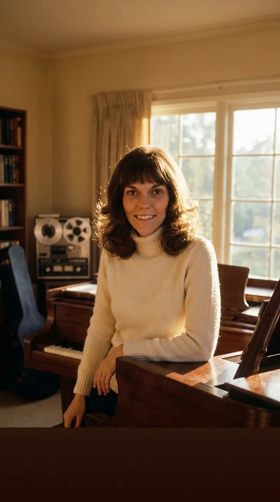
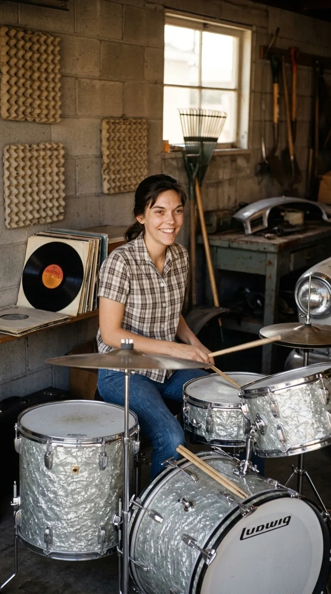
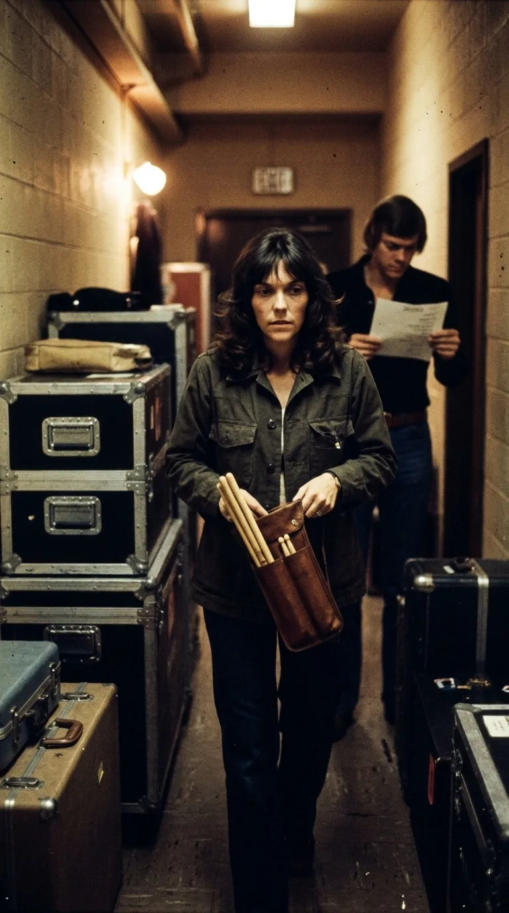
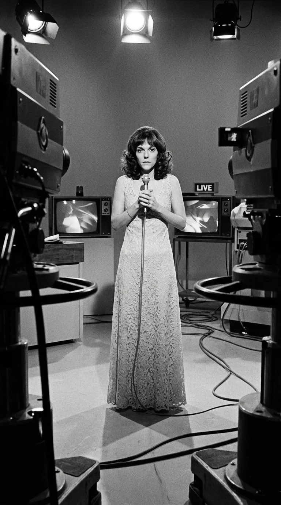
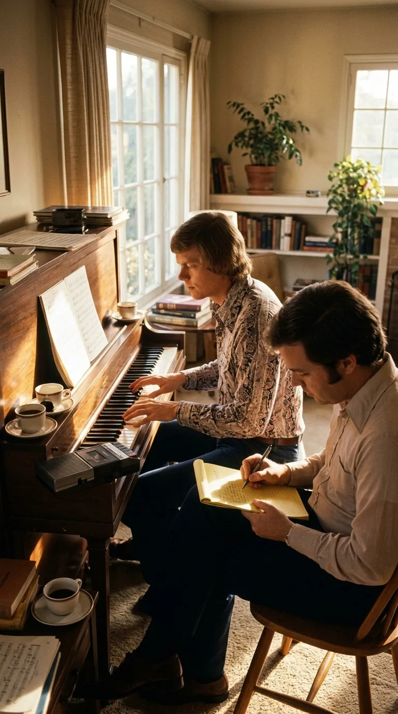
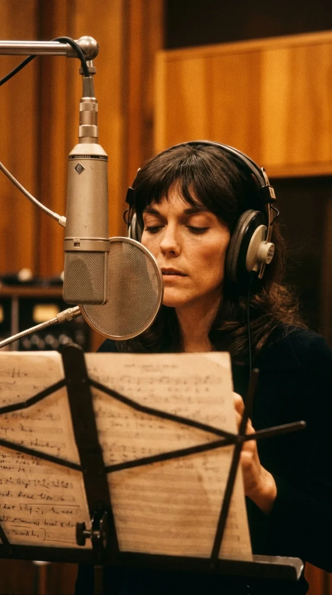
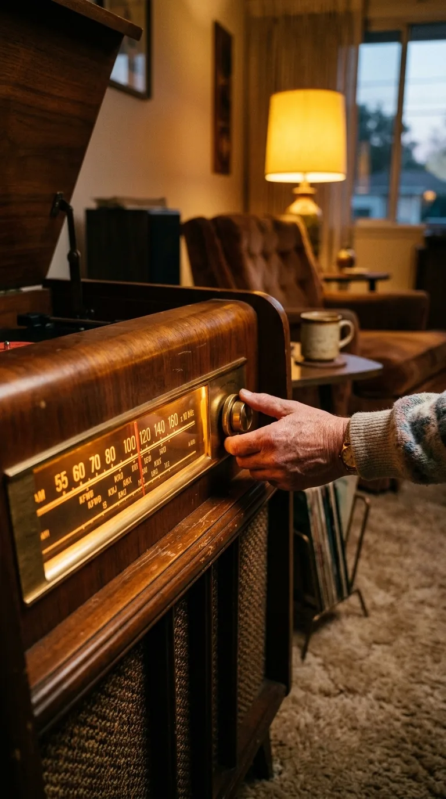
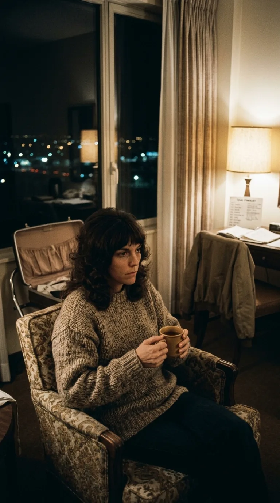
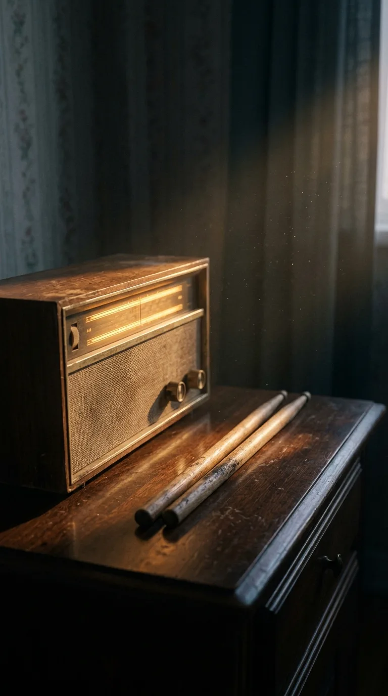

# El Refugio que Llegó Demasiado Tarde: La Herida Secreta tras «Yesterday Once More»

> *«When I was young I'd listen to the radio, waitin' for my favorite songs... How I wondered where they'd gone.»*  
> — John Bettis y Richard Carpenter (1973)

---

### Prólogo: El Milagro del Dial Encendido

En la primavera de 1973, millones de personas en todo el planeta encendían sus aparatos de radio para escuchar una voz que parecía flotar sobre el tiempo. No había sintetizadores estridentes ni agresividad eléctrica; solo una melodía de piano delicada, un compás templado de batería y una voz de contralto tan íntima, límpida y melancólica que daba la impresión de estar cantando a escasos centímetros del oído de quien escuchaba.

Aquella canción se titulaba **«Yesterday Once More»**. Era una elegía a la infancia, una plegaria laica sobre la magia de los viejos éxitos de los años sesenta que regresaban a través de las ondas para sanar la soledad cotidiana. Quien la escuchaba sentía una punzada de cálida nostalgia por tiempos más amables.

Sin embargo, detrás del cristal blindado del estudio de grabación, la mujer que pronunciaba aquellas palabras no estaba recordando un pasado dorado. Estaba atrapada en un presente asfixiante. A los veintitrés años, **Karen Carpenter** se consumía en silencio bajo el peso descomunal de las expectativas de la industria musical, el control familiar y el inicio implacable de una batalla contra la anorexia nerviosa que diez años más tarde apagaría su corazón. Para Karen, aquella canción no era un simple ejercicio de estilo retro: era el anhelo desesperado por volver a los días en que su único refugio era sentarse detrás de los tambores en la casa de sus padres en Downey, antes de que el mundo decidiera arrebatarle su instrumento para colocarla, vulnerable y sola, frente al juicio implacable de los focos.

*California, 1973: Karen Carpenter junto al piano, la voz de contralto que cautivó al mundo entero.*

---

### Acto I: La Muchacha Detrás de los Tambores (1964)

Para entender la hondura de *Yesterday Once More*, es imprescindible comprender la verdadera identidad de Karen Carpenter. Ella nunca soñó con ser una estrella pop ni con convertirse en el rostro público de la balada estadounidense. 

En 1964, en la escuela secundaria de Downey, California, Karen descubrió la batería casi por accidente, como una vía de escape para evitar las clases de educación física en la banda de marcha escolar. Cuando sus manos tomaron las baquetas por primera vez, ocurrió algo definitivo: descubrió que poseía un sentido del tiempo, una agilidad de muñeca y una precisión rítmica asombrosas. Pasaba horas encerrada en el garaje familiar tocando sobre discos de jazz de Dave Brubeck y Joe Morello.

En la batería, Karen encontraba una felicidad absoluta y sin dobleces. Su set de percusión era un escudo protector: una trinchera física donde podía expresarse sin ser juzgada por su aspecto exterior. Durante toda su carrera, cuando los periodistas le preguntaban qué era, respondía siempre con una sonrisa sincera:  
*«Yo no soy una cantante que aprendió a tocar la batería; soy una baterista que canta».*

*Downey, California, 1964: Karen Carpenter a los catorce años en su trinchera de paz: tras los tambores Ludwig en el garaje familiar.*

---

### Acto II: La Maquinaria del Éxito Devorador (1970–1972)

En 1970, el arreglo prodigioso concebido por su hermano Richard para *(They Long to Be) Close to You* de Burt Bacharach catapultó al dúo a la cima planetaria. De la noche a la mañana, The Carpenters se transformaron en un fenómeno multimillonario. Su sonido limpio y armónicamente perfecto cautivó a una nación que buscaba serenidad tras la turbulencia de la Guerra de Vietnam y las convulsiones sociales de finales de los sesenta.

Pero el éxito vino acompañado de un calendario despiadado: más de doscientos conciertos al año, compromisos publicitarios, grabaciones televisivas y hoteles impersonales en distintos continentes. La vida de los hermanos Carpenter quedó reducida a maletas, autobuses de gira y horarios cronometrados al milímetro.

*Camerinos en 1971: Karen Carpenter sosteniendo su estuche de baquetas entre maletas de gira, con Richard revisando el repertorio al fondo.*

En medio de ese ritmo agotador, comenzó a gestarse una decisión que cambiaría el destino de Karen. Los ejecutivos discográficos, los promotores y los directores de televisión insistieron en que era un desperdicio visual tener a una muchacha tan atractiva oculta detrás de platillos y tambores. Le exigieron que saliera al frente del escenario, que vistiera vestidos largos y cantara de pie con un micrófono de mano.

Aquella imposición la despojó de su armadura. Expuesta a cuerpo entero ante las cámaras y el escrutinio del público, Karen empezó a sentirse profundamente insegura respecto a su silueta. En 1972, al verse en una grabación televisiva, un comentario frívolo sobre su peso desencadenó una estricta obsesión por el control de su cuerpo que pronto derivó en restricciones alimentarias severas.

*1972: Obligada a dejar los tambores para cantar al frente de las cámaras bajo los focos de televisión, privada de su armadura protectora.*

---

### Acto III: La Noche en que Nació la Canción (1973)

A principios de 1973, durante un breve receso en Los Ángeles entre giras internacionales, Richard Carpenter y su letrista habitual, **John Bettis**, se reunieron en la casa de Richard para planificar su quinto álbum de estudio, titulado *Now & Then*.

Richard, un virtuoso de los arreglos y apasionado de la historia del pop, tenía en mente una ambiciosa cara B conceptual: un homenaje sonoro a la era dorada de las emisoras de radio AM de finales de los cincuenta y principios de los sesenta, con un locutor hilvanando canciones emblemáticas. Pero para que el concepto funcionara, necesitaban un tema original de apertura y cierre que condensara el alma del proyecto.

Sentado al piano de cola, Richard comenzó a tararear una secuencia melódica nostálgica y reposada. John Bettis, escuchando la cadencia de los acordes, sintió de inmediato la imagen que la música evocaba: dos hermanos que crecieron pegados al transistor en el asiento trasero del automóvil familiar, buscando refugio en las canciones de otros cuando el mundo exterior parecía incomprensible.

Bettis escribió las primeras líneas en un bloc de notas:  
*«When I was young I'd listen to the radio, waitin' for my favorite songs. When they played I'd sing along, it made me smile...»*

Era una letra sencilla en apariencia, pero cargada de una verdad dolorosa: la constatación de que la única infancia libre que habían tenido ya había quedado atrás para siempre.

*Los Ángeles, 1973: Richard Carpenter al piano y John Bettis escribiendo los primeros versos de «Yesterday Once More».*

---

### Acto IV: La Sesión en los Estudios A&M (Mayo de 1973)

En mayo de 1973, The Carpenters entraron a los legendarios estudios de A&M Records en Sunset Boulevard (Hollywood). Karen se sentó al micrófono vocal, acompañada únicamente por el piano acústico de Richard y la línea de bajo de Joe Osborn.

En este tema, Karen también grabó las pistas de batería, deleitándose en volver a marcar el pulso rítmico con sutiles redobles de escobillas y golpes de caja secos y elegantes. Pero cuando llegó el momento de registrar la toma vocal principal, el estudio enmudeció.

El ingeniero de sonido **Ray Gerhardt** recordaría años más tarde que Karen no necesitó repeticiones agotadoras. Su colocación vocal era tan perfecta que su voz de contralto parecía surgir sin esfuerzo desde el pecho. Sin embargo, lo que conmovió a todos en la cabina de control no fue la técnica, sino la tristeza insondable que impregnaba cada palabra. Cuando Karen cantó:  
*«Those were such happy times and not so long ago / How I wondered where they'd gone»*  
no sonaba como una artista interpretando un guion de nostalgia; sonaba como alguien que se asomaba al precipicio de su propia vida, preguntándose en qué momento exacto se había extraviado la felicidad.

*Hollywood, mayo de 1973: Karen Carpenter con auriculares frente al micrófono Neumann en A&M Studios, dejando grabada una emoción irrepetible.*

---

### Acto V: El Mágico Dial de la Cara B

En el álbum *Now & Then*, *Yesterday Once More* no fue concebida como una pista aislada, sino como el pórtico de entrada a un medley histórico. Al terminar la primera parte del tema, el sonido de un motor de coche encendiéndose y el dial de una radio AM sintonizando estática daba paso a la voz del legendario DJ de Los Ángeles, **Tony Peluso**.

A través de las ondas ficticias, Karen y Richard versionaban con devoción temas inmortales como *The End of the World* de Skeeter Davis, *One Fine Day* de The Chiffons y *Johnny Angel* de Shelley Fabares, antes de regresar en el cierre a la melodía de *Yesterday Once More*.

Aquel experimento convirtió el vinilo en una auténtica cápsula del tiempo. El oyente no solo escuchaba música; era transportado a un viaje en carretera por las autopistas de California al atardecer, donde la radio era una compañera leal que jamás abandonaba.

*El dial de la memoria: el sintonizador analógico guiando el viaje radiofónico de la cara B de «Now & Then».*

---

### Acto VI: El Huracán Global y el Récord en Japón

Publicada como sencillo en mayo de 1973, *Yesterday Once More* se convirtió en uno de los éxitos más fulgurantes de la década. Alcanzó el puesto número 2 en el *Billboard Hot 100* de Estados Unidos (solo frenada por *Bad, Bad Leroy Brown* de Jim Croce) y el número 2 en las listas oficiales del Reino Unido.

Pero fue en **Japón** donde la canción alcanzó dimensiones casi místicas. El público nipón conectó profundamente con la contención emocional, la pureza melódica y la nostalgia otoñal del tema. Se convirtió en el sencillo internacional más vendido en la historia de la música occidental en el país, superando los dos millones de copias y manteniendo su vigencia durante décadas en la memoria colectiva.

Desde Tokio hasta Londres, auditorios enteros coreaban con lágrimas en los ojos:  
*«Every sha-la-la-la, every wo-o-wo-o still shines...»*

*Tokio, 1973: The Carpenters sobre el escenario ante un auditorio colmado, consagrando el sencillo más vendido en la historia de Japón.*

---

### Acto VII: La Soledad en el Hotel

Paradójicamente, mientras la canción triunfaba en el mundo entero, el abismo interior de Karen se ensanchaba. En las giras multitudinarias de 1973 y 1974, la ovación de decenas de miles de personas contrastaba brutalmente con el silencio de su habitación de hotel tras apagar las luces.

Karen continuaba sometiendo su cuerpo a un rigor alimentario extremo, ocultando su delgadez bajo capas de ropa holgada. Richard, por su parte, lidiaba con una adicción creciente a los sedantes (*Quaaludes*) producto del insomnio y la presión laboral. Los dos hermanos que habían cantado a la dulzura de la juventud se encontraban ahora atrapados en una trampa dorada construida por su propio triunfo.

La canción que prometía que los viejos amigos de la radio regresarían para siempre se convirtió en un recordatorio constante de que el tiempo, una vez perdido, no tiene marcha atrás.

*1974: La quietud tras la ovación multitudinaria: Karen contemplando en soledad el horizonte urbano desde la habitación del hotel.*

---

### Epílogo: El Eco Inmortal

El 4 de febrero de 1983, a la edad de treinta y dos años, Karen Carpenter falleció en la casa de sus padres en Downey debido a una insuficiencia cardíaca provocada por las secuelas de una década de batalla contra la anorexia nerviosa. Su partida conmocionó al mundo y sacó de las sombras un trastorno que hasta entonces apenas era comprendido por la sociedad.

Décadas después, *Yesterday Once More* sigue sonando con la misma pureza cristalina del primer día. Cada vez que su arpegio de piano se despliega y la voz de Karen pronuncia su primera estrofa, ocurre el milagro que ella misma profetizó: la música se convierte en ese viejo amigo que regresa a buscarnos, recordándonos que aunque la vida nos hiera y los años se escapen, hubo un tiempo en que fuimos inocentes y felices al calor de una melodía.

*El eco del silencio: la radio tibia en la penumbra y las baquetas en calma, el refugio que siempre esperará a quien busca su voz.*

---

### 📚 Fuentes y Archivo Documental

1. **Coleman, Ray** (1994). *The Carpenters: The Untold Story*. HarperCollins, Londres / Nueva York. (Biografía oficial y testimonios de Richard Carpenter sobre las sesiones de grabación de 1973 en A&M Studios).
2. **Schmidt, Randy L.** (2010). *Little Girl Blue: The Life of Karen Carpenter*. Chicago Review Press. (Investigación documental sobre las cartas, presiones de imagen escénica y desarrollo de la anorexia nerviosa).
3. **Bettis, John** (2004). Entrevistas de archivo para el documental de PBS *Close to You: Remembering The Carpenters*. (Testimonio sobre el proceso de composición lírica y el impacto emocional de la voz de Karen).
4. **Billboard Magazine** (1973). Archivo hemerográfico de listas de éxitos, reseñas del LP *Now & Then* (junio de 1973) y posiciones oficiales de sencillos.
5. **Oricon Singles Chart** (1973–1974). Registros oficiales de ventas discográficas y certificaciones de sencillos internacionales en Japón.
6. **A&M Records Historical Archives** (1973). Hojas de sesión de grabación de estudio, créditos técnicos de personal y notas de producción de Richard Carpenter.
