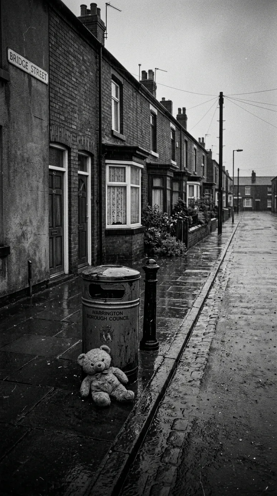
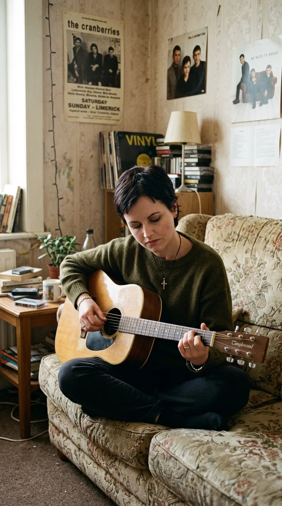
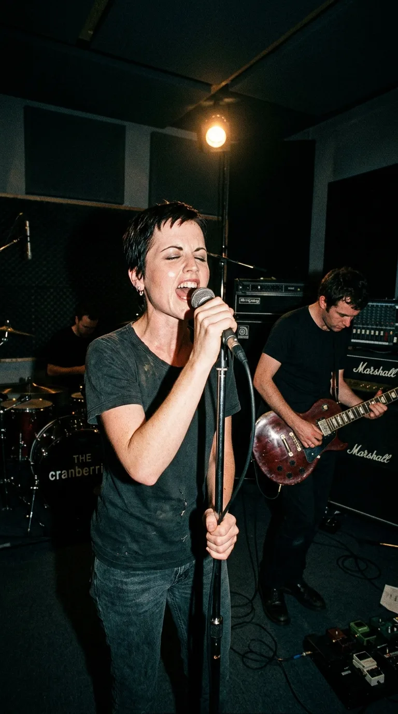
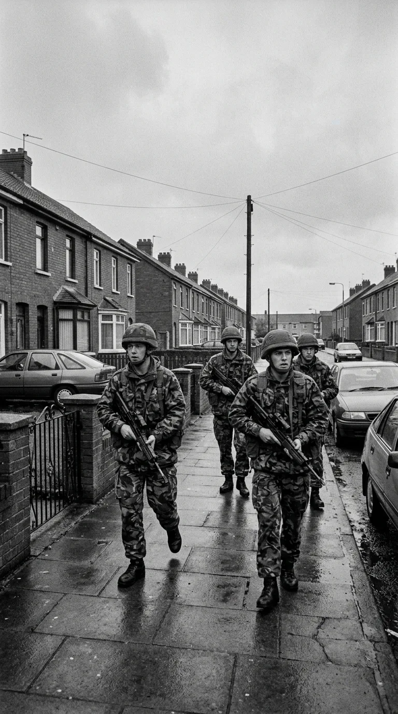
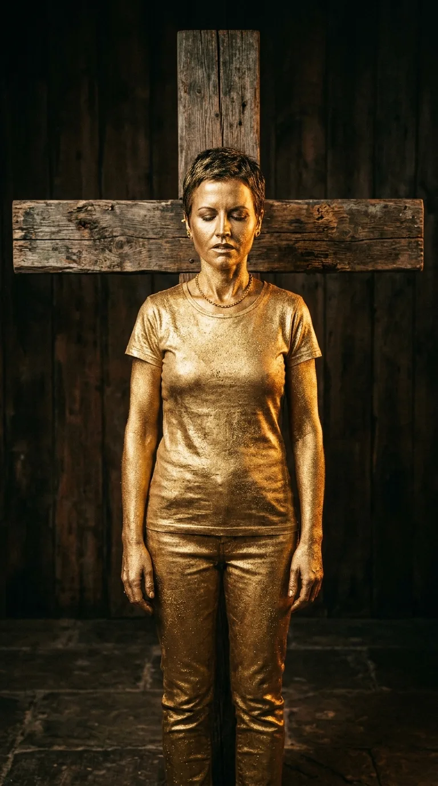
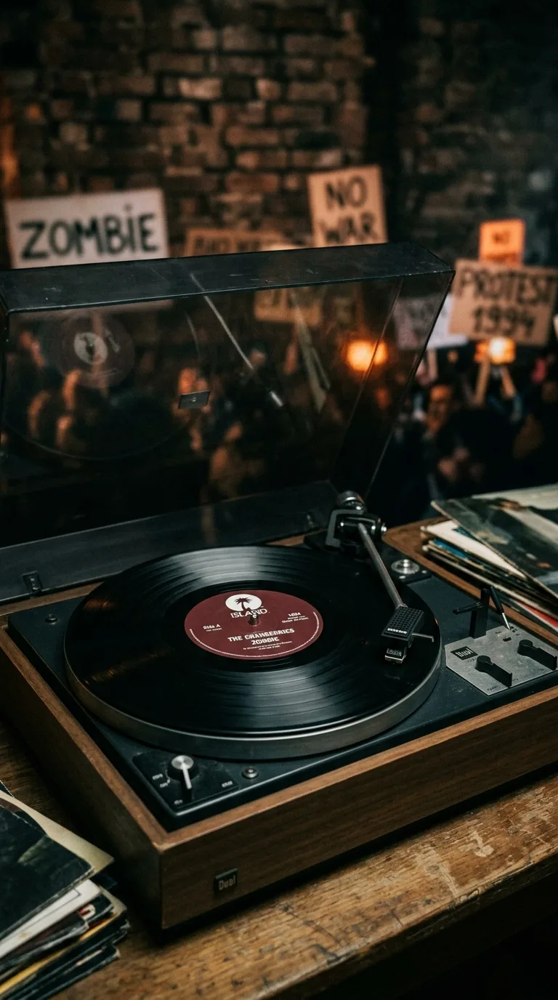
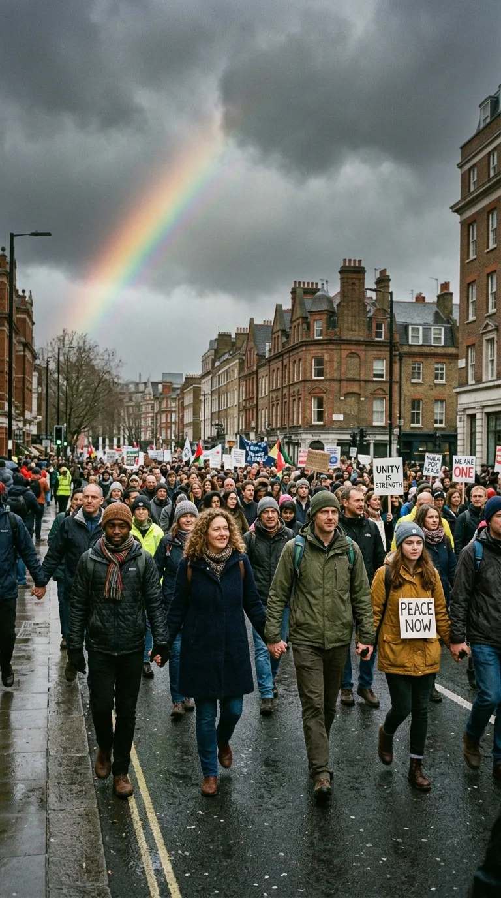

*1993–1994: El lamento por dos niños asesinados que rompió el silencio de toda una generación y desafió la violencia sectaria.*

---

### Prólogo: El sábado de compras que se tiñó de sangre

En la mañana del sábado **20 de marzo de 1993**, víspera del Día de la Madre en el Reino Unido, la calle peatonal Bridge Street de la localidad industrial de Warrington, en Cheshire (Inglaterra), rebosaba de familias, carritos de bebé y niños comprando regalos y flores.

A las 12:27 del mediodía, sin previo aviso suficiente para evacuar a la multitud, dos bombas camufladas en el interior de papeleras de hierro fundido detonaron con una diferencia de un minuto. El estallido arrojó metralla, clavos y esquirlas de metal a decenas de metros a la redonda.

La tragedia fue atroz. **Johnathan Ball**, un niño inocente de apenas **tres años** que había salido al centro de la mano de su niñera para comprar una tarjeta del Día de la Madre, murió en el acto. **Tim Parry**, un muchacho de **doce años** apasionado por el fútbol que esperaba a sus amigos para comprar unos pantalones cortos, sufrió lesiones cerebrales devastadoras y falleció cinco días después en el hospital. Otras cincuenta y seis personas resultaron gravemente mutiladas y heridas.

La autoría del atentado fue asumida por el **IRA Provisional** (Ejército Republicano Irlandés). Aquel golpe indiscriminado contra niños indefensos provocó una ola de repugnancia y dolor sin precedentes tanto en el Reino Unido como en la propia República de Irlanda.

A más de quinientos kilómetros de allí, en un modesto apartamento de la ciudad irlandesa de Limerick, una joven cantautora de veintiún años contemplaba las imágenes del telediario con las lágrimas rodando por sus mejillas y las manos temblando de rabia. Se llamaba **Dolores O'Riordan**.

*Warrington, marzo de 1993: La calle desierta bajo la lluvia tras el atentado que segó la vida de Tim Parry y Johnathan Ball.*

---

### Acto I: El llanto en la soledad de Limerick

Dolores O'Riordan no era una observadora indiferente. Como irlandesa criada en un ambiente católico tradicional en la campiña de Ballybricken, conocía de cerca las heridas de los «Troubles» (el conflicto norirlandés que desangraba a la isla desde finales de los años sesenta). Pero ver cómo un grupo armado utilizaba el nombre de Irlanda y de su bandera para asesinar a criaturas de tres y doce años en una calle comercial inglesa le provocó una náusea moral insoportable.

> *«Recuerdo estar sentada sola en mi piso de Limerick, viendo a las madres de esos niños destrozadas en televisión —recordaría Dolores años más tarde—. Sentí una vergüenza y un dolor inmenso. Quería gritarle al mundo que eso no nos representaba a los irlandeses; que ningún ideal político, ninguna frontera y ninguna bandera justificaban semejante monstruosidad»*.

Sola en su habitación, Dolores tomó su guitarra acústica. Con los acordes básicos de *Mi menor, Do mayor, Sol mayor y Re con bajo en Fa sostenido (Em - C - G - D/F#)*, comenzó a esculpir unos versos furiosos, desprovistos de metáforas poéticas tibias:

> *«Another head hangs lowly, child is slowly taken... / And the violence caused such silence, who are we mistaken? / But you see, it's not me, it's not my family...»*  
> *(«Otra cabeza cuelga cabizbaja, un niño es arrebatado lentamente... / Y la violencia causó tal silencio, ¿en qué nos hemos equivocado? / Pero ya ves, no soy yo, no es mi familia...»)*

No era una canción sobre bandos políticos. Era una condena a la deshumanización: a esos hombres armados que, programados por odios atávicos heredados desde el alzamiento de Pascua de 1916 (*«It's the same old theme since nineteen-sixteen...»*), actuaban como muertos vivientes sin alma, como **zombis** autómatas incapaces de conmoverse ante la muerte infantil:

> *«In your head, in your head, they are fighting... / With their tanks, and their bombs, and their bombs, and their guns... / In your head, in your head they are crying: / Zombie, zombie, zombie...»*

*Limerick, 1993: En la intimidad de su habitación, Dolores canaliza el dolor del duelo en un manifiesto pacifista indomable.*

---

### Acto II: La metamorfosis en Windmill Lane Studios

Hasta ese momento, The Cranberries eran conocidos mundialmente por su álbum debut *Everybody Else Is Doing It, So Why Can't We?* (1993), un disco repleto de pop de guitarras cristalinas, melodías etéreas y baladas nostálgicas como *«Linger»* y *«Dreams»*. El público los consideraba una dulce banda de pop alternativo celta.

Cuando la banda entró a los míticos **Windmill Lane Studios** de Dublín a comienzos de 1994 junto a su productor de cabecera, el prestigioso **Stephen Street** (conocido por sus trabajos con The Smiths y Blur), Dolores exigió una transformación radical.

—*«No quiero guitarras acústicas dulces para este tema —le advirtió a Noel Hogan, el guitarrista—. Esta canción tiene que sonar a hierro, a tanques, a cemento roto. Necesitamos que duela»*.

Noel Hogan cambió su habitual guitarra Rickenbacker por una pesada Gibson Les Paul con pedales de distorsión al límite; el bajista Mike Hogan endureció sus líneas con un bajo agresivo y el baterista Fergal Lawler aporreó la batería con la cadencia marcial de una marcha fúnebre.

Pero la verdadera conmoción fue la voz de Dolores. Dejando atrás los susurros melancólicos, se plantó ante el micrófono y desató una fuerza visceral que nadie sospechaba en su menudo cuerpo de metro y medio: utilizó la técnica del *yodeling* gaélico tradicional —esos saltos abruptos entre la voz de pecho y la voz de cabeza—, no como un adorno folclórico, sino como un aullido desgarrador de furia y luto que ponía la piel de gallina a los ingenieros tras la consola.

*Dublín, 1994: Dolores y The Cranberries en Windmill Lane Studios desatando un sonido de guitarras abrasivas y marcha fúnebre.*

---

### Acto III: El desafío a la discográfica Island Records

Cuando los ejecutivos de su sello discográfico, **Island Records**, escucharon la maqueta final de *«Zombie»*, cundió el pánico en las oficinas de Londres y Nueva York. 

La discográfica temía que una canción tan explícitamente política y con un sonido tan abrasivo alienara a las emisoras de radio que programaban *«Linger»* en bucle. Llegaron incluso a ofrecerle a la banda un cheque en blanco de **un millón de dólares** para que guardaran el tema en un cajón y grabaran otro álbum de pop melódico.

Dolores O'Riordan rechazó la oferta de inmediato y con desprecio:

—*«Esta canción no se negocia —le espetó a los directivos—. No la compuse para vender discos de radiofórmula; la compuse porque dos niños murieron despedazados en una papelera y alguien tenía que decir la verdad. O sale como primer sencillo de 'No Need to Argue', o rompemos el contrato ahora mismo»*.

La discográfica capituló ante su determinación.

---

### Acto IV: El rodaje clandestino de Samuel Bayer en Belfast

Para acompañar el lanzamiento, la banda contrató al director de videoclips más cotizado de la era grunge: **Samuel Bayer**, el realizador detrás de *«Smells Like Teen Spirit»* de Nirvana.

Bayer viajó a Belfast (Irlanda del Norte) con una cámara de 16 milímetros y filmó escenas de un realismo documental sobrecogedor: niños de barrios obreros jugando a la guerra entre barricadas, patrullas de soldados británicos armados patrullando las calles de West Belfast y los gigantescos murales sectarios que dividían a católicos y protestantes.

*Belfast, 1994: Patrullas militares en barrios obreros norirlandeses, capturadas por la lente documental de Samuel Bayer.*

En contraposición, en un estudio de Los Ángeles, Bayer filmó a Dolores O'Riordan cubierta de purpurina dorada de la cabeza a los pies, de pie frente a una cruz monumental y rodeada por un coro de niños que emulaban ángeles dolientes. El contraste entre la crudeza del conflicto callejero y la imaginería litúrgica creó uno de los videoclips más icónicos y reproducidos en la historia de MTV.

*La iconografía mística del videoclip: Dolores bañada en oro como un ángel doliente en defensa de la infancia.*

---

### Acto V: El himno universal y el abrazo del padre de Tim Parry

Publicada en septiembre de **1994** como adelanto del álbum *No Need to Argue*, *«Zombie»* provocó un cataclismo mundial. Se convirtió en el número uno en más de diez países —incluyendo Australia, Francia, Alemania y la lista Modern Rock de Estados Unidos—, catapultando las ventas del disco por encima de los diecisiete millones de ejemplares.

*1994: El vinilo de «Zombie» que conquistó las listas mundiales y desafió el silencio de la violencia sectaria.*

Pero su mayor triunfo no fue comercial. En los meses y años posteriores, el clamor generado por la canción ayudó a cristalizar el hartazgo ciudadano contra la violencia armada, abonando el terreno social que culminaría en el histórico **Acuerdo de Viernes Santo de 1998**, que puso fin a tres décadas de conflicto civil en Irlanda del Norte.

Años después, **Colin Parry**, el padre del pequeño Tim Parry de doce años asesinado en Warrington, conoció personalmente a Dolores O'Riordan y a los miembros de la banda. Conmovido, le agradeció públicamente haber inmortalizado la memoria de su hijo y la de Johnathan Ball:

> *«La canción de Dolores le dio una voz inmortal a dos niños que ya no podían hablar. Nos demostró que el arte tiene el poder de convertir la tragedia más oscura en un grito invencible de paz para toda la humanidad»*.

---

### Epílogo: La voz inmortal de la mariposa de hierro

El 15 de enero de 2018, la voz de Dolores O'Riordan se apagó para siempre en Londres a los cuarenta y seis años, dejando un vacío irremplazable en el panorama de la música internacional.

Tres décadas después de aquel atentado de Warrington, *«Zombie»* sigue acumulando miles de millones de reproducciones y resonando en estadios de todo el mundo. Es el testimonio imperecedero de una artista menuda pero gigante, que demostró que cuando la música se empuña no como un adorno de entretenimiento, sino como una espada moral contra la barbarie, es capaz de desarmar a los tanques y silenciar para siempre el eco de las bombas.

*La esperanza tras la tormenta: una marcha pacífica de manos unidas, el legado de reconciliación que Dolores ayudó a forjar.*

---

### 📚 Fuentes y Archivo Documental

1. **O'Riordan, Dolores** (1994–2017). Archivo de entrevistas en prensa internacional (*Vox Magazine*, *NME*, *Rolling Stone*, *The Irish Times* y *Hot Press*), donde la autora relata la redacción en Limerick tras el atentado de Warrington y la negativa al cheque de Island Records.
2. **Parry, Colin** (1994). *Tim: An Ordinary Boy*. Hodder & Stoughton, Londres. Memorias del padre de Tim Parry sobre la tragedia de Warrington, la campaña por la paz y su encuentro con The Cranberries.
3. **Street, Stephen** (2018). *Record Maker: In the Studio with The Cranberries*. Documentos de producción, registros de consolas analógicas y entrevistas sobre las sesiones de grabación en Windmill Lane Studios para el álbum *No Need to Argue*.
4. **Hogan, Noel & Lawler, Fergal** (2019). *Remembering Dolores: The Story of 'No Need to Argue'*. Entrevistas retrospectivas con la BBC e ITV Documentaries sobre la composición y el sonido grunge de *«Zombie»*.
5. **BBC News & The Guardian Archives (marzo de 1993)**. Cobertura hemerográfica oficial del atentado de Warrington en Bridge Street, informes periciales y resoluciones judiciales sobre el IRA Provisional.
6. **Bayer, Samuel** (1994). *Production Notes on the 'Zombie' Music Video Shoot in Belfast*. Archivos visuales de MTV Networks y Film London.
