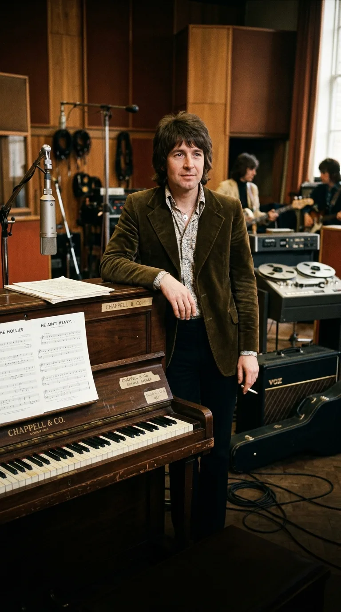
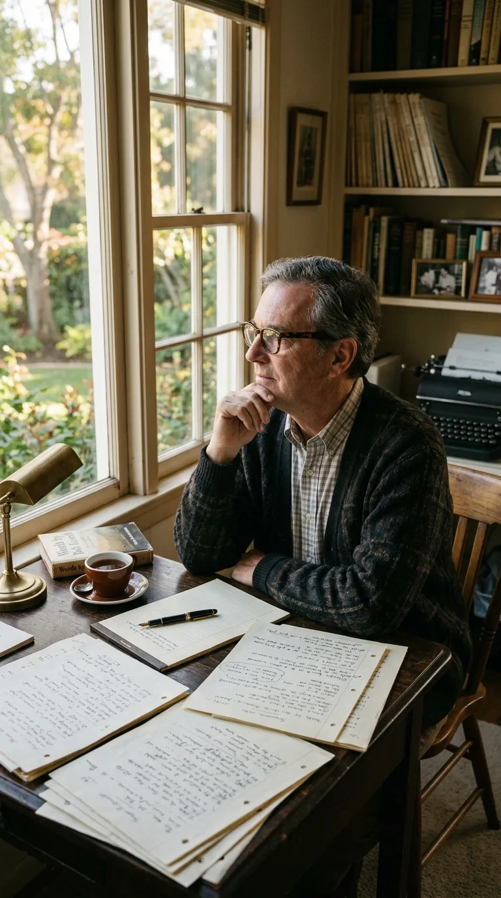
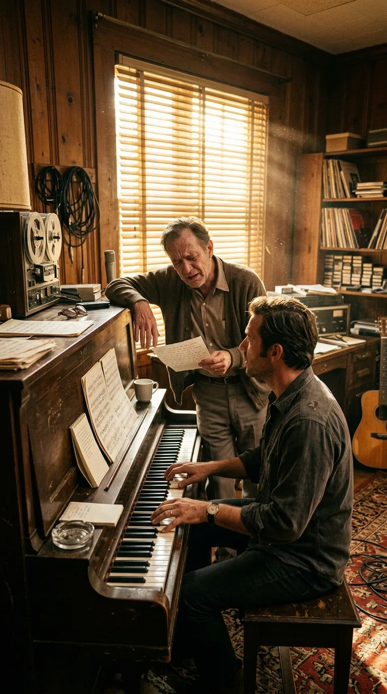
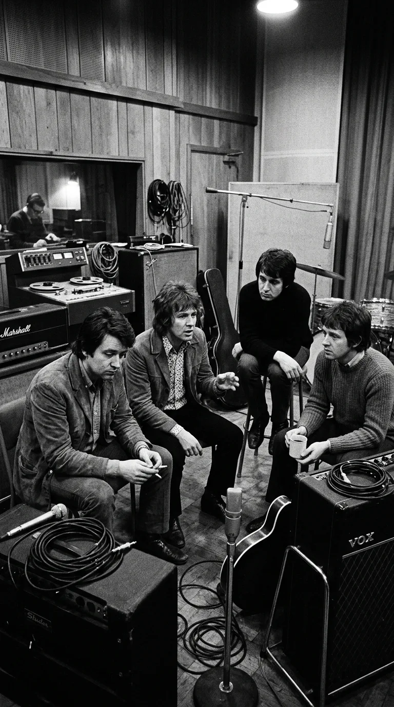
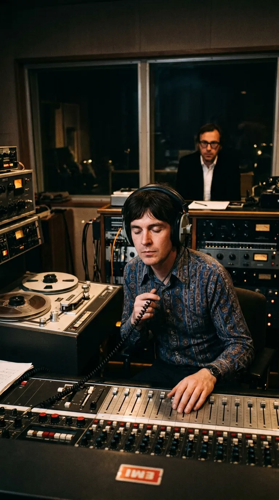
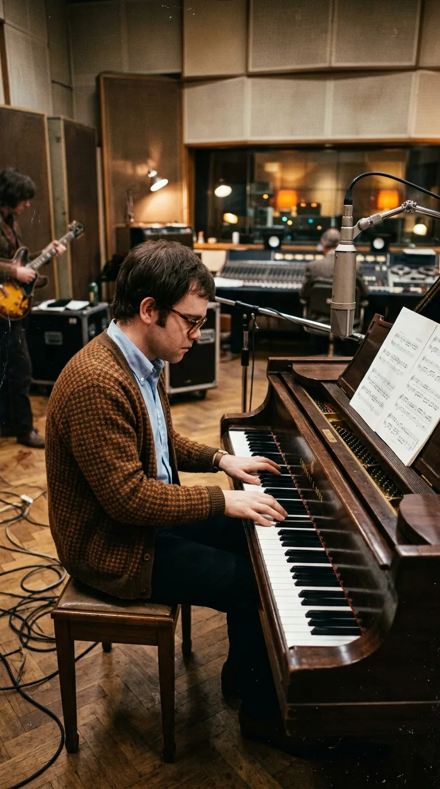
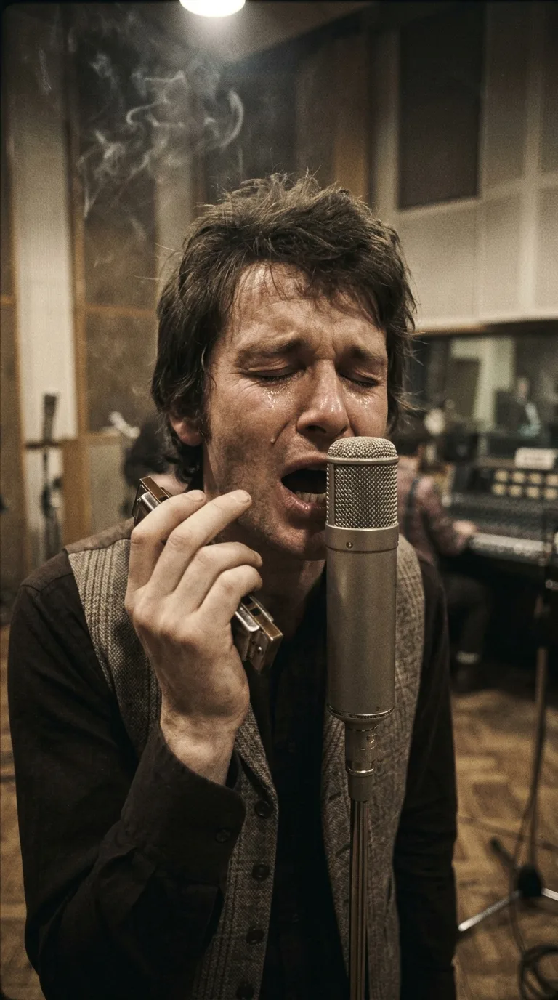
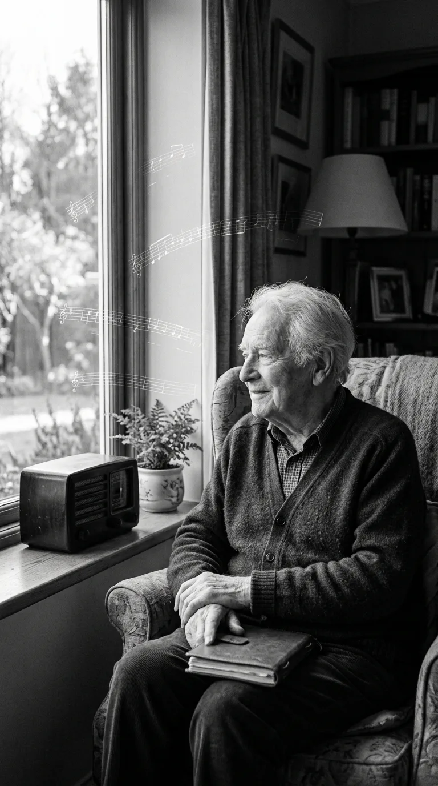

# The Anthem Born of a Farewell: The Agony and the Miracle Behind «He Ain't Heavy, He's My Brother»

> *«The road is long, with many a winding turn...  
> He ain't heavy, he's my brother.»*

---

*1969: The Hollies at Abbey Road, the British band that transformed a prayer into a universal anthem of compassion.*

In early 1969, inside a sun-drenched California home, a fifty-four-year-old man sat before his writing desk, acutely aware that the sand in his hourglass was slipping away with merciless speed. His name was **Bob Russell**, one of the most respected lyricists of the golden age of American songwriting, renowned for crafting timeless classics for Duke Ellington such as *«Do Nothin' Till You Hear from Me»* and *«Don't Get Around Much Anymore»*.

Yet that spring, Russell was not writing for smoky jazz lounges or the bright lights of Broadway. He was battling terminal Hodgkin's lymphoma. The physical agony was devastating, and his doctors had gently warned him that he had mere months left to live. Far from yielding to bitterness or isolation, Bob felt an urgent spiritual necessity to distill the supreme meaning of human existence into one final work: selfless compassion and the moral duty to lift a fellow human being when their legs could no longer carry them.

The result of that race against death would be **«He Ain't Heavy, He's My Brother»**, one of the most profoundly moving ballads of the 20th century. Yet for that quiet prayer to become a planetary anthem, fate had to weave an astonishing chain of coincidences: a legend born in the snow-covered grounds of a Nebraska orphanage, a British rock band on the brink of dissolution, and a shy, unknown twenty-two-year-old pianist who was paid a mere twelve British pounds before the entire world came to know him as **Elton John**.

---

## Act I: Three Encounters on the Threshold of Silence

Through a mutual music publisher, Bob Russell was introduced to New York-born pianist and composer **Bobby Scott**, a talented musician with deep roots in jazz and rhythm and blues. Scott traveled to Los Angeles to meet the ailing lyricist. Because of Russell’s frequent bouts of severe pain and exhausting medical treatments, the two artists **were only able to meet in person three times**.

*California, 1969: Bob Russell at his California desk, waging a quiet race against a terminal illness to dictate his poetic farewell.*

Despite his extreme physical frailty, Russell’s poetic clarity remained completely intact. During those brief encounters, Scott would improvise harmonic progressions on the piano while Russell—either leaning against the instrument's frame or dictating verses in a halting, breathless voice from an armchair—sculpted a lyric of disarming dignity. There was no trace of self-pity in his words; it was an anthem honoring the resilience of the human soul in the face of life's harshest terrain.

*California, 1969: Composer Bobby Scott at the piano, while Bob Russell recites verses, leaning upon the instrument with profound emotion.*

For the title and conceptual core of the song, Russell drew upon an image deeply embedded in American popular lore: the story of **Boys Town**.

---

## Act II: «He Ain't Heavy, Father... He's My Brother»

In 1917, Catholic priest **Edward J. Flanagan** founded a home in Omaha, Nebraska, for orphaned, abandoned, and homeless boys, welcoming children of every race and creed. Decades later, in 1943, Father Flanagan saw a drawing in a magazine that deeply moved him: an older boy carrying a smaller child afflicted with polio and leg braces upon his back, laboriously crossing a snow-covered path.

*The Legend of Boys Town: An older brother carrying his ailing younger sibling through the snow under the motto "He ain't heavy, Father... he's my brother."*

When the priest asked the youth if carrying his companion didn't make for a terribly heavy burden, the boy replied with disarming innocence:  
*«He ain't heavy, Father... he's m' brother»*.

That phrase became the official motto of Boys Town, cast in bronze monuments and printed on posters across the country. Bob Russell rescued it from the memories of his youth to serve as the chorus of his life's final testament. For Russell, who felt the suffocating weight of illness in his own flesh, the metaphor attained a transcendent dimension: the weight of another’s struggles is never burdensome when borne out of brotherly love.

With the melody finished and a modest demo recorded onto magnetic tape, Bobby Scott and Russell’s representatives offered the song to several established artists. Joe Cocker recorded it for his debut album, though with a much more soulful and tortured delivery. What the song truly required was an interpretation that struck a delicate balance between orchestral solemnity and an almost sacred tenderness.

It was then that the tape crossed the Atlantic and landed in London.

---

## Act III: The Hollies at the Crossroads of Abbey Road

For the British group **The Hollies**, the summer of 1969 was not a season of celebration, but a battle for survival. Having reigned as one of the most successful acts of the *British Invasion* with evergreen hits like *«Bus Stop»* and *«Carrie Anne»*, the band had suffered a devastating blow: **Graham Nash**—guitarist, songwriter, and the architect of their legendary vocal harmonies—had departed the group in late 1968 to settle in California and form **Crosby, Stills & Nash**.

*Abbey Road Studio Two: The Hollies debating their uncertain future following Graham Nash's departure for California.*

The British music press immediately wrote off The Hollies as a spent force. The addition of guitarist Terry Sylvester helped bridge the gap, but the group desperately needed a song of undeniable artistic gravity to prove they were still a vital force.

Producer **Ron Richards** received the demo of *«He Ain't Heavy, He's My Brother»* and played it for lead vocalist **Allan Clarke**. The impact was instantaneous. Clarke listened to the tape in the dim light of the control room at **Abbey Road Studios** and burst into tears:  
*«As soon as I heard the opening notes and the lyrics, a chill ran straight down my spine. This wasn't just another pop tune for the charts; it was a prayer, something sacred. I told the lads: 'We have to record this, but we have to sing it with our hearts completely on our sleeves'»*.

*Abbey Road, 1969: Allan Clarke in the dim control room, listening to the demo with tears and reverent devotion.*

---

## Act IV: The Twelve-Pound Pianist and the Harmonica of the Soul

On June 25, 1969, The Hollies gathered in the legendary **Studio Two at Abbey Road** to lay down the track. To perform the intricate and delicate acoustic piano introduction required to anchor the song's emotional weight, the band hired a twenty-two-year-old session player who regularly worked at the studios just to pay the rent on his tiny apartment.

*Abbey Road, June 1969: A twenty-two-year-old Reg Dwight (Elton John) playing the immortal chords on the grand piano for a fee of twelve pounds.*

His birth name was **Reginald Kenneth Dwight**, though he was beginning to use the stage name **Elton John** in local circles. For that afternoon's work on the Abbey Road grand piano, Dwight was paid the standard British musicians' union rate: **twelve British pounds**. His unhurried, melancholic, and solemn chords would go on to become one of the most recognizable piano intros in Western pop history.

Upon that cushion of piano keys, Allan Clarke delivered one of the most naked vocal performances of his career. Rather than simply singing, Clarke picked up a marine band harmonica and blew a solitary, plaintive melody at the outset, evoking the chill wind of a desolate road. Backed by Johnnie Spence’s sweeping orchestral string arrangements, Clarke’s vocal climax as he delivered the final line (*«He ain't heavy... he's my brother»*) conveyed a genuine lump in the throat, knowing that across the ocean, the man who penned those words was fading away day by day.

*Abbey Road, 1969: Allan Clarke before a Neumann U47 microphone with his harmonica in hand, pouring his voice into the sorrow of grief and brotherhood.*

---

## Epilogue: The Eternal Light of a Man at Peace

Released in September 1969 in the United Kingdom and shortly thereafter in the United States, The Hollies' version was an explosive success: it climbed to number 3 on the British charts and reached number 7 on the Billboard Hot 100, catapulting the band back to the international forefront.

*A serene portrait of Bob Russell in his final days, having lived to see his masterwork turn into a planetary source of comfort.*

Bob Russell was able to hear the recording from his sickbed in California. Those who kept vigil during his final days affirmed that the songwriter smiled in quiet peace upon realizing his personal agony had been transformed into universal solace for millions. On February 18, 1970, at the age of fifty-five, Russell passed away. Posthumously, at that year's Academy Awards, he received a nomination for his cinematic work, and his memory was forever enshrined in the *Songwriters Hall of Fame*.

The song, however, never stopped walking. In 1988, nineteen years after its initial release, an advertising campaign returned The Hollies' original recording to the British public, propelling it straight to the **undisputed number 1 spot in the UK**. And in 2012, following the historic judicial verdict regarding the **Hillsborough stadium disaster** (where 97 Liverpool fans lost their lives in 1989), a coalition of British artists known as *The Justice Collective* re-recorded the track as a tribute to the victims and their families, once again capturing the UK Christmas number one as the ultimate symbol of shared memory and justice.

*The path toward the light: two silhouettes walking together toward a golden dawn, the eternal metaphor of brotherhood.*

More than half a century after an expiring man defied death to dictate his final verses, *«He Ain't Heavy, He's My Brother»* stands as an indelible reminder of our noblest condition: that on the long and winding road of life, no burden is ever too heavy when it is carried out of love for the brother walking by our side.

---

### 📚 Sources and Archival Records

1. **Russell, Bob & Scott, Bobby** (1969). *He Ain't Heavy, He's My Brother* (Original sheet music and copyright registration notes). Harrison Music Corp. / Jenny Music Inc.
2. **Clarke, Allan & Hicks, Tony** (Archival interviews, 1970–1995). Testimonials regarding the recording sessions at Abbey Road Studio Two and the participation of Reg Dwight. *Melody Maker* and *New Musical Express*.
3. **Flanagan, Father Edward J.** (1943). Historical archives of *Boys Town*, Omaha, Nebraska. Origins and registration of the orphanage's official motto and iconography.
4. **Norman, Philip** (2001). *Sir Elton: The Definitive Biography*. Pan Macmillan. Chapters dedicated to his early London session work and the twelve-pound collaboration with The Hollies.
5. **The Hillsborough Inquest & The Justice Collective** (2012). Documentation of the charitable campaign and UK number-one single release. BBC Music & Official Charts Company.

---

### 💬 Community and Reflection

What song or pivotal moment in your own life has taught you that true human greatness lies in walking beside and lifting up another when the road turns steep? Let us hear your thoughts in the comments below.