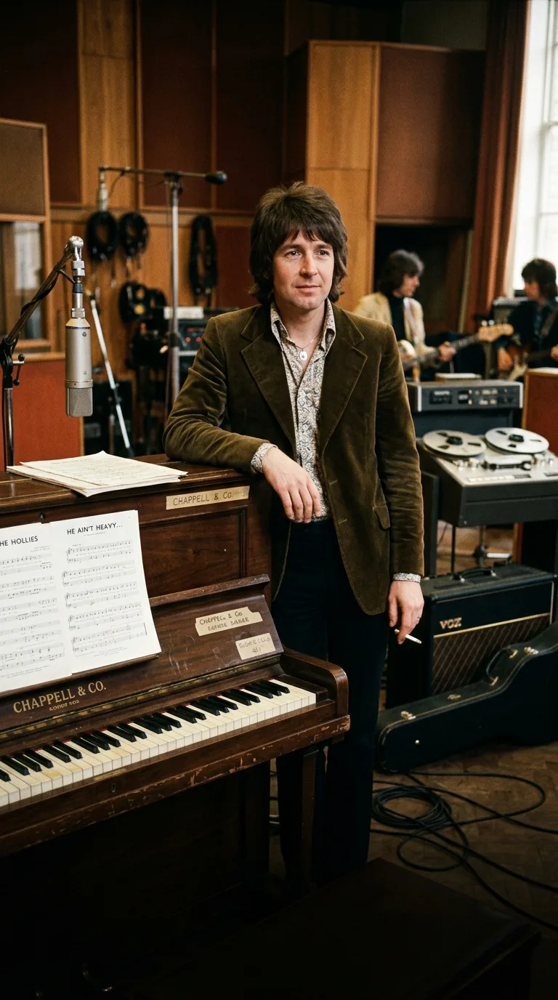
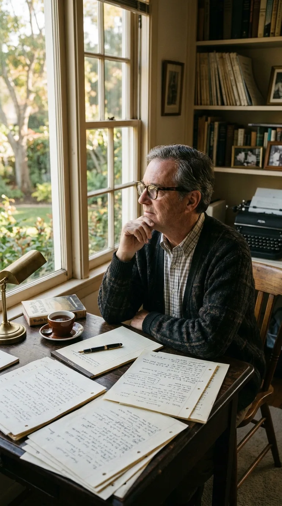
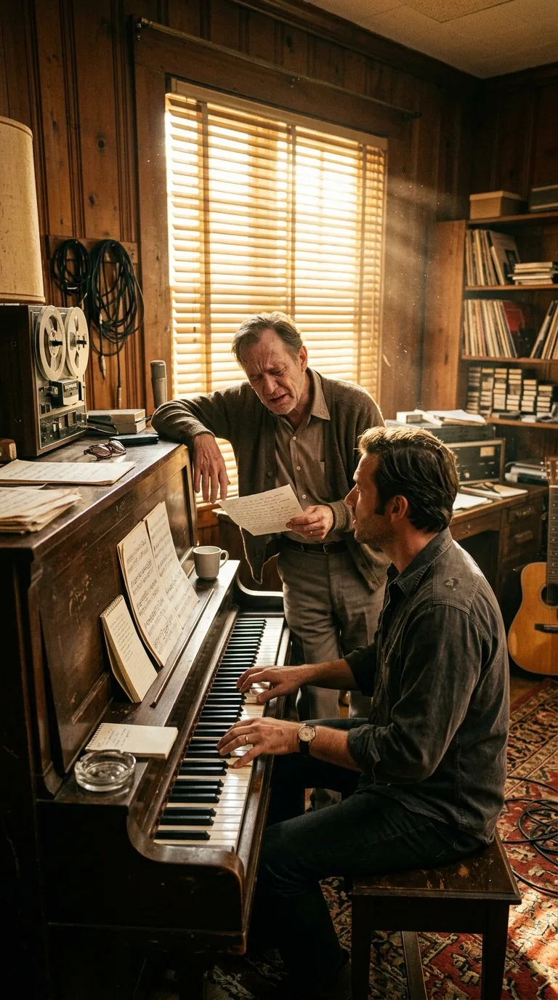
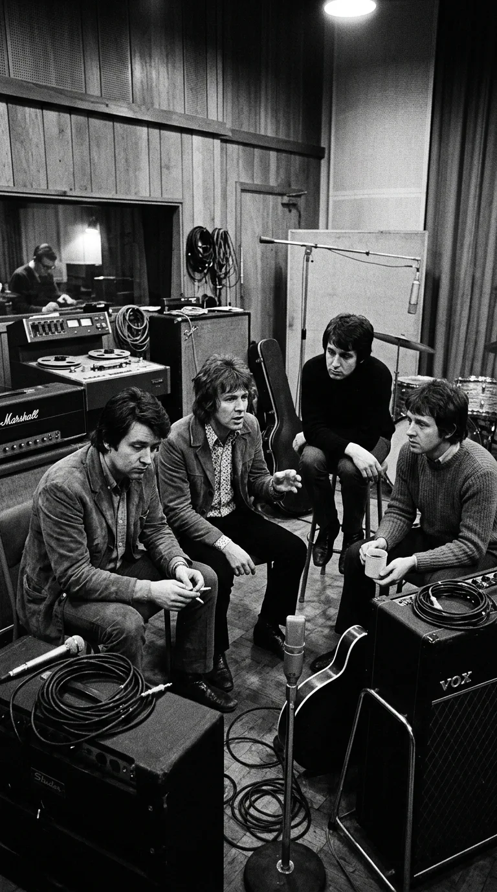
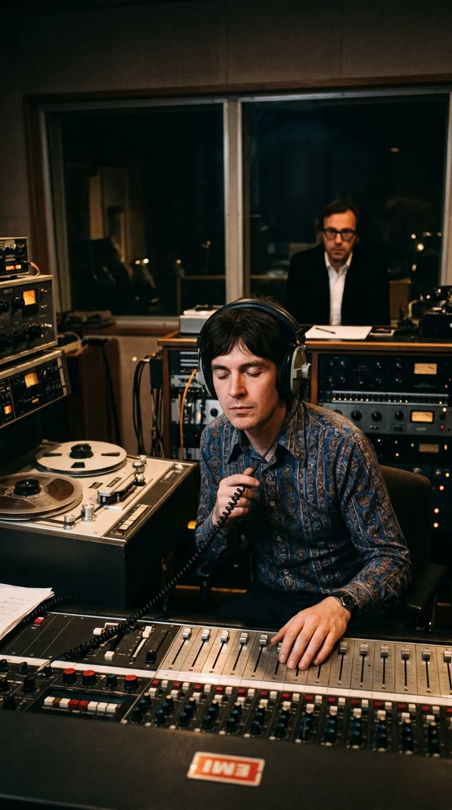
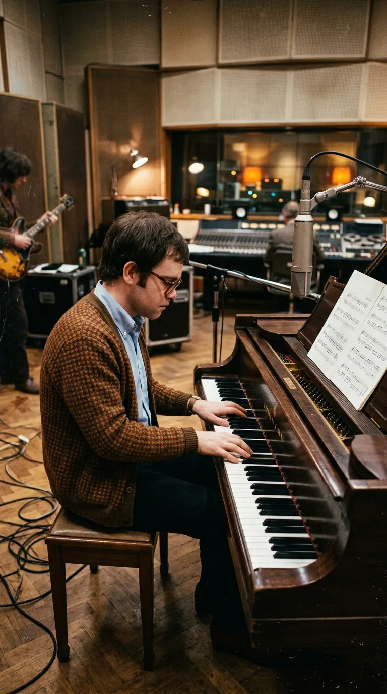
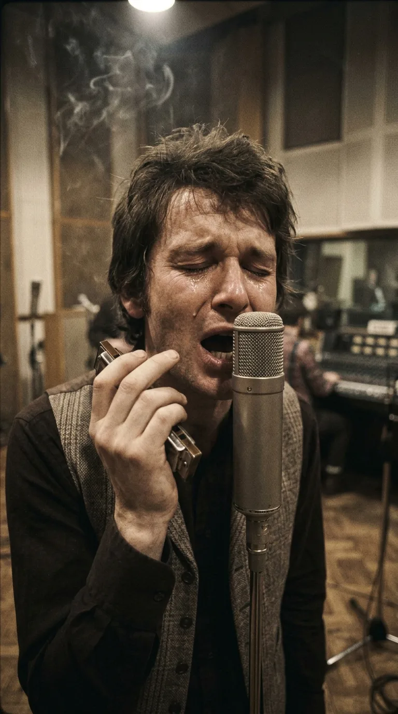
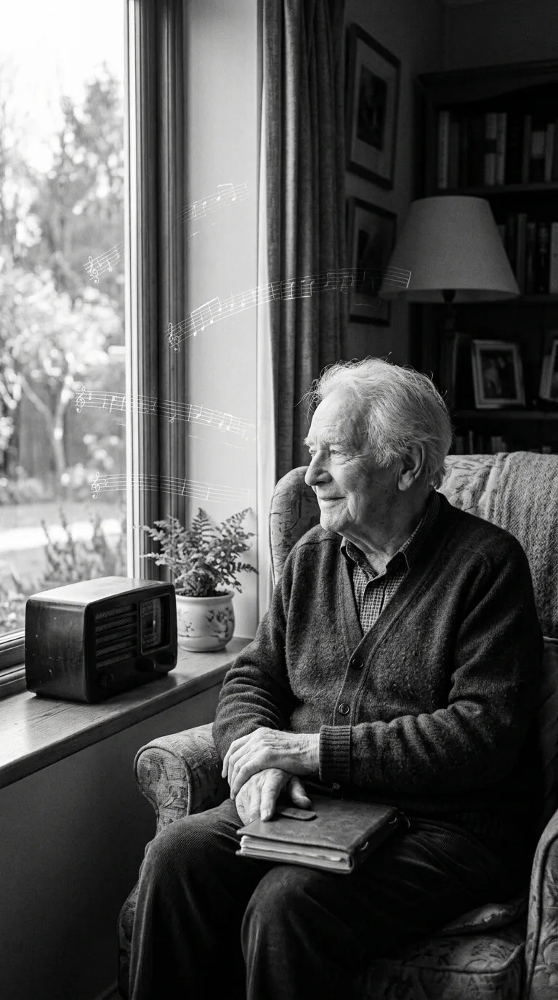

# El Himno que Nació de una Despedida: La Agonía y el Milagro Detrás de «He Ain't Heavy, He's My Brother»

> *«The road is long, with many a winding turn...  
> He ain't heavy, he's my brother.»*

---

*1969: The Hollies en Abbey Road, la banda británica que transformó una plegaria en un himno universal de compasión.*

A principios de 1969, en una soleada casa de California, un hombre de cincuenta y cuatro años se sentaba frente a su mesa de trabajo sabiendo que la arena de su reloj se deslizaba con implacable rapidez. Su nombre era **Bob Russell**, uno de los letristas más respetados de la época dorada de la música estadounidense, autor de clásicos inmortales para Duke Ellington como *«Do Nothin' Till You Hear from Me»* y *«Don't Get Around Much Anymore»*.

Pero en aquella primavera, Russell no escribía para los salones de baile ni para los reflectores de Broadway. Padecía un linfoma de Hodgkin en fase terminal. Los dolores físicos eran devastadores y los médicos le habían advertido con honestidad que apenas le quedaban unos pocos meses de vida. Lejos de entregarse a la amargura o al aislamiento, Bob sintió la urgencia espiritual de condensar en una última obra el sentido supremo de la existencia humana: la compasión desinteresada y el deber moral de sostener al prójimo cuando sus piernas ya no responden.

El resultado de esa carrera contra la muerte sería **«He Ain't Heavy, He's My Brother»**, una de las baladas más conmovedoras del siglo XX. Sin embargo, para que aquella plegaria se convirtiera en un himno planetario, el destino tuvo que tejer una asombrosa cadena de coincidencias: una leyenda nacida en la nieve de un orfanato de Nebraska, una banda de rock británica al borde de la disolución y un tímido pianista desconocido de veintidós años que cobró apenas doce libras esterlinas antes de que el mundo entero lo llamara **Elton John**.

---

## Acto I: Tres Encuentros en el Umbral del Silencio

A través de un editor musical común, Bob Russell fue presentado al pianista y compositor neoyorquino **Bobby Scott**, un músico talentoso con raíces en el jazz y el rhythm and blues. Scott viajó a Los Ángeles para reunirse con el letrista. Debido a las recurrentes crisis de dolor y a los tratamientos médicos de Russell, los dos artistas **solo pudieron verse en persona tres veces**.

*California, 1969: Bob Russell en su mesa de trabajo, librando una carrera contra la enfermedad terminal para dictar su despedida poética.*

A pesar de su extrema debilidad física, la lucidez poética de Russell permanecía intacta. Durante sus breves encuentros, Scott improvisaba progresiones armónicas al piano mientras Russell, apoyado en el marco del instrumento o dictando versos con voz entrecortada desde un sillón, iba esculpiendo una letra de una dignidad desarmante. No había en sus palabras rastro de autocompasión; era un himno a la resistencia del alma humana frente a la adversidad del camino.

*California, 1969: El compositor Bobby Scott al piano y Bob Russell recitando versos apoyado en el instrumento con profunda emoción.*

Para el título y núcleo conceptual de la canción, Russell recurrió a una estampa profundamente arraigada en la memoria popular norteamericana: la historia de **Boys Town** (La Ciudad de los Muchachos).

---

## Acto II: «No Pesa, Padre... Es mi Hermano»

En 1917, el sacerdote católico **Edward J. Flanagan** fundó en Omaha, Nebraska, un hogar para niños huérfanos, abandonados y en situación de calle, sin distinción de raza o credo. Décadas después, en 1943, el padre Flanagan vio en una revista un dibujo que lo conmovió profundamente: un muchacho mayor cargando sobre su espalda a un niño más pequeño con polio y aparatos ortopédicos en las piernas, cruzando fatigosamente un camino cubierto de nieve.

*La leyenda de Boys Town: Un hermano mayor cargando sobre su espalda al pequeño enfermo en la nieve bajo el lema "No pesa, es mi hermano".*

Cuando el sacerdote le preguntó al joven si llevar a cuestas a su compañero no representaba una carga demasiado pesada, el chico respondió con una inocencia desarmante:  
*«He ain't heavy, Father... he's m' brother»* (*«No pesa, Padre... es mi hermano»*).

Aquella frase se convirtió en el lema oficial de Boys Town, grabada en esculturas de bronce y carteles por todo el país. Bob Russell la rescató de su infancia para convertirla en el estribillo de su vida. Para él, que sentía en carne propia el peso asfixiante de la enfermedad, la metáfora cobraba una dimensión trascendental: el peso de las dificultades ajenas jamás fatiga cuando se asume por amor fraternal.

Con la melodía terminada y la maqueta grabada en una modesta cinta magnética, Bobby Scott y los representantes de Russell intentaron ofrecer la canción a varios intérpretes consagrados. Joe Cocker la grabó para su álbum debut, pero con un enfoque más soul y desgarrado. Hacía falta una interpretación que equilibrara la solemnidad orquestal con una ternura casi religiosa.

Fue entonces cuando la cinta cruzó el Atlántico y aterrizó en Londres.

---

## Acto III: The Hollies en la Encrucijada de Abbey Road

Para el grupo británico **The Hollies**, el verano de 1969 no era un tiempo de celebraciones, sino de supervivencia. Tras haber sido una de las agrupaciones más exitosas de la *British Invasion* con éxitos como *«Bus Stop»* y *«Carrie Anne»*, la banda había sufrido un golpe devastador: **Graham Nash**, guitarrista, compositor y pieza clave de sus míticas armonías vocales, había abandonado el grupo a finales de 1968 para radicarse en California y fundar **Crosby, Stills & Nash**.

*Abbey Road Studio Two: The Hollies debatiendo su futuro tras la partida de Graham Nash hacia California.*

La prensa musical británica daba a The Hollies por acabados. La incorporación del guitarrista Terry Sylvester intentaba llenar el vacío, pero el grupo necesitaba desesperadamente una canción con un peso artístico incuestionable para demostrar que seguían vigentes.

El productor **Ron Richards** recibió la maqueta de *«He Ain't Heavy, He's My Brother»* y se la reprodujo al cantante principal, **Allan Clarke**. El impacto fue instantáneo. Clarke escuchó la cinta en la penumbra de la sala de control de los estudios **Abbey Road** y rompió a llorar:  
*«En cuanto escuché las primeras notas y la letra, sentí un escalofrío por toda la espalda. No era una canción de pop para las listas de éxitos; era una plegaria, algo sagrado. Les dije a los muchachos: 'Tenemos que grabar esto, pero tenemos que cantarlo con el corazón en la mano'»*.

*Abbey Road, 1969: Allan Clarke en la penumbra de la sala de control escuchando la maqueta con lágrimas y devoción reverente.*

---

## Acto IV: El Pianista de Doce Libras y la Armónica del Alma

El 25 de junio de 1969, The Hollies se reunieron en el legendario **Estudio Dos de Abbey Road** para registrar la canción. Para interpretar la compleja y delicada introducción de piano acústico que debía sostener la emoción del tema, la banda contrató a un músico de sesión de veintidós años que trabajaba habitualmente en los estudios tratando de pagar el alquiler de su pequeño apartamento.

*Abbey Road, junio de 1969: Un joven Reg Dwight (Elton John) de veintidós años tocando al piano de cola los acordes inmortales por doce libras.*

Su nombre de nacimiento era **Reginald Kenneth Dwight**, aunque comenzaba a utilizar en círculos locales el nombre artístico de **Elton John**. Por aquella tarde de trabajo al piano de cola de Abbey Road, Dwight cobró la tarifa estándar del sindicato de músicos británicos: **doce libras esterlinas**. Sus acordes pausados, melancólicos y solemnes se convertirían en una de las introducciones pianísticas más reconocibles de la historia del pop occidental.

Sobre ese colchón de piano, Allan Clarke colocó una de las interpretaciones vocales más desnudas de su carrera. En lugar de limitarse a cantar, Clarke tomó una armónica marina y sopló una melodía solitaria y quejumbrosa al inicio, evocando el viento frío de un camino desolado. Respaldado por el arreglo orquestal de cuerdas concebido por Johnnie Spence, el clímax vocal de Clarke al pronunciar la frase final (*«He ain't heavy... he's my brother»*) transmitía un nudo en la garganta genuino, sabiendo que al otro lado del océano el hombre que había escrito esas palabras se apagaba día tras día.

*Abbey Road, 1969: Allan Clarke al micrófono Neumann U47 con la armónica en mano, entregando su voz al desgarro del luto y la fraternidad.*

---

## Epílogo: La Luz Eterna de un Hombre en Paz

Lanzada en septiembre de 1969 en el Reino Unido y poco después en los Estados Unidos, la versión de The Hollies fue un éxito fulgurante: alcanzó el puesto número 3 en las listas británicas y el número 7 en el Billboard Hot 100, devolviendo a la banda a la primera línea internacional.

*El retrato en serenidad de Bob Russell en sus últimos días, habiendo escuchado su obra convertida en consuelo planetario.*

Bob Russell pudo escuchar la grabación en su lecho de convalecencia en California. Testigos de sus últimos días afirmaron que el autor sonrió en paz al comprobar cómo su agonía personal se había transformado en un consuelo universal para millones de personas. El 18 de febrero de 1970, a los cincuenta y cinco años, Russell falleció. Póstumamente, en la ceremonia de los Premios Óscar de ese mismo año, fue nominado por su trabajo cinematográfico, y su memoria quedó sellada para siempre en el *Songwriters Hall of Fame*.

La canción, sin embargo, nunca dejó de caminar. En 1988, diecinueve años después de su lanzamiento, una campaña publicitaria devolvió la grabación original de The Hollies al público británico, catapultándola al **número 1 indiscutible del Reino Unido**. Y en 2012, tras la histórica resolución judicial sobre la tragedia del estadio de **Hillsborough** (donde 97 aficionados del Liverpool perdieron la vida en 1989), una coalición de artistas británicos conocida como *The Justice Collective* regrabó el tema en homenaje a las víctimas y sus familias, alcanzando nuevamente el número uno navideño en el Reino Unido como símbolo supremo de justicia y memoria compartida.

*El sendero hacia la luz: dos siluetas caminando juntas hacia el amanecer dorado, la metáfora eterna de la hermandad.*

Más de medio siglo después de aquella tarde en que un hombre desahuciado desafió a la muerte para dictar sus últimos versos, *«He Ain't Heavy, He's My Brother»* permanece como un recordatorio indeleble de nuestra condición más noble: que en el largo y tortuoso sendero de la vida, ninguna carga es demasiado pesada cuando se lleva por amor al hermano que camina a nuestro lado.

---

### 📚 Fuentes y Archivo Documental

1. **Russell, Bob & Scott, Bobby** (1969). *He Ain't Heavy, He's My Brother* (Partitura original y notas de registro). Harrison Music Corp. / Jenny Music Inc.
2. **Clarke, Allan & Hicks, Tony** (Entrevistas de archivo, 1970-1995). Testimonios sobre las sesiones de grabación en Abbey Road Studio Two y la participación de Reg Dwight. *Melody Maker* y *New Musical Express*.
3. **Flanagan, Father Edward J.** (1943). Archivo histórico de *Boys Town*, Omaha, Nebraska. Origen y registro del lema oficial y la iconografía del orfanato.
4. **Norman, Philip** (2001). *Sir Elton: The Definitive Biography*. Pan Macmillan. Capítulos dedicados a los primeros años de trabajo de sesión en Londres y la colaboración de 12 libras con The Hollies.
5. **The Hillsborough Inquest & The Justice Collective** (2012). Documentación de la campaña benéfica y lanzamiento del sencillo número uno en el Reino Unido. BBC Music & Official Charts Company.

---

### 💬 Comunidad y Reflexión

¿Qué canción o acontecimiento en tu propia vida te ha enseñado que la verdadera grandeza humana reside en acompañar y sostener al otro cuando el camino se vuelve cuesta arriba? Te leemos en los comentarios.
