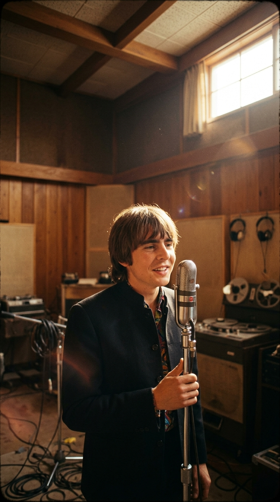
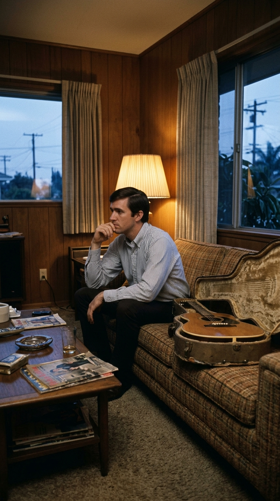
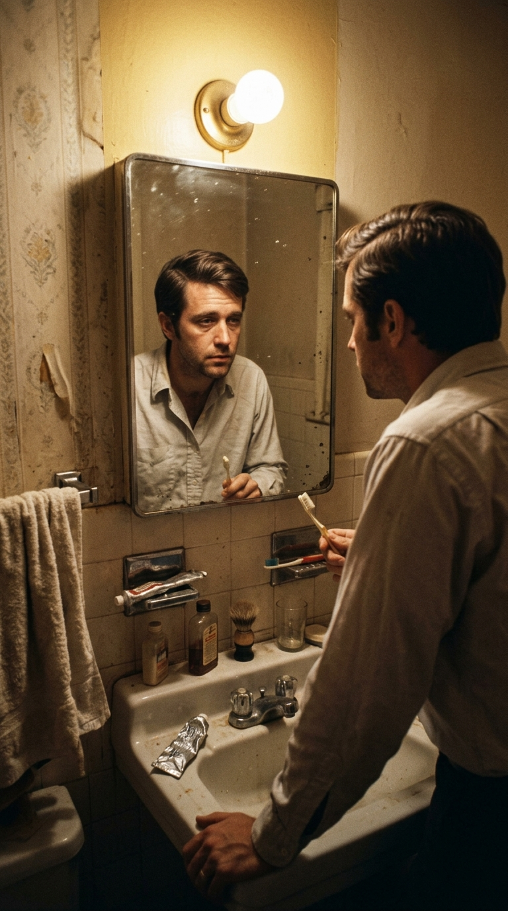
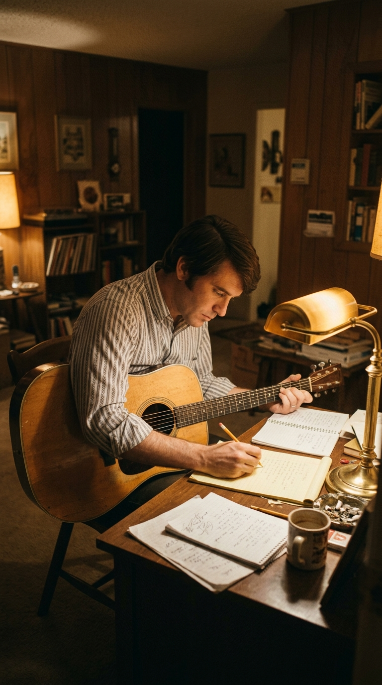
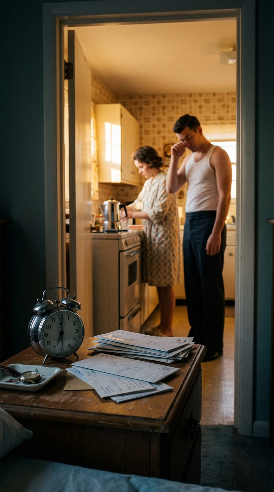
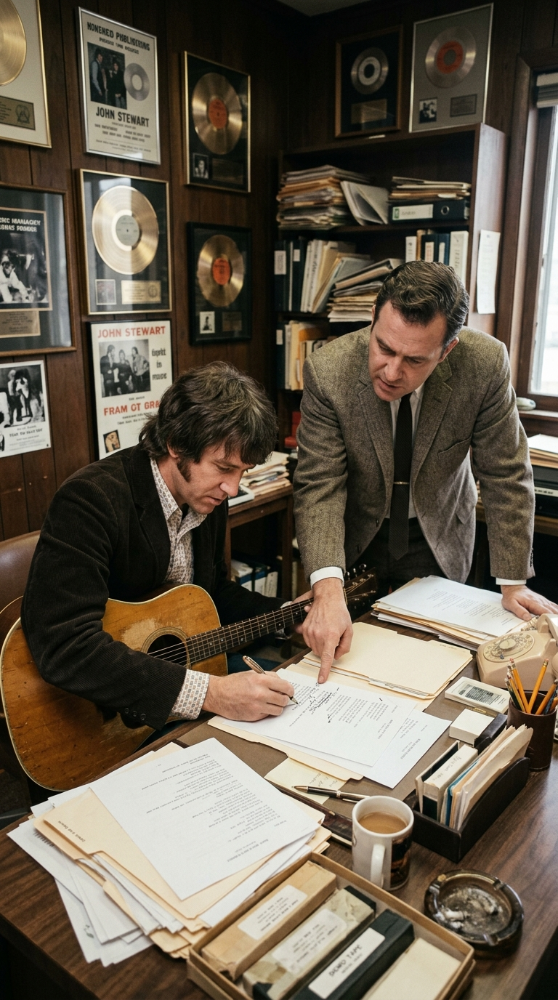
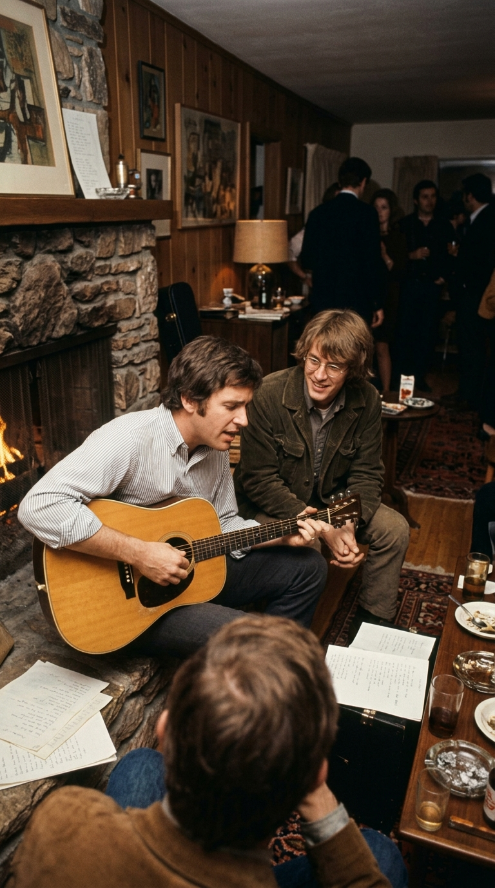
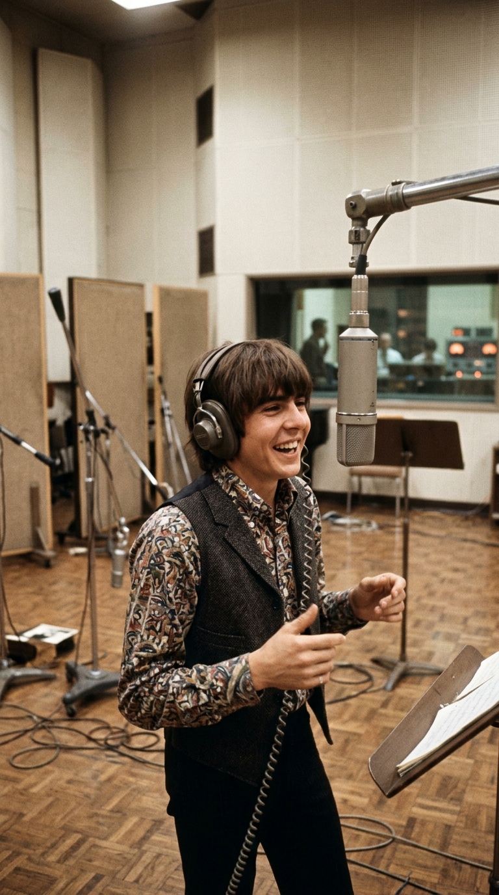
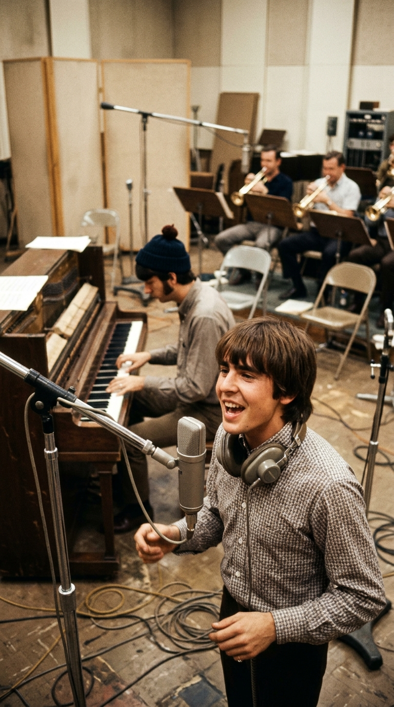
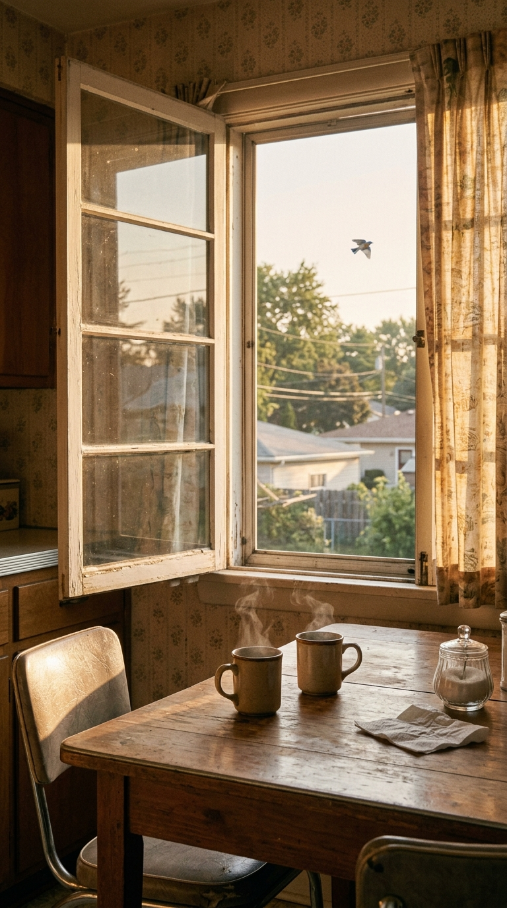

# El secreto agridulce oculto detrás de la sonrisa de «Daydream Believer» de The Monkees

> *«Oh, podría esconderme bajo las alas del pájaro azul mientras canta, el despertador de las seis en punto jamás sonaría… Pero suena y me levanto, me limpio el sueño de los ojos, mi cuchilla de afeitar está fría y arde».*
> — **John Stewart / The Monkees**, *«Daydream Believer»* (1967).

---

### I. El ocaso de un cantautor en West Covina

Durante casi seis décadas, el mundo ha escuchado los primeros compases de piano de *«Daydream Believer»* como el equivalente sonoro de una mañana de primavera: una celebración juvenil, inocente y luminosa de los años sesenta inmortalizada por la sonrisa británica de **Davy Jones** al frente de **The Monkees**.

Sin embargo, la historia real de su nacimiento se escribió en las antípodas de la euforia. En la primavera de 1967, su verdadero autor, el cantautor estadounidense **John Stewart**, tenía veintisiete años y sentía que su vida artística había llegado a un callejón sin salida. Durante seis años había recorrido el país como integrante del legendario grupo de folk **The Kingston Trio**, pero el terremoto cultural desatado por The Beatles, The Rolling Stones y la electrificación de Bob Dylan había convertido de la noche a la mañana a los tríos acústicos de camisas a rayas en reliquias del pasado.

Con *The Kingston Trio* a punto de dar su último concierto de despedida en junio de 1967 en el club *hungry i* de San Francisco, Stewart se refugió en su modesta casa suburbana de **West Covina, California**, sumido en una honda depresión. No sabía de qué iba a vivir ni quién querría escuchar sus canciones en un mundo que parecía haberlo dejado atrás.

Una noche, mientras se lavaba los dientes frente al espejo del baño antes de irse a dormir, se quedó mirando su propio reflejo en silencio. Pensó en todas las promesas que nos hacemos en la primera juventud y en lo que ocurre cuando las luces de la fiesta se apagan y llega la rutina de la vida adulta.

Como relataría años más tarde en entrevistas documentales:

> *«Estaba en West Covina, California, sintiendo que mi carrera había terminado. Me estaba cepillando los dientes antes de acostarme, me miré al espejo y de pronto vino a mi mente la frase: "Oh, I could hide 'neath the wings of the bluebird as she sings, the six o'clock alarm would never ring...". Salí del baño, tomé mi guitarra y escribí la canción entera esa misma noche»*.

---

### II. El despertar después del cuento de hadas

Lejos de ser una balada adolescente, John Stewart concibió *«Daydream Believer»* como la tercera parte de una trilogía realista sobre la vida cotidiana en los suburbios estadounidenses. Lo que escribió en su bloc de notas aquella madrugada era, en realidad, **el retrato agridulce de un matrimonio joven unos años después de la boda**, cuando el hechizo de la luna de miel se enfrenta a la dureza del despertador y las facturas impagas.

El protagonista de la canción es un joven obrero o empleado que desearía quedarse escondido bajo el canto de los pájaros, pero a quien la alarma de las seis de la mañana obliga a levantarse a oscuras y afeitarse con una cuchilla helada que le irrita la piel. Su esposa, **Jean** (*«Sleepy Jean»*), fue en sus años de instituto la «reina del baile de graduación» (*homecoming queen*), y alguna vez creyó que él sería un «caballero blanco sobre su corcel» (*white knight on his steed*).

Pero la realidad económica de la pareja es otra: no tienen ni un solo dólar para gastar (*«without dollar one to spend»*), y él no es un príncipe de cuento de hadas, sino un «soñador despierto» (*daydream believer*) que sigue buscando la manera de hacerla feliz cuando termina la fantasía.

De hecho, en el manuscrito original de 1967, la herida del personaje era mucho más explícita. En la segunda estrofa, Stewart había escrito:

> *«You once thought of me as a white knight on his steed / Now you know how **funky** I can be»*.

En el argot estadounidense de mediados de los años sesenta (antes de que James Brown transformara el término en sinónimo de ritmo bailable), la palabra ***funky*** significaba «deprimido, sucio, maloliente o venido a menos». Es decir, el esposo le confesaba con crudeza a su mujer: *«Antes me veías como un caballero de brillante armadura; ahora ya ves lo hundido que puedo estar»*.

Cuando Stewart presentó la canción a **Frank Werber** —representante y editor de *The Kingston Trio*— y a la discográfica Spanky and Our Gang, ambos la rechazaron. Werber le advirtió que ninguna emisora de radio en Estados Unidos transmitiría una canción con la palabra *«funky»*, y exigió tacharla. A regañadientes, Stewart cambió esas cinco letras por la palabra ***«happy»*** (*«Now you know how happy I can be»*), cambiando para siempre el tono de la obra: lo que era una confesión de desencanto se transformó en una tierna pregunta de amor capaz de sobrevivir a la pobreza: *«¿Pero cuánto, cariño, necesitamos en realidad?»*.

---

### III. El encuentro fortuito en una fiesta de Hollywood

Con la canción archivada en un cajón tras el rechazo de varios artistas, el destino intervino unas semanas más tarde en las colinas de Hollywood. John Stewart asistió a una fiesta nocturna en la casa de la madre del cantautor **Hoyt Axton**, en Laurel Canyon.

Entre los invitados se encontraba **Chip Douglas**, bajista del grupo *The Turtles* que acababa de asumir un reto histórico: producir a **The Monkees**. Hartos de ser tratados por la prensa como un grupo prefabricado para la televisión que no tocaba sus propios instrumentos, **Davy Jones**, **Micky Dolenz**, **Michael Nesmith** y **Peter Tork** se habían rebelado contra el supervisor musical Don Kirshner y habían conquistado el derecho a elegir su repertorio, tocar en el estudio y dirigir sus propias grabaciones con Douglas al mando.

En medio de la velada, Chip Douglas se acercó a John Stewart junto a la chimenea y le preguntó: *«Oye, John, ahora estoy produciendo a The Monkees. ¿Por casualidad tienes alguna canción guardada que nos pueda servir?»*.

Stewart tomó su guitarra acústica y le cantó *«Daydream Believer»* allí mismo. Apenas terminó el último acorde, Douglas supo que había encontrado una joya.

---

### IV. «7A…»: la broma de Davy Jones y el trompetista de jazz

El 14 de junio de 1967, The Monkees entraron al **Estudio A de RCA Victor en Hollywood** para grabar la canción en las sesiones del álbum *Pisces, Aquarius, Capricorn & Jones Ltd.*.

El ambiente en el estudio reflejaba la recién estrenada libertad creativa del cuarteto. **Michael Nesmith** se sentó al piano vertical para tocar la célebre introducción que abre el tema, **Peter Tork** ideó el puente de cuerdas y **Davy Jones** —el carismático cantante nacido en Mánchester, Inglaterra, de apenas veintiún años— asumió la voz solista.

Cuando llevaban ya varias tomas y el cansancio empezaba a notarse en la sala, el ingeniero de sonido anunció por el micrófono de órdenes el número de la nueva toma: *«Seven A»* (*«Toma 7A»*). Desde el centro de la sala, Davy Jones preguntó con su acento mancuniano: *«¿Qué número es este, Chip?»*. Cuando Chip Douglas le gritó desde la cabina *«¡Seven A!»*, Jones —que medía apenas 1,60 metros de estatura— respondió bromeando frente al micrófono abierto:

> *«Okay, don't get excited, man… it's 'cause I'm short, I know…»*
> *(«Vale, no te alteres, hombre… ya sé que es porque soy bajito…»).*

Aquella ocurrencia espontánea precedió a una interpretación vocal tan cálida, honesta y luminosa que Chip Douglas decidió conservar el diálogo íntegro al comienzo del disco sencillo. Meses después, el 9 de agosto de 1967, la leyenda del jazz de la Costa Oeste **Shorty Rogers** acudió al estudio para escribir el arreglo de metales de cuatro trompetas que corona el estribillo con una fanfarria inolvidable.

---

### V. Epílogo: El sueño que rescató a su creador

Lanzada el 25 de octubre de 1967 como sencillo con *«Goin' Down»* en la cara B, *«Daydream Believer»* subió como la espuma hasta alcanzar el **número uno del *Billboard Hot 100*** en diciembre de 1967, manteniéndose un mes entero en la cima y vendiendo más de dos millones de copias en su primer lanzamiento.

Para **John Stewart**, aquel cheque de regalías caído del cielo en su hora más oscura fue mucho más que un alivio financiero: le devolvió la fe en su oficio y le permitió financiar en 1969 su aclamado álbum solista *California Bloodlines*, considerado hoy una piedra angular del *country-rock* y la música *americana*. Hasta su fallecimiento en enero de 2008, Stewart jamás dejó de agradecer públicamente a The Monkees y a Davy Jones (quien fallecería cuatro años más tarde, en febrero de 2012) por haberle dado alas a una canción escrita frente al espejo de un baño cuando creía que todo había terminado.

Quizá por eso *«Daydream Believer»* sigue emocionando a generaciones enteras: porque detrás de sus trompetas alegres nos recuerda que el verdadero amor no consiste en vivir dentro de un cuento de hadas, sino en despertar a las seis de la mañana junto a la persona que amas y descubrir que, incluso con los bolsillos vacíos, todavía se puede soñar despierto.

---

### 💬 Comunidad Acordes Ocultos
¿Sabías que detrás del ritmo alegre de *«Daydream Believer»* se escondía esta historia de desilusión y rescate humano? Cuéntanos en los comentarios qué recuerdo te trae esta canción y compártela con tu propio compañero o compañera de sueños.

---

### 📚 Fuentes y Archivo Documental
1. **Sandoval, Andrew (2005).** *The Monkees: The Day-by-Day Story of the '60s TV Pop Sensation*. Backbeat Books, San Francisco. (Registro documental exhaustivo de las sesiones del 14 de junio y 9 de agosto de 1967 en el Estudio A de RCA Victor en Hollywood, con ficha técnica de Chip Douglas, Davy Jones, Michael Nesmith y Shorty Rogers).
2. **Stewart, John — Archivo de Entrevistas en *NPR* y *Songfacts* (1998–2006).** Testimonio directo de John Stewart sobre su depresión en West Covina en 1967 tras el final de *The Kingston Trio*, la composición frente al espejo, la censura de la palabra *«funky»* por Frank Werber y el encuentro con Chip Douglas en Laurel Canyon.
3. **Jones, Davy (1987).** *They Made a Monkee Out of Me*. Dome Press, Florida. (Memorias oficiales de Davy Jones sobre la rebelión creativa del grupo en 1967 y la grabación de *«Daydream Believer»*).
4. **Archivos de Sesión de Colgems / RCA Victor Records (Hollywood, 1967).** Notas de producción del sencillo Colgems #66-1012 (*«Daydream Believer» / «Goin' Down»*) y del álbum *The Birds, The Bees & The Monkees* (1968).
