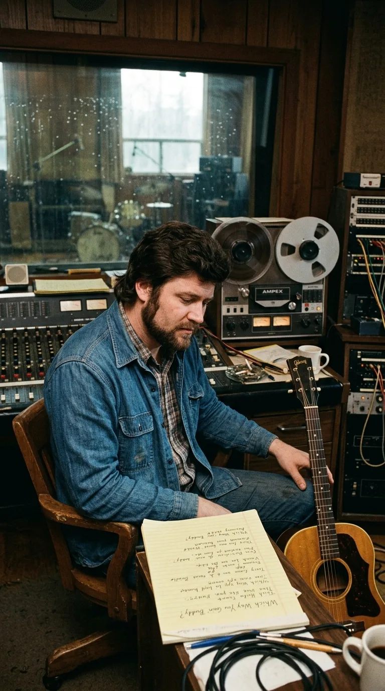
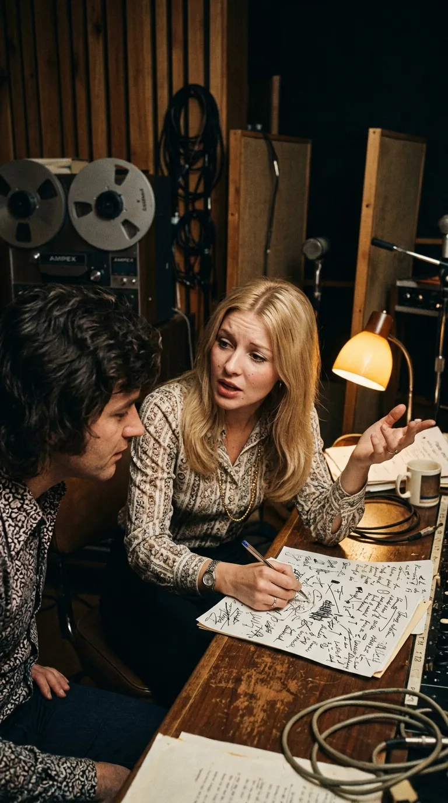
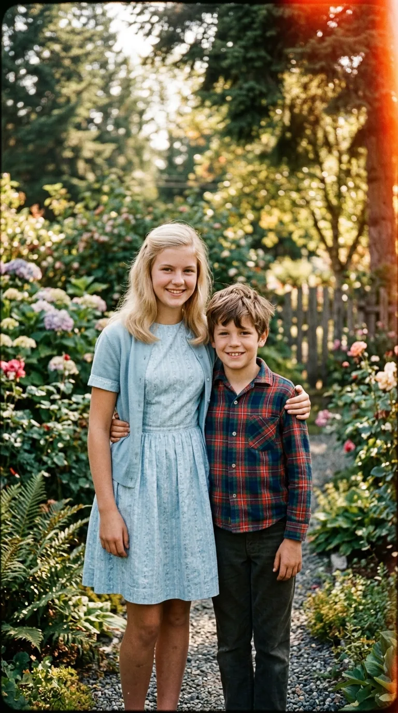
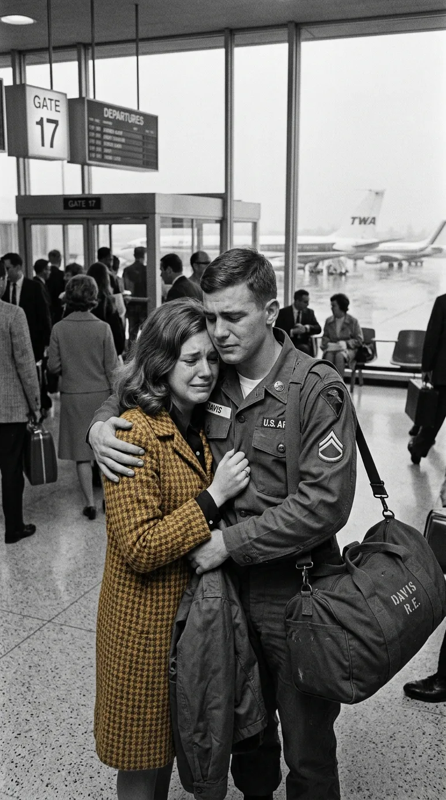
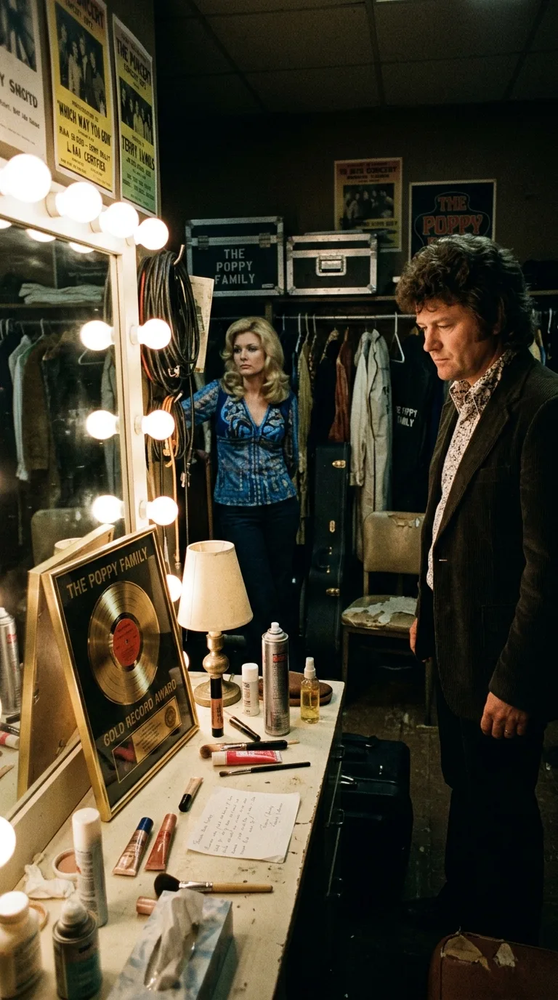

# 🎙️ El Nombre que Salvó una Vida: La Verdad Detrás de «Which Way You Goin' Billy?»

### *De un descarte masculino a himno desgarrador de la era de Vietnam: cómo Susan Jacks inmortalizó a su hermano en un clásico de cuatro millones de discos y cómo él le devolvió el aliento cuatro décadas después.*

---

**Por la redacción de Acordes Ocultos**  
*Tiempo de lectura estimado: 9 minutos*

---

### Prólogo: La intuición que rescató una plegaria

Hay canciones que parecen esperar pacientemente a que alguien descifre su verdadero corazón. A comienzos de 1969, en una modesta sala de grabación de Vancouver, un joven músico canadiense llamado **Terry Jacks** rasgueaba su guitarra intentando dar forma a una composición recién escrita. Se titulaba *«Which Way You Goin' Buddy?»* y describía una conversación cotidiana entre dos amigos de pueblo, donde uno de ellos decidía hacer la maleta y marcharse sin rumbo fijo. La melodía era bonita, pero las palabras sonaban frías, rutinarias y carentes de pulso emocional.

En un rincón de la sala, su joven esposa y compañera artística, **Susan Pesklevits** (conocida mundialmente como **Susan Jacks**), de apenas veinte años, escuchaba con creciente inquietud. Cuando Terry concluyó la toma y miró a través de la consola esperando su aprobación, Susan negó suavemente con la cabeza:

—*«Terry, esto no funciona como una charla entre dos hombres»*, le dijo con firmeza. *«Esto no puede ser una despedida casual. Tiene que ser la súplica desesperada de una mujer que ve cómo el amor de su vida se marcha para siempre, sintiendo que una parte de su alma se va con él»*.

Susan tomó un lápiz y se sentó sobre un amplificador. Tachó versos enteros, reescribió la perspectiva en primera persona y, al llegar al estribillo, comprendió que el genérico «Buddy» no transmitía ninguna intimidad. Pensó entonces en su hogar, en su familia de ocho hermanos en Columbia Británica y en el vínculo más tierno de su infancia: su hermano menor, **William**, a quien todos en casa llamaban cariñosamente **Billy**.

Aquella tarde nació una de las melodías más desgarradoras y puras del pop occidental:

> *«Which way you goin' Billy?*  
> *Can I go too?*  
> *Which way you goin' Billy?*  
> *Can I go with you?*  
> *I really love you, Billy,*  
> *and all this time*  
> *I thought you loved me, Billy,*  
> *and you were mine...»*

Nadie sospechaba entonces que aquel cambio de nombre no solo convertiría a **The Poppy Family** en un fenómeno planetario de más de cuatro millones de discos, sino que sellaría un pacto silencioso de destino entre dos hermanos que, cuatro décadas más tarde, se encontrarían en una sala de operaciones para consumar un auténtico milagro de vida.

---

### Acto I: La alquimia mística de The Poppy Family

*Terry Jacks en el estudio de Vancouver explorando arreglos acústicos, 1969.*

A finales de los años sesenta, el panorama musical de Vancouver bullía con una vibrante mezcla de folk acústico, psicodelia suave y experimentación contracultural. Susan Pesklevits ya era una artista precoz en la televisión canadiense desde los quince años, pero su voz —un instrumento de una pureza cristalina, aterciopelada y melancólica, emparentada espiritualmente con la de Karen Carpenter o Astrud Gilberto— necesitaba un marco instrumental singular para desplegar su magia.

Junto a Terry Jacks en la guitarra rítmica y la producción, reclutaron al talentoso guitarrista **Craig McCaw** y a un virtuoso percusionista sikh llamado **Satwant Singh**. McCaw aportó texturas luminosas con su guitarra acústica de doce cuerdas, mientras Singh introdujo un elemento insólito en el pop de la época: el compás sincopado, ondulante y espiritual de las **tablas indias tradicionales**.

*Susan y Terry Jacks trabajando en las letras y arreglos de The Poppy Family en Vancouver, 1969.*

Cuando Susan se colocó frente al micrófono de condensador para registrar la pista vocal definitiva de *«Which Way You Goin' Billy?»*, el contraste sonoro resultó hipnótico. No había baterías estridentes ni sobreproducciones grandilocuentes. Sobre el latido orgánico de las tablas y el arpegio de doce cuerdas, la voz de Susan sonaba frágil, desarmada y profundamente humana. Su interpretación transmitía el dolor genuino de quien asume una pérdida inevitable, jurando devoción eterna incluso frente al desamparo.

---

### Acto II: El eco de Vietnam y el llanto en los aeropuertos (1970)

*El vínculo fraterno de la infancia: Susan Pesklevits junto a su hermano menor Billy.*

Publicado inicialmente en Canadá a finales de 1969 por el sello London Records, el sencillo trepó con velocidad meteórica hasta el número uno de las listas nacionales. Sin embargo, su verdadero terremoto sociocultural se desató en marzo de 1970, cuando el disco fue editado en los Estados Unidos.

El país norteamericano atravesaba entonces uno de los periodos más oscuros y divisivos de su historia contemporánea: la escalada bélica en el sudeste asiático, la reactivación del sorteo de reclutamiento obligatorio para la **Guerra de Vietnam** y los trágicos tiroteos de la Universidad de Kent State en mayo de 1970 habían sumido a la juventud en un clima de angustia permanente.

*Vancouver, 1969: Susan Jacks al micrófono de condensador junto a Craig McCaw en la guitarra de doce cuerdas y Satwant Singh en las tablas indias.*

En ese contexto de zozobra, *«Which Way You Goin' Billy?»* dejó de ser una balada sentimental de estudio para convertirse en una catarsis colectiva. Aunque la canción no había sido escrita como un alegato político, millones de novias, esposas y madres estadounidenses proyectaron en sus versos la dolorosa realidad de las despedidas en las terminales de autobuses y aeropuertos militares. «Billy» se convirtió en el rostro simbólico de los muchachos de dieciocho años que subían a los aviones de transporte militar rumbo a Saigón, sin certeza de volver a pisar suelo patrio.

*Las despedidas en los aeropuertos militares en 1970: la plegaria de una generación que no quería dejar marchar a sus jóvenes.*

El sencillo escaló hasta el **número dos del Billboard Hot 100** estadounidense (bloqueado de la cima únicamente por *The Long and Winding Road* de The Beatles y *Everything Is Beautiful* de Ray Stevens) y conquistó el número uno en la prestigiosa revista *Cash Box*. Con más de cuatro millones de copias despachadas en todo el mundo, The Poppy Family se transformó en la exportación musical canadiense más exitosa de su tiempo, cosechando múltiples premios Gold Leaf (los actuales Juno Awards).

---

### Acto III: El costo del éxito y la profecía cumplida

*La soledad del éxito: The Poppy Family y las tensiones internas en el cenit de su popularidad, 1972.*

Pero el éxito masivo suele cobrar una factura despiadada en las relaciones íntimas. Tras la vorágine de giras y apariciones televisivas internacionales, las tensiones artísticas en el seno del grupo se volvieron insostenibles. Terry Jacks asumió una postura de control estricto en la producción, lo que derivó en la salida de Craig McCaw y Satwant Singh en 1970.

Reducidos a un dúo bajo la sombra del matrimonio, la convivencia entre Susan y Terry se fue erosionando lentamente. Susan sentía que su identidad como creadora quedaba eclipsada por las directrices de su esposo. Para 1973, la relación sentimental colapsó definitivamente: Susan abandonó el hogar común y solicitó el divorcio.

Paradójicamente, aquellos versos que Susan había cantado con el alma abierta (*«Te amaré siempre, Billy, aunque te marches lejos...»*) parecieron profetizar el propio naufragio de su vida privada. Tras la separación, Terry Jacks adaptó en solitario una canción de Jacques Brel titulada *«Seasons in the Sun»*, convirtiéndose en un descomunal éxito mundial de catorce millones de copias. Susan, por su parte, emprendió una respetada y prolífica carrera como solista y compositora en Nashville, dejando atrás las glorias efímeras de los años sesenta para rehacer su vida junto al jugador de fútbol canadiense Ted Dushinski, con quien tuvo a su único hijo, Thad.

---

### Acto IV: La sombra de la enfermedad y el milagro del hermano (2010)

*Susan Jacks en su residencia de Vancouver en los años de convalecencia.*

El destino, sin embargo, guardaba un último capítulo de una hondura sobrecogedora. A mediados de la década de 2000, la vida golpeó a Susan con una dureza implacable. En 2005, su esposo Ted falleció víctima de un agresivo cáncer de pulmón. Poco después, la propia salud de la cantante se deterioró de forma alarmante al ser diagnosticada con una **insuficiencia renal terminal crónica**.

Durante años, Susan dependió de extenuantes sesiones de diálisis para mantenerse con vida. Su energía física se disipaba y su capacidad pulmonar para cantar sobre los escenarios parecía perdida para siempre. Hacía falta un donante compatible con urgencia extrema, una probabilidad médica remota en pacientes de edad madura.

Fue entonces cuando la historia cerró su círculo perfecto. Al enterarse del cuadro crítico de su hermana, **William «Billy» Pesklevits** —aquel muchacho cuyo apodo Susan había inmortalizado cuatro décadas atrás para salvar un disco del olvido— no dudó un solo segundo. Se sometió a las pruebas de compatibilidad y se ofreció voluntariamente a entregarle uno de sus órganos.

*Vancouver, 2010: Susan Jacks en la habitación del hospital conmovida junto a su hermano Billy tras el trasplante renal que le salvó la vida.*

En **2010**, en el quirófano de un hospital de Vancouver, los cirujanos completaron con éxito el trasplante renal de Billy a Susan. Aquel acto de amor fraterno incondicional le devolvió la vida y el aliento. Apenas unos meses después de la intervención, visiblemente recuperada y conmovida hasta las lágrimas, Susan Jacks volvió a subir a un escenario para encabezar un recital benéfico en favor de la *Kidney Foundation of Canada*, demostrando que su voz mantenía intacta la pureza y la luz de sus mejores años.

---

### Epílogo: El círculo sagrado del amor

*La gratitud del destino: el vinilo de 1970, lilas y la luz del amanecer sobre el puerto de Vancouver.*

El 25 de abril de 2022, a los setenta y tres años, Susan Jacks partió de este mundo en el Surrey Memorial Hospital tras complicaciones derivadas de su larga afección renal. Su legado artístico, sin embargo, permanece invulnerable al paso del tiempo.

Más de medio siglo después de aquella tarde de 1969 en que una muchacha de veinte años tomó un lápiz para borrar la palabra *Buddy* y escribir *Billy*, su canción nos recuerda una verdad eterna: en el arte y en la existencia, las obras que perduran no son las que nacen del artificio técnico ni de las modas de consumo, sino aquellas que se fundan en la devoción más limpia del corazón humano. El amor que Susan sembró en un disco viajó por el mundo entero durante cuarenta años, solo para regresar en el momento más oscuro y salvarle la vida de la mano del hermano que nunca la dejó sola.

---

### 📚 Fuentes y Archivo Documental

* **Billboard Magazine**: Histórico de listas Hot 100 y Easy Listening (marzo a julio de 1970). Registro de posición Nº 2 para *«Which Way You Goin' Billy?»*.
* **RPM Weekly (Canadá)**: Listas oficiales de éxitos Cancon (octubre de 1969 a enero de 1970). Sencillo Nº 1 nacional y concesión de los Gold Leaf Awards de 1970 a The Poppy Family.
* **Cash Box Magazine**: Ranking de éxitos de sencillos en Estados Unidos (junio de 1970, Nº 1 nacional).
* **CBC Radio & Television Archives**: Entrevistas retrospectivas a Susan Jacks (2010–2016) sobre la génesis de la canción, el rechazo a «Buddy» y la sustitución por «Billy».
* **Jacks, Terry**: *40 Years of Seasons in the Sun* (Memorias autobiográficas y registros de producción en Goldfish Records / London Records).
* **Kidney Foundation of Canada (Registros 2010-2011)**: Comunicados institucionales y cobertura del recital benéfico de Susan Jacks tras la donación renal de su hermano William «Billy» Pesklevits.
* **BC Entertainment Hall of Fame**: Registro oficial de inducción de Susan Jacks (27 de junio de 2010).
* **The Globe and Mail & The Vancouver Sun**: Obituarios y crónicas biográficas de Susan Jacks (25–28 de abril de 2022).
