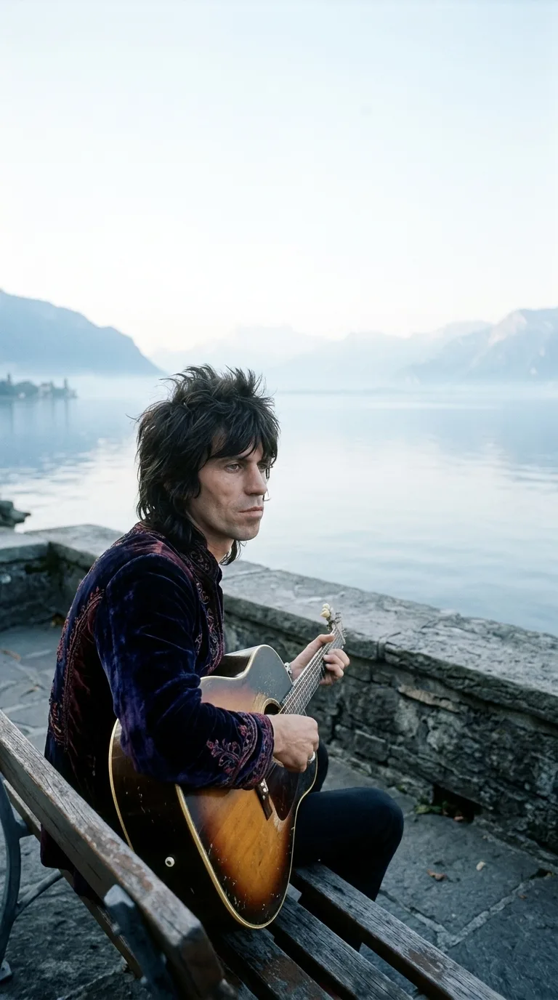
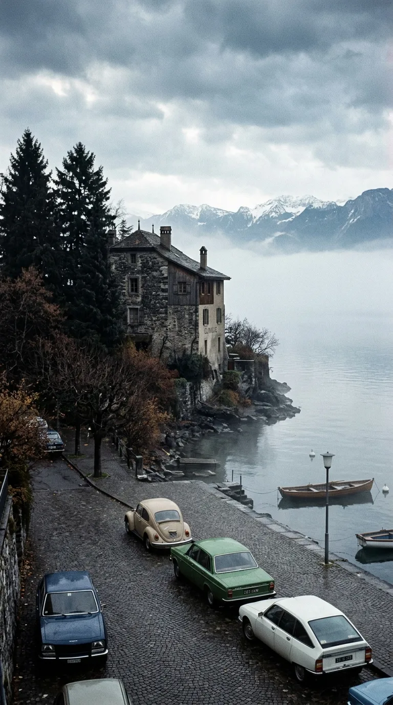
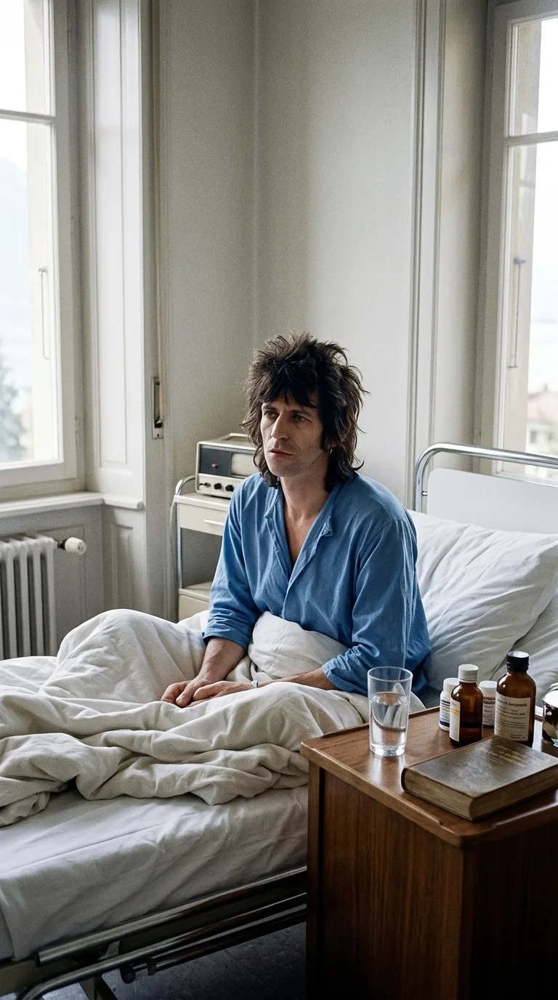
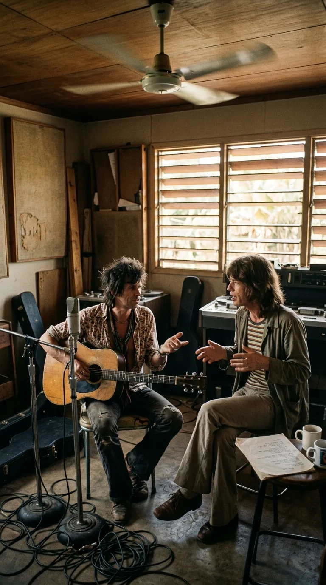
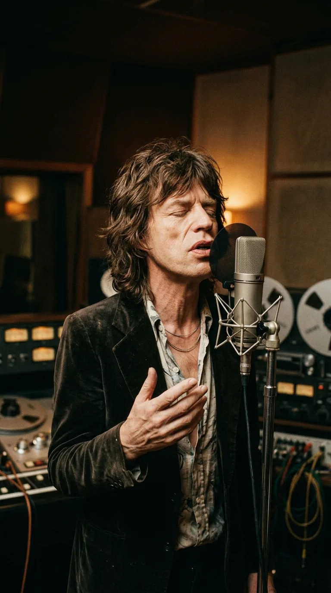
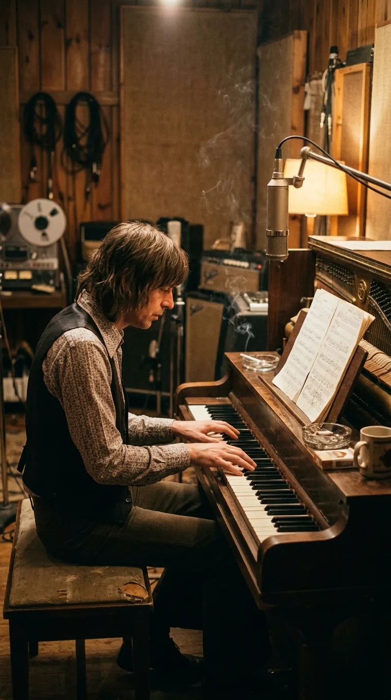
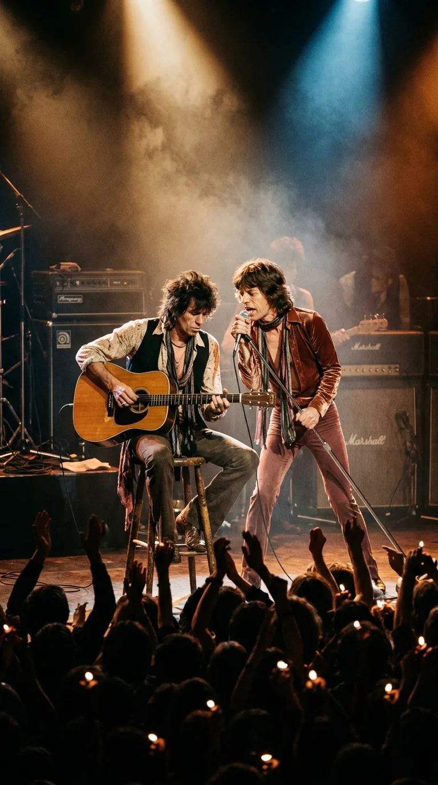

# The Acoustic Miracle in a Swiss Clinic

### By Secret Chords

*Switzerland, 1972: Keith Richards near the shores of Lake Geneva, at the dawn of The Rolling Stones' acoustic rebirth.*

---

### Prologue: The Weight of Isolation

In the early spring of 1972, Keith Richards felt his body falling apart piece by piece. Hounded by British and French police and consumed by a severe heroin addiction that threatened to devour both his life and the future of The Rolling Stones, the guitarist checked himself into a medical clinic in the quiet lakeside town of Vevey, on the shores of Lake Geneva in Switzerland. Through weeks of strict isolation, he endured a punishing, exhausting withdrawal: fever, uncontrollable tremors, nausea, and the icy hush of the Alpine peaks.

*Vevey, 1972: The Swiss clinic tucked among Alpine pines and mist, where Keith Richards fought through withdrawal.*

During the darkest days of his recovery, he barely had the strength to sit upright. One morning, however, as the worst of the physical storm began to break and a little warmth returned to his hands, Keith reached toward the corner of his room where an old steel-string acoustic guitar was resting. Numb and trembling after weeks without playing, his fingers instinctively settled onto an A-minor ninth chord and a delicate descending arpeggio.

In that moment of stark human fragility—when touching the strings again felt like drawing breath—a name and a melody slipped from his lips like an involuntary sigh: *"Angie, Angie... when will those clouds all disappear?"* Those chords, born among hospital sheets, would not only mark Keith Richards' return to life; they would give birth to one of the most poignant ballads in the history of rock.

*Spring 1972: Recovering in his clinic room, Keith's fingers instinctively traced the opening chords of "Angie."*

---

### Act I: Two Births on the Shores of Lake Geneva

The writing of "Angie" holds a moving coincidence that popular mythology would take decades to untangle. While Keith Richards was wrestling with his own demons inside the detox clinic in Vevey, his partner at the time, model and actress Anita Pallenberg, was just a few miles away in a nearby hospital giving birth to their second child, a daughter.

The baby girl was born on April 17, 1972, and named Angela (registered in full as Dandelion Angela Richards). For nearly fifty years, countless biographers and fans assumed the song had been deliberately composed as a lullaby for his newborn daughter, or as an apology to Anita for the guitarist's long absences. With the blunt honesty that has always defined him, Keith himself dispelled the myth in his 2010 autobiography, *Life*:

> *"I was in the clinic in Vevey, unable to move for days. When I could finally sit up in bed and pick up the acoustic guitar, my fingers started moving on their own. I sang, 'Angie, Angie.' It wasn't about anyone in particular. It was just a name that fit the rhythm and the sadness of that progression. Only afterward did I find out that Anita had named our daughter Angela. It was an absolute coincidence, almost mystical."*  
> — Keith Richards.

The song was neither a fatherly dedication nor a calculated anthem; it was the private cry of a broken man grasping desperately for a sliver of light through a fog of pain.

*Switzerland, April 1972: Anita Pallenberg with her newborn daughter Angela, whose arrival coincided miraculously with the birth of the song.*

---

### Act II: The False Love Triangle and Exile in Kingston (1972)

If the legend of the baby girl was tender, the 1970s tabloid press preferred to spin a far more lucrative scandal: claiming the song was written for Angela Bowie, David Bowie's first wife, and alleging Mick Jagger had penned it after being caught in bed with rock's great chameleon. That rumor, repeated endlessly in tabloids around the globe, was completely fabricated.

The truth was infinitely more sobering and human. By November 1972, cornered by British tax authorities and legally barred from France, The Rolling Stones were living in exile. Hardly any Western nation would let them enter to work following their recent drug arrests. The one country in the world that opened its legal doors to them was Jamaica.

The band touched down in a sweltering, turbulent Kingston and booked the modest Dynamic Sound Studios—a rustic, un-air-conditioned room where reggae and calypso records were usually cut. There, Keith Richards played Mick Jagger the acoustic demo he had sketched months earlier in Switzerland.

Jagger was immediately drawn to the wounded delicacy of the melody. Rather than changing the name, he wrote the final verses out of the wreckage of his own emotional life: the slow, bitter farewell to Marianne Faithfull, empty pockets after a romantic shipwreck, and the heartbreaking realization that loving someone is not always enough to bridge the distance:

> *With no loving in our souls  
> And no money in our coats  
> You can't say we're satisfied...  
> But Angie, Angie, you can't say we never tried.*

*Kingston, Jamaica, 1972: Richards and Jagger at Dynamic Sound Studios, shaping the Swiss demo into its final lyrical form.*

*1972: Mick Jagger before the condenser microphone, delivering one of the most vulnerable vocal performances of his career.*

---

### Act III: Nicky Hopkins' Piano and Immortality

Inside that Jamaican studio, an unrepeatable musical convergence took place. Keith Richards held his acoustic guitar with a warm, unhurried touch; Charlie Watts kept a hushed, patient pulse on snare and brushes; and legendary session pianist Nicky Hopkins sat at the upright piano to weave one of the most memorable introductions in rock history. Hopkins' notes fall like raindrops down a fogged windowpane, conversing with Keith's strumming and lifting Jagger's voice into a register of raw vulnerability the band had never explored before.

*1972: Nicky Hopkins at the upright piano, weaving the iconic chordal introduction that immortalized the track.*

To complete the atmosphere, arranger Nicky Harrison later added a restrained bed of strings in London, framing the chorus without dimming an ounce of its acoustic purity.

Released in August 1973 as the lead single from *Goats Head Soup*, "Angie" immediately became an unstoppable international phenomenon. It climbed to number one on the US Billboard Hot 100, topped charts in Australia, Canada, and across much of Europe, and proved that rock's self-styled bad boys were capable of writing the tenderest, most elegant, and most human ballad of their generation.

*1973: Keith Richards and Mick Jagger onstage in Europe, moving crowds with the ballad that conquered charts worldwide.*

---

### Epilogue: The Wound That Became a Shelter

More than five decades have passed since that solitary morning at the clinic in Vevey. The man who could barely steady his own hands went on to play those exact same chords in front of millions in stadiums across five continents.

"Angie" endures in collective memory because it makes no attempt to dress up suffering or hide life's defeats. It reminds us that even in the bleakest hospital rooms, when the mind reels and the soul's pockets run empty, six strings over wood and the will to keep breathing are enough to turn an intimate tragedy into a universal anthem of redemption.

*Stillness over Lake Geneva: the memory of a wound that music transformed into universal consolation.*

---

### 📚 Sources and Archival Records

* **Richards, Keith & Fox, James**: *Life*. Little, Brown and Company, New York, 2010. (Chapters 9 and 10: sessions in Switzerland, detox in Vevey, and recording in Jamaica).
* **Jagger, Mick**: Historical interviews for *Rolling Stone* magazine (1973 and 1995 retrospective with Jann Wenner on *Goats Head Soup*).
* **Davis, Stephen**: *Old Gods Almost Dead: The 40-Year Odyssey of the Rolling Stones*. Broadway Books, 2001.
* **Bockris, Victor**: *Keith Richards: The Biography*. Da Capo Press, 2003.
* **Dynamic Sound Studios Kingston**: Recording logs for *Goats Head Soup* (November–December 1972) with engineer Andy Johns.
