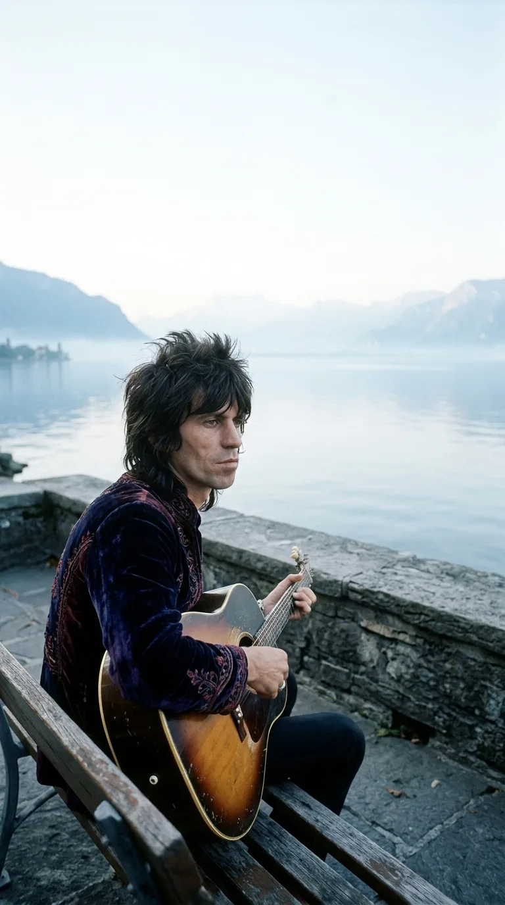
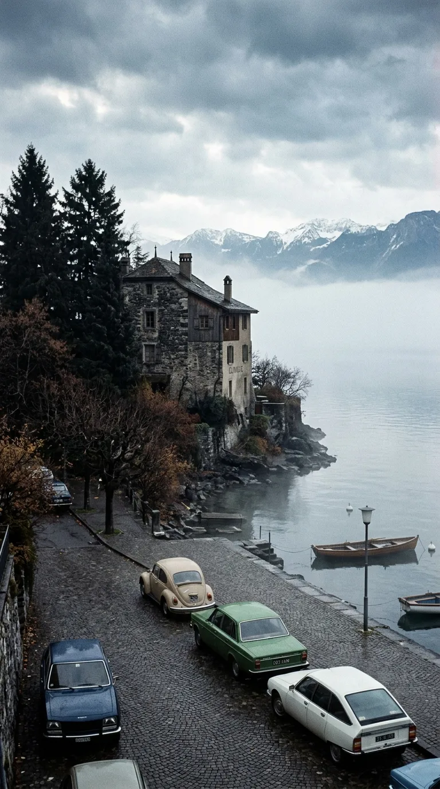
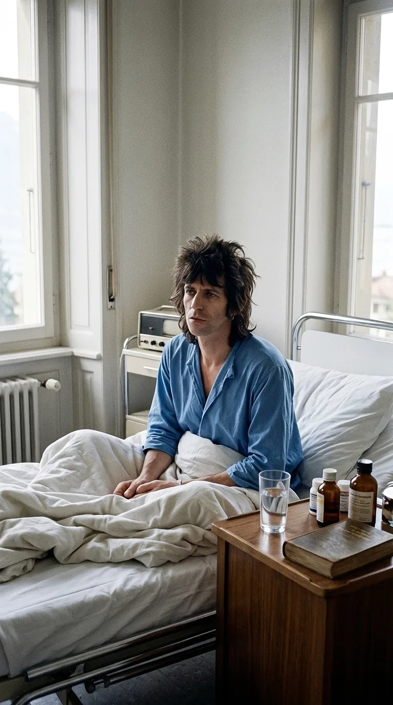
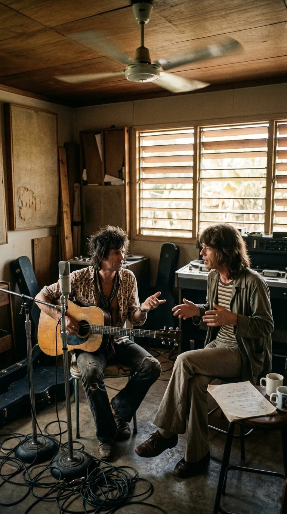
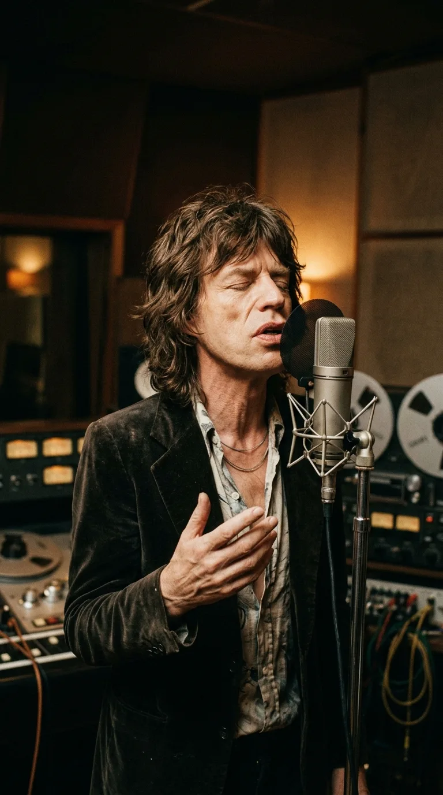
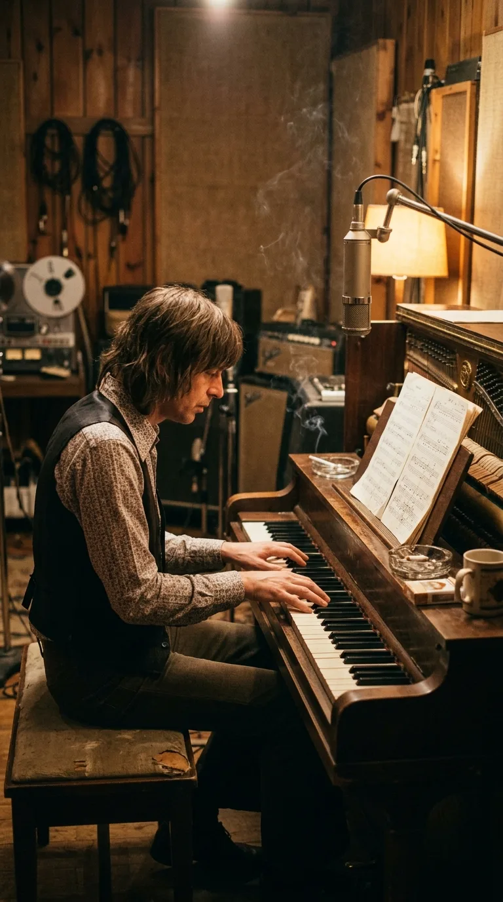
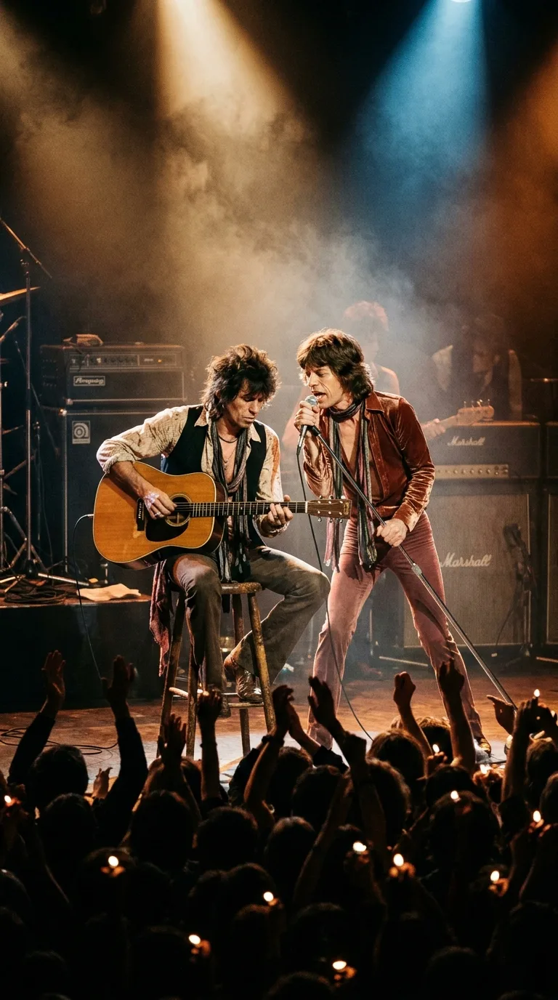

# El milagro acústico en la clínica suiza

### Por Acordes Ocultos

*Suiza, 1972: Keith Richards en las inmediaciones del lago Lemán, en los albores del renacimiento acústico de The Rolling Stones.*

---

### Prólogo: El peso del aislamiento

A principios de la primavera de 1972, Keith Richards sentía que su cuerpo se desmoronaba en pedazos. Acosado por la policía británica y francesa, y consumido por una severa adicción a la heroína que amenazaba con devorar su vida y el futuro de The Rolling Stones, el guitarrista decidió internarse en una clínica médica en la tranquila localidad de Vevey, a orillas del lago Lemán, en Suiza. Durante semanas de aislamiento riguroso, atravesó un doloroso y extenuante síndrome de abstinencia: fiebre, temblores incontrolables, náuseas y el silencio helado de las montañas alpinas. 

*Vevey, 1972: El edificio de la clínica suiza entre la bruma y los pinos alpinos, donde Keith Richards combatió el síndrome de abstinencia.*

En los días más oscuros de su convalecencia, apenas tenía fuerzas para erguirse. Sin embargo, una mañana, cuando el peor vendaval físico comenzó a ceder y sus manos recuperaron algo de temperatura, Keith estiró el brazo hacia el rincón de su habitación, donde descansaba una vieja guitarra acústica de cuerdas de acero. Sus dedos, entumecidos y temblorosos tras semanas sin tocar, encontraron intuitivamente la posición de un acorde de la menor con novena y un sutil arpegio descendente. 

En ese instante de extrema fragilidad humana, en el que volver a rozar las cuerdas equivalía a respirar de nuevo, un nombre y una melodía brotaron de sus labios como un suspiro involuntario: *«Angie, Angie... when will those clouds all disappear?»* (Angie, Angie... ¿cuándo desaparecerán todas esas nubes?). Aquellos acordes nacidos entre sábanas de hospital no solo marcarían el renacimiento de Keith Richards, sino que darían vida a una de las baladas más conmovedoras de toda la historia del rock.

*Primavera de 1972: Convaleciente en la habitación de la clínica, los dedos de Keith buscaron intuitivamente los primeros acordes de «Angie».*

---

### Acto I: Dos nacimientos a orillas del lago Lemán

La composición de «Angie» encierra una conmovedora coincidencia que la mitología popular tardaría décadas en comprender. Mientras Keith Richards luchaba contra sus propios demonios en la clínica de desintoxicación de Vevey, su compañera sentimental de entonces, la modelo y actriz Anita Pallenberg, se encontraba a escasos kilómetros, ingresada en un hospital cercano dando a luz a su segunda hija. 

La niña nació el 17 de abril de 1972 y recibió el nombre de Angela (cuyo nombre completo fue registrado como Dandelion Angela Richards). Durante casi cincuenta años, infinidad de biógrafos y fanáticos asumieron que la canción había sido escrita deliberadamente como una serenata para la recién nacida, o como una carta de disculpa a Anita por las ausencias del guitarrista. El propio Keith desmitificaría la anécdota con la honestidad brutal que siempre lo ha caracterizado en su autobiografía *Life* (2010):

> *«Estaba en la clínica de Vevey, incapaz de moverme durante días. Cuando finalmente pude sentarme en la cama y coger la guitarra acústica, mis dedos comenzaron a moverse por su cuenta. Canté: 'Angie, Angie'. No era sobre nadie en particular. Era simplemente un nombre que encajaba con el ritmo y la tristeza de esa progresión. Solo después me enteré de que Anita había llamado Angela a nuestra hija. Fue una coincidencia absoluta, casi mística».*  
> — Keith Richards.

El tema no era una dedicatoria filial ni un himno preconcebido; era el grito íntimo de un hombre quebrado que buscaba desesperadamente una hendidura de luz entre la niebla del dolor.

*Suiza, abril de 1972: Anita Pallenberg con su hija recién nacida Angela, cuya llegada coincidió milagrosamente con el nacimiento de la canción.*

---

### Acto II: El falso triángulo y el destierro en Kingston (1972)

Si la leyenda de la niña era tierna, la prensa sensacionalista de los años setenta prefirió inventar un escándalo mucho más rentable: aseguraban que la canción estaba dedicada a Angela Bowie, la primera esposa de David Bowie, afirmando que Mick Jagger la había escrito tras haber sido descubierto en la cama junto al camaleón del rock. Aquel rumor, repetido hasta la saciedad en tabloides de medio mundo, era completamente falso.

La realidad era infinitamente más sombría y humana. En noviembre de 1972, acorralados por problemas fiscales con el fisco británico y vetados judicialmente en Francia, The Rolling Stones se encontraban en el destierro. Casi ningún país occidental les permitía ingresar para trabajar debido a sus recientes arrestos por posesión de estupefacientes. El único lugar del mundo que les abrió las puertas legales fue Jamaica.

La banda aterrizó en un Kingston sofocante y convulso, alquilando los modestos Dynamic Sound Studios, un espacio rústico sin aire acondicionado donde solían grabarse discos de reggae y calipso. Allí, Keith Richards le mostró a Mick Jagger la maqueta acústica que había compuesto meses atrás en Suiza. 

Magger quedó cautivado por la delicadeza herida de la melodía. En lugar de cambiar el nombre, decidió escribir los versos definitivos basándose en el desmoronamiento de su propia vida afectiva: la amarga y lenta despedida de Marianne Faithfull, los bolsillos vacíos tras el naufragio emocional y la desgarradora certeza de que amar a alguien no siempre alcanza para salvar la distancia:

> *With no loving in our souls  
> And no money in our coats  
> You can't say we're satisfied...  
> But Angie, Angie, you can't say we never tried.*  
>  
> *(Sin amor en nuestras almas  
> y sin dinero en nuestros abrigos,  
> no puedes decir que estamos satisfechos...  
> Pero Angie, Angie, no puedes decir que nunca lo intentamos).*

*Kingston, Jamaica, 1972: Richards y Jagger en los estudios Dynamic Sound, dando forma lírica definitiva a la maqueta suiza.*

*1972: Mick Jagger frente al micrófono de condensador, imprimiendo una de las interpretaciones vocales más vulnerables de su carrera.*

---

### Acto III: El piano de Nicky Hopkins y la inmortalidad

En el estudio jamaicano ocurrió un encuentro sonoro irrepetible. Keith Richards empuñaba su guitarra acústica con una pulsación templada y limpia; Charlie Watts marcaba un pulso tenue y paciente con las escobillas y la caja; y el legendario pianista de sesión Nicky Hopkins se sentó al piano vertical para tejer una de las introducciones más memorables de la historia del rock. Las notas de Hopkins caen como gotas de lluvia sobre un cristal empañado, dialogando con los rasgueos de Keith y elevando la voz de Jagger a un registro de vulnerabilidad desgarradora que la banda nunca antes había explorado.

*1972: Nicky Hopkins al piano vertical, tejiendo la legendaria introducción de acordes que inmortalizó el tema.*

Para rematar la atmósfera, el arreglista Nicky Harrison añadió en Londres un sutil colchón de cuerdas que enmarca el estribillo sin restarle un ápice de pureza acústica. 

Publicada en agosto de 1973 como sencillo de adelanto del álbum *Goats Head Soup*, «Angie» se convirtió de inmediato en un fenómeno internacional arrollador. Alcanzó el número 1 del Billboard Hot 100 en Estados Unidos, lideró las listas de Australia, Canadá y buena parte de Europa, y demostró que los autoproclamados «chicos malos del rock» eran capaces de escribir la balada más tierna, elegante y humana de su generación.

*1973: Keith Richards y Mick Jagger sobre el escenario europeo, conmoviendo al público con la balada que conquistó el número uno mundial.*

---

### Epílogo: La herida que se convirtió en refugio

Han pasado más de cinco décadas desde aquella mañana solitaria en la clínica de Vevey. Aquel hombre que no podía sostener sus manos terminó tocando esos mismos acordes frente a millones de personas en estadios de los cinco continentes.

«Angie» perdura en la memoria colectiva porque no intenta maquillar el sufrimiento ni esconder las derrotas de la vida. Nos recuerda que incluso en los cuartos de hospital más sombríos, cuando la mente zozobra y los bolsillos del alma se quedan vacíos, bastan seis cuerdas de madera y la voluntad de seguir respirando para transformar una tragedia íntima en un himno universal de redención.

*La quietud sobre el lago Lemán: el recuerdo de una herida que la música transformó en consuelo universal.*

---

### 📚 Fuentes y Archivo Documental

* **Richards, Keith & Fox, James**: *Life*. Little, Brown and Company, Nueva York, 2010. (Capítulos 9 y 10: sesiones en Suiza, desintoxicación en Vevey y grabación en Jamaica).
* **Jagger, Mick**: Entrevistas históricas para la revista *Rolling Stone* (1973 y retrospectiva de 1995 con Jann Wenner sobre *Goats Head Soup*).
* **Davis, Stephen**: *Old Gods Almost Dead: The 40-Year Odyssey of the Rolling Stones*. Broadway Books, 2001.
* **Bockris, Victor**: *Keith Richards: The Biography*. Da Capo Press, 2003.
* **Dynamic Sound Studios Kingston**: Registros de grabación de *Goats Head Soup* (noviembre-diciembre de 1972) con el ingeniero Andy Johns.
