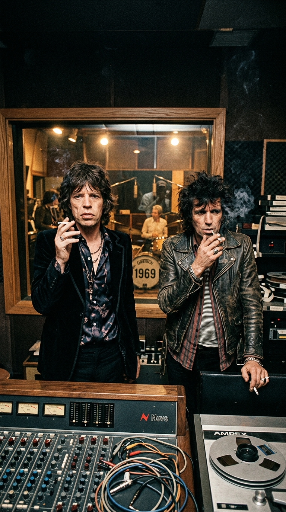
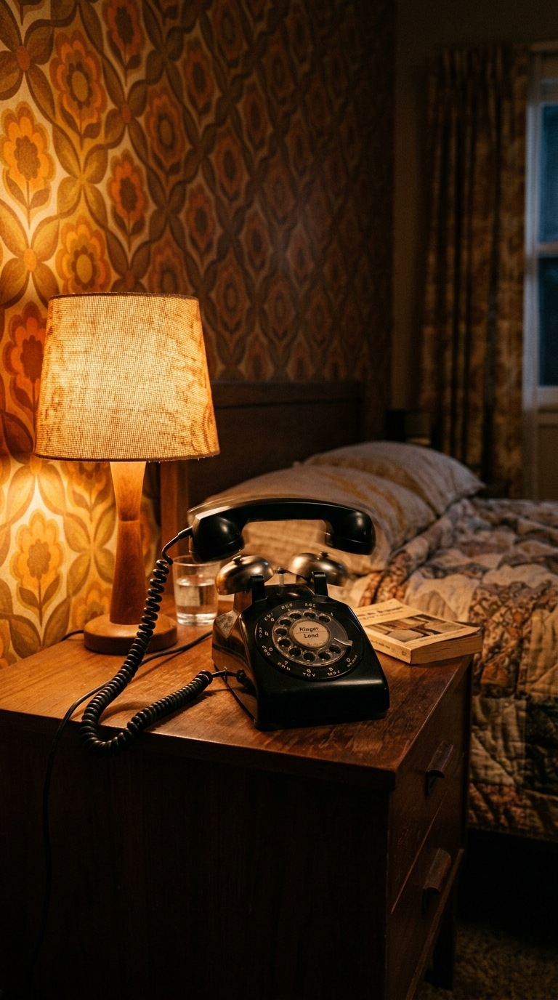
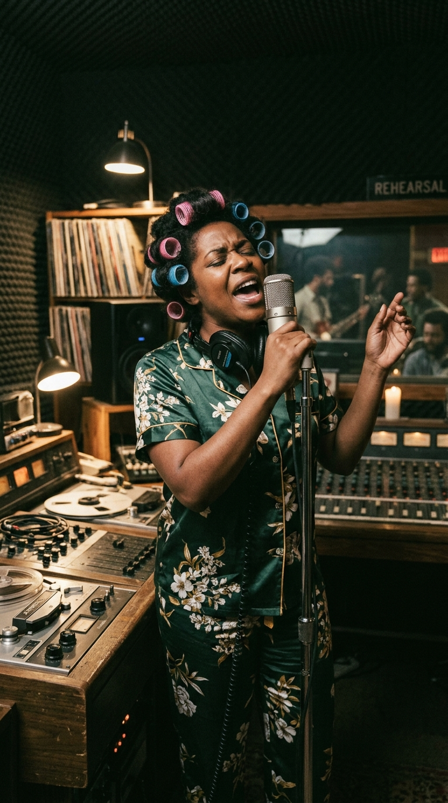
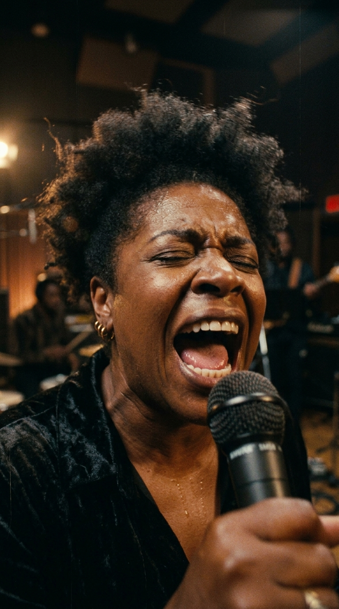
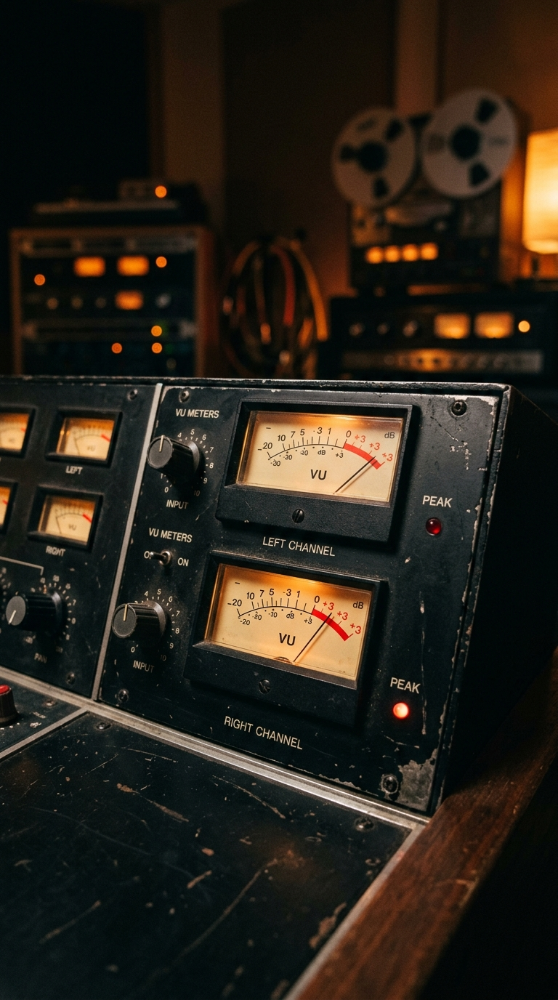
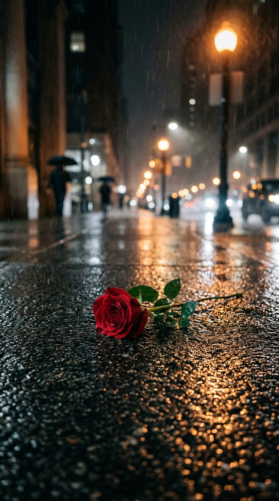
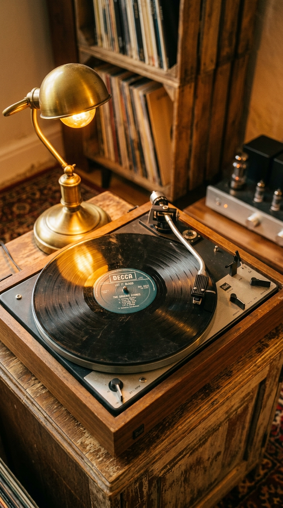

# ⚡ The Scream That Tore Through the Dawn: The Hidden Wound of «Gimme Shelter»

> *«The world in 1969 was falling apart. There was an insidious violence in the air: the Vietnam War on television screens, the Manson murders, the riots... 'Gimme Shelter' was a song about the end of the world, a warning that the storm was already upon our heads and that no one would escape unscathed.»*  
> — **Keith Richards**, on the conception of the track, London, 1969.

---

*Sunset Sound Studios, Los Ángeles, November 1969: A young, pregnant backing vocalist, ripped from her sleep in the dead of night, screams the most heartbreaking lament in rock history into a microphone.*

---

### Prologue: The Sunset of the Dream and the Scent of Ash

The year **1969** did not conclude with pastoral songs of peace or the utopian idyll of flowers in hair. It died asphyxiated under a dense atmosphere of paranoia, disillusionment, and blood.

In Southeast Asia, the Vietnam War reached its most brutal phase, claiming the lives of tens of thousands of conscripts in daily television broadcasts that cast mourning over Western households. In August of that year, the murders perpetrated by Charles Manson’s cult at Cielo Drive in Los Angeles shattered the apparent innocence of the Californian counterculture. And within the inner circle of The Rolling Stones, wounds were festering in living flesh: barely four months prior, on July 3rd, their founder and multi-instrumentalist **Brian Jones** had been found lifeless, floating in the swimming pool of his estate at Cotchford Farm in Sussex.

*Sunset Sound, 1969: Jagger and Richards examine the master tapes of 'Let It Bleed', searching for a spark that encapsulates the terminal atmosphere of their time.*

The Stones understood they were no longer the provocative youths of British rhythm and blues; they were the involuntary chroniclers of an era hurtling toward the abyss. Yet, as they began assembling the master pieces for their new album, *Let It Bleed*, the song destined to open the record possessed an implacable rhythm section, but lacked its ultimate tragic dimension.

They needed a voice not of this world. A howl capable of embodying the terror of a mother watching fire consume her city. And that voice would arrive in the most unusual way: at two in the morning, in house slippers and abruptly dragged from bed.

---

### Act I: The Arpeggio of Rain and the Shadows of Mount Street

The instrumental genesis of *«Gimme Shelter»* did not begin beneath the palms of California, but on a gray, stormy afternoon in the London neighborhood of Mayfair.

**Keith Richards** was alone in the apartment of his friend, art dealer Robert Fraser, on Mount Street. Outside, the London sky turned leaden, and a torrential downpour began to lash the windows with unusual violence. Through the glass, Richards watched hundreds of pedestrians running in panic, covering their heads with wet newspapers in search of an overhang, an awning, or any corner to shelter from the deluge.

With a Gibson Hummingbird acoustic guitar on his lap, tuned to *Open E*, Richards’ fingers began to trace a circular, tremulous, and dark arpeggio.

Yet the tempest unsettling Keith was not merely meteorological. During those exact days, his romantic partner, actress **Anita Pallenberg**, was shooting the controversial film *Performance* in London studios, sharing scenes of explicit intimacy with **Mick Jagger** himself. Reclusive and alone, tormented by jealousy and suspicion, Richards poured all his emotional anguish into those acoustic strings.

> *«The line 'Ooh, a storm is threatening my very life today' tumbled out immediately»*, Richards would recall in his memoirs. *«I saw people running for shelter from the rain, but to me it was something far more visceral: the physical certainty that everything around me was about to be swept away by a gale»*.

When Jagger heard the riff, he instantly grasped its emotional density. He incorporated one of the gloomiest harmonica lines of his repertoire and completed the verses with a litany summarizing the social and political tension of the era:

> *«War, children, it's just a shot away, it's just a shot away...»*

Months later, in the autumn of 1969, the band transferred the tapes to **Sunset Sound** studios in Los Angeles to complete production alongside **Jimmy Miller**. The instrumental architecture was a masterclass in restrained tension: Bill Wyman’s understated bass, Charlie Watts’ martial and dry pulse, hypnotic maracas, and layers of electric and acoustic guitars overdubbed by Keith.

However, as the track progressed toward its climactic section, Miller and Jagger felt an inescapable void. The verses about rape and murder sounded incomplete in Jagger’s voice. They required a feminine counterpoint to elevate the grievance to the category of biblical prophecy.

It was close to two in the morning when Jimmy Miller lifted the telephone receiver.

---

### Act II: The 2:00 AM Phone Call on Curtis Street

On the other end of the line, in a residence in South Los Angeles, the bedside telephone bell shattered the bedroom silence.

*Los Angeles, 2:00 AM: The ring that interrupted a pregnant woman's rest and altered the destiny of a historic recording.*

**Merry Clayton**, a talented twenty-one-year-old African American vocalist—daughter of a New Orleans Baptist pastor, trained in gospel choirs and tempered in Ray Charles’ *Raelettes*—was fast asleep.

Clayton was in the early months of a **delicate pregnancy** requiring strict physical rest. Her husband, prominent jazz saxophonist and musical director **Curtis Amy**, picked up the phone with surprise. The call came from renowned arranger and producer **Jack Nitzsche**, a close collaborator of Phil Spector and a close friend of The Rolling Stones.

*—Curtis, I’m sorry about the hour, but I need Merry in the studio right now* —Nitzsche explained—. *I’ve got some boys here from England called The Rolling Stones. They have a song that needs a powerful female backing vocal, and no one in this town can deliver what they’re looking for.*

Merry, still half-asleep, rejected the proposal from her bed:  
*—Tell them no. It’s two in the morning, I’m pregnant, my hair is full of rollers, and I have no idea who these rolling guys are.*

Yet Curtis Amy, mindful of the professional demands of the Californian studio circuit, calmly stroked her shoulder:  
*—Honey, get up. It’s an important session. Go, do your thing, sign the union sheet, and come back to rest. I’ll stay awake waiting for you.*

*Curtis Street, dawn of 1969: Wrapped in a mink coat over her silk nightgown, Merry departs for the studio, unaware of the price she would pay for her dedication.*

Merry Clayton did not stop to change her attire. She kept the plastic rollers secured in her hair with a net, stayed in her long silk nightgown, wrapped herself in a heavy fur coat, and tied a scarf around her neck to protect her larynx from the night chill.

She got into her car and drove through the deserted avenues of Los Angeles to 6650 Sunset Boulevard.

---

### Act III: The Vocal Crack That Shook Sunset Sound

Upon entering the rooms of Sunset Sound past two-thirty in the morning, the members of The Rolling Stones were surprised.

Before them stood not a backing singer in evening wear, but a young, fatigued woman with hair rollers and wrapped in a winter coat. Merry Clayton walked through the control room door, chewing gum with poise, and looked Mick Jagger in the eyes:  
*—All right. Explain clearly what I need to sing, because I need to get back to my bed.*

Jagger, impressed by the performer’s determination, walked over to the music stand and hummed the notes of the melody. When Clayton read the words scribbled on the sheet of paper, she looked up in astonishment:  
*«Rape, murder! It's just a shot away, it's just a shot away...»*

For a young woman raised in the precepts of her father’s Baptist church, singing such raw lyrics was disconcerting. Yet she took a deep breath, closed her eyes, positioned herself in front of the Neumann condenser microphone, and nodded to the engineers behind the glass to roll the two-inch tape.

*Sunset Sound, recording booth: The visceral force of a throat that transformed a rock verse into an eternal testimony of pain.*

On the **first take**, Clayton’s voice burst forth with staggering punch, doubling Jagger’s line with a gospel solidity that forced the technicians to attenuate the potentiometers to prevent analog distortion.

On the **second take**, Clayton elevated the dramatic intensity, drawing upon her full mezzo-soprano register to project every word with spine-chilling drama.

Yet it was on the **third take** that the unrepeatable happened.

Merry decided to forego the established melodic guide. She firmly braced her diaphragm, gathered all the air in her lungs, and attacked an octave higher with harrowing vehemence. She lifted her chin toward the top of the room and projected a lament that chilled the blood of everyone present:

> *«¡RAPE, MURDER! IT'S JUST A SHOT AWAY!*  
> *¡¡RAPE, MURDER!! IT'S JUST A SHOT AWAY...»*

In that second beat, upon uttering the word *«murder»*, Merry Clayton’s vocal cords were pushed beyond human acoustic limits. **Her voice fractured twice consecutively**, emitting an aphonic tear, a guttural break charged with purity and suffering so raw that the room fell into absolute awe.

*VU meters in the red, saturating the console: The sound pressure and emotional power defied the analog circuits of the mixing desk.*

On the isolated vocal track preserved in the master archives, in the millisecond following Merry’s vocal fracture, Mick Jagger can be heard clearly, fascinated and dumbfounded in the control room, uttering a spontaneous exclamation that was forever captured in the mix:  
*«WHOO!»*.

Clayton lowered her arms, opened her eyelids, and looked at the booth through the glass.  
*—Is that enough, or do you need me to do it again?* —she asked with professional serenity.  
*—Merry... that is the most incredible thing we have ever heard in our lives* —Jimmy Miller replied, visibly moved—. *Please, go rest.*

Mick Jagger accompanied her to the exit with a gesture of reverent gratitude. Merry Clayton got into her car and began the journey back to Curtis Street. The clock struck half past three in the morning.

---

### Act IV: The Invisible Loss and the Shadow of Altamont

What transpired in the hours that followed constitutes one of the most painful and private passages in the history of popular music.

A few hours after returning home, as the first morning light broke over Los Angeles, Merry Clayton awoke startled by intense, sharp abdominal pain. Her husband Curtis found her drenched in cold sweat and suffering from severe hemorrhaging. He rushed her to the nearest medical center.

Despite the efforts of the medical staff, the outcome was irreversible: **Merry Clayton suffered a sudden miscarriage.**

For decades, the singer and her circle maintained a modest silence regarding the tragedy. However, in her intimate memory, the conviction always remained that the excessive physical and pulmonary exertion expended that dawn to reach those extreme notes in *«Gimme Shelter»* had triggered the interruption of her pregnancy.

> *«For many years, it was impossible for me to listen to that song»*, Clayton recounted emotionally decades later in the documentary *20 Feet from Stardom*. *«Every time it played on the radio, I felt a knot in my chest. It threw me right back to the memory of my baby. It reminded me of the deepest pain a woman can experience in her body and soul»*.

*The silent wound: Behind rock's most admired song lay the invisible mourning of a mother who surrendered her own health in exchange for an eternal beat.*

Merry Clayton’s tragedy seemed to confer upon the track a chillingly premonitory quality.

Barely a day after the release of *Let It Bleed* in the United States, on **December 6, 1969**, The Rolling Stones performed at the free festival at **Altamont Speedway** in Northern California. The gathering devolved into chaos and unchecked violence under the watch of the *Hell's Angels*, mistakenly hired as security.

During the group's performance, just feet from the stage, young African American **Meredith Hunter** was fatally assaulted by members of the Hell's Angels amidst the crowd.

The lyrical warning of *«Gimme Shelter»* materialized in tragic fashion: the storm had unleashed its fury, and violence was indeed just a shot away. The 1960s were closing in an abrupt and gloomy manner.

---

### Epilogue: The Sanctuary of Immortality

As the decades passed, Merry Clayton turned that trauma into a lesson of resilience and spiritual dignity.

In **1970**, backed by producer Lou Adler, she recorded her own solo version of *«Gimme Shelter»*, reclaiming interpretive authorship of the song and transforming it into a manifesto of resistance that climbed high on the R&B charts. And when in **2014** the documentary *20 Feet from Stardom* won the **Academy Award**, universal recognition paid tribute to the vocalist who, in a bathrobe and hair rollers, had left a piece of her soul before the microphone at Sunset Sound.

*The inextinguishable echo: Half a century later, Merry Clayton's vocal solo remains one of the most genuine and moving passages ever recorded in modern music.*

Today, when Keith Richards’ arpeggio emerges from the gloom and Merry Clayton’s voice bursts over Charlie Watts’ drums, the impact remains instantaneous.

Because we are not witnessing sonic artifice or sterile technical display. We are confronting the naked truth of the human soul—a testimony of vulnerability, fortitude, and beauty that transformed an intimate wound into the sacred sanctuary of millions facing the world's storms.

---

### 💬 The Question for Our Community

*«Gimme Shelter»* proves that art's pinnacle moments are frequently born on the most delicate border between creative surrender and the deepest human pain.

**What do you experience every time you hear Merry Clayton’s voice crack on the word 'Murder'? Did you know the human price and tragedy that accompanied this historic recording?**

*We read you in the comments of our weekly publication.*

---

### 📚 Sources and Archival Records

1. **Richards, Keith with James Fox** (2010). *Life*. Little, Brown and Company, New York. Keith Richards' memoirs detailing the rainy afternoon on Mount Street, the Open E tuning, and the atmosphere of apprehension shared with Jagger and Anita Pallenberg.
2. **Clayton, Merry** (2013–2014). *Documentary testimonies in the Oscar-winning feature film «20 Feet from Stardom»* (Dir. Morgan Neville) and interviews with *The Los Angeles Times* (Randy Lewis), where she recounts the midnight call, the session in her nightgown, and the loss of her pregnancy.
3. **Booth, Stanley** (2000). *The True Adventures of the Rolling Stones*. A Cappella Books, Chicago. Direct documentary chronicle of the 1969 studio events and on-site coverage of the Altamont festival incidents.
4. **Bockris, Victor** (2003). *Keith Richards: The Biography*. Da Capo Press. Analysis of the mixing sessions at Sunset Sound Studios (Los Angeles) and arranger Jack Nitzsche's coordination to bring in Merry Clayton.
5. **Miller, Jimmy & Sunset Sound Archives** (1969, 2009). *Master Recording Sheets & Isolated Tracks of «Let It Bleed»*. Documentation of vocal take three, Neumann tube microphones, and the logging of Mick Jagger's spontaneous scream on the analog console.
6. **Egan, Sean** (2013). *The Mammoth Book of the Rolling Stones*. Running Press. Compilation of press clippings on the critical reception of *Let It Bleed* in *Rolling Stone* and the international press of late 1969.