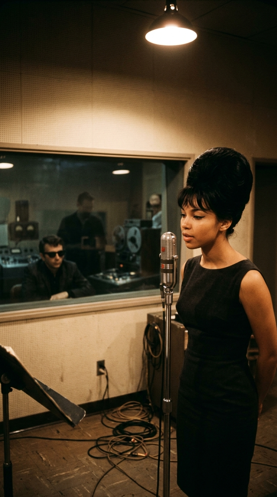
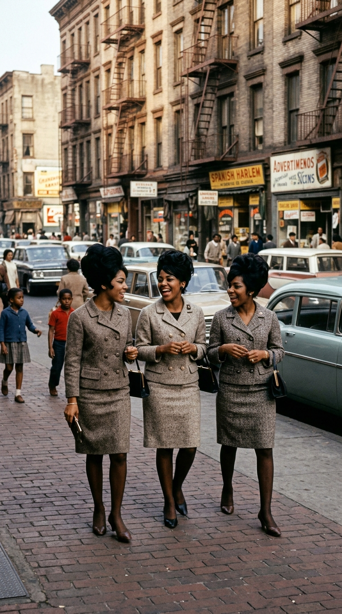
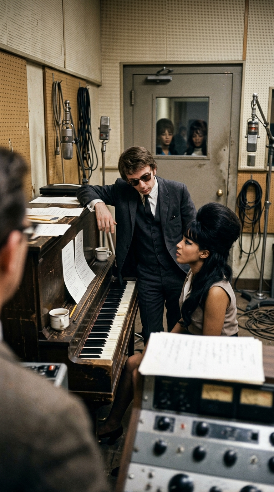
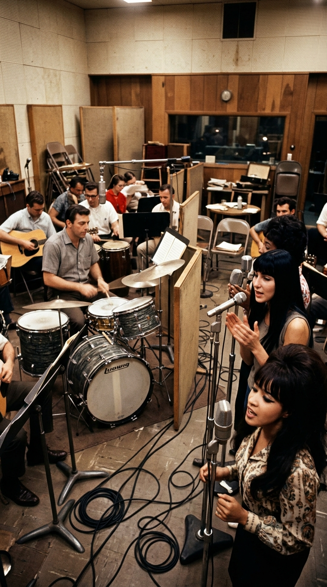
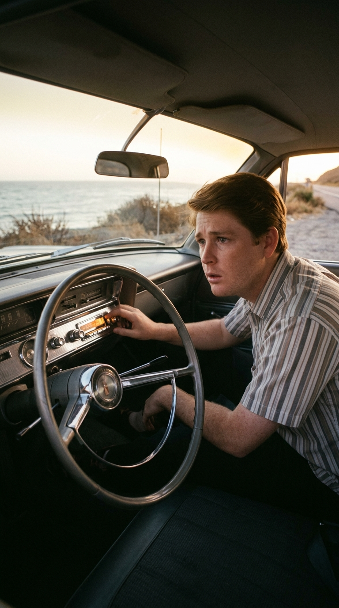
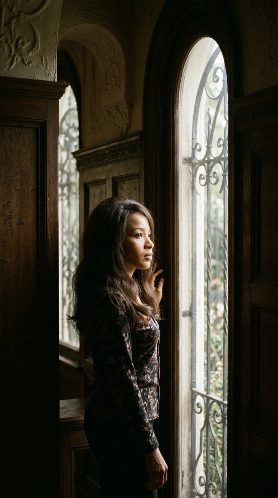
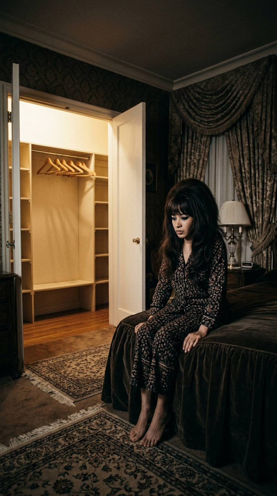
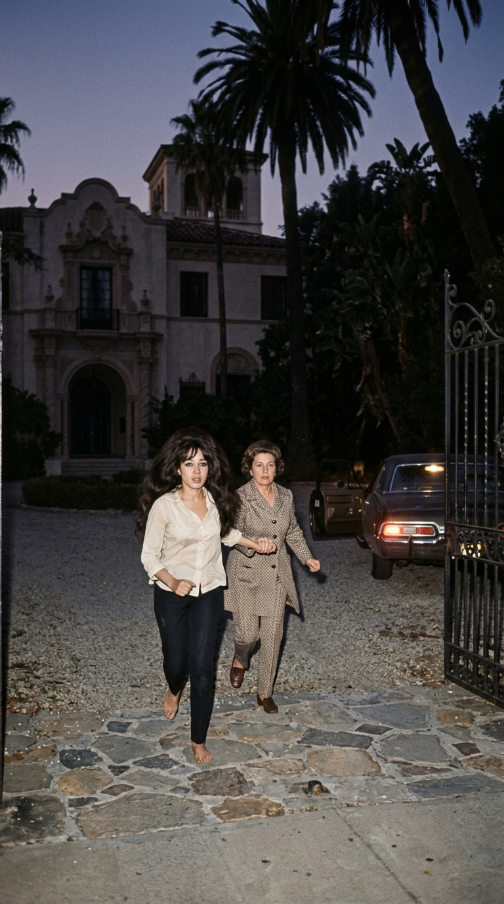
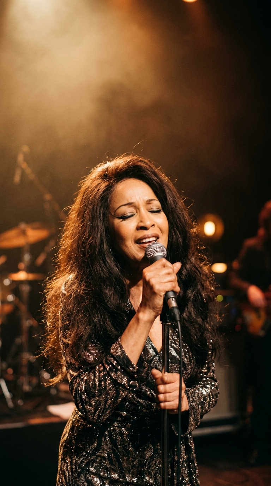

# «Be My Baby»: El himno de amor adolescente que le costó la libertad a su propia voz

*En julio de 1963, una joven de diecinueve años nacida en el Harlem hispano de Nueva York entró a los estudios Gold Star de Los Ángeles para grabar la declaración de amor más luminosa de su década. Lo que el mundo entero escuchó como la cumbre del romance juvenil terminó convirtiéndose en el inicio de un largo cautiverio real del que su intérprete, Ronnie Spector, tuvo que escapar descalza para recuperar su vida y su voz.*

---

### I. Tres jóvenes del Harlem hispano y un golpe de batería para la historia

A comienzos de 1963, **Veronica «Ronnie» Bennett** tenía diecinueve años y recorría las calles de Washington Heights y el Harlem hispano de Nueva York junto a su hermana mayor, **Estelle Bennett**, y su prima **Nedra Talley**. Las tres jóvenes —de ascendencia afroamericana, cherokee e irlandesa— habían formado un trío vocal llamado primero *The Darling Sisters* y más tarde **The Ronettes**. Con sus imponentes peinados cardados en forma de colmena (*beehive*), su delineado negro pronunciado y su energía sobre el escenario del Peppermint Lounge, buscaban una oportunidad que las llevara más allá de los clubes nocturnos de Manhattan.

Esa oportunidad llegó cuando Estelle consiguió una audición frente al productor más codiciado e impredecible de la industria estadounidense: **Phil Spector**, de entonces veintitrés años. Al escuchar el timbre cálido, vibrante y vulnerable de Veronica frente al piano de los estudios Mirasol en Nueva York, Spector quedó inmediatamente obsesionado con su voz. Poco después, reunió a la pareja de compositores recién casados del Brill Building, **Jeff Barry** y **Ellie Greenwich**, para escribir una canción hecha a la medida de aquella joven de diecinueve años: **«Be My Baby»**.

---

### II. La sesión de Gold Star Studios: celos en la cabina y el debut fortuito de Cher

En julio de 1963, Ronnie, Estelle y Nedra volaron a California para grabar el tema en el reducido **Estudio A de Gold Star Studios**, en el 6252 de Santa Monica Boulevard, en Hollywood. Sin embargo, antes de encender las consolas, la obsesión personal de Spector hacia Veronica empezó a trazar una frontera invisible entre ella y su propia familia.

Según relató la propia Ronnie Spector en sus memorias de 1990 (*Be My Baby: How I Survived Mascara, Miniskirts, and Madness*), el productor quería poseer su voz en exclusiva. Con el pretexto de que el arreglo requería únicamente su registro solista en la toma principal, Spector retuvo a Veronica durante semanas de ensayos exhaustivos al piano, obligándola a repetir cada sílaba y cada suspiro del estribillo (*«Oh-oh-oh-oh»*), mientras buscaba excusas para mantener a Estelle y a Nedra al margen de la sesión vocal definitiva.

Cuando finalmente se grabó la pista instrumental con la legendaria brigada de músicos de sesión conocida como *The Wrecking Crew*, un accidente fortuito en el primer compás selló la historia del pop: el baterista **Hal Blaine**, al intentar golpear la caja en el segundo tiempo, dejó caer accidentalmente una de sus baquetas, produciendo el célebre patrón sincopado —*«bum, bum-bum, ¡pah!»*— que Spector decidió conservar en la mezcla maestra. En el fondo de aquella sala abarrotada de guitarras, pianos, sección de vientos y castañuelas, faltó a última hora una de las coristas contratadas. Para cubrir su puesto frente al micrófono de apoyo y tocar las palmas, el asistente del estudio, **Sonny Bono**, propuso a la adolescente de diecisiete años que lo había acompañado aquella tarde a mirar la sesión: una joven desconocida llamada **Cherilyn Sarkisian**, quien debutó aquel día en un estudio de grabación antes de que el mundo la conociera como **Cher**.

---

### III. El día en que Brian Wilson detuvo su automóvil en la carretera

Publicada en agosto de 1963 bajo el sello Philles Records, **«Be My Baby»** escaló hasta el puesto número 2 del *Billboard Hot 100* y vendió más de dos millones de copias, transformando para siempre la sensibilidad de la música popular.

Su impacto emocional quedó inmortalizado en una escena ocurrida pocos días después de su estreno radial en California. **Brian Wilson**, líder y compositor de *The Beach Boys*, conducía su automóvil por la carretera de la costa del Pacífico cuando los cuatro golpes de batería de Hal Blaine y la voz suplicante de Ronnie Bennett brotaron por primera vez del altavoz del tablero. Conmovido hasta el asombro, Wilson tuvo que orillarse y detener el vehículo sobre la grava del camino para escuchar la canción sin distracciones. Fascinado por aquella grabación —a la que consideró durante toda su vida la mayor obra maestra de la historia del pop—, Wilson compuso pocos meses después **«Don't Worry Baby»** específicamente para que la cantara Ronnie, aunque los celos férreos de Phil Spector impidieron que ella pudiera grabarla.

---

### IV. La mansión de Alhambra: cuando la canción de amor se volvió cerrojo

Mientras el mundo entero bailaba y se enamoraba al compás de *«Be My Baby»*, la vida íntima de Veronica Bennett tomó un rumbo sombrío. Tras años de control profesional y emocional, Ronnie contrajo matrimonio con Phil Spector en 1968 y se mudó con él a **La Collina**, una imponente mansión de estilo español de veintitrés habitaciones en Alhambra, California.

Lo que debía ser un hogar se convirtió en una prisión vigilada. Spector rodeó la propiedad con cercas electrificadas, alambre de púas y perros guardianes. Incapaz de tolerar que su esposa fuera admirada por el público o mantuviera contacto con el mundo exterior, le prohibió grabar y presentarse en escenarios. Cuando Ronnie intentaba conducir por los alrededores simplemente para ver gente en las calles, él llenaba el asiento del copiloto con un maniquí inflable de tamaño real para simular que iba acompañada y evitar que alguien se acercara a su ventanilla.

El aislamiento llegó a su punto más extremo dentro de las habitaciones de la mansión: temiendo que ella lo abandonara, Spector confiscó y escondió bajo llave todos los zapatos de Ronnie para que no pudiera caminar fuera de la casa. En sus memorias, Ronnie documentó también que su esposo llegó a instalar un ataúd dorado con tapa de cristal en el sótano de la residencia, advirtiéndole que la expondría allí dentro si algún día intentaba dejarlo.

---

### V. El 10 de junio de 1972: la huida descalza hacia la libertad

A mediados de 1972, tras cuatro años de encierro que habían quebrantado su salud y silenciado su carrera, la madre de Ronnie, **Beatrice Bennett**, visitó la mansión de Alhambra y comprendió que la vida de su hija corría peligro si permanecía un día más detrás de aquellas rejas.

Al atardecer del **10 de junio de 1972**, aprovechando una ausencia temporal de Spector y tras caminar sobre vidrios rotos para salir por una ventana lateral, Ronnie corrió **descalza** por el sendero de piedra de la propiedad tomada de la mano de su madre hasta alcanzar un automóvil que las esperaba afuera. Como no tenía un solo par de zapatos en los pies, dejó atrás su ropa, sus discos de oro y sus derechos editoriales. En el acuerdo de divorcio firmado en 1974, aceptó renunciar a sus futuras regalías con tal de obtener su libertad inmediata, pues sabía que si no salía de aquella mansión jamás volvería a cantar.

Durante las décadas siguientes, Ronnie Spector reconstruyó su camino desde cero, volvió a los escenarios junto a figuras como Bruce Springsteen, Billy Joel y Joey Ramone, fue incorporada al **Salón de la Fama del Rock and Roll** en 2007 y, tras años de litigios judiciales, logró recuperar el reconocimiento legítimo de su legado artístico antes de su fallecimiento en enero de 2022. Cada vez que vuelven a sonar aquellos tres segundos de batería seguidos de su voz inolvidable, «Be My Baby» recuerda que ninguna jaula de oro pudo apagar jamás el canto de quien nació para ser libre.

---

### 📚 Fuentes y Archivo Documental

* **Spector, Ronnie & Waldron, Vince (1990 / reed. 2022).** *Be My Baby: How I Survived Mascara, Miniskirts, and Madness*. Harmony Books / Henry Holt and Co., Nueva York. (Testimonio autobiográfico directo sobre la audición de The Ronettes, las sesiones en Gold Star Studios, el encierro en la mansión de Alhambra y su huida descalza el 10 de junio de 1972).
* **Blaine, Hal & Goggin, David (1990).** *Hal Blaine and the Wrecking Crew: The Story of the World's Most Recorded Musician*. MixBooks. (Documentación sobre el golpe accidental de baqueta en el segundo tiempo de la introducción de «Be My Baby» en Gold Star Studio A en julio de 1963).
* **Bono, Sonny (1991) & Cher (2024).** *And the Beat Goes On* (Pocket Books) y *Cher: The Memoir, Part One* (Dey Street Books). (Registro documental del debut de Cherilyn Sarkisian, de 17 años, en los coros y palmas de «Be My Baby» en julio de 1963).
* **Wilson, Brian & Greenman, Ben (2016).** *I Am Brian Wilson: A Memoir*. Da Capo Press. (Relato de primera mano sobre la primera vez que escuchó «Be My Baby» conduciendo en la costa de California en agosto de 1963 y la composición posterior de «Don't Worry Baby»).
* **Corte de Apelaciones del Estado de Nueva York (2002).** *Talley v. Spector / Bennett v. Philles Records, Inc.* (Expedientes judiciales sobre los derechos y regalías de The Ronettes).
