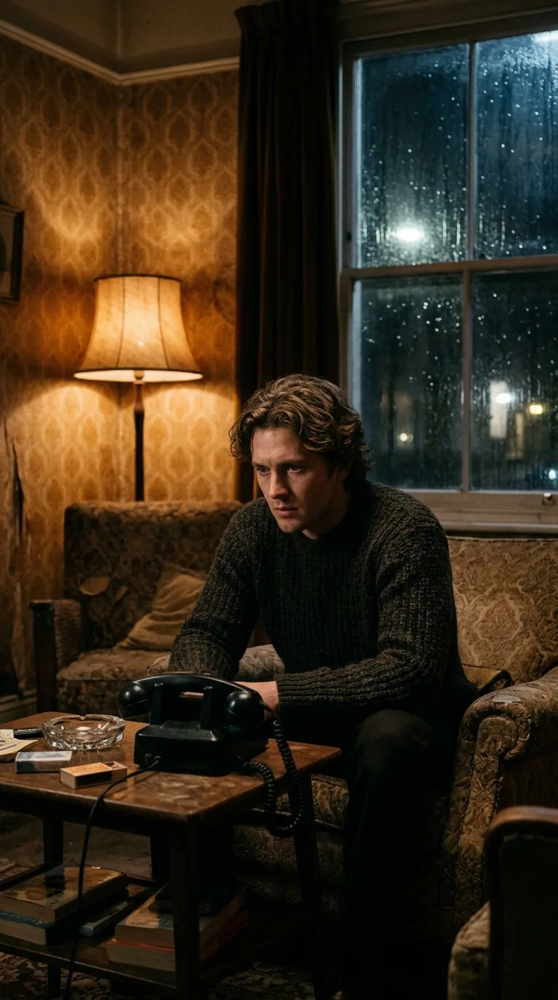
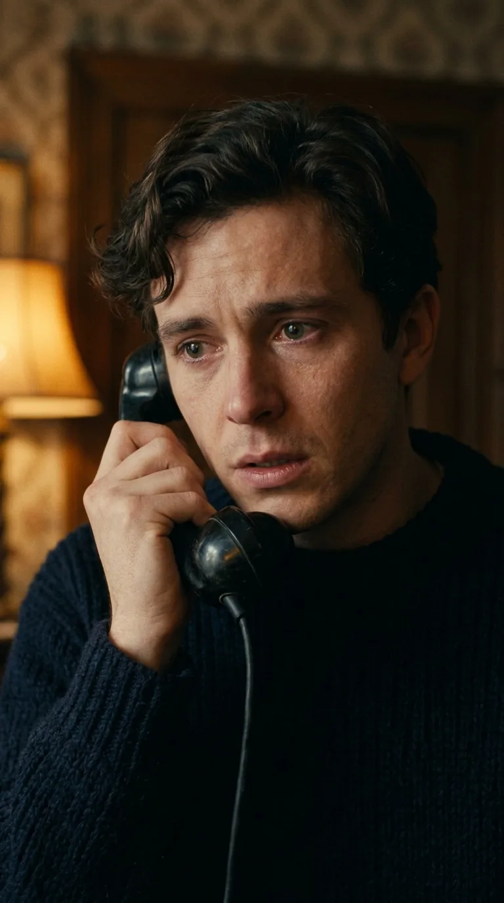
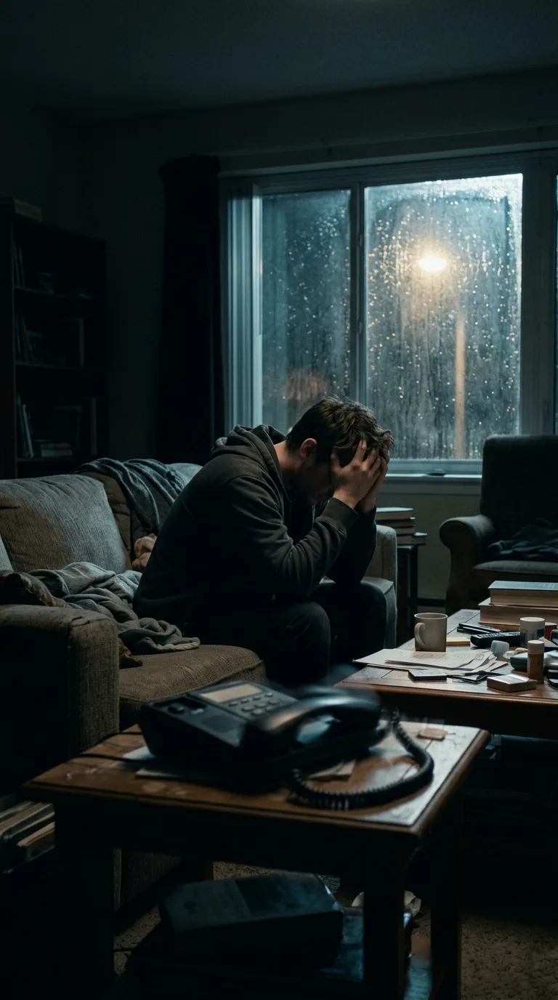
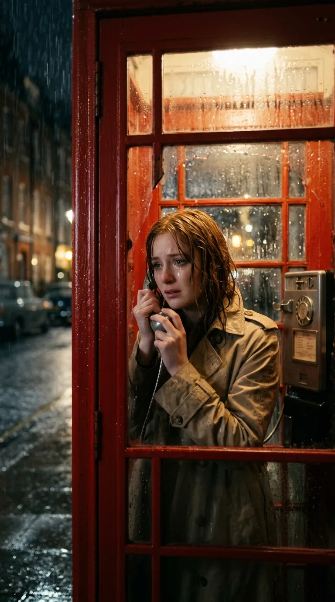
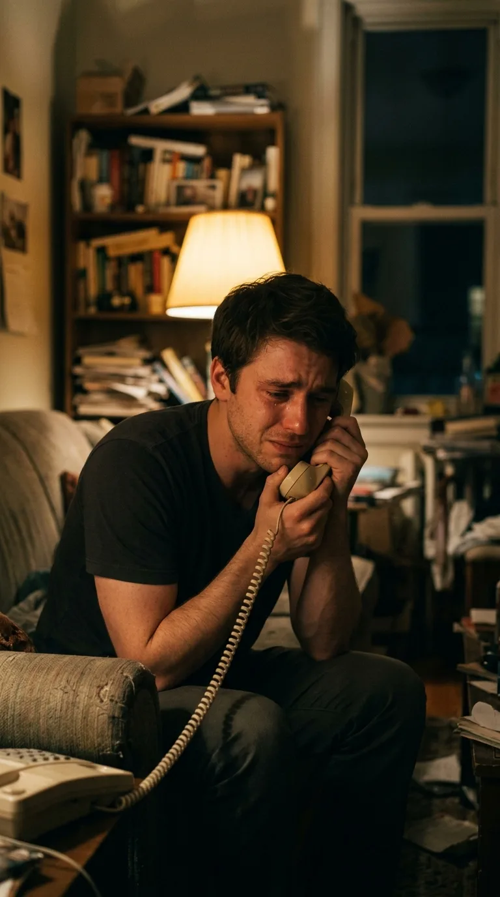

# El hombre que fingió ser otro: El secreto de «Baby I Know»

### Prólogo: El teléfono en la penumbra

Existe una clase particular de dolor que no admite testigos. Hay despedidas tan violentas y definitivas que el instinto de supervivencia más elemental consiste en desaparecer antes de que el otro escuche el crujido del corazón al romperse.

En la primavera de 1977, cuando la música británica se debatía entre la ferocidad del punk y los estertores de la música disco, la banda inglesa The Rubettes dio a conocer una de las canciones más atípicas y secretamente desgarradoras de la década: *«Baby I Know»*. Lejos del falsete eufórico de sus primeros éxitos, la pieza —compuesta por Alan Williams y John Richardson, y cantada con una melancolía áspera por el guitarrista Tony Thorpe— encerraba un drama psicológico íntimo, narrado en tiempo real a través del cable de un teléfono analógico.

No era una declaración de amor convencional ni un reproche amargo. Era el relato en tres actos de una llamada telefónica nocturna donde un hombre, al verse confrontado con el adiós de la mujer que todavía ama, toma una determinación desesperada: fingir que es otra persona.

> *«You called me to tell me goodbye*  
> *I told you that I was some other guy*  
> *You said that you'd phone when he got home*  
> *You told me to tell him that you'd called...»*

---

### Acto I: La mentira piadosa

La escena se abre en la quietud sofocante de un apartamento en penumbra. Es medianoche. Afuera, la lluvia golpea con insistencia las ventanas de cristal, difuminando el resplandor ámbar de las farolas de la calle. Cuando el timbre del teléfono de disco retumba contra las paredes vacías, el hombre sabe instintivamente quién está al otro lado.

Al descolgar el pesado auricular de baquelita negra y escuchar su voz, el golpe es certero. Ella llama para despedirse. Ha tomado una decisión definitiva; tal vez se marcha de la ciudad, tal vez ha iniciado una nueva vida con alguien más.

En ese instante fugaz, el protagonista comprende que si responde con su propia voz, el orgullo se desmoronará en una súplica humillante o en un llanto incontrolable. Prefiere salvar la dignidad del recuerdo antes que mendigar clemencia. Con la garganta apretada y tragando saliva, altera el tono, modula la respiración y finge ser un extraño: un compañero de piso indiferente, un amigo circunstancial que atiende por casualidad.

—*«Él no está en casa»*, le dice con calculada frialdad.  
Ella, sin sospechar el engaño, le pide que le deje un recado: avísale que llamé para decirle adiós.

Al cortar la comunicación, el silencio que regresa a la habitación es más pesado que el plomo. En su pecho queda suspendida una certeza que no pudo pronunciar en voz alta: *«Ya no tienes que decirme adiós... ya no tienes que oírme llorar... porque, cariño, yo lo sé»*.

---

### Acto II: La insistencia de la madrugada

Las horas posteriores a una ruptura son un limbo insomne. El hombre permanece sentado en el borde del sofá, observando cómo las gotas de lluvia resbalan por el cristal exterior. El reloj avanza hacia la madrugada; son casi las dos de la mañana.

De pronto, contra toda lógica, el aparato vuelve a sonar.

> *«The phone rang again for some time*  
> *I knew it was you on the line*  
> *I'd hurt you before, I knew it for sure*  
> *Forgive me for being unkind...»*

El timbre insiste con una urgencia distinta. No es la llamada calculada de quien cierra una puerta con serenidad; es la vibración de quien se encuentra al borde del precipicio. Al levantar el auricular por segunda vez, el hombre se prepara para mantener la farsa, preguntándose qué herida del pasado sigue doliendo al otro extremo de la línea.

---

### Acto III: El llanto en la cabina fría

Al otro lado de la conexión telefónica, el escenario es desolador. Ella no llama desde la calidez de un hogar seguro. Está de pie dentro de una cabina telefónica pública, castigada por el viento y la lluvia. Con las monedas temblando entre los dedos y el cabello empapado sobre el cuello de su gabardina, la compostura se ha desvanecido por completo.

Creyendo ciegamente que habla con aquel amable desconocido que contestó horas antes, la mujer se derrumba:

> *«When you called much later that night*  
> *Said he'd be out 'til daylight*  
> *But if there's something that I can tell him*  
> *Forgive me for asking, but is something not right?*  
> *And then you broke down and cried...»*

Entre sollozos entrecortados que golpean el diafragma del auricular, ella confiesa la verdad desnuda. El nuevo hombre por el que lo había dejado, aquel por quien quemó sus naves y se despidió a medianoche, la ha abandonado. Le ha cerrado la puerta; no quiere saber más de ella. Sola, en medio de la tormenta y sin adónde ir, recurre al único número que sus dedos recuerdan de memoria, esperando encontrar al menos el eco del pasado.

---

### Acto IV: La mayor muestra de ternura

Es en este punto donde la narrativa de *«Baby I Know»* alcanza una estatura moral conmovedora. Cualquier persona herida por el rechazo habría sentido la tentación del triunfo amargo, la mezquindad de un reproche o la satisfacción cruel de ver al otro pagar por sus errores.

El hombre no hace nada de eso.

Apretando el auricular contra su mejilla, sintiendo el llanto de ella como si cayera sobre su propia piel, decide protegerla. No revela su identidad; comprende que si confiesa ser él, añadirá la vergüenza y la humillación al dolor insoportable que ella ya está sufriendo.

Todavía en el papel de ese tercero invisible, le habla con una delicadeza infinita:

> *«Told me you loved him, but your love had been denied*  
> *He didn't want you no more...*  
> *I told her: 'Don't you be so sure*  
> *He'll never want you to go...*  
> *'Cause, baby, baby, I know...'*  
> *Baby, I know...»*

—*«No estés tan segura de que te ha olvidado»*, le susurra con la voz temblando de emoción reprimida. —*«Él jamás querría que te fueras... te lo aseguro. Yo lo sé»*.

Al pronunciar esas palabras, el hombre está hablando de sí mismo. Se está ofreciendo como un refugio eterno, perdonando cada traición sin exigir recompensa y consolando a la mujer que ama con la mentira más noble y piadosa jamás contada.

---

### Epílogo: El amor que no necesita su nombre

Cuando la línea finalmente se corta y el tono continuo llena el auricular, la lluvia comienza a amainar sobre el asfalto de la ciudad. El hombre cuelga el teléfono con lentitud y mira por última vez hacia la calle vacía.

La cultura popular suele asociar el amor con la posesión, el reclamo y la victoria compartida en voz alta. Pero la historia que habita en los acordes de esta joya de 1977 nos recuerda una verdad mucho más honda: a veces, el amor más puro y desinteresado no consiste en ganar, sino en saber callar. Consiste en hacerse a un lado, borrar el propio nombre y soportar el peso de la tormenta para que la persona amada encuentre, al menos por una noche, un destello de esperanza en medio de la oscuridad.

---

### 📚 Fuentes y Archivo Documental

1. **Williams, Alan & Richardson, John.** Partituras originales registradas y notas de composición para el álbum *Baby I Know* (State Records, ETAT 4, 1977).
2. **Thorpe, Tony.** Entrevistas de archivo sobre las sesiones vocales y acústicas de 1977, detallando el giro estilístico hacia el country-folk y la interpretación de la letra.
3. **Official Charts Company (Reino Unido).** Historial del *UK Singles Chart*, semanas de marzo y abril de 1977. Registro oficial del sencillo *«Baby I Know»* alcanzando el Top 10 (#10).
4. **State Records / Polydor International.** Archivo discográfico y notas de lanzamiento del álbum de estudio *Baby I Know* (1977), producido por The Rubettes y Alan Blakley.
5. **BBC Radio 1 Archive.** Transmisiones de *Top of the Pops* de marzo de 1977, registro sonoro de las interpretaciones en directo con instrumentación acústica y banjo.
6. **Larkin, Colin.** *The Virgin Encyclopedia of 70s Pop*. Londres: Virgin Books, 2002. Análisis discográfico sobre la transición de The Rubettes del glam bubblegum a la composición madura de cantautor.
