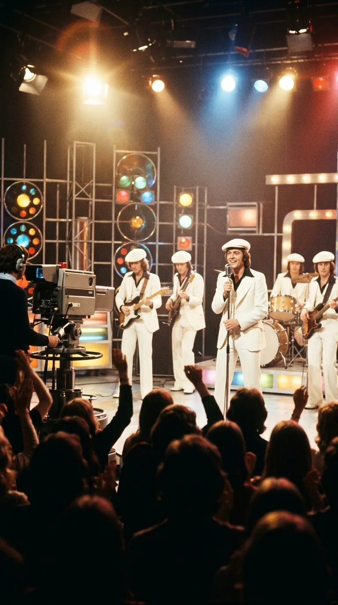
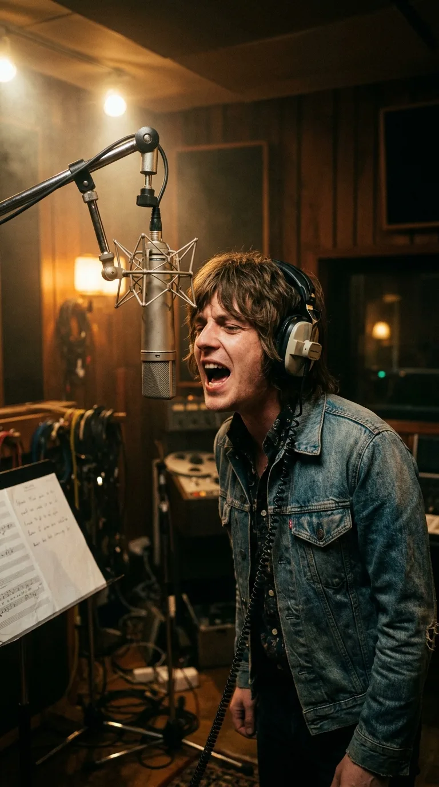
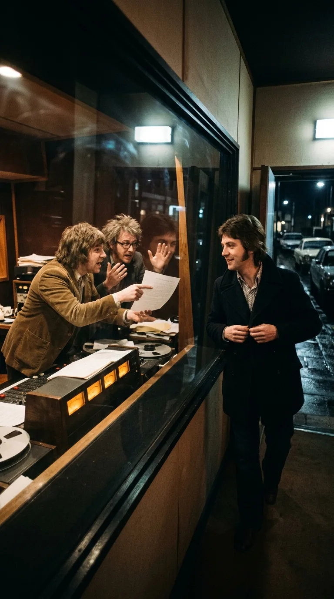
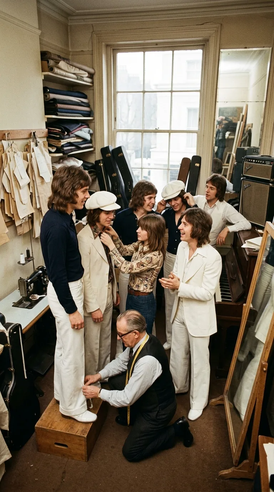
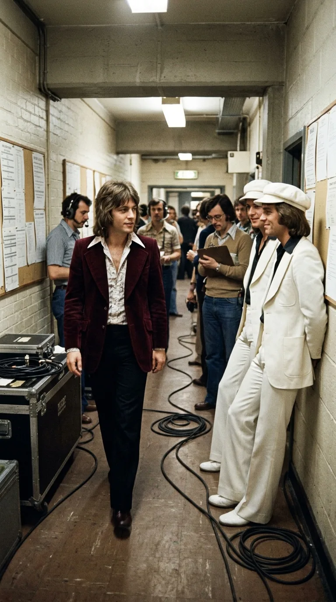
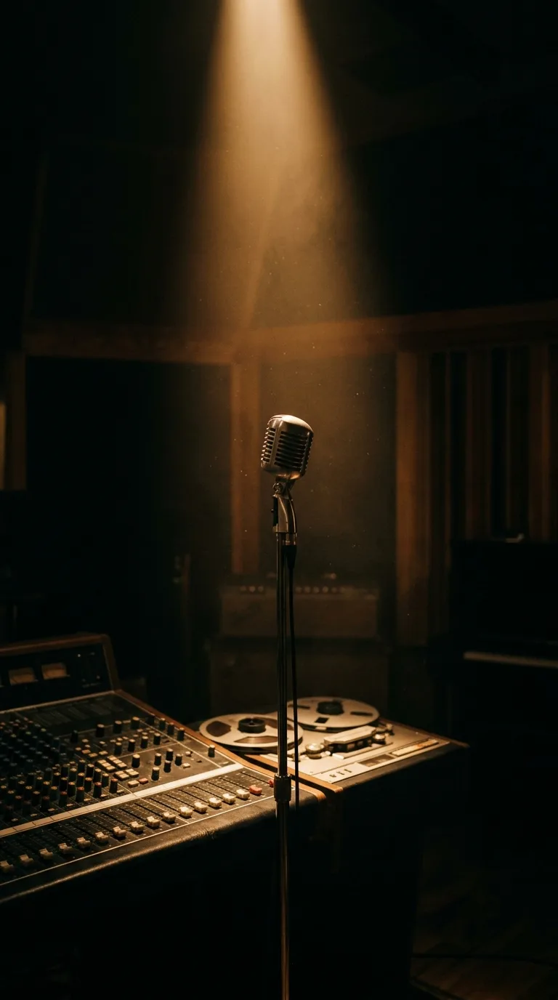

# Sugar Baby Love: La voz fantasma detrás del traje blanco

### Prólogo: El espejismo de la televisión británica

En la tarde del jueves 9 de mayo de 1974, millones de hogares británicos sintonizaron la cadena BBC One para presenciar la emisión semanal de *Top of the Pops*. Era la era dorada del *glam rock*: una época en la que la juventud devoraba purpurina, zapatos de plataforma y melodías inmediatas que prometían un escape frente a la crisis del petróleo y las huelgas mineras que oscurecían el paisaje del Reino Unido.

De pronto, las cámaras del Estudio 8 de Television Centre enfocaron a seis jóvenes que parecían salidos de una fantasía cinematográfica de los años cincuenta. Vestían trajes de sastrería impolutos de un blanco cegador y boinas planas a juego. Frente al micrófono cromado de pie, el apuesto vocalista Alan Williams sonreía con seguridad mientras por los altavoces estallaba un torrente de coros doo-wop y un grito en falsete de una pureza sobrenatural:

> *«Bop-shu-wop, bop-bop-shu-wop...*  
> *Sugar Baby Love, Sugar Baby Love...*  
> *I didn't mean to make you blue...»*

El impacto en la audiencia fue instantáneo y arrollador. Aquella voz aguda, que trepaba con una ligereza acrobática a lo largo de más de tres octavas, parecía una bendición de otro planeta. En cuestión de días, las tiendas de discos de Oxford Street agotaron sus existencias. El sencillo vendió más de ocho millones de copias en todo el planeta y se instaló en el número uno del *UK Singles Chart* durante cuatro semanas consecutivas, conquistando además las listas de Francia, Alemania, los Países Bajos y media Europa.

The Rubettes eran, oficialmente, el nuevo fenómeno pop de Gran Bretaña. 

Sin embargo, a escasos kilómetros de los estudios de la BBC, en la quietud de un modesto apartamento londinense, un joven cantante de sesión llamado Paul Prewer contemplaba la pantalla del televisor mientras sostenía una taza de té. Su respiración se detuvo al escuchar la emisión. El rostro sonriente en el monitor no era el suyo, pero cada vibrato, cada suspiro y cada nota de ese falsete inmortal habían salido de su propia garganta cuatro meses antes, en la penumbra de una madrugada solitaria en Holland Park.

---

### Acto I: Una madrugada en Holland Park

La génesis de *«Sugar Baby Love»* comenzó lejos de los reflectores de la fama, en los legendarios **Lansdowne Studios** de Londres, a finales de 1973. Sus autores eran dos veteranos de la industria musical británica: **Wayne Bickerton** —jefe del departamento de artistas y repertorio (A&R) de Polydor Records— y su socio compositor **Tony Waddington**. Ambos habían formado parte de The Pete Best Four en la era del Merseybeat y compartían una fascinación insaciable por las armonías vocales del rock and roll norteamericano de finales de los cincuenta.

Bickerton y Waddington habían compuesto la pieza como parte de un proyecto de musical retro rock and roll, pero su primer objetivo comercial fue más pragmático: intentar colocar la canción como candidata para representar al Reino Unido en el Festival de Eurovisión de 1974. Ofrecieron la composición a varios grupos establecidos de la escena glam y doo-wop, incluyendo a Showaddywaddy, pero todos la rechazaron por considerarla anacrónica o excesivamente compleja en sus exigencias vocales.

Convencidos de que la melodía poseía un magnetismo irresistible si se interpretaba con la dinámica adecuada, Bickerton y Waddington alquilaron horas de estudio en Lansdowne para registrar una maqueta profesional de demostración. Reclutaron a músicos de sesión de primer orden y convocaron a un cantante extraordinario de veintitrés años: **Paul Prewer**, cuyo nombre artístico era **Paul Da Vinci**.

Da Vinci poseía un instrumento biológico único: un registro tenor con una extensión prodigiosa de tres octavas y media, capaz de proyectar un falsete de pecho y cabeza con una resonancia de campana de cristal que ningún vocalista de pop comercial podía igualar.

La sesión fue agotadora. Tras horas grabando secciones de acompañamiento, metales y percusiones, la noche avanzó hasta bien entrada la madrugada. Eran la 1:30 de la mañana cuando Da Vinci se colocó los auriculares frente a un micrófono de condensador **Neumann U87**.

> *«Estábamos cansados, pero Wayne me pidió que diera todo lo que tenía en el arranque»*, recordaría Da Vinci años después. *«Me coloqué frente al micro y me entregué por completo. No hubo trucos ni repeticiones infinitas. Hice esa introducción y los agudos con toda la potencia de mis pulmones. Cuando terminé la toma, la sala de control se quedó en absoluto silencio»*.

---

### Acto II: La negativa del hombre libre

Al otro lado del cristal de la pecera de control, Wayne Bickerton y Tony Waddington se miraron con los ojos desorbitados. La aguja de los vúmetros analógicos había bailado al compás de una toma vocal perfecta. Aquello ya no sonaba a una simple maqueta para tentar a otros artistas; era, por derecho propio, un éxito comercial incontestable.

Bickerton salió de inmediato al piso de grabación con el contrato prácticamente en la mano.

—*«Paul, esto es enorme»*, le dijo con entusiasmo desbordante. *«Vamos a crear un grupo alrededor de esta canción. Queremos que tú seas el cantante principal. Te garantizamos giras, televisión y un contrato discográfico prioritario»*.

Para cualquier músico joven que luchaba por abrirse camino en el competitivo Londres de 1974, la propuesta equivalía a un billete de lotería premiado. Pero Paul Da Vinci tomó una decisión que cambiaría el curso de su destino para siempre: declinó amablemente la oferta.

Apenas unas semanas antes, Da Vinci había firmado un contrato como solista con el sello discográfico independiente **Penny Farthing Records**, propiedad del productor Larry Page. En su horizonte mental, Da Vinci soñaba con construir una carrera a su propio nombre, con baladas orquestadas y composiciones propias, en lugar de verse atrapado en la disciplina de una banda prefabricada con estética adolescente.

Da Vinci cobró su tarifa sindical correspondiente por la sesión nocturna, recogió su abrigo y se despidió en la neblina invernal de Holland Park, convencido de que su gran oportunidad como solista estaba a punto de llegar.

---

### Acto III: Nace la ilusión de los trajes blancos

En los primeros meses de 1974, la maqueta fue presentada al comité de preselección británico para Eurovisión, pero fue desestimada; la BBC optó por enviar a Olivia Newton-John con *«Long Live Love»*, en una edición que pasaría a la historia por la consagración absoluta de ABBA con *«Waterloo»* en Brighton.

Lejos de rendirse, Wayne Bickerton llevó la grabación a la junta ejecutiva de Polydor Records. El director general de la filial británica escuchó la cinta y sentenció sin rodeos:  
—*«Es un número uno indiscutible. Pero no podemos publicarla bajo el nombre de dos productores de oficina. Necesitamos una banda real, con caras jóvenes, trajes deslumbrantes y presencia escénica para defenderla en la televisión»*.

Ante la negativa irrevocable de Paul Da Vinci a sumarse al proyecto, Bickerton y Waddington decidieron fabricar el grupo desde los cimientos. Contactaron a músicos de sesión que habían participado en la pista instrumental o que frecuentaban los circuitos de ensayo de Londres: el cantante y guitarrista **Alan Williams**, el baterista **John Richardson**, el bajista **Mick Clarke**, el guitarrista solista **Tony Thorpe**, y los teclistas **Bill Hurd** y **Pete Arnesen**.

Para el concepto visual, los productores buscaron una identidad inmediatamente reconocible que contrastara con el cuero desgastado del pub rock y las plataformas multicolores del glam: diseñaron trajes blancos impolutos inspirados en el doo-wop de los años cincuenta, coronados por boinas blancas. Los bautizaron con un nombre sonoro y sofisticado: **The Rubettes**.

Quedaba un único problema técnico: la pista vocal. Cuando Alan Williams intentó regrabar las partes vocales principales en el estudio, la realidad física se impuso de inmediato. Williams era un intérprete melódico solvente, pero el estratosférico falsete de tres octavas y media de Paul Da Vinci sencillamente no podía ser replicado por nadie en la alineación.

Bickerton tomó entonces una determinación audaz que marcaría a fuego la historia del pop de la década: conservaron la pista maestra original intacta. La voz que el público compraría en el vinilo y escucharía por las radios sería íntegramente la de Paul Da Vinci, complementada únicamente por los coros de apoyo de la maqueta de noviembre.

---

### Acto IV: La coronación y la sombra

El 9 de mayo de 1974, The Rubettes hicieron su debut en *Top of the Pops*. Como era norma en los programas de televisión de entretenimiento de la época, las actuaciones se realizaban mediante reproducción mimética (playback) sobre la pista instrumental y vocal comercial. Alan Williams se colocó frente al micrófono y movió los labios con soltura sobre el falsete de Da Vinci.

La respuesta popular fue volcánica:

* El disco trepó vertiginosamente por el *UK Singles Chart*, alcanzando el **número uno el 18 de mayo de 1974**, puesto que retuvo durante un mes completo.
* Vendió más de un millón de copias solo en las islas británicas, y superó los **ocho millones a nivel global**.
* Encabezó las listas oficiales en Alemania, Francia, Bélgica, los Países Bajos y Suiza, transformando a The Rubettes en ídolos de póster en revistas como *Bravo* y *Jackie*.

Mientras el grupo viajaba en jets y limusinas custodiados por multitudes de admiradores, Paul Da Vinci vivió el episodio más agridulce de su carrera. En su hogar, la alegría de escuchar su creación liderando las listas mundiales se mezclaba con la extrañeza de ver a otra persona recibiendo los laureles por su destreza vocal.

Pocos meses después, Da Vinci lanzó su primer sencillo en solitario con Penny Farthing: *«Your Baby Has Gone Surfin'»*. Aprovechando la inercia de su voz y su descomunal registro, la canción alcanzó el Top 20 en el Reino Unido (llegando al puesto número 20 en agosto de 1974).

El destino propició un encuentro inevitable: durante las grabaciones de *Top of the Pops* en el otoño de 1974, Paul Da Vinci y los integrantes de The Rubettes se cruzaron en los angostos pasillos del BBC Television Centre. Entre cables de cámara y técnicos de iluminación, Williams y Da Vinci intercambiaron una mirada de complicidad teñida de ironía profesional: ambos sabían perfectamente cuál era la verdad que sostenía aquel fenómeno de masas.

---

### Epílogo: El triunfo de la verdad sin rencor

Cuando los periodistas de la prensa musical británica comenzaron a notar las diferencias entre las interpretaciones en directo de la banda en sus conciertos y la grabación original del vinilo, la verdad sobre la "voz fantasma" salió a la luz pública. Lejos de desatar un litigio destructivo, los involucrados manejaron la situación con una madurez poco habitual en la industria del espectáculo.

Wayne Bickerton y Polydor reconocieron formalmente los créditos y la remuneración correspondiente a Paul Da Vinci por su interpretación en la cinta maestra. Por su parte, The Rubettes demostraron con el paso de los años que eran músicos formidables por propio derecho: grabaron álbumes notables, colocaron una decena de sencillos en las listas europeas (como *«Juke Box Jue»* e *«I Can Do It»*) y Williams asumió con dignidad el liderazgo vocal de los temas posteriores adaptados a su tesitura.

Paul Da Vinci continuó una dilatada y respetada trayectoria como cantante de sesión de élite, prestando su portentosa voz a bandas sonoras, producciones operísticas y giras del prestigioso musical del West End *Jesus Christ Superstar*. Décadas después, Da Vinci y los miembros originales de The Rubettes incluso llegaron a compartir escenario en conciertos conmemorativos, celebrando juntos una anécdota que el tiempo convirtió en mito entrañable.

En un universo musical a menudo dominado por las apariencias y las coreografías calculadas, la historia de *«Sugar Baby Love»* perdura como un recordatorio poético del misterio que encierra la música grabada. Las modas pasan, los trajes blancos envejecen y las luces de los platós se apagan; pero cuando la aguja cae en el surco, esa voz registrada a la una y media de la madrugada en una cinta magnética sigue suspendida en el aire, intocable, libre y eterna.

---

### 📚 Fuentes y Archivo Documental

1. **Bickerton, Wayne & Waddington, Tony.** Entrevistas de archivo para el documental de BBC Radio 2 *The Story of Pop* (1975) y notas de producción discográfica sobre las sesiones de Lansdowne Studios en noviembre de 1973.
2. **Da Vinci, Paul (Paul Prewer).** Entrevista testimonial en *Record Collector Magazine*, N.º 312 (julio de 2005): *«The High Voice Behind The White Suits»*, detallando la sesión de la 1:30 AM y su contrato con Penny Farthing Records.
3. **Williams, Alan.** *The Rubettes: The Unauthorized Story & The Glam Rock Years*. Londres: Music Press Books, 2000. (Memorias del vocalista principal de directo sobre la fundación de la banda, el debut en *Top of the Pops* y el manejo de las voces de estudio).
4. **Official Charts Company (Reino Unido).** Historial del *UK Singles Chart*, semanas del 11 de mayo al 15 de junio de 1974. Registro de permanencia de *«Sugar Baby Love»* en el N.º 1.
5. **BBC Television Archives.** Archivo de cintas maestras de *Top of the Pops*, emisión del 9 de mayo de 1974 (Estudio 8, BBC Television Centre, Londres).
6. **Larkin, Colin.** *The Virgin Encyclopedia of 70s Pop*. Londres: Virgin Books, 2002. Entrada exhaustiva sobre The Rubettes, Wayne Bickerton y las grabaciones de sesión del pop británico de mediados de los setenta.
