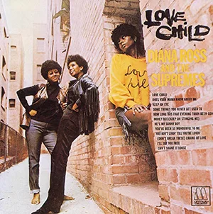
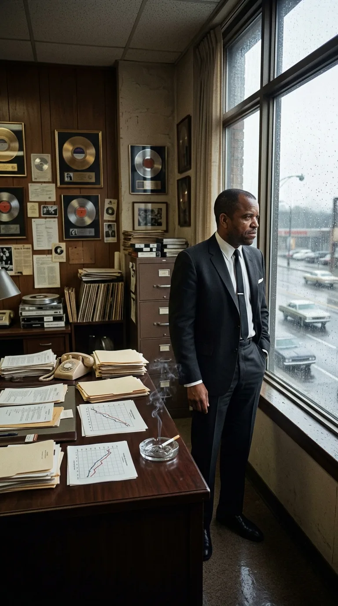
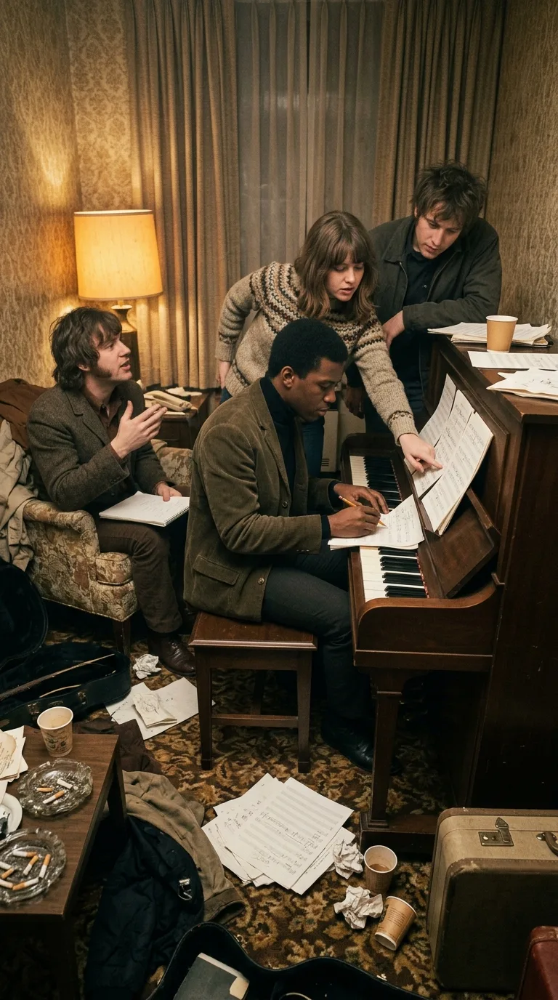
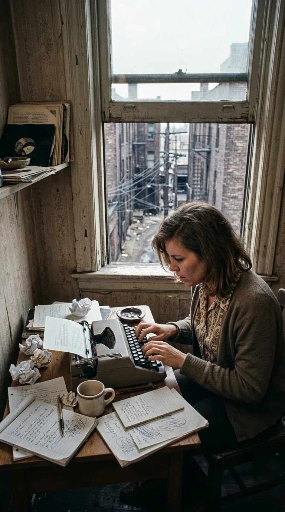
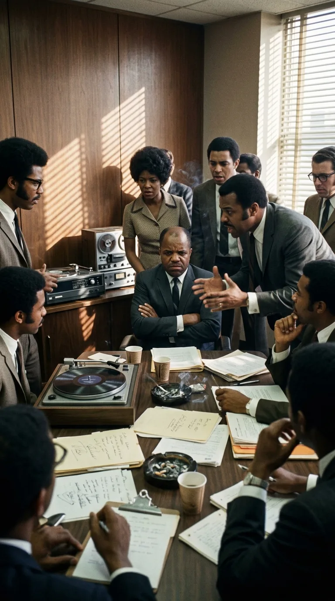
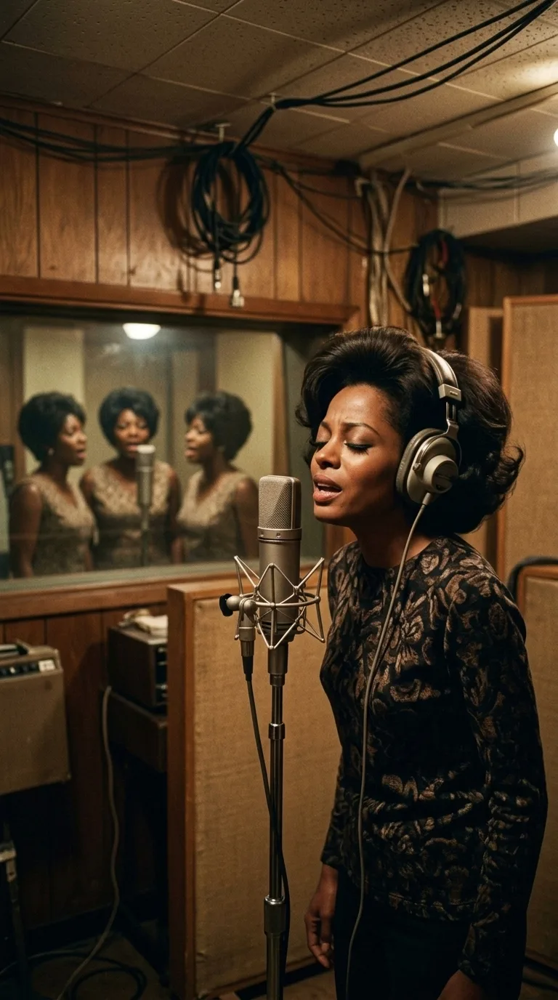
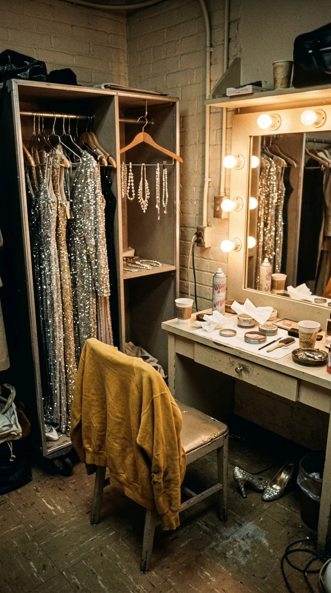
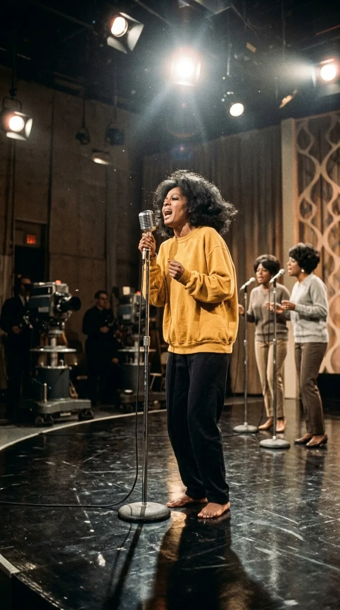
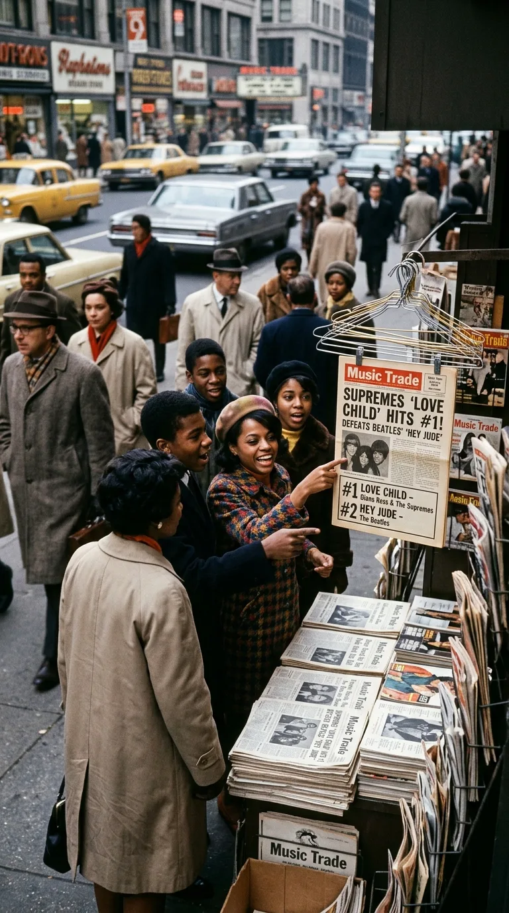
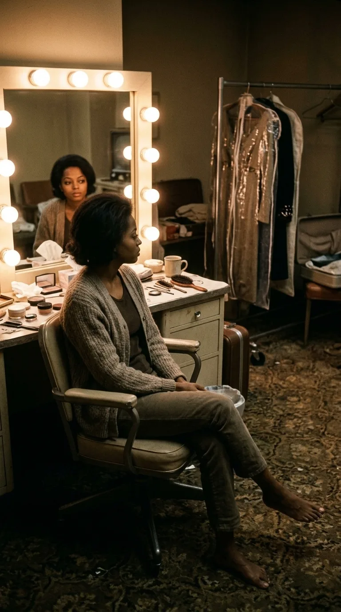

# Descalzas en el Paraíso: El Grito Oculto tras «Love Child»

**Por Acordes Ocultos**  
*Tiempo de lectura aproximado: 7 minutos*

---

*Detroit, 1968: Diana Ross despojada del artificio de gala, con sudadera mostaza y cabello afro natural.*

---

### Prólogo: La Caída del Reloj de Oro

Durante la mitad de la década de 1960, **Diana Ross & The Supremes** no eran únicamente el mayor fenómeno comercial de la música negra: eran el embrujo perfecto del sueño americano. Cuando irrumpían en el plató de un programa de variedades o en los salones de baile de Las Vegas, lo hacían envueltas en vestidos de chifón bordados a mano, pelucas impecablemente esculpidas y una cadencia de movimientos que parecía ajena a cualquier imperfección terrenal. Berry Gordy, el estratega implacable detrás de Motown Records, había construido un espejo en el que la burguesía blanca podía mirarse sin miedo: tres muchachas de Detroit que cantaban al amor adolescente con la delicadeza de una porcelana cortesana.

Pero en el verano de 1968, los cimientos de Hitsville U.S.A. crujían bajo el peso de la realidad. Las calles de las ciudades estadounidenses ardían tras el asesinato de Martin Luther King Jr., la guerra de Vietnam desangraba a una generación entera y, en los pasillos de Motown, la maquinaria de hacer números uno se había detenido en seco. Holland-Dozier-Holland, el trío de compositores prodigio responsable de diez éxitos colosales consecutivos, había roto sus contratos y marchado a los tribunales reclamando sus regalías. Las canciones que siguieron palidecían en las listas. La prensa musical comenzaba a firmar el acta de defunción de The Supremes.

*Hitsville U.S.A., 1968: Berry Gordy contempla la lluvia tras la ventana en su despacho de Detroit, ante el declive en las ventas de The Supremes.*

---

### Acto I: El Cónclave del Hotel Pontchartrain

Consciente de que el declive de su buque insignia significaba el colapso simbólico de todo su imperio, Berry Gordy tomó una determinación extrema. No recurriría a los veteranos complacientes. En su lugar, convocó a cuatro jóvenes hambrientos de la factoría: Pam Sawyer, una letrista británica radicada en Estados Unidos; Deke Richards, guitarrista y arreglista meticuloso; Frank Wilson, un productor de voz templada; y R. Dean Taylor, un cantautor canadiense blanco con un sentido trágico del ritmo pop.

Gordy los encerró en una suite del Hotel Pontchartrain, en el centro de Detroit. La orden era taxativa y no admitía negociaciones:

> *"De esta habitación no sale nadie hasta que tengamos un número uno indiscutible para Diana y las chicas."*

Durante días enteros, la habitación se convirtió en una trinchera. Entre ceniceros desbordados de colillas, tazas de café frío y partituras destrozadas sobre la alfombra, los cuatro autores comprendieron que no bastaba con imitar viejas fórmulas. El pop edulcorado de los primeros años sesenta estaba muerto. Si querían que The Supremes sobrevivieran a 1968, tenían que hacer sangrar la melodía.

*Hotel Pontchartrain: The Clan (Pam Sawyer, Frank Wilson, Deke Richards y R. Dean Taylor) encerrados al piano buscando un número uno urgente.*

---

### Acto II: El Tabú de la Calle y la Duda del Patriarca

Fue Pam Sawyer quien arrojó sobre el piano una propuesta que hizo enmudecer a la sala. La idea desafiaba el código moral de la radio comercial estadounidense: escribir sobre una muchacha nacida en la miseria de un conventillo suburbano, fruto de una relación fuera del matrimonio (*"a love child"*), que suplica desesperadamente a su novio que no la presione a tener relaciones íntimas para no condenar a un hijo inocente al mismo estigma social que ella carga en los hombros.

*Detroit, 1968: Pam Sawyer escribiendo a máquina unos versos crudos sobre pobreza y maternidad extramatrimonial.*

Cuando Berry Gordy escuchó la primera maqueta acústica, palideció. La palabra «bastardo» era el fantasma que ninguna emisora familiar admitiría. Gordy temía desmantelar en tres minutos la reputación aristocrática que le había costado una década forjar. Sin embargo, en los versos palpitaba una verdad incontestable: Diana Ross, Florence Ballard y Mary Wilson no habían nacido en palacios de cristal, sino en los proyectos de vivienda pública Brewster-Douglass de Detroit. Conocían el frío del invierno colándose por las tablas, el hedor de la pobreza y el desprecio de las miradas ajenas. La canción no era una provocación gratuita; era su propia sangre puesta en compás de cuatro por cuatro.

*Berry Gordy y los ejecutivos de Motown debatiendo con tensión sobre la audaz temática de «Love Child».*

Gordy dio luz verde, pero impuso una condición: la producción debía ser implacable, con un muro sonoro de percusiones y cuerdas que transformara el dolor en una marcha de combate. Aquel colectivo clandestino firmaría el tema bajo un seudónimo colectivo: **The Clan**.

---

### Acto III: Sombras en el «Snakepit» de Hitsville

El drama no se limitó a la letra; penetró hasta las entrañas mismas del grupo. A finales de septiembre de 1968, cuando Diana Ross entró al legendario estudio subterráneo conocido como «The Snakepit» para grabar la pista vocal definitiva, no lo hizo acompañada por Mary Wilson ni Cindy Birdsong.

*Estudio «The Snakepit»: Diana Ross en solitaria entrega vocal frente al micrófono Neumann U67, respaldada en secreto por The Andantes.*

En un giro secreto orquestado por la dirección de producción para acelerar los tiempos y garantizar una precisión quirúrgica, las armonías vocales de fondo fueron grabadas por **The Andantes** (Louvain Demps, Marlene Barrow y Jackie Hicks), las coristas fijas de sesión de Motown. Cuando el disco llegó a las prensas, la portada acreditaba a Diana Ross & The Supremes, pero dentro del surco la comunión fundacional estaba rota. Diana cantaba en una soledad sobrecogedora, respaldada por voces anónimas, asumiendo sobre sus propios hombros la carga de un destino individual que pronto la alejaría definitivamente de sus compañeras.

---

### Acto IV: La Herejía en The Ed Sullivan Show

El verdadero cataclismo cultural ocurrió la noche del domingo **29 de septiembre de 1968**. Millones de familias en todo Estados Unidos se congregaron ante el televisor para sintonizar el estreno de temporada de *The Ed Sullivan Show*, en los estudios CBS de Nueva York. 

En los percheros del camerino colgaban, relucientes, los vestidos de noche de lentejuelas doradas y los zapatos de tacón que el público esperaba ver. Diana Ross se plantó frente al espejo y tomó una decisión que desafió medio siglo de etiqueta televisiva: descolgó una sudadera holgada y raída de algodón mostaza, se despojó de las joyas y ordenó salir al plató con el cabello en un corte afro corto y **completamente descalza**.

*Camerino de CBS Studio 50: Vestidos de lentejuelas descartados en el perchero y tacones abandonados frente al espejo.*

Cuando el telón se alzó y las cámaras de la CBS enfocaron el plano general, la audiencia contuvo el aliento. Frente al micrófono no estaban las maniquíes complacientes de la burguesía pop; había tres mujeres negras vestidas con la dignidad de la clase trabajadora, pisando con pies desnudos el suelo del estudio más importante de la televisión norteamericana.

*29 de septiembre de 1968: Diana Ross en The Ed Sullivan Show, descalza y con sudadera de algodón, rompiendo medio siglo de etiqueta televisiva.*

Diana Ross cantó con una furia descarnada, cerrando los puños, tensando las venas de su cuello y arrojando cada estrofa como una acusación moral contra la hipocresía social:

> *"Love child, never meant to be... Love child, 'scuse my pedigree!"*

En ese instante de transfiguración, la música pop descubrió que la elegancia no residía en las pedrerías de alta costura, sino en la valentía de no pedir perdón por el origen.

---

### Acto V: El Destronamiento de los Titanes

La respuesta del público fue volcánica. Apenas semanas después de la emisión televisiva, las tiendas de discos de costa a costa agotaron los pedidos del sencillo (Motown 1135). En noviembre de 1968, «Love Child» alcanzó el número uno indiscutible del *Billboard Hot 100*, arrancando de la cima a la canción más vendida del año: nada menos que **«Hey Jude» de The Beatles**, que llevaba nueve semanas consecutivas en el trono.

*Noviembre de 1968: Los quioscos celebran cómo «Love Child» desbanca a «Hey Jude» de The Beatles del número uno de Billboard.*

The Supremes no solo habían salvado a Motown del abismo financiero; habían demostrado que una canción de denuncia social nacida del fango de los suburbios podía conquistar el planeta entero sin renunciar a su pulso bailable.

---

### Epílogo: El Espejo sin Máscaras

Cuando los focos de los estudios se apagaron y las cámaras dejaron de transmitir, Diana Ross regresó al camerino en silencio. Aquella noche no hubo champán ni recepciones de gala. Solo una artista sentada frente al tocador, contemplando su rostro al natural y sus pies aún polvorientos por la tarima del escenario.

*El camerino en silencio: Diana Ross sentada descalza ante el tocador, contemplando su verdad en el espejo tras la ovación nacional.*

«Love Child» sigue resonando casi seis décadas después como un recordatorio inapelable: hay momentos en que el arte, para no morir asfixiado por sus propios oropeles, está obligado a quitarse los zapatos y mirar a la cara a aquellos que nacieron con el viento en contra.

---

### 📚 Fuentes y Archivo Documental

1. **Gordy, Berry** (1994). *To Be Loved: The Music, the Magic, the Memories of Motown*. Warner Books, Nueva York.
2. **Wilson, Mary** (1986). *Dreamgirl: My Life as a Supreme*. St. Martin's Press, Nueva York.
3. **Ribowsky, Mark** (2009). *The Supremes: A Saga of Motown Dreams, Success, and Betrayal*. Da Capo Press.
4. **Taraborrelli, J. Randy** (2007). *Diana Ross: A Biography*. Citadel Press.
5. **The Ed Sullivan Show Archives** (29 de septiembre de 1968). CBS Studio 50, Nueva York. Registro audiovisual oficial de la interpretación de «Love Child».
6. **Billboard Magazine** (noviembre de 1968). *Hot 100 Charts & Motown Records Sales Reports*.
