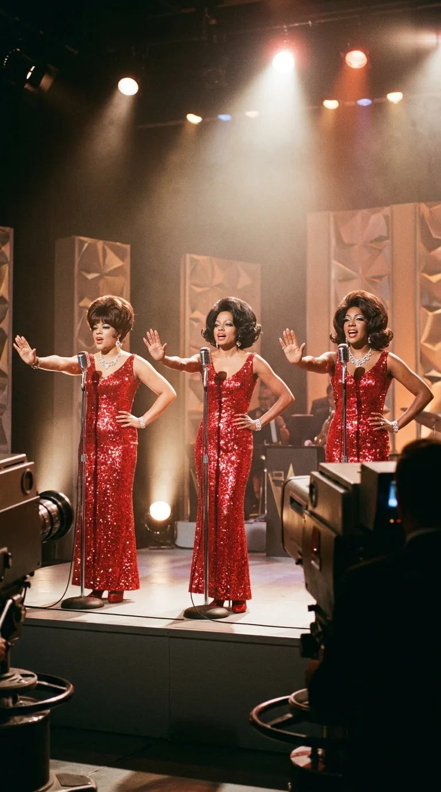
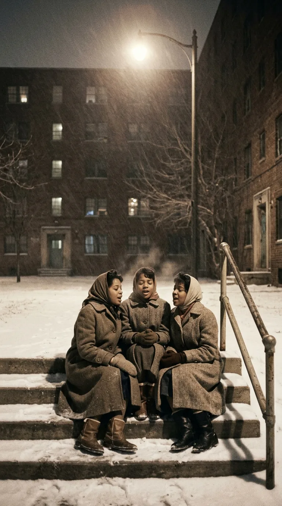
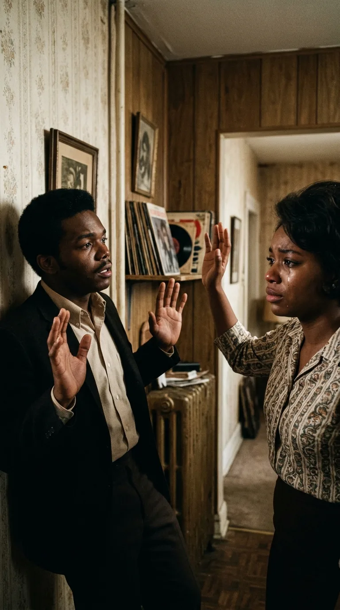
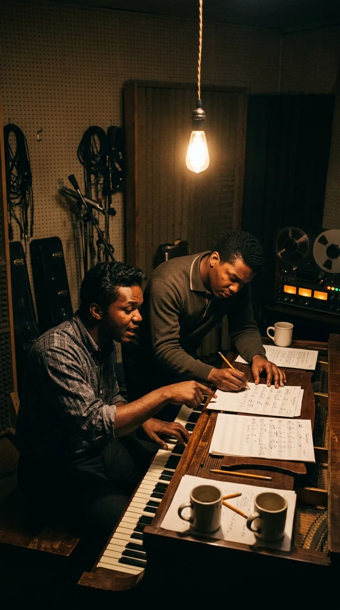
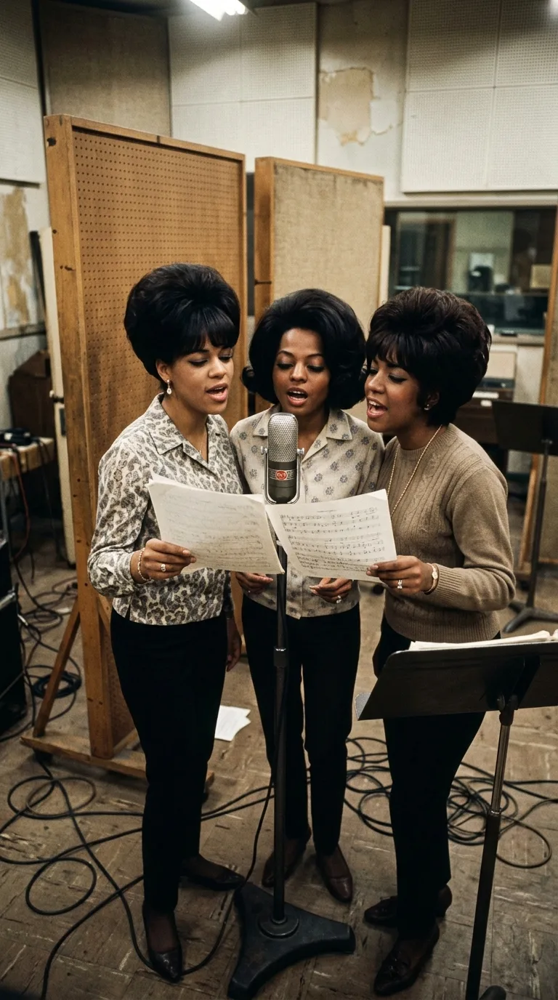
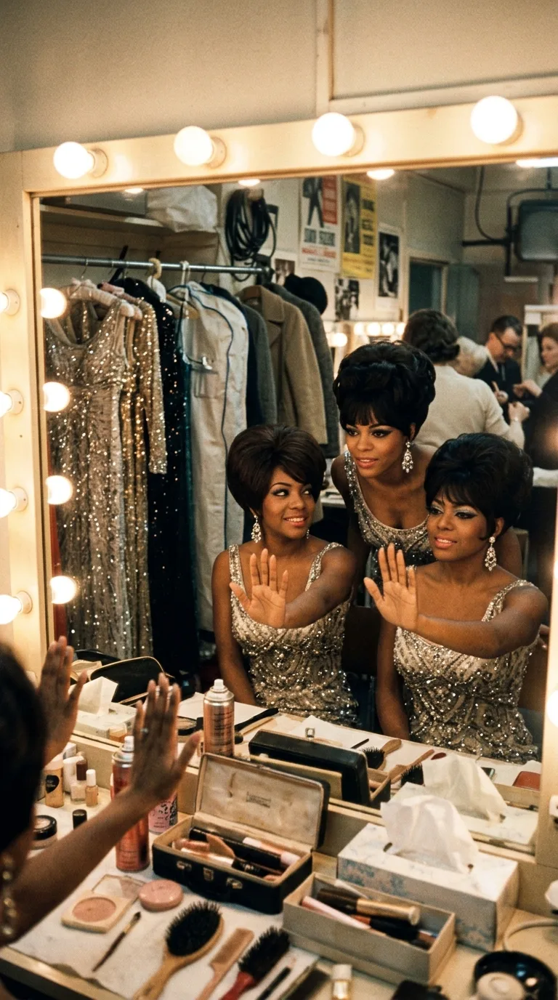

# El Ruego que Paró un Golpe: La Verdadera Historia Detrás de «Stop! In the Name of Love»

> *«Stop! In the name of love, before you break my heart... Think it over, haven't I been good to you?»*  
> — **The Supremes** (Composición de Holland–Dozier–Holland)

---

### Prólogo: La fiesta bailable que ocultaba una herida

Durante más de seis décadas, el mundo entero ha bailado al compás de *«Stop! In the Name of Love»*. Pocas canciones en la historia de la música popular poseen una entrada tan arrolladora: ese redoble de batería seguido por el acorde de órgano y tres voces femeninas que irrumpen a capela antes de que cualquier instrumento tome el control. Millones de personas han alzado la palma de la mano al frente en fiestas, conciertos y programas de televisión imitando su icónica coreografía.

Sin embargo, detrás del brillo de las lentejuelas, los peinados impecables y la elegancia coreografiada de The Supremes, se esconde una de las paradojas emocionales más intensas de la era dorada de Motown. Aquella melodía eufórica no nació para celebrar el amor; nació de la humillación, del miedo a la soledad y de una súplica desesperada pronunciada al borde de una bofetada.

Fue el grito de quien ve a la persona que ama arreglarse frente al espejo para marcharse con otra, y comprende que lo único que le queda entre las manos es el ruego desgarrador de pedirle que se detenga antes de romperle el corazón para siempre.

---

### Acto I: Tres niñas en los bloques de Brewster

Para entender la vibración emocional que The Supremes imprimían a cada nota, es necesario retroceder a los duros inviernos de Detroit a finales de los años cincuenta. Diana Ross, Florence Ballard y Mary Wilson no nacieron entre lujos. Eran tres adolescentes que crecieron en los austeros apartamentos de protección oficial de Brewster-Douglass Projects, una barriada obrera donde la música era el único pasaporte hacia la dignidad.

Florence Ballard, la más rebelde y talentosa vocalmente, fundó el grupo bajo el nombre de The Primettes. Compartían vestidos remendados, ensayaban en las escaleras comunitarias para aprovechar la acústica del hormigón y soñaban con grabar en un modesto edificio de dos plantas en West Grand Boulevard: *Hitsville U.S.A.*, el cuartel general de Berry Gordy.

Cuando finalmente firmaron con Motown en 1961, nadie apostaba por ellas. Durante casi tres años acumularon fracaso tras fracaso en las listas, ganándose el cruel apodo de *«las Supremes sin éxito»*. Pero en lugar de rendirse, aquel rechazo forjó entre las tres una hermandad a prueba de balas. Cuando el éxito finalmente estalló en 1964 con una seguidilla histórica de números uno, el trío parecía indestructible. Sin embargo, en los despachos de la discográfica comenzaban a tejerse decisiones empresariales que, años más tarde, terminarían fracturando aquella inocencia juvenil.

---

### Acto II: La tormenta íntima de Lamont Dozier

A finales de 1964, el hombre detrás de los mayores éxitos de Motown, el compositor Lamont Dozier, atravesaba su propio laberinto sentimental. Formaba una sociedad creativa imbatible junto a los hermanos Brian y Eddie Holland, trabajando jornadas agotadoras de más de dieciséis horas diarias en el estudio. Pero en el terreno personal, su vida afectiva se tambaleaba.

Una noche, en su apartamento de Detroit, una agria discusión de pareja estalló sin previo aviso. Su novia lo confrontó con amargura, acusándolo de desatención y de mantener un romance secreto a sus espaldas. Los reproches subieron de tono con una violencia desmedida. La mujer, herida en su amor propio y desbordada por las lágrimas, levantó el brazo dispuesta a cruzarle la cara de una bofetada y marcharse dando un portazo que pondría punto final a la relación.

Acorralado contra la pared, en un reflejo puramente instintivo de supervivencia y vulnerabilidad, Dozier levantó las manos abiertas y gritó con la voz rota:  
*«¡Stop! In the name of love... before you break my heart!»* *(¡Detente! En nombre del amor... ¡antes de que me rompas el corazón!)*

La habitación quedó en un silencio sepulcral. La mujer bajó el brazo, desconcertada por la teatralidad involuntaria de la frase, y la tensión se disolvió en una risa nerviosa. Pero en la mente de Dozier, el músico devoró al hombre: comprendió de inmediato que aquellas palabras contenían una verdad humana universal. Sin perder un minuto, bajó las escaleras y condujo a toda velocidad hacia *Hitsville U.S.A.*

---

### Acto III: El ruego grabado en el Studio A

Al llegar al cuartel general de Motown en plena madrugada, Dozier despertó a Brian Holland. Sentados frente al piano vertical del *Studio A*, comenzaron a tejer la melodía. Brian encontró una progresión rítmica implacable, casi marcial, mientras Eddie Holland daba forma a los versos: la historia de una mujer que observa en silencio cómo su amante se viste para acudir a una cita con otra persona, soportando la frialdad de sus caricias y rogándole que recuerde todo lo vivido antes de destruirlo todo.

En enero de 1965, The Supremes entraron a la cabina de grabación. Con la base instrumental grabada por los legendarios músicos de sesión The Funk Brothers —sostenida por el bajo elástico de James Jamerson y unas campanas tubulares que sonaban como alarmas de auxilio—, Diana Ross se plantó frente al micrófono.

La interpretación de Diana no fue la de una diva altiva; fue la de una mujer suplicante. Cuando canta con un hilo de voz *«Think it over... haven't I been sweet to you? Haven't I been good to you?»*, se percibe la desolación de quien sabe que la partida es inevitable. Por detrás, las armonías de Florence Ballard y Mary Wilson respondían como un coro griego, amplificando el dolor de la traición silenciosa.

---

### Acto IV: La palma al frente y las lágrimas tras bambalinas

El sencillo salió a la calle el 8 de febrero de 1965. En cuestión de tres semanas, escaló hasta el número uno del Billboard Hot 100, convirtiendo a The Supremes en el primer grupo de la historia en encadenar cuatro números uno consecutivos en Estados Unidos.

Poco después, durante su primera gira promocional por el Reino Unido, el trío se encontraba en los camerinos de los estudios de televisión de Londres antes de actuar en el mítico programa *Ready Steady Go!*. Nerviosas por no tener una rutina definida para la televisión británica, ensayaron junto a The Temptations un gesto instintivo: una mano alzada con la palma abierta al frente marcando el alto, y la otra posada sobre la cadera, conteniendo el temblor del cuerpo.

Aquella coreografía elemental se convirtió en un símbolo global. Cuando The Supremes extendían la mano en televisión, no estaban haciendo un paso de baile; estaban levantando un muro contra el abandono.

Sin embargo, el destino guardaba una nota amarga. Mientras el planeta entero coreaba el tema, las tensiones internas en el seno de la banda comenzaban a devorarlas. Florence Ballard, la muchacha que había iniciado el sueño en los suburbios de Detroit, veía cómo la maquinaria de Motown la relegaba sistemáticamente a la sombra de Diana Ross. Apenas dos años después, Florence sería expulsada del grupo, cayendo en una espiral de depresión y pobreza que culminaría con su trágica muerte en 1976 con solo treinta y dos años. Aquel ruego de *«Stop!»* parecía un presagio del naufragio que nadie supo detener.

---

### Epílogo: El muro que detiene el adiós

*«Stop! In the Name of Love»* sigue estremeciendo las pistas de baile y los corazones más de medio siglo después porque no es una pieza arqueológica de pop ligero. Es el testimonio sonoro de ese instante exacto en que el amor pende de un hilo, de ese segundo aterrador en el que una persona sabe que está a punto de ser reemplazada y apela al último reducto de piedad que le queda al corazón humano.

Una plegaria que nació de una discusión de alcoba en una noche fría de Detroit y que, gracias a la voz de tres muchachas de barrio humilde, se transformó en el ruego más hermoso y contagioso de la historia del soul.

---

### 💬 La Pregunta a la Comunidad

¿Qué recuerdo o momento de tu vida te trae el sonido inconfundible de The Supremes? ¿Conocías la tensa discusión real que dio origen a este himno? Te leemos en los comentarios.

---

### 📚 Fuentes y Archivo Documental
* **Dozier, Lamont**: *How Sweet It Is: A Songwriter's Reflections on Motown, Motown, and Life* (BMG Books, 2019). Relato autobiográfico detallado sobre la disputa doméstica y la composición del tema.
* **Wilson, Mary**: *Dreamgirl: My Life as a Supreme* (St. Martin's Press, 1986). Memorias oficiales sobre la infancia en Brewster-Douglass y las grabaciones en Hitsville U.S.A.
* **Gordy, Berry**: *To Be Loved: The Music, the Magic, the Memories of Motown* (Warner Books, 1994).
* **Posner, Gerald**: *Motown: Music, Money, Sex, and Power* (Random House, 2002).
* **Archivos Históricos de Motown Records (1964-1965)**: Hojas de sesión del Studio A, registros de derechos de autor y certificaciones de ventas de la RIAA.
