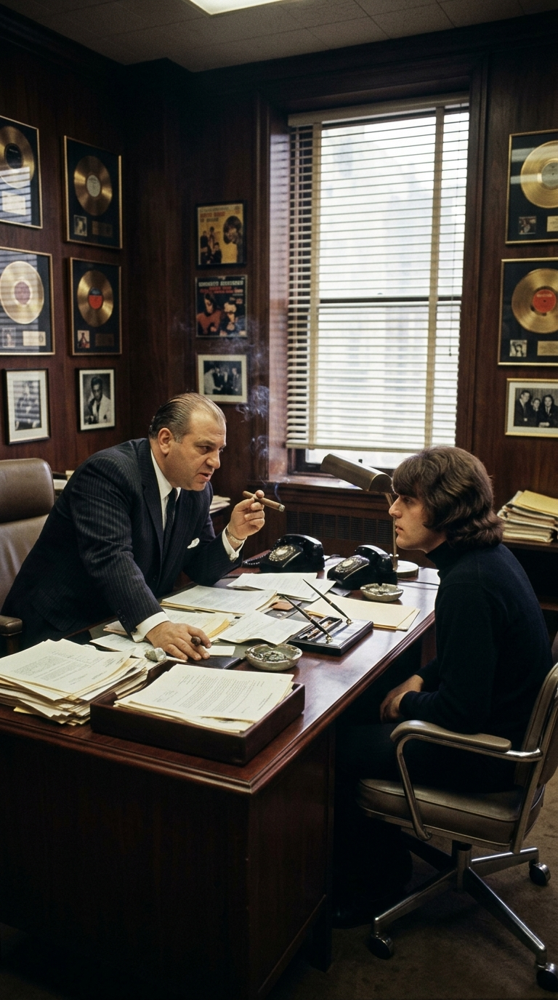
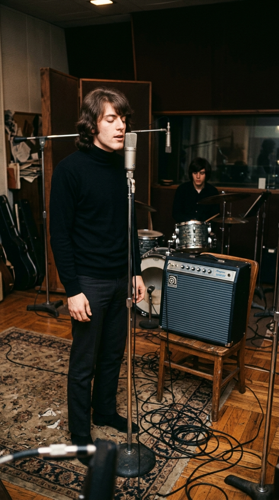
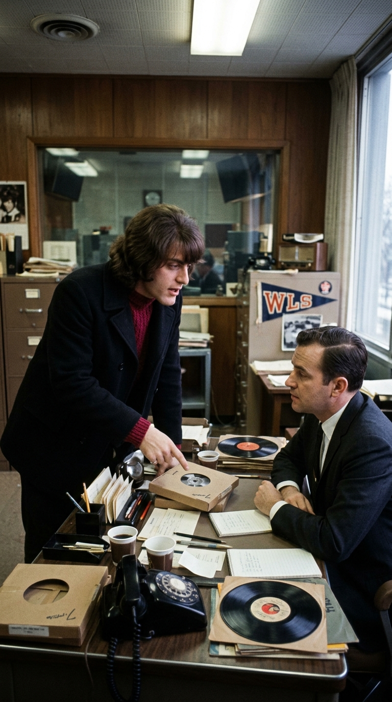
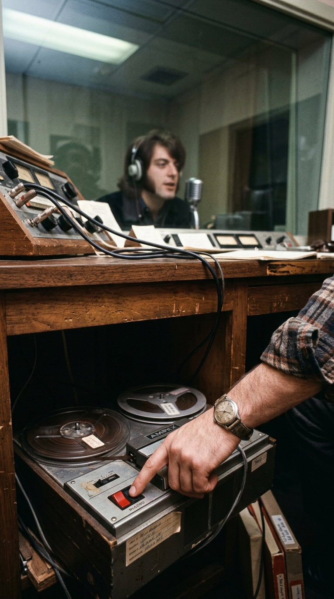
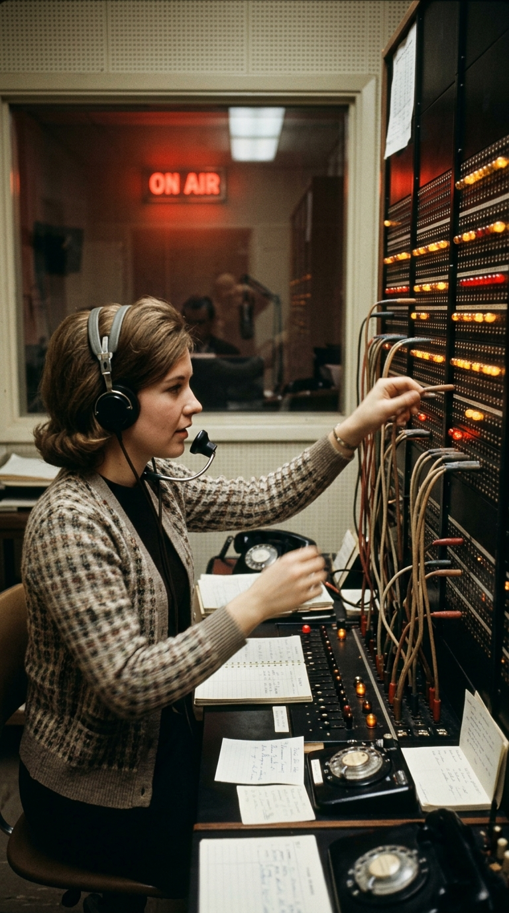
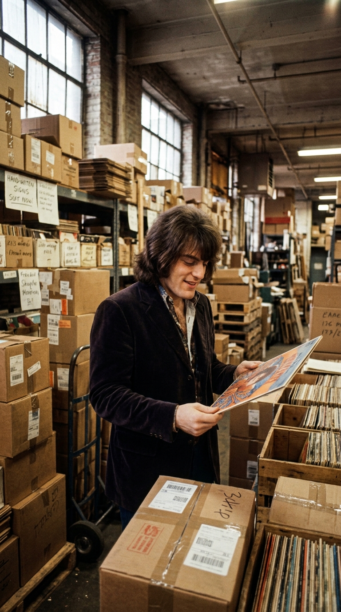

# El secreto detrás de «Crimson and Clover»: Dos palabras al despertar, la mafia y una cinta robada

*A finales de 1968, con apenas veintiún años, el músico estadounidense Tommy James vivía atrapado dentro de una disquera neoyorquina controlada por la familia mafiosa Genovese. En medio de la presión por entregar un nuevo éxito que financiara las operaciones del sello y le permitiera ser tomado en serio como artista, despertó una mañana con dos palabras flotando en su mente y grabó un borrador preliminar que una emisora de Chicago copió a escondidas, transformando una canción inacabada en un clásico de cinco millones y medio de copias.*

---

### I. El pacto involuntario con el «padrino» de Broadway

La historia de **«Crimson and Clover»** no puede comprenderse sin el laberinto en el que había caído su autor dos años antes. En la primavera de 1966, cuando **Tommy James** (nacido Thomas Gregory Jackson en 1947 y criado en Niles, Michigan) viajó a Nueva York con diecinueve años tras el sorpresivo estallido regional de su sencillo *«Hanky Panky»*, las principales compañías discográficas del país —entre ellas CBS, Atlantic y RCA— se disputaron su contrato en menos de veinticuatro horas.

Sin embargo, a la mañana siguiente, todos los ejecutivos retiraron sus ofertas de manera repentina y en absoluto silencio. La razón tenía nombre y apellido: **Morris Levy**, fundador y presidente de **Roulette Records**, cuyas oficinas en el 1631 de Broadway funcionaban como centro financiero y fachada discográfica de la **familia criminal Genovese**, encabezada entonces por Thomas «Tommy Ryan» Eboli y Vincent «The Chin» Gigante. Levy había llamado personalmente a los directivos de las demás disqueras para advertirles que aquel muchacho le pertenecía.

Como documentó el propio Tommy James en sus memorias de 2010 (*Me, the Mob, and the Music*), firmar con Roulette Records significaba entrar en un territorio sin salida: los discos del grupo vendían millones de ejemplares y sonaban en todo el continente, pero las regalías desaparecían en la contabilidad del sello, y cualquier intento de reclamar el dinero adeudado o cambiar de compañía ponía en riesgo directo la vida de los músicos.

---

### II. Dos palabras en la penumbra del amanecer

A mediados de **1968**, tras encadenar éxitos de corte juvenil como *«I Think We're Alone Now»* y *«Mony Mony»*, y después de recorrer Estados Unidos participando en la campaña presidencial del vicepresidente Hubert Humphrey, Tommy James tenía veintiún años y sentía que su carrera corría el riesgo de quedar encasillada para siempre en el *bubblegum pop* adolescente. Necesitaba dar un giro hacia un sonido maduro, envolvente y psicodélico, y convenció a Morris Levy —quien urgía efectivo inmediato tras las pérdidas de un proyecto cinematográfico fallido— de que le permitiera producir y escribir su propio material junto al baterista de la banda, **Peter Lucia**.

La chispa nació sin instrumentos ni partituras. Una mañana de otoño de 1968, en el instante exacto en que salía del sueño en su apartamento de Manhattan antes de abrir los ojos, dos palabras cruzaron su mente unidas por su pura musicalidad: ***«Crimson»*** (*carmesí*, su color favorito) y ***«Clover»*** (*trébol*, su flor preferida). Tommy se incorporó en la cama y las anotó de inmediato en una libreta. No significaban nada literal todavía, pero evocaban una atmósfera de ensueño, misterio y deseo juvenil alrededor de la cual comenzó a construir, junto a Peter Lucia, una cadencia lenta de guitarra con trémolo que rompía con todo lo que habían grabado hasta entonces.

---

### III. Cinco horas en Allegro Sound y la voz bajo el agua

A finales de 1968, Tommy James y The Shondells entraron a los **Allegro Sound Studios** de Nueva York con el ingeniero **Bruce Staple** al mando de una nueva consola de dieciséis pistas. Durante una sesión nocturna de unas cinco horas, Tommy grabó la guitarra principal, el bajo y las voces sobre una estructura todavía incompleta: como aún no había terminado de escribir la segunda estrofa ni el puente definitivo, rellenó la parte central con silencios dramáticos, redobles de batería y coros provisionales (*«Yeah, my mind's such a sweet thing...»*).

Para la sección final de la pieza —cuando se repite hipnóticamente *«Crimson and clover, over and over»*—, Tommy buscaba que su voz sonara como si estuviera sumergida en un sueño. En lugar de utilizar un procesador de estudio convencional, pidió al ingeniero Bruce Staple que conectara el micrófono vocal directamente a la entrada de un amplificador de guitarra **Ampeg** con el efecto de trémolo activado al mismo pulso de la canción, enviando la señal desde la salida del amplificador hacia la consola de grabación. Al terminar la jornada al amanecer, sacaron una **mezcla preliminar en cinta (*rough mix*)** únicamente para llevársela a casa y decidir qué versos le añadirían en la siguiente sesión.

---

### IV. La trampa en la radio WLS de Chicago

En diciembre de 1968, tras ofrecer un concierto en las afueras de Chicago, Tommy James hizo una visita de cortesía a las oficinas de **WLS 890 AM**, una de las emisoras de cincuenta mil vatios más influyentes del medio oeste estadounidense, dirigida por el programador **John Rook**.

Entusiasmado con el nuevo rumbo sonoro de su banda, Tommy sacó del bolsillo de su abrigo el carrete con la mezcla preliminar de *«Crimson and Clover»* y pidió reproducirla en privado en una sala de escucha, advirtiendo expresamente a los directivos que se trataba de un borrador inacabado al que todavía le faltaban estrofas y ajustes de mezcla, y haciéndoles prometer que bajo ninguna circunstancia lo grabarían ni lo pondrían al aire.

Lo que el músico de veintiún años no advirtió fue que, mientras su cinta giraba en el reproductor de la sala, en la cabina contigua habían encendido a escondidas una segunda grabadora de carrete conectada en línea para copiar el audio íntegro. Al día siguiente, mientras Tommy regresaba en avión hacia Nueva York, la emisora WLS comenzó a transmitir aquella copia clandestina anunciándola a todo volumen como una «primicia mundial exclusiva».

---

### V. El borrador que vendió cinco millones y medio de copias

El efecto en la audiencia de Chicago fue inmediato y arrollador. En cuestión de minutos, la central telefónica de WLS colapsó con miles de llamadas de oyentes hipnotizados por aquella melodía de guitarra trémula y aquella voz ondulante que no se parecía a nada de lo que sonaba en la radio a finales de 1968.

En menos de cuarenta y ocho horas, los distribuidores de discos de Illinois inundaron de pedidos las oficinas de Roulette Records en Manhattan exigiendo decenas de miles de copias de una canción que formalmente ni siquiera estaba terminada. Cuando Tommy James acudió al despacho de Morris Levy para explicarle que necesitaba entrar de nuevo al estudio para completar la letra y pulir la mezcla definitiva, el jefe de Roulette se lo prohibió tajantemente: ordenó prensar y enviar a las tiendas exactamente el mismo **borrador preliminar** que había enloquecido a Chicago.

Lanzada comercialmente a finales de diciembre de 1968, **«Crimson and Clover»** alcanzó el **puesto número 1 del *Billboard Hot 100*** el 1 de febrero de 1969 —permaneciendo en la cima en Estados Unidos, Reino Unido (en listas independientes), Alemania, Suiza, Canadá y Nueva Zelanda— y vendió **más de 5,5 millones de copias**, convirtiéndose en el sencillo más exitoso en la historia de Roulette Records y siendo inmortalizada nuevamente en 1982 por la versión de **Joan Jett and the Blackhearts**.

Aunque la red mafiosa de Morris Levy retuvo durante décadas cerca de treinta y cinco millones de dólares en regalías pertenecientes a Tommy James —fondos que el músico solo pudo empezar a recuperar tras el fallecimiento de Levy en 1990 y la posterior venta del catálogo a Universal y Rhino Records—, aquel sueño nacido al despertar demostró que, incluso en medio de las sombras más peligrosas de la industria, la sensibilidad de un artista de veintiún años fue capaz de crear una belleza que el tiempo jamás pudo borrar.

---

### 📚 Fuentes y Archivo Documental

* **James, Tommy & Fitzpatrick, Martin (2010).** *Me, the Mob, and the Music: One Helluva Ride with Tommy James & The Shondells*. Scribner / Simon & Schuster, Nueva York. (Testimonio autobiográfico directo sobre el control de Morris Levy y la familia Genovese en Roulette Records, la concepción del título «Crimson and Clover» al despertar, la grabación en Allegro Sound Studios y la copia secreta realizada en la emisora WLS de Chicago en diciembre de 1968).
* **Carlin, Richard (2016).** *Godfather of the Music Business: Morris Levy*. University Press of Mississippi. (Documentación histórica y judicial sobre las operaciones de Roulette Records, sus vínculos con Thomas Eboli y Vincent Gigante, y la retención sistemática de regalías a sus artistas).
* **Bronson, Fred (2003).** *The Billboard Book of Number One Hits*. Billboard Books. (Ficha hemerográfica y entrevista con Tommy James y el ingeniero Bruce Staple sobre el uso del amplificador Ampeg para el trémolo vocal y el ascenso al número 1 el 1 de febrero de 1969).
* **Archivos de WLS 890 AM Chicago (Diciembre de 1968 - Enero de 1969).** Registros de programación de John Rook y listas *Silver Dollar Survey* de Chicago donde debutó la copia preliminar de «Crimson and Clover».
