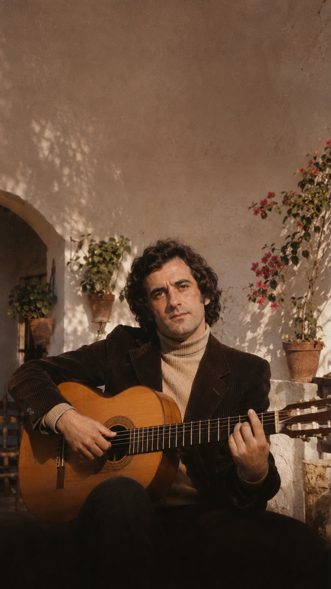

# El amor que un periódico salvó del olvido: La verdadera historia de «Sólo pienso en ti»

**Por Acordes Ocultos**  
*Tiempo estimado de lectura: 6 minutos*

---

## Prólogo: La mesa de madera en Montilla

Una tarde húmeda y fría de noviembre de 1978, un joven cantautor de treinta y un años mataba el tiempo en una modesta cafetería de Montilla, en el corazón de la provincia de Córdoba. Se llamaba Víctor Manuel y esperaba la hora de subirse a un escenario en el vecino pueblo de Aguilar de la Frontera. Sobre la mesa, junto a una taza de café ya templada, descansaba un ejemplar recién impreso del *Diario de Córdoba*.

El artista comenzó a pasar las páginas sin un rumbo fijo, devorando noticias locales de siembras, convenios agrícolas y avisos de provincia, hasta que su mirada se detuvo en seco ante un reportaje especial. El titular hablaba de una institución llamada PROMI, una residencia y escuela fundada en la localidad cordobesa de Cabra para acoger, educar e integrar a jóvenes con discapacidad intelectual.

Al final de aquella crónica periodística, una escena breve y desgarradoramente hermosa iluminaba la página en blanco y negro: dos internos del centro, ajenos al ruido del mundo y a los prejuicios de una España que despertaba de la dictadura, paseaban en silencio de la mano por los senderos de naranjos del jardín.

Se llamaban Antonio y Mari Luz.

Aquella imagen cotidiana y luminosa no solo conmovió a Víctor Manuel hasta las lágrimas; encendió en su pecho una melodía urgente que cambiaría para siempre la historia social y musical de un país.

---

## Acto I: Dos vidas marcadas por la fragilidad

Para comprender el calado de aquel paseo por el jardín, es imprescindible asomarse al doloroso abismo que la sociedad española reservaba en los años sesenta y setenta a quienes nacían o crecían con una diversidad funcional.

Mari Luz había llegado al mundo sana y vivaz en una familia humilde. Sin embargo, cuando apenas era una bebé de pocos meses, la fatalidad quebró su destino: en un instante fortuito, se resbaló de las manos de su padre y cayó contra el suelo. El golpe le provocó un traumatismo craneoencefálico severo con secuelas neurológicas irreversibles. Desde aquella mañana amarga, la niña creció arrastrando una dificultad cognitiva que sus padres, desgarrados por la culpa y la falta de recursos de la época, no sabían cómo afrontar.

El origen de Antonio estaba envuelto en una tristeza aún más punzante. Nacido con una discapacidad intelectual congénita, padeció la incomprensión feroz de un entorno familiar que sentía su condición como una deshonra o un estigma insalvable. Incapaces de asumir su crianza y presionados por el qué dirán de los pueblos cerrados de la posguerra, sus allegados decidieron recluirlo desde muy joven en un sanatorio, apartándolo de la vista de todos como a un pariente al que se prefiere dar por olvidado.

Dos seres humanos a los que la vida parecía haber negado cualquier promesa de afecto, compañía o futuro.

---

## Acto II: El oasis de Cabra y el florecer de un milagro

A finales de la década, el doctor Juan Pérez Marín y un grupo de pedagogos y familias decidieron desafiar la psiquiatría arcaica de la época fundando PROMI en Cabra. Frente al modelo manicomial de reclusión y sedación, PROMI apostó por la dignidad: enseñar oficios, talleres de carpintería, horticultura, música y convivencia comunitaria.

Allí ingresaron Antonio y Mari Luz. Y allí, entre virutas de madera, mesas de comedor compartidas y paseos al atardecer, ocurrió el prodigio.

Antonio, retraído y silencioso tras años de abandono, comenzó a buscar con timidez la mirada de Mari Luz. Ella, con una inocencia desarmante y una sonrisa limpia capaz de disipar cualquier penumbra, le devolvió el gesto. Pronto, la complicidad se transformó en un amor sereno, paciente y sin dobleces. No necesitaban palabras grandilocuentes: les bastaba encontrarse en el patio, entrelazar los dedos y caminar juntos sintiendo el calor de la piel del otro.

Pero en la España de 1978, aquel amor chocaba de frente contra un muro invisible. La doctrina médica conservadora, las familias y las leyes de tutela consideraban que las personas con discapacidad intelectual carecían de derecho a la vida afectiva, al noviazgo y a la sexualidad. La idea de que dos internos pudieran considerarse pareja despertaba murmullos, alarmas morales e intentos de separación.

---

## Acto III: La composición hacia atrás

Cuando Víctor Manuel terminó de leer el reportaje en el café de Montilla, sintió un nudo en la garganta. La frase final del periodista describiendo a Antonio y Mari Luz de la mano era tan rotunda que el cantautor decidió hacer lo contrario de lo que suele hacer un letrista: en lugar de avanzar la historia, decidió componer la canción «hacia atrás».

*«Partí de esa imagen final de los dos caminando por el jardín y me puse a imaginar cómo habían llegado hasta allí, de dónde venían sus heridas y qué dolores cargaban en el alma»*, recordaría años después el músico asturiano.

Esa misma noche, en la soledad de una habitación de hotel y con su guitarra acústica entre los brazos, Víctor Manuel hilvanó los versos con una hondura lírica insuperable:

> *«Él nació de pie, le desahució el cariño de su propia piel...  
> Ella tiene luz de hacer amanecer, se le resbaló al padre una mañana...»*

La canción no era una mirada compasiva desde la lástima; era un himno a la victoria de la dignidad y a la pureza de un sentimiento que no entendía de expedientes clínicos ni diagnósticos. El estribillo estallaba como una declaración de libertad inapelable: *«Juntos de la mano se les ve por el jardín... no puede haber nadie en este mundo tan feliz»*.

---

## Acto IV: La batalla legal y el himno que derribó los muros

Registrada e incluida en su álbum *Soy un corazón tendido al sol* (1979), editado por CBS, «Sólo pienso en ti» se convirtió de inmediato en un fenómeno cultural sin precedentes. Alcanzó el número uno en las listas de ventas de toda España e Iberoamérica, sonó en las emisoras de radio día y noche y llevó a Víctor Manuel a actuar en los principales platós de televisión.

Pero el mayor impacto no fue discográfico, sino humano. La canción situó por primera vez en el debate público español una realidad hasta entonces invisibilizada: el derecho fundamental de las personas con discapacidad intelectual a amar, casarse y forjar su propio destino.

Inspirados por el aliento que la canción y el centro PROMI les brindaban, Antonio y Mari Luz decidieron dar el paso decisivo: casarse. No fue un camino fácil. Tuvieron que enfrentar reticencias legales sobre su capacidad civil y acudir al obispado para sortear los impedimentos canónicos que prohibían el sacramento matrimonial a personas con lesiones cognitivas. 

Su convicción inquebrantable, respaldada por la dirección del centro y el eco de la canción, doblegó las resistencias. Se celebró la boda y, poco después, Antonio y Mari Luz se mudaron a su propia vivienda tutelada.

---

## Epílogo: La vida después del mito

Lejos de los focos y la fama pasajera, la historia real de Antonio y Mari Luz no terminó con los aplausos de 1979. A lo largo de las décadas siguientes, construyeron un hogar auténtico, lleno de trabajo, respeto mutuo y alegría.

Tuvieron tres hijos, a los que criaron con entrega y esfuerzo cotidiano. Uno de ellos, con el orgullo de toda la familia, completó sus estudios superiores en la Universidad de Córdoba, demostrando de manera inapelable que el amor y la constancia de unos padres están infinitamente por encima de cualquier prejuicio médico.

Décadas más tarde, en múltiples homenajes y encuentros públicos, Víctor Manuel ha vuelto a abrazar en el escenario a Antonio y Mari Luz, con el pelo ya blanco y las manos curtidas por el tiempo, pero con la misma mirada limpia con la que un día de 1978 decidieron desafiar al mundo.

«Sólo pienso en ti» nos recuerda que no hay mayor revolución que la ternura, y que cuando dos personas deciden amarse con el alma desnuda, no existe muro humano capaz de apagar su luz.

---

### 📚 Fuentes y Archivo Documental

* **Hemeroteca Diario de Córdoba (Noviembre de 1978)**: Crónica original de la Fundación PROMI en Cabra (Córdoba).
* **Víctor Manuel**: *Antes de que sea tarde* (Memorias, Editorial Aguilar, 2015). Testimonio autobiográfico sobre el proceso de composición y su relación con Antonio y Mari Luz.
* **Archivos Documentales de TVE y Canal Sur**: Programas especiales y entrevistas testimoniales a Antonio, Mari Luz y los fundadores de PROMI.
* **Discografía Oficial**: Álbum *Soy un corazón tendido al sol* (CBS Records, 1979). Producción de Danilo Vaona.
