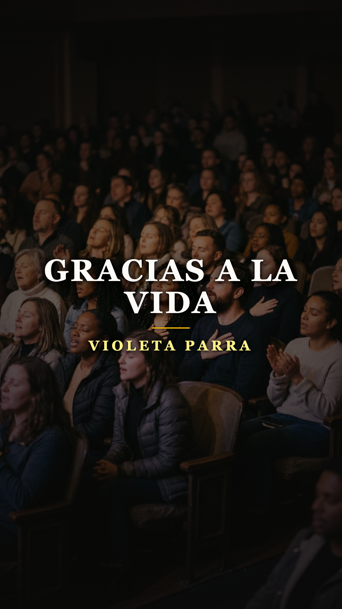
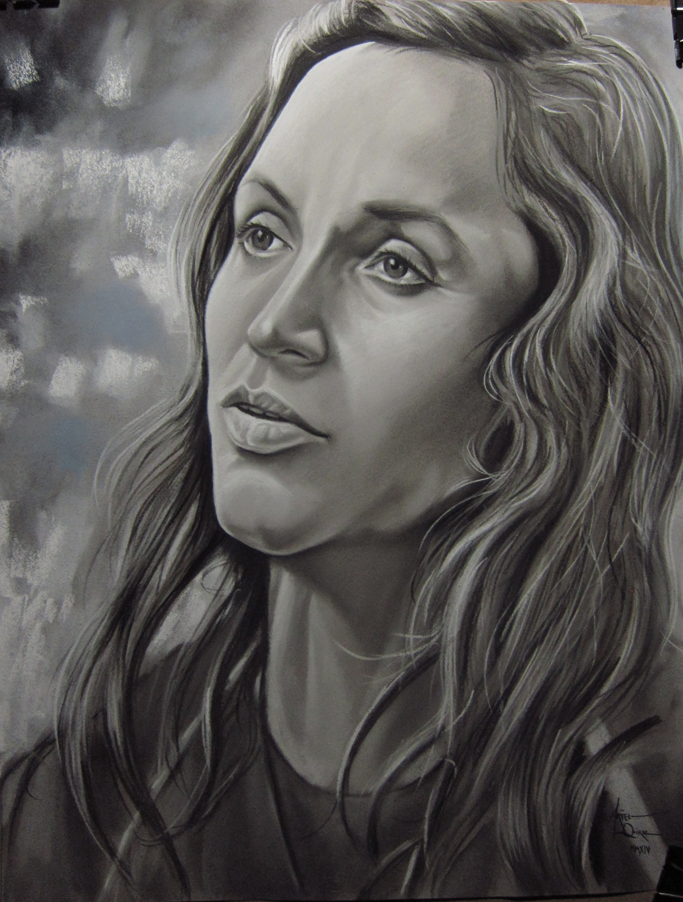
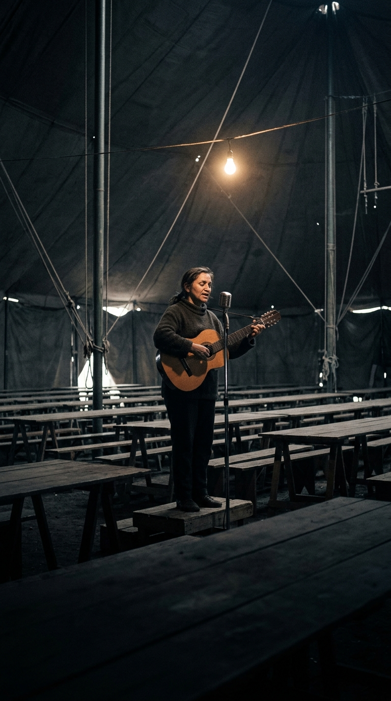

# Escribió la canción más hermosa sobre vivir cuando ya había decidido marcharse

**Por el equipo editorial de Acordes Ocultos**

---

> *«Gracias a la vida que me ha dado tanto / Me dio dos luceros que cuando los abro / Perfecto distingo lo negro del blanco / Y en el alto cielo su fondo estrellado / Y en las multitudes el hombre que yo amo...»*

En cualquier rincón del mundo hispanohablante, los primeros compases del charango de **«Gracias a la vida»** son recibidos como una plegaria de gratitud universal. Decenas de intérpretes legendarias —desde Mercedes Sosa y Joan Baez hasta Elis Regina— la han entonado ante estadios abarrotados, convirtiéndola en un himno de resistencia, esperanza y afirmación vital. Para generaciones de oyentes, la letra representa el triunfo del espíritu humano sobre las tinieblas: un canto luminoso que celebra los sentidos, la belleza del paisaje y la bendición de existir.

Sin embargo, detrás de cada uno de sus versos late la paradoja más desgarradora en la historia de la música popular. Violeta Parra no compuso esta obra desde la euforia ni desde la serenidad del triunfo. La concibió en el invierno más crudo de su existencia, sumida en la indigencia, el aislamiento y el desamor, bajo una carpa de circo batida por el viento frío en la periferia de Santiago de Chile.

No era una fiesta: era un inventario final. Una carta de despedida de dignidad sobrehumana, redactada por una mujer que ya había tomado la decisión irrevocable de marcharse para siempre.

---

## Acto I: La utopía de barro en La Reina (1965-1966)

En diciembre de 1965, tras regresar de Europa donde había alcanzado el hito histórico de exponer sus tapices y arpilleras en el prestigioso Museo de Artes Decorativas del Palacio del Louvre en París, Violeta Parra soñó con su mayor obra comunitaria. Convenció al alcalde de La Reina, Fernando Castillo Velasco, de que le cediera un terreno baldío en la calle Cañada, en los faldeos precordilleranos de Santiago.

Allí levantó una inmensa carpa de circo con capacidad para mil personas. Su visión era tan colosal como ingenua: fundar una «Universidad del Folclore», un centro vivo donde campesinos, poetas, artesanos y estudiantes compartieran vino, empanadas recién horneadas, cantos tradicionales y saberes ancestrales sin intermediarios comerciales.

Pero la realidad santiaguina fue implacable. El invierno de 1966 fue feroz, transformando el descampado de La Reina en un barrizal impenetrable. La clase media y la bohemia intelectual de la capital rara vez hacían el largo viaje hasta los suburbios cordilleranos. En noches heladas donde el frío traspasaba la lona, Violeta y sus hijos cantaban con las manos entumecidas ante dos o tres parroquianos desconcertados, o frente a hileras de tablones desiertos. 

La ruina financiera se volvió asfixiante. Las deudas se multiplicaban, la luz se cortaba y Violeta cocinaba en precariedad absoluta, devorada por una profunda sensación de incomprensión y abandono colectivo.

---

## Acto II: El desarraigo de Gilbert Favre y el dolor sin cura

A la catástrofe económica se sumó el derrumbe de su refugio emocional. Durante años, Violeta había compartido una intensa pasión creativa con el antropólogo y musicólogo suizo **Gilbert Favre** («el gringo»), a quien había conocido en Santiago y con quien vivió en Ginebra y París. Favre tocaba la quena y compartía su devoción por el folclore andino.

Sin embargo, a comienzos de 1966, la relación se fracturó. Favre decidió marcharse a Bolivia, instalándose en La Paz para fundar el conjunto folclórico *Los Jairas* en la famosa peña Naira. Desesperada por el vacío que dejaba su partida, Violeta viajó a Bolivia a mediados de ese año para intentar recuperarlo. El encuentro fue devastador: descubrió que Gilbert ya había rehecho su vida sentimental junto a una mujer boliviana y que su historia en común estaba definitivamente muerta.

La compositora regresó a Santiago con el alma hecha pedazos. Quienes la vieron en aquellos meses relataron cómo caminaba descalza sobre la tierra húmeda de la carpa, sumida en silencios interminables, con la mirada extraviada en las brasas de un brasero humeante. Su hija Isabel Parra recordaría más tarde que la vitalidad arrolladora de su madre se había transformado en una fragilidad transparente.

---

## Acto III: El inventario de gratitud y *Las últimas composiciones*

Fue precisamente en ese abismo emocional donde la grandeza poética de Violeta Parra se elevó por encima de la tragedia cotidiana. Entre agosto y octubre de 1966, en una modesta sala de grabación de RCA Victor en Santiago, grabó las canciones de su álbum definitivo: **«Las últimas composiciones de Violeta Parra»**. El título, elegido por ella misma, poseía una sobrecogedora carga premonitoria que nadie en su entorno supo descifrar a tiempo.

En ese disco convivían temas de una furia desgarradora como *«Maldigo del alto cielo»* con joyas de pura melancolía como *«Volver a los 17»* y *«Run Run se fue pa'l norte»*. Pero la cumbre del álbum fue **«Gracias a la vida»**, estructurada en estrofas solemnes de arte menor que evocaban las décimas campesinas y los rezos antiguos.

En lugar de maldecir la soledad o reprochar al amor esquivo, Violeta realizó una ofrenda de despedida:
* Dio gracias por los **dos luceros** (los ojos) que le permitieron distinguir el bien del mal, el fondo estrellado del cielo y el rostro del hombre que amó.
* Dio gracias por el **oído**, que grabó en su memoria nocturna los grillos, los canarios, los martillos, los chubascos y la voz tierna del amado.
* Dio gracias por el **sonido y el abecedario**, las palabras que le permitieron nombrar a su madre, a sus amigos y alumbrar el camino del alma.
* Dio gracias por la **marcha de sus pies cansados**, que recorrieron quebradas, llanos y ciudades.
* Y finalmente dio gracias por el **corazón**, que temblaba al contemplar el fruto del cerebro humano y distinguir la dicha del quebranto:

> *«Gracias a la vida que me ha dado tanto / Me ha dado la risa y me ha dado el llanto / Así yo distingo dicha de quebranto / Los dos materiales que forman mi canto / Y el canto de ustedes que es el mismo canto / Y el canto de todos que es mi propio canto.»*

Aquel no era un balance optimista; era la serena liquidación de cuentas de quien se prepara para cerrar la puerta.

---

## Acto IV: La mañana del 5 de febrero de 1967

El disco salió a la venta a finales de 1966, pero la acogida comercial inicial fue modesta. La carpa de La Reina seguía semivacía y las deudas amenazaban con el desalojo. El domingo 5 de febrero de 1967, el verano santiaguino ardía con un calor sofocante.

Pasadas las seis de la tarde, mientras en el patio de la carpa algunos familiares y visitantes compartían un mate, Violeta se retiró a su pequeña habitación de madera y lona. Tomó un revólver que guardaba celosamente y se disparó en la sien. Tenía 49 años.

El impacto conmocionó a Chile y a toda América Latina. Su hermano, el gran poeta Nicanor Parra, declararía años después que Violeta fue víctima de una sensibilidad tan inmensa que la realidad no pudo sostenerla. Al ordenar sus pertenencias, no encontraron cartas de rencor. El testamento ya había sido grabado en vinilo meses atrás: se llamaba *«Gracias a la vida»*.

---

## Epílogo: La herencia de consuelo de todo un continente

Tras su partida, la canción inició un viaje milagroso. En 1971, Mercedes Sosa grabó una versión inmortal en su álbum *Homenaje a Violeta Parra*. La voz profunda y maternal de la argentina transformó la íntima despedida de la chilena en un canto colectivo de consuelo para un continente que pronto se vería azotado por dictaduras y exilios.

La paradoja se completó: la canción más generosa sobre la belleza de estar vivo nació del instante más desolador de quien no pudo seguir viviendo. Violeta Parra enseñó al mundo una lección que trasciende las épocas: que incluso cuando el dolor nos quita todo, siempre queda la dignidad suprema de dar las gracias por haber visto las estrellas, haber escuchado la lluvia y haber amado con el corazón entero.

---

### 📚 Fuentes y Archivo Documental

* **Parra, Isabel.** *El libro mayor de Violeta Parra* (Ediciones Michay, Madrid, 1985; reeditado por Cuarto Propio, Santiago, 2012). Testimonios familiares sobre la carpa de La Reina y los últimos meses de vida.
* **Subercaseaux, Bernardo y Stambuk, Patricia.** *Gracias a la vida: Violeta Parra, testimonio* (Editorial Galerna, Buenos Aires, 1976 / Pehuén Editores, 2011).
* **Parra, Nicanor.** *Discursos de sobremesa* y poemas dedicados a Violeta (*Defensa de Violeta Parra*, 1967).
* **Sáez, Fernando.** *La vida intranquila: Biografía esencial de Violeta Parra* (Sudamericana, Santiago, 1999).
* **Fundación Museo Violeta Parra (Santiago de Chile).** Archivos epistolares, fotografías documentales de la Carpa de La Reina y registros discográficos de RCA Victor (1966).
* **Castillo Velasco, Fernando.** Memorias sobre la cesión de los terrenos de La Reina y la carpa comunitaria (Documentos de la Municipalidad de La Reina, 1965-1967).