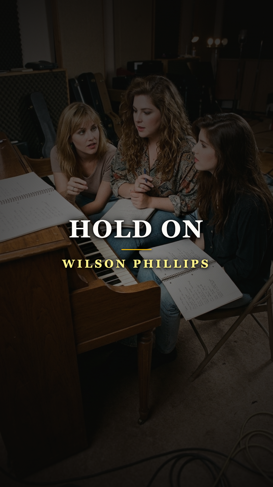

# El mantra de sobriedad que salvó a las hijas del rock: la historia oculta de «Hold On»

### Por Acordes Ocultos
*Dedicado a quienes han necesitado un motivo para resistir un día más.*

---

### Prólogo: La luz que engañó a una década

A comienzos de 1990, una armonía vocal de asombrosa pureza irrumpió en las emisoras de radio de todo el planeta. Tres jóvenes californianas de poco más de veinte años, vestidas con chaquetas holgadas y sonrisas serenas, cantaban sobre abrir el corazón, romper cadenas interiores y encontrar la fuerza para seguir adelante. El estribillo de *«Hold On»* era tan pegadizo y luminoso que trepó de inmediato al número uno del *Billboard Hot 100*, desplazando a gigantes del pop y consagrándose meses después como la Canción del Año de 1990.

Para la industria musical y los millones de adolescentes que compraron el casete debut de **Wilson Phillips**, aquella pieza parecía la cumbre del optimismo californiano: un himno de autoayuda elegante, pulido y perfectamente empaquetado para la televisión musical.

Sin embargo, detrás de la cortina de producción dorada y los acordes soleados, la verdad era infinitamente más sombría. La letra no había sido concebida en una sala de juntas ni como un cálculo comercial. Había sido garabateada con desesperación a las dos de la madrugada en el interior de un automóvil estacionado, por una joven de veintiún años que temblaba de ansiedad y que repetía entre lágrimas un mantra de doce pasos para no morir de sobredosis.

---

### Acto I: La herencia envenenada del rock

Para entender la carga invisible que pesaba sobre **Chynna Phillips** y las hermanas **Carnie** y **Wendy Wilson**, es imprescindible asomarse a las ruinas de dos de las dinastías más legendarias y trágicas de la música popular estadounidense.

Carnie y Wendy eran hijas de **Brian Wilson**, el genio creador de *The Beach Boys*. Pero el hombre que compuso las sinfonías adolescentes de *Pet Sounds* no fue para ellas una figura paterna presente, sino un fantasma recluido en una habitación en penumbra. Durante gran parte de la infancia de las niñas, Brian permaneció postrado en la cama, atrapado en una devastadora espiral de psicosis paranoide, abuso severo de sustancias y bajo el control psicológico asfixiante de su terapeuta, Eugene Landy. Las hermanas Wilson crecieron en una mansión silenciosa donde la genialidad y la demencia convivían puerta con puerta.

Por su parte, Chynna era hija de **John Phillips** y **Michelle Phillips**, los pilares de *The Mamas & the Papas*. El hogar de los Phillips en Laurel Canyon fue el epicentro del libertinaje bohemio de los años sesenta, un entorno donde los cócteles de cocaína, heroína y desapego afectivo sustituían con frecuencia a la crianza cotidiana. John Phillips pasaba meses sumergido en adicciones despiadadas que más tarde destruirían su salud y su familia.

Ambas estirpes musicales compartían el mismo don milagroso: una capacidad casi genética para entrelazar las cuerdas vocales en armonías abiertas y conmovedoras. Pero también compartían una maldición silenciosa: una predisposición devastadora hacia la autodestrucción.

---

### Acto II: El coche en la colina y los doce pasos

Al cumplir los veintiún años, a finales de 1988, Chynna Phillips sintió que la historia de sus padres comenzaba a devorarla a ella también. Tras varios años de consumo descontrolado de drogas y alcohol, atravesando relaciones sentimentales destructivas y sumida en ataques de pánico recurrentes, Chynna comprendió que estaba a un paso de cruzar una frontera sin retorno.

Aterrada por el espejo de su padre, tomó una decisión crucial: ingresar en programas de recuperación y comenzar a asistir con regularidad a las reuniones de **Alcohólicos Anónimos (AA)**. Allí, en salas comunitarias modestas entre tazas de café aguado y sillas plegables de chapa, escuchó por primera vez el axioma fundamental que los adictos en rehabilitación utilizan para no perder la cordura frente a la abstinencia: *«Un día a la vez»* (*One day at a time*). La eternidad era un peso insoportable; la única meta posible era resistir las próximas veinticuatro horas.

Por aquellos mismos meses, las tres amigas de la infancia decidieron juntarse para cantar. El reputado compositor y productor **Glen Ballard** (quien años más tarde produciría *Jagged Little Pill* de Alanis Morissette) escuchó sus timbres vocales combinados y quedó fascinado. Ballard les preparó una maqueta instrumental en casete con una secuencia de acordes acústicos cálidos y directos, y se la entregó a Chynna para que buscara una melodía y una idea lírica.

Aquella noche, Chynna conducía de regreso a la casa de su madre en Beverly Hills. Se sentía profundamente sola, angustiada por la abstinencia y abrumada por la responsabilidad de su propio futuro. Detuvo el vehículo junto a la acera bajo la luz ámbar de una farola. Puso la cinta en el reproductor del tablero y dejó que los acordes de Ballard inundaran el habitáculo.

En lugar de componer un relato de ficción, Chynna miró su propio reflejo en el retrovisor y comenzó a escribir una conversación consigo misma.

---

### Acto III: «Hold On»: El diálogo frente al espejo

Las primeras frases que brotaron en la libreta no eran poesía abstracta; eran un diagnóstico descarnado de su propio encierro emocional:

> *«I know this pain / Why do you lock yourself up in these chains? / No one can change your life except for you / Don't ever let anyone step all over you...»*  
> *(«Conozco este dolor. ¿Por qué te encierras tú misma en estas cadenas? Nadie puede cambiar tu vida excepto tú; nunca dejes que nadie pase por encima de ti...»)*

Chynna recordó las palabras que repetía en las reuniones de sobriedad. Cuando las ganas de recaer o el vacío interior se volvían insoportables, la única respuesta era negociar con el reloj: *«Si tan solo logro aguantar un día más... solo un día más, las cosas pueden cambiar»*.

De esa súplica privada nació el núcleo de la canción:

> *«Don't you know things can change? / Things'll go your way / If you hold on for one more day...»*  
> *(«¿Acaso no sabes que las cosas pueden cambiar? Todo irá a tu favor si tan solo resistes un día más»).*

Al día siguiente, Chynna se reunió con Carnie Wilson y Glen Ballard. Cuando les mostró las estrofas y cantó la melodía, Carnie —que también lidiaba con sus propios demonios de ansiedad y autoestima derivados del trauma familiar con Brian— rompió a llorar y se sumó de inmediato a pulir la estructura. No estaban fabricando un sencillo para las listas de ventas: estaban construyendo el salvavidas que todas necesitaban para mantenerse a flote.

---

### Acto IV: La alquimia de la supervivencia

Cuando Chynna, Carnie y Wendy se colocaron alrededor del micrófono de condensador en el estudio de grabación, ocurrió un fenómeno casi místico. Los arreglos vocales, diseñados meticulosamente con la intuición heredada de Brian Wilson y John Phillips, no sonaban a nostalgia sesentera ni a ejercicio de copia: vibraban con una urgencia contemporánea y visceral.

Lanzada en febrero de 1990 como el sencillo de presentación de su álbum homónimo, *«Hold On»* protagonizó un ascenso meteórico. En junio de 1990 alcanzó el puesto **número uno del Billboard Hot 100**, superando a figuras consolidadas como Madonna y Michael Bolton. A finales de aquel año, la revista *Billboard* la declaró oficialmente el sencillo más exitoso del año en los Estados Unidos.

El videoclip, rodado en los paisajes ventosos de una playa californiana, transmitía una frescura y una luminosidad que cautivaron a millones. Pero en los buzones de las cantantes empezaron a acumularse miles de cartas muy distintas a las habituales cartas de fans adolescentes: misivas de pacientes con cáncer terminal en salas de quimioterapia, testimonios de personas que habían descolgado el teléfono antes de intentar quitarse la vida, y adictos que contaban cómo escuchaban la canción cada amanecer para cumplir sus primeros treinta días limpios.

---

### Epílogo: El valor de un día más

Tres décadas después de su publicación, *«Hold On»* sigue viva en el inconsciente colectivo de la cultura popular. Aunque generaciones más jóvenes la redescubrieron gracias a su icónica aparición en la escena final de la comedia *Bridesmaids* (2011), la obra conserva intacto su peso testimonial.

Chynna Phillips ha compartido en innumerables ocasiones cómo aquella canción se convirtió en su juramento perpetuo de sobriedad. Las tres muchachas que cargaban con el linaje de las mentes más quebradas de la historia del pop lograron romper la cadena del destino no huyendo del dolor, sino cantándolo a tres voces con el pecho abierto.

Porque hay canciones que se diseñan en laboratorios para dominar el verano, y hay canciones que nacen en el silencio de un automóvil para recordarle a un alma rota que la noche siempre termina, y que mañana vale la pena volver a intentar resistir.

---

### 📚 Fuentes y Archivo Documental

1. **Phillips, Chynna**. Entrevistas autobiográficas sobre sobriedad, composición de *Hold On* y Alcohólicos Anónimos en *Rolling Stone* y *The Kelly Clarkson Show* (2020–2022).
2. **Wilson, Carnie**. *I'm Still Hungry: Tales of Food, Family, and Forgiveness*. HarperEntertainment, 2001 (Memorias sobre la infancia junto a Brian Wilson y los inicios de Wilson Phillips).
3. **Ballard, Glen**. Entrevistas de producción y análisis de sesiones de grabación en *Sound on Sound* y *Songfacts* (1995, 2011).
4. **Bronson, Fred**. *The Billboard Book of Number One Hits*. Billboard Books, 2003 (Ficha histórica y récord de *Hold On* como Single del Año 1990).
5. **Gaines, Steven**. *Heroes and Villains: The True Story of the Beach Boys*. New American Library, 1986 (Documentación biográfica sobre Brian Wilson, adicciones y custodia).
6. **Phillips, John**. *Papa John: An Autobiography*. Doubleday, 1986 (Crónica histórica del entorno familiar de The Mamas & the Papas).
